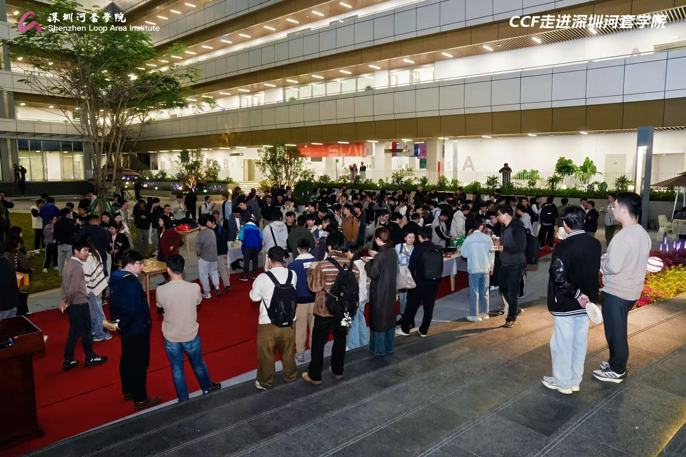
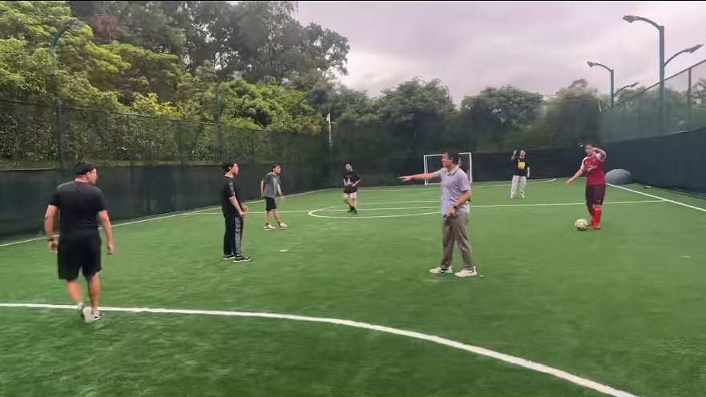
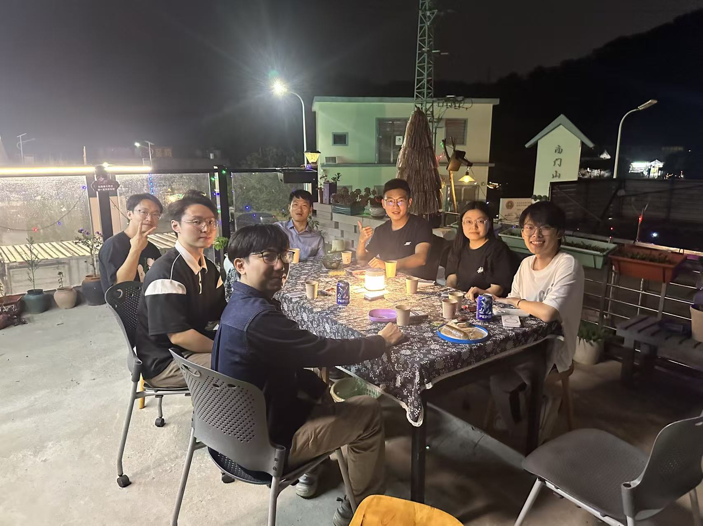
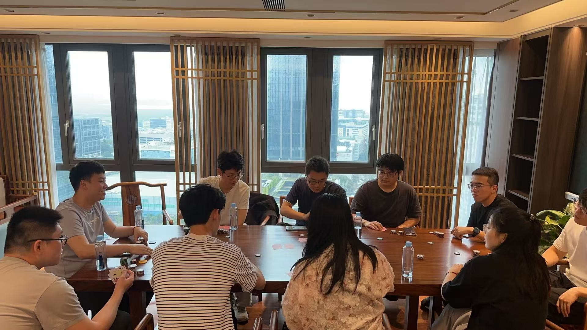
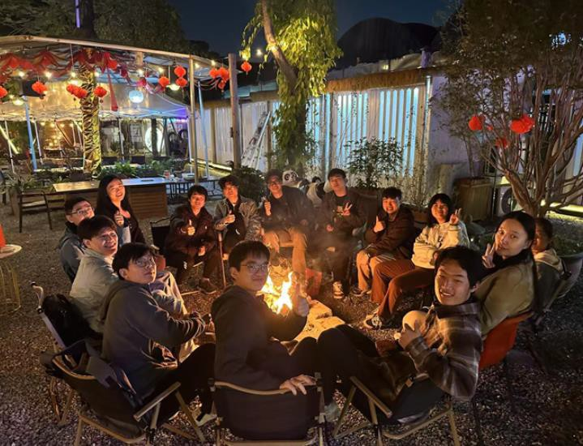
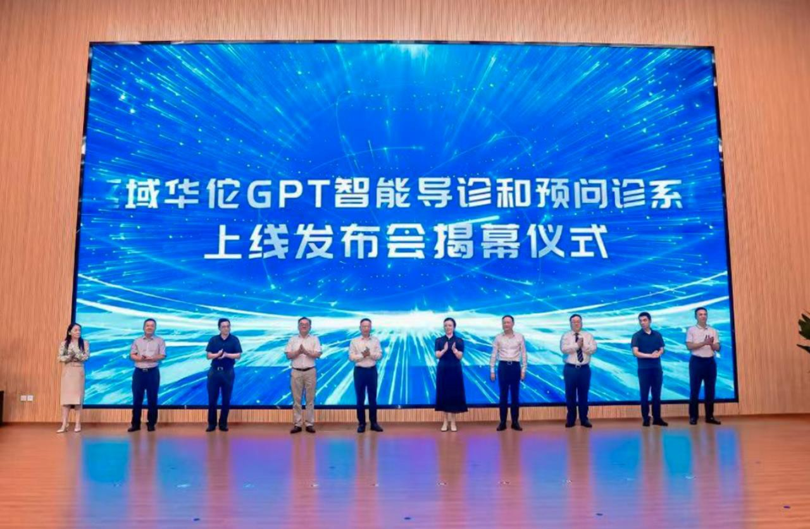
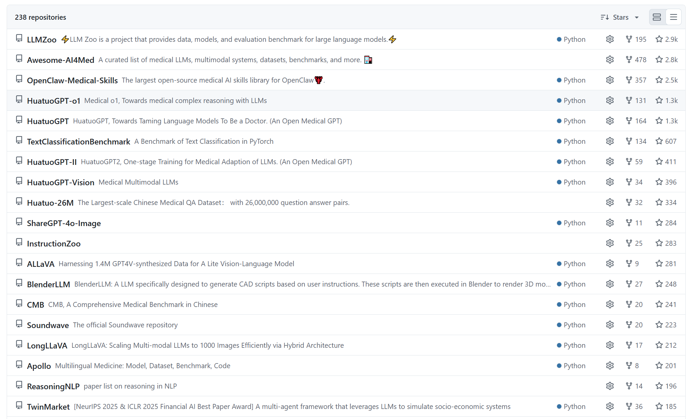
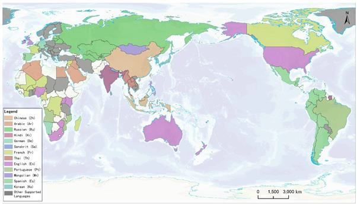
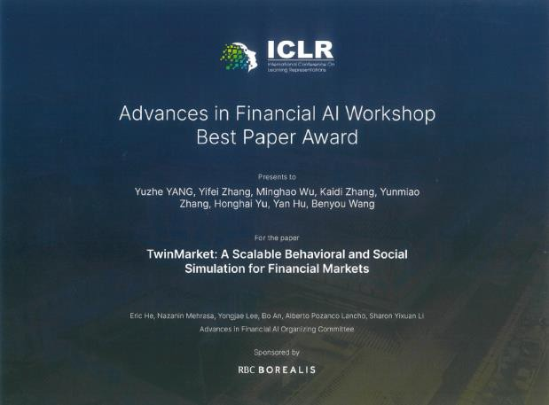
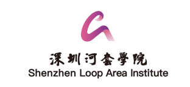

  <link rel="stylesheet" href="{{ '/assets/css/research.css' | relative_url }}?v={{ site.time | date: '%s' }}">
  <section class="home-hero" aria-label="Freedom AI">
    
      
      CCF at SLAICCF 走进河套学院
    
    
      
      Basketball together一起打篮球
    
    
      
      Football in the rain雨中足球
    
    
      
      Rooftop talks天台夜谈
    
    
      
      Table games桌游时光
    
    
      
      Bonfire night篝火之夜
    
    

      <button class="home-hero__control" type="button" aria-label="Previous slide" title="Previous slide" data-home-hero-prev>
        <i class="fas fa-chevron-left" aria-hidden="true"></i>
      </button>
      <button class="home-hero__control" type="button" aria-label="Next slide" title="Next slide" data-home-hero-next>
        <i class="fas fa-chevron-right" aria-hidden="true"></i>
      </button>
    

    

      

        <h1>Freedom AI</h1>
        
Free humanity from the boundaries of life through AI.用 AI 让人类突破生命的边界。

      

      

        <a class="home-button home-button--light" href="{{ '/projects/' | relative_url }}">Explore our research了解我们的研究</a>
        <a class="home-button" href="{{ '/life/' | relative_url }}">Life生活</a>
        <a class="home-button" href="{{ '/blog/' | relative_url }}">Blog博客</a>
      

    

  </section>

  
    Research Directions: rendered from _data/research.yml, the same data as /projects/,
    so the two pages always show the same six directions. Each card opens its
    section of /projects/; each chip opens that program.
  
  
  <section class="home-section" id="research" aria-labelledby="home-research-title">
    

      <h2 id="home-research-title">Research Directions研究方向</h2>
      <a class="home-more" href="{{ projects_url }}">All projects查看全部项目</a>
    

    
We build open, capable, and deployable AI across six connected directions: agentic AI, physical AI, multimodal interaction, AI for infrastructure, AI applications, and evaluation and safety.我们围绕六个相互连接的方向，构建开放、强大、可落地的 AI：智能体 AI、物理 AI、多模态交互、AI 基础设施、AI 应用，以及评测与安全。

    
  </section>

  <section class="home-section" aria-labelledby="home-latest-title">
    

      <h2 id="home-latest-title">Latest from the Lab最新动态</h2>
      <a class="home-more" href="{{ '/blog/' | relative_url }}">All posts全部文章</a>
    

    

      
      
      
      
      
      
      
      <a class="home-post" href="{{ post_href }}" target="_blank" rel="noopener">
        
          
          
          
          
          
          
          <small>Freedom AI Blog</small><strong>{{ title_en }}{{ title_zh }}</strong>
          
        
        
          <time datetime="{{ post.date | date_to_xmlschema }}">{{ post.date | date: '%b %-d, %Y' }}{{ post.date | date: '%Y年%-m月%-d日' }}</time>{{ post_dir.name }}{{ post_dir.name_zh }}
          {{ title_en }}{{ title_zh }}
        
      </a>
      
    

  </section>

  <section class="home-section" aria-labelledby="home-impact-title">
    

      <h2 id="home-impact-title">Impact影响力</h2>
      <a class="home-more" href="{{ '/impact/' | relative_url }}">Full impact查看完整影响力</a>
    

    
Freedom AI grows inside a larger Shenzhen ecosystem for cross-modal cognitive computing. The Shenzhen Key Laboratory of Cross-Modal Cognitive Computing, built at CUHK-Shenzhen and approved by the Shenzhen Science and Technology Innovation Bureau on January 30, 2024, connects frontier research, student training, open-source systems, and deployments in healthcare, education, industry, and public-service settings.Freedom AI 成长于深圳更大的跨模态认知计算生态系统中。深圳市跨模态认知计算重点实验室依托香港中文大学（深圳）建设，于 2024 年 1 月 30 日获深圳市科技创新局批准，连接前沿研究、学生培养、开源系统以及医疗、教育、产业和公共服务领域的落地应用。

    

      

        <strong>300K+</strong>
        HuatuoGPT service visits in Longgang public hospitals.龙岗公立医院 HuatuoGPT 服务人次。
      

      

        <strong>520K+</strong>
        Clinical AI interactions across triage and pre-consultation workflows.分诊与预问诊流程中的医疗 AI 交互次数。
      

      

        <strong>95.4%</strong>
        Reported triage accuracy in the Longgang deployment.龙岗部署中报告的分诊准确率。
      

    

    

      

        
      

      

        

          <h3>Healthcare at city scale城市规模的医疗服务</h3>
          
HuatuoGPT serves Longgang hospitals and community health centers, supporting city-scale triage and pre-consultation workflows.HuatuoGPT 服务龙岗医院和社区健康中心，支持城市级分诊与预问诊工作流。

        

        

          <h3>Open-source ecosystem开源生态</h3>
          
FreedomIntelligence models, datasets, and benchmarks have 10K+ GitHub stars and 1M+ Hugging Face downloads.FreedomIntelligence 模型、数据集和基准已获 10K+ GitHub stars 和 100 万+次 Hugging Face 下载。

        

        

          <h3>Global access全球覆盖</h3>
          
Apollo and AceGPT expand multilingual medical AI for under-served languages and local healthcare contexts.Apollo 和 AceGPT 将多语言医疗 AI 扩展到服务不足的语言和本地医疗场景。

        

        

          <h3>Award-winning research获奖研究</h3>
          
Recognized at SIGIR, NAACL, NLPCC, ICLR Financial AI, and NeurIPS ResponsibleFM, with coverage from Nature and major media.在 SIGIR、NAACL、NLPCC、ICLR 金融 AI 和 NeurIPS ResponsibleFM 获奖，并获 Nature 及主流媒体报道。

        

      

    

    

      <figure>
        
        <figcaption>Open-source models, datasets, and benchmarks used by the community.社区广泛使用的开源模型、数据集和基准。</figcaption>
      </figure>
      <figure>
        
        <figcaption>Apollo brings multilingual medical AI to under-served languages.Apollo 将多语言医疗 AI 带到服务不足的语言。</figcaption>
      </figure>
      <figure>
        
        <figcaption>Recognition for financial AI and socio-economic system research.金融 AI 与社会经济系统研究获得认可。</figcaption>
      </figure>
    

  </section>

  <section class="home-section">
    <h2>Where We Work我们在哪里</h2>
    
Freedom AI is based at the School of Data Science, The Chinese University of Hong Kong, Shenzhen, SRIBD, and Shenzhen Loop Area Institute. We work with students, engineers, clinicians, and industry partners to turn frontier AI into usable systems.Freedom AI 依托香港中文大学（深圳）数据科学学院、深圳市大数据研究院和深圳河套学院。我们与学生、工程师、临床医生及产业伙伴合作，将前沿 AI 转化为可用的系统。

    

      
      
      
    

  </section>

  <section class="home-section home-join">
    

      <h2>Join Us加入我们</h2>
      
We are recruiting research assistant professors, postdocs, PhD students, MPhil students, research assistants, visiting students, and engineers. We especially welcome students interested in the Shenzhen Loop Area Institute joint-training pathway and the Deep Eye research program.我们正在招募研究助理教授、博士后、博士生、硕士生、研究助理、访问学生和工程师。尤其欢迎有意申请深圳河套学院联培项目和深眼科研项目的同学。

      

        <a class="home-button home-button--primary" href="mailto:wangbenyou@cuhk.edu.cn">Contact Us联系我们</a>
        <a class="home-button" href="/alumni/">People and Alumni团队与校友</a>
        <a class="home-button" href="{{ '/ai-test/' | relative_url }}">One-week AI project test一周 AI 项目测试</a>
      

    

    <ul>
      <li>Project-based frontier AI training.项目制前沿 AI 训练。</li>
      <li>Strong GPU and engineering resources.充足 GPU 与工程资源。</li>
      <li>Close collaboration with industry and hospitals.与产业和医院紧密合作。</li>
      <li>Freedom to pursue ambitious research ideas.自由追求有雄心的研究想法。</li>
    </ul>
  </section>

  

    

      

        
      

    

  

  

