<link rel="stylesheet" href="{{ '/assets/css/project-hub.css' | relative_url }}?v={{ site.time | date: '%s' }}">

Explore six connected research directions, from learning and interaction to infrastructure, applications, and trustworthy AI.从学习与交互，到基础设施、领域应用与可信 AI，探索六个相互连接的研究方向。

<nav class="research-map" aria-label="Research directions">
<a href="#agentic-ai"><strong>Agentic AI</strong><small>Reasoning, learning, tool use, and interactive environments.推理、强化学习、工具使用与交互环境。</small></a>
<a href="#physical-ai"><strong>Physical AI</strong><small>Connecting foundation models with spatial environments, robots, and real-world interaction.连接基础模型、空间环境、机器人与真实世界交互。</small></a>
<a href="#multimodal-interaction"><strong>Multimodal Interaction</strong><small>Understanding and communicating across vision, speech, and languages.融合视觉、语音与多语言理解和交流。</small></a>
<a href="#ai-for-infra"><strong>AI for Infra</strong><small>Efficient models, scalable systems, and accelerator adaptation.高效模型、可扩展系统与国产算力适配。</small></a>
<a href="#ai-applications"><strong>AI Applications</strong><small>Medical, dental, legal, educational, financial, and optimization systems.医疗、牙科、法律、教育、金融与运筹优化。</small></a>
<a href="#evaluation-safety"><strong>Evaluation and Safety</strong><small>Benchmarks, responsible evaluation, and interpretable models.评测基准、负责任评估与模型可解释性。</small></a>
</nav>

<button type="button" data-expand-topics>Expand all projects展开全部项目</button><button type="button" data-collapse-topics>Collapse all projects收起全部项目</button>

<section class="research-group" id="agentic-ai"><header class="research-group-header"><h2>Agentic AI</h2>
Reasoning, learning, tool use, and interactive environments.推理、强化学习、工具使用与交互环境。
</header>

LLM Reasoning & Agentic RL

  <section class="project-program-section project-theme-optimization" data-project-tags="Reasoning & Agents;AI Systems & Infrastructure" data-project-url="/projects/llm-reasoning-agentic-rl/">
    

      
Reasoning, RL, and adaptive test-time compute

      
      

        This project organizes the lab's recent work on verifiable reasoning, policy optimization, path pruning, code-integrated thinking, and multimodal R1-style training. The through-line is simple: make LLMs reason with feedback signals that are inspectable, efficient, and useful for downstream agents.
      

      

        <a class="project-action primary" href="/projects/llm-reasoning-agentic-rl/">Open LLM Reasoning & Agentic RL</a>
        <a class="project-action" href="/projects/reasoning-math-optimization/">Open Math and Optimization</a>
        <a class="project-action" href="https://wabyking.github.io/" target="_blank" rel="noopener">Papers from Benyou Wang</a>
      

    

    

      

        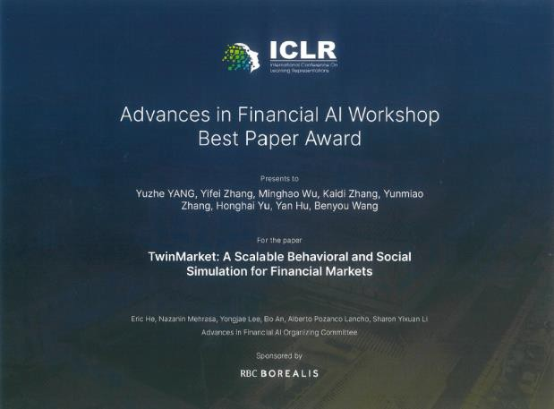
      

      

        <h3>Paper organization</h3>
        <ol class="project-paper-list">
          <li><a href="https://wabyking.github.io/" target="_blank" rel="noopener">OnePO: Direct One-stage Policy Optimization for SFT-free Domain Adaptation</a> - direct policy optimization without a separate SFT stage.</li>
          <li><a href="https://arxiv.org/abs/2605.25511" target="_blank" rel="noopener">CRPO: Character-centric Group Relative Policy Optimization for Role-aware Reasoning in Role-playing Agents</a> - RL objectives for role-aware reasoning agents.</li>
          <li><a href="https://arxiv.org/abs/2506.12860" target="_blank" rel="noopener">Question-Free Fine-Tuning</a> - efficient and adaptive reasoning fine-tuning.</li>
          <li><a href="https://arxiv.org/abs/2604.16029" target="_blank" rel="noopener">Cut Your Losses! Learning to Prune Paths Early for Efficient Parallel Reasoning</a> - learnable path pruning for large reasoning models.</li>
          <li><a href="https://arxiv.org/abs/2503.21776" target="_blank" rel="noopener">Video-R1: Reinforcing Video Reasoning in MLLMs</a> - R1-style reinforcement learning for multimodal video reasoning.</li>
          <li><a href="https://arxiv.org/abs/2506.09820" target="_blank" rel="noopener">CoRT: Code-integrated Reasoning within Thinking</a> - executable computation inside the reasoning process.</li>
        </ol>
      

    

    

      
Project stack<strong>Reasoning papers, code, and datasets</strong>

      

        <a class="project-stack-row" href="https://bijiaxihh.github.io/STOP/" target="_blank" rel="noopener">Project<strong>STOP / Cut Your Losses</strong>Early path pruning for efficient parallel reasoning.</a>
        <a class="project-stack-row" href="https://github.com/tulerfeng/Video-R1" target="_blank" rel="noopener">GitHub<strong>Video-R1</strong>Video-R1-CoT and RL training resources for video reasoning.</a>
        <a class="project-stack-row" href="https://github.com/ChengpengLi1003/CoRT" target="_blank" rel="noopener">GitHub<strong>CoRT</strong>Code-integrated reasoning resources.</a>
        <a class="project-stack-row" href="https://github.com/1KE-JI/UPFT" target="_blank" rel="noopener">GitHub<strong>UPFT</strong>Unsupervised prefix fine-tuning for efficient reasoning models.</a>
      

    

  </section>

LLM Agents, Applications & Human-Agent Interaction

  <section class="project-program-section project-theme-human" data-project-tags="Reasoning & Agents;World Models & Simulation" data-project-url="/projects/llm-agents-applications/">
    

      
Agents, applications, simulators, and human-agent interaction

      
      

        This project groups papers where LLMs become agents and interactive systems: tool planners, user simulators, standardized patients, role-playing agents, market participants, speech-to-speech systems, and micro-world actors. The goal is to organize agent papers by what the agent does, what environment it acts in, how it interacts with humans, and how the interaction is evaluated.
      

      

        <a class="project-action primary" href="/projects/llm-agents-applications/">Open Agent Applications</a>
        <a class="project-action" href="/projects/human-agent-interaction/">Open Interaction Details</a>
        <a class="project-action" href="https://wabyking.github.io/" target="_blank" rel="noopener">Papers from Benyou Wang</a>
      

    

    

      

        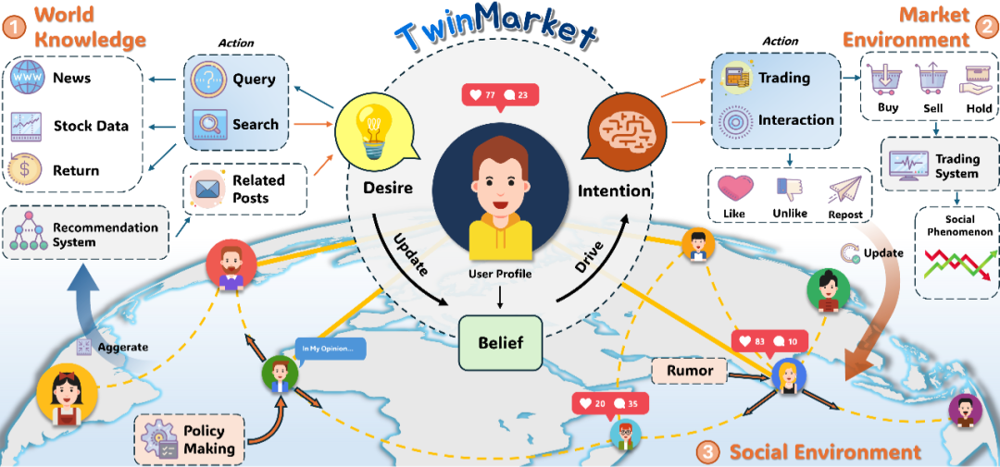
      

      

        <h3>Paper organization</h3>
        <ol class="project-paper-list">
          <li><a href="https://aclanthology.org/2025.naacl-long.169/" target="_blank" rel="noopener">Smurfs: Multi-Agent System using Context-Efficient DFSDT for Tool Planning</a> - multi-agent tool planning with context-efficient search.</li>
          <li><a href="https://arxiv.org/abs/2308.11534" target="_blank" rel="noopener">Large Language Model as a User Simulator</a> - LLM users for dialogue training and evaluation.</li>
          <li><a href="https://openreview.net/forum?id=9nddtu94uX" target="_blank" rel="noopener">PlatoLM: Teaching LLMs via a Socratic Questioning User Simulator</a> - Socratic interaction as a training signal.</li>
          <li><a href="https://arxiv.org/abs/2511.14783" target="_blank" rel="noopener">Human or LLM as Standardized Patients?</a> - AI patients for medical education and evaluation.</li>
          <li><a href="https://arxiv.org/abs/2602.24080" target="_blank" rel="noopener">Human or Machine? A Preliminary Turing Test for Speech-to-Speech Interaction</a> - human-likeness evaluation for speech-to-speech interaction.</li>
          <li><a href="https://arxiv.org/abs/2502.01506" target="_blank" rel="noopener">TwinMarket: A Scalable Behavioral and Social Simulation for Financial Markets</a> - LLM investor agents in market simulation.</li>
          <li><a href="https://arxiv.org/abs/2603.00585" target="_blank" rel="noopener">MicroVerse</a> - agentic micro-world simulation for scientific processes.</li>
        </ol>
      

    

    

      
Project stack<strong>Agent applications and environments</strong>

      

        <a class="project-stack-row" href="https://arxiv.org/abs/2405.05955" target="_blank" rel="noopener">Paper<strong>Smurfs</strong>Multi-agent tool planning through context-efficient DFSDT.</a>
        <a class="project-stack-row" href="https://github.com/FreedomIntelligence/EasyMED" target="_blank" rel="noopener">GitHub<strong>EasyMED</strong>AI standardized patient framework and evaluation resources.</a>
        <a class="project-stack-row" href="/projects/twinmarket-financial-simulation/">Project<strong>TwinMarket</strong>Financial market simulation with LLM agents.</a>
        <a class="project-stack-row" href="/projects/microverse-world-simulation/">Project<strong>MicroVerse</strong>Micro-world simulation with hidden mechanisms and evolving states.</a>
      

    

  </section>

Mobile Agent

  <section class="project-program-section project-theme-human" data-project-tags="Reasoning & Agents;AI Systems & Infrastructure" data-project-url="/projects/mobile-agent/">
    

      
Phone-use agents and mobile workflow execution

      
      

        这条线把手机变成通用智能体的真实执行场：从隐私与安全评测，到可控手机环境、GUI / CLI / tool mixed-action harness，再到面向真实 App workflow 的 open model 训练，让 phone-use agents 能可靠、安全、可审计地完成任务。
      

      

        <a class="project-action primary" href="/projects/mobile-agent/">Open Mobile Agent</a>
        <a class="project-action" href="https://phoneharness.github.io/" target="_blank" rel="noopener">Open PhoneHarness</a>
        <a class="project-action" href="https://huggingface.co/datasets/PhoneHarness/phoneharness-bench" target="_blank" rel="noopener">Open Dataset</a>
      

    

    

      

        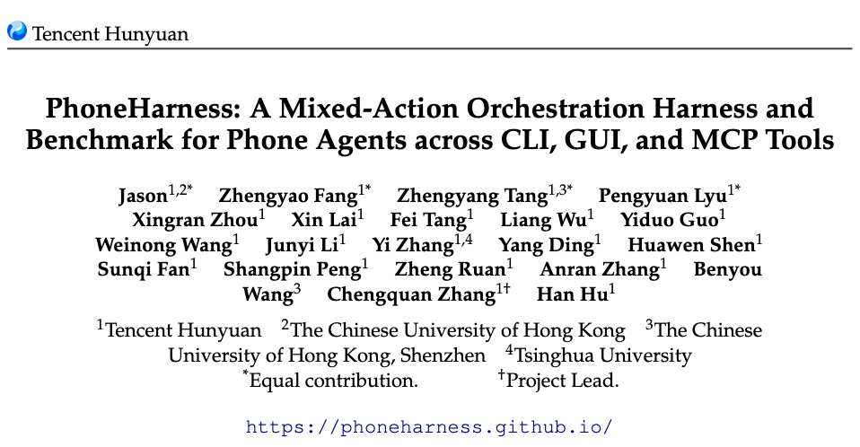
      

      

        <h3>相关论文整理</h3>
        <ol class="project-paper-list">
          <li><a href="https://arxiv.org/abs/2604.00986" target="_blank" rel="noopener">Do Phone-Use Agents Respect Your Privacy?</a>：用 MyPhoneBench 评测手机智能体的权限、披露和记忆控制风险。</li>
          <li><a href="https://arxiv.org/abs/2605.07630" target="_blank" rel="noopener">Safe, or Simply Incapable?</a>：区分真正安全、危险行动和“什么也做不好”的失败。</li>
          <li><a href="https://arxiv.org/abs/2605.29486" target="_blank" rel="noopener">PhoneWorld</a>：把真实 GUI 轨迹和截图转成可复用、可执行、可验证的手机环境。</li>
          <li><a href="https://arxiv.org/abs/2606.14832" target="_blank" rel="noopener">PhoneHarness</a>：用 GUI、CLI 和 tool action 的混合动作空间评测真实手机工作流完成度。</li>
          <li><a href="https://arxiv.org/abs/2606.23049" target="_blank" rel="noopener">PhoneBuddy</a>：结合真实 App 环境和 mock phone environment 训练开放 phone-use agent 模型。</li>
        </ol>
      

    

    

      
项目 / 代码 / 数据资源<strong>Mobile agent stack</strong>

      

        <a class="project-stack-row" href="/projects/mobile-agent/">Project<strong>Mobile Agent</strong>手机智能体的评测、安全、环境、harness 和训练路线总览。</a>
        <a class="project-stack-row" href="https://phoneharness.github.io/" target="_blank" rel="noopener">Project<strong>PhoneHarness</strong>Mixed GUI、CLI 和 tool action 的手机智能体项目主页。</a>
        <a class="project-stack-row" href="https://github.com/PhoneHarness/PhoneHarness" target="_blank" rel="noopener">GitHub<strong>PhoneHarness/PhoneHarness</strong>Phone-use agent harness 和 evaluation workflow 代码。</a>
        <a class="project-stack-row" href="https://huggingface.co/datasets/PhoneHarness/phoneharness-bench" target="_blank" rel="noopener">HF Dataset<strong>PhoneHarness Bench</strong>手机智能体 mixed-action benchmark 数据资源。</a>
      

    

  </section>

Agentic Creation & Executable Artifacts

  <section class="project-program-section project-theme-optimization" data-project-tags="Reasoning & Agents;World Models & Simulation" data-project-url="/projects/agentic-creation-executable-artifacts/">
    

      
From instructions to runnable games, CAD scripts, solvers, and code

      
      

        这条线关注的不是“模型说得像不像”，而是智能体能不能把自然语言需求变成真正可运行、可渲染、可验证的产物。代表任务包括生成可玩的 Godot 游戏、可执行的 Blender CAD 脚本、数学建模求解器，以及把推理过程接到代码执行环境中。
      

      

        <a class="project-action primary" href="/projects/agentic-creation-executable-artifacts/">Open Agentic Creation</a>
        <a class="project-action" href="https://github.com/FreedomIntelligence/gamecraft-bench" target="_blank" rel="noopener">Open GameCraft-Bench</a>
        <a class="project-action" href="https://github.com/FreedomIntelligence/BlenderLLM" target="_blank" rel="noopener">Open BlenderLLM</a>
      

    

    

      

        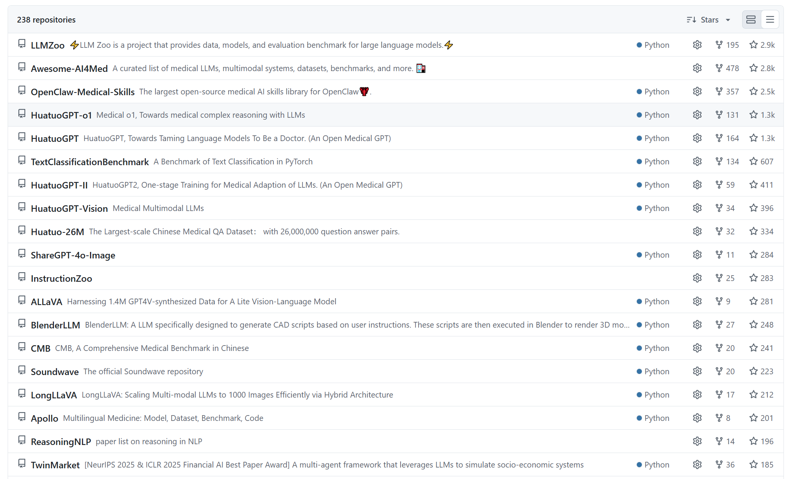
      

      

        <h3>相关论文整理</h3>
        <ol class="project-paper-list">
          <li><a href="https://arxiv.org/abs/2606.17861" target="_blank" rel="noopener">GameCraft-Bench</a>：评估 coding agents 是否能把游戏规格生成完整、可启动、可 replay 的 Godot 项目。</li>
          <li><a href="https://arxiv.org/abs/2412.14203" target="_blank" rel="noopener">BlenderLLM</a>：训练 LLM 生成可在 Blender 中执行并渲染 3D 模型的 CAD 脚本。</li>
          <li><a href="https://arxiv.org/abs/2405.13144" target="_blank" rel="noopener">Mamo</a>：面向数学建模的 benchmark 和 solver，把自然语言问题转成可求解模型。</li>
          <li><a href="https://arxiv.org/abs/2405.17743" target="_blank" rel="noopener">ORLM</a>：训练大模型做自动化优化建模，连接问题描述、约束、目标函数和代码。</li>
          <li><a href="https://arxiv.org/abs/2506.09820" target="_blank" rel="noopener">CoRT</a>：把 code execution 放进 reasoning，提升中间计算的可验证性。</li>
        </ol>
      

    

    

      
项目 / 代码 / benchmark<strong>Executable artifact stack</strong>

      

        <a class="project-stack-row" href="/projects/agentic-creation-executable-artifacts/">Project<strong>Agentic Creation</strong>可执行产物生成、验证和交互式评测总览。</a>
        <a class="project-stack-row" href="https://github.com/FreedomIntelligence/gamecraft-bench" target="_blank" rel="noopener">GitHub<strong>FreedomIntelligence/gamecraft-bench</strong>可玩游戏生成 benchmark、任务、replay 和 hidden rubric。</a>
        <a class="project-stack-row" href="https://github.com/FreedomIntelligence/BlenderLLM" target="_blank" rel="noopener">GitHub<strong>FreedomIntelligence/BlenderLLM</strong>CAD script 生成模型、BlendNet 数据和 CADBench。</a>
        <a class="project-stack-row" href="https://github.com/FreedomIntelligence/Mamo" target="_blank" rel="noopener">GitHub<strong>FreedomIntelligence/Mamo</strong>数学建模 benchmark 与 solver 资源。</a>
        <a class="project-stack-row" href="https://github.com/Cardinal-Operations/ORLM" target="_blank" rel="noopener">GitHub<strong>Cardinal-Operations/ORLM</strong>自动化优化建模训练框架和 IndustryOR benchmark。</a>
      

    

  </section>

环境工程和世界模型

  <section class="project-program-section project-theme-environment" data-project-tags="World Models & Simulation;Reasoning & Agents" data-project-url="/projects/environment-engineering-world-models/">
    

      
Environment engineering and world models

      
      

        这条线把“模型能力”放进可运行环境中：定义状态、行动、工具、用户、规则、世界动力学和评测对齐，让智能体能在用户模拟、金融市场、科学微世界和可执行优化环境中训练、评测和迭代。
      

      

        <a class="project-action primary" href="/projects/environment-engineering-world-models/">Open Environment Engineering</a>
        <a class="project-action" href="https://wabyking.github.io/" target="_blank" rel="noopener">Benyou Wang Papers</a>
      

    

    

      

        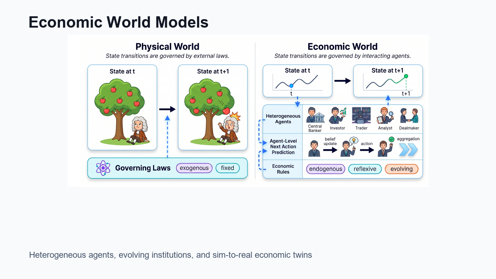
      

      

        <h3>相关论文整理</h3>
        <ol class="project-paper-list">
          <li><a href="https://arxiv.org/abs/2603.00585" target="_blank" rel="noopener">MicroVerse: A Preliminary Exploration Toward a Micro-World Simulation</a>：把 world model 扩展到器官、细胞和亚细胞过程，强调隐藏机制、状态演化和科学约束。</li>
          <li><a href="https://arxiv.org/abs/2502.01506" target="_blank" rel="noopener">TwinMarket: A Scalable Behavioral and Social Simulation for Financial Markets</a>：用 LLM 投资者构造金融市场环境，从个体信念和信息流生成宏观行为。</li>
          <li><a href="/assets/pdf/economic-world-models.pdf" target="_blank" rel="noopener">From Economic Agents to Agentic Economies</a>：把智能体、环境、共演化和真实世界对齐组织成经济世界模型的系统蓝图。</li>
          <li><a href="https://arxiv.org/abs/2308.11534" target="_blank" rel="noopener">Large Language Model as a User Simulator</a>：用 LLM 构造可控用户环境，为多轮对话训练和评测提供可重复交互对象。</li>
          <li><a href="https://arxiv.org/abs/2405.17743" target="_blank" rel="noopener">ORLM: A Customizable Framework in Training Large Models for Automated Optimization Modeling</a>：把自然语言问题转成优化模型、约束、目标函数和可执行代码。</li>
          <li><a href="https://arxiv.org/abs/2510.04204" target="_blank" rel="noopener">CALM Before the STORM</a>：研究优化建模中的原生推理能力，把工程问题组织成可验证建模环境。</li>
        </ol>
      

    

    

      
项目 / 论文 / 代码资源<strong>Environment stack</strong>

      

        <a class="project-stack-row" href="/projects/environment-engineering-world-models/">Project<strong>环境工程和世界模型</strong>组织环境定义、智能体接口、世界动力学和评测对齐的总览页。</a>
        <a class="project-stack-row" href="/projects/economic-world-models/">Project<strong>Economic World Models</strong>经济世界模型架构、能力阶梯和 agentic economies。</a>
        <a class="project-stack-row" href="/projects/twinmarket-financial-simulation/">Project<strong>TwinMarket</strong>金融市场中的多智能体社会仿真环境。</a>
        <a class="project-stack-row" href="/projects/microverse-world-simulation/">Project<strong>MicroVerse</strong>面向生物和科学机制的微世界模拟。</a>
        <a class="project-stack-row" href="https://github.com/Cardinal-Operations/ORLM" target="_blank" rel="noopener">GitHub<strong>Cardinal-Operations/ORLM</strong>自动化优化建模训练框架和 benchmark。</a>
        <a class="project-stack-row" href="https://github.com/tangzhy/STORM" target="_blank" rel="noopener">GitHub<strong>tangzhy/STORM</strong>CALM/STORM 优化建模推理资源。</a>
      

    

  </section>

</section>
<section class="research-group" id="physical-ai"><header class="research-group-header"><h2>Physical AI</h2>
Connecting foundation models with spatial environments, robots, and real-world interaction.连接基础模型、空间环境、机器人与真实世界交互。
</header>
<article class="physical-feature">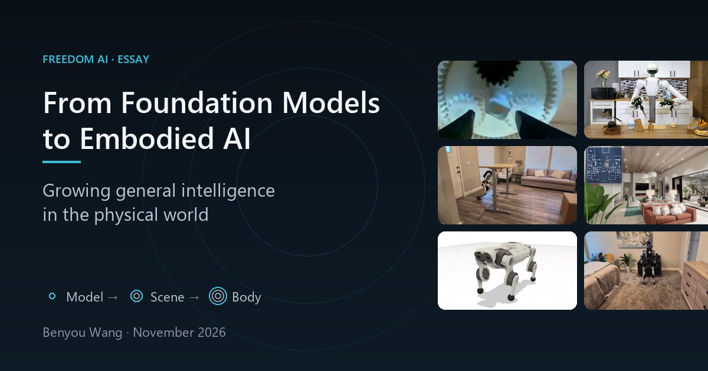
<h3>From Foundation Models to Embodied AI从大模型到具身智能</h3>
Explore spatial environments, simulation, robot control, and on-device systems through our research overview and demonstrations.通过研究综述与演示，探索空间环境、仿真、机器人控制和端侧系统。
<a class="project-action primary" href="/blog/2026/foundation-models-to-embodied-ai/en/">Explore research and demos查看研究与演示</a>
</article>
</section>
<section class="research-group" id="multimodal-interaction"><header class="research-group-header"><h2>Multimodal Interaction</h2>
Understanding and communicating across vision, speech, and languages.融合视觉、语音与多语言理解和交流。
</header>

多模态大模型

  <section class="project-program-section project-theme-multimodal" data-project-tags="Foundation Models;Reasoning & Agents;AI Systems & Infrastructure;Healthcare AI" data-project-url="/projects/multimodal-foundation-models/">
    

      
Multimodal foundation models and visual reasoning

      
      

        多模态大模型方向把文字、图像、视频、音频和医学视觉放进同一个能力地图：从 LongLLaVA/MileBench 的长上下文视觉理解，到 TRIM 的视觉 token 压缩、ShareGPT-4o-Image/Janus-4o 的开放图像生成，再到 Video-R1、HuatuoGPT-Vision 和 FusionAudio 这类面向推理、医疗和音频场景的模型与数据。
      

      

        <a class="project-action primary" href="/projects/multimodal-foundation-models/">Open Multimodal LLMs</a>
        <a class="project-action" href="/projects/long-context-multimodal/">Open LongLLaVA and MileBench</a>
        <a class="project-action" href="/projects/sharegpt-4o-image-janus-4o/">Open ShareGPT-4o and Janus-4o</a>
      

    

    

      

        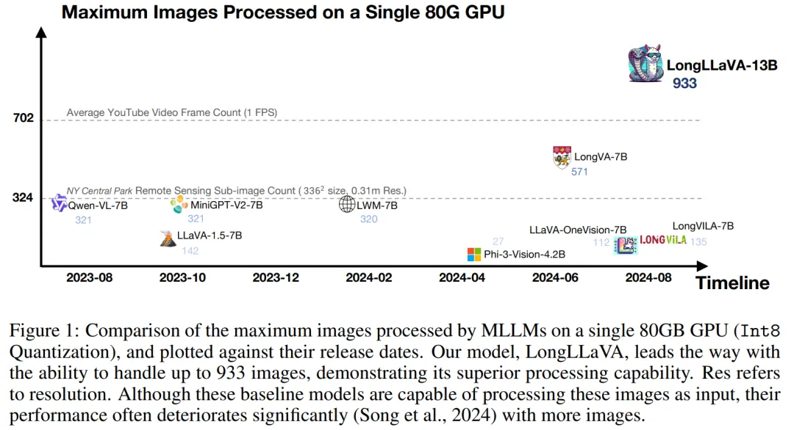
      

      

        <h3>相关论文整理</h3>
        <ol class="project-paper-list">
          <li><a href="https://arxiv.org/abs/2409.02889" target="_blank" rel="noopener">LongLLaVA: Scaling Multi-modal LLMs to 1000 Images Efficiently</a>：长上下文多图像理解和推理。</li>
          <li><a href="https://arxiv.org/abs/2404.18532" target="_blank" rel="noopener">MileBench: Benchmarking MLLMs in Long Context</a>：多图像、视频和长视觉上下文评测。</li>
          <li><a href="https://arxiv.org/abs/2409.10994" target="_blank" rel="noopener">TRIM: Less is More for Efficient Multi-modal LLMs</a>：减少冗余视觉 token，降低多模态推理成本。</li>
          <li><a href="https://arxiv.org/abs/2506.18095" target="_blank" rel="noopener">ShareGPT-4o-Image and Janus-4o</a>：开放 GPT-4o 风格图像生成/编辑数据和统一多模态模型。</li>
          <li><a href="https://arxiv.org/abs/2503.21776" target="_blank" rel="noopener">Video-R1: Reinforcing Video Reasoning in MLLMs</a>：把 R1-style reasoning training 扩展到视频理解。</li>
          <li><a href="https://arxiv.org/abs/2406.19280" target="_blank" rel="noopener">HuatuoGPT-Vision</a>：面向医学视觉知识注入的多模态医学大模型。</li>
        </ol>
      

    

    

      
模型 / 数据 / 代码入口<strong>Multimodal stack</strong>

      

        <a class="project-stack-row" href="/projects/multimodal-foundation-models/">Project<strong>多模态大模型</strong>总览视觉理解、视觉生成、视频推理、医学视觉和音频多模态。</a>
        <a class="project-stack-row" href="/projects/long-context-multimodal/">Project<strong>LongLLaVA and MileBench</strong>长上下文多模态模型和 benchmark。</a>
        <a class="project-stack-row" href="/projects/sharegpt-4o-image-janus-4o/">Project<strong>ShareGPT-4o-Image and Janus-4o</strong>开放图像生成/编辑数据和统一多模态模型。</a>
        <a class="project-stack-row" href="https://github.com/FreedomIntelligence/LongLLaVA" target="_blank" rel="noopener">GitHub<strong>FreedomIntelligence/LongLLaVA</strong>长上下文多模态模型资源。</a>
        <a class="project-stack-row" href="https://github.com/FreedomIntelligence/TRIM" target="_blank" rel="noopener">GitHub<strong>FreedomIntelligence/TRIM</strong>高效多模态 token reduction。</a>
        <a class="project-stack-row" href="https://github.com/FreedomIntelligence/HuatuoGPT-Vision" target="_blank" rel="noopener">GitHub<strong>HuatuoGPT-Vision</strong>医学视觉语言模型和数据资源。</a>
      

    

  </section>

Speech LLMs

  <section class="project-program-section project-theme-speech" data-project-tags="Foundation Models;Reasoning & Agents" data-project-url="/projects/speech-audio-talking-head-ai/">
    

      
Speech LLMs and speech-to-speech agents

      
      

        Speech LLMs 方向把大模型从文本扩展到语音输入、语音输出、语气、情绪和副语言信息。相关项目包括 Soundwave、S2S-Arena、EchoMind、FusionAudio、UNSPOKEN，以及 speech-to-speech Turing Test。
      

      

        <a class="project-action primary" href="/projects/speech-audio-talking-head-ai/">Open Speech and Audio Project</a>
        <a class="project-action" href="https://github.com/FreedomIntelligence/Soundwave" target="_blank" rel="noopener">Open Soundwave</a>
      

    

    

      

        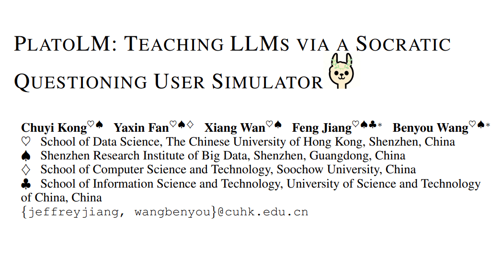
      

      

        <h3>相关论文整理</h3>
        <ol class="project-paper-list">
          <li><a href="https://arxiv.org/abs/2502.12900" target="_blank" rel="noopener">Soundwave: Less is More for Speech-Text Alignment in LLMs</a>：用更少数据完成 speech-text alignment。</li>
          <li><a href="https://arxiv.org/abs/2503.05085" target="_blank" rel="noopener">S2S-Arena</a>：评测 speech-to-speech 模型的语义理解和副语言指令跟随。</li>
          <li><a href="https://arxiv.org/abs/2510.22758" target="_blank" rel="noopener">EchoMind</a>：面向 empathetic Speech Language Models 的多层级 benchmark。</li>
          <li><a href="https://arxiv.org/abs/2602.24080" target="_blank" rel="noopener">Human or Machine? A Preliminary Turing Test for Speech-to-Speech Interaction</a>：评测 S2S 系统是否真正像人类对话。</li>
          <li><a href="https://arxiv.org/abs/2506.01111" target="_blank" rel="noopener">FusionAudio-1.2M</a>：细粒度音频 caption 与 multimodal contextual fusion。</li>
          <li><a href="https://github.com/Hongru0306/UNSPOKEN" target="_blank" rel="noopener">UNSPOKEN</a>：用未说出口的声学线索评测 audio language models 的隐喻推理。</li>
        </ol>
      

    

    

      
GitHub / Hugging Face 资源<strong>Code, models, datasets</strong>

      

        <a class="project-stack-row" href="https://github.com/FreedomIntelligence/Soundwave" target="_blank" rel="noopener">GitHub<strong>FreedomIntelligence/Soundwave</strong>Speech-text alignment for LLMs。</a>
        <a class="project-stack-row" href="https://huggingface.co/FreedomIntelligence/Soundwave" target="_blank" rel="noopener">HF Model<strong>FreedomIntelligence/Soundwave</strong>Soundwave 模型卡。</a>
        <a class="project-stack-row" href="https://github.com/FreedomIntelligence/S2S-Arena" target="_blank" rel="noopener">GitHub<strong>FreedomIntelligence/S2S-Arena</strong>Speech-to-speech paralinguistic benchmark。</a>
        <a class="project-stack-row" href="https://hlt-cuhksz.github.io/EchoMind/" target="_blank" rel="noopener">Project<strong>EchoMind</strong>Empathetic speech language model benchmark。</a>
        <a class="project-stack-row" href="https://github.com/FreedomIntelligence/FusionAudio" target="_blank" rel="noopener">GitHub<strong>FreedomIntelligence/FusionAudio</strong>Fine-grained audio captioning data and models。</a>
      

    

  </section>

多语言大语言模型

  <section class="project-program-section project-theme-multilingual" data-project-tags="Foundation Models;Healthcare AI" data-project-url="/projects/multilingual-localized-llms/">
    

      
Multilingual and localized LLMs

      
      

        多语言主线从 Phoenix / LLMZoo 的开放多语言聊天开始，到 AceGPT 的阿拉伯语本地化，再到 Apollo / ApolloMoE 的多语言医学模型、语料和评测。核心目标是让医学和通用 AI 不只服务少数高资源语言。
      

      

        <a class="project-action primary" href="/projects/multilingual-localized-llms/">Open Multilingual Project</a>
        <a class="project-action" href="/projects/rag-instruction-data/">Open Data Infrastructure</a>
      

    

    

      

        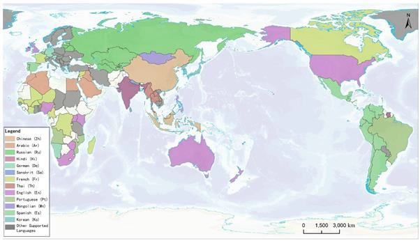
      

      

        <h3>相关论文整理</h3>
        <ol class="project-paper-list">
          <li><a href="https://arxiv.org/abs/2304.10453" target="_blank" rel="noopener">Phoenix: Democratizing ChatGPT across Languages</a>：早期开放多语言聊天模型。</li>
          <li><a href="https://aclanthology.org/2024.naacl-long.450/" target="_blank" rel="noopener">AceGPT, Localizing Large Language Models in Arabic</a>：阿拉伯语大模型本地化与对齐。</li>
          <li><a href="https://arxiv.org/abs/2403.03640" target="_blank" rel="noopener">Apollo: Lightweight Multilingual Medical LLMs towards Democratizing Medical AI to 6B People</a>：多语言医学模型、数据和评测。</li>
          <li><a href="https://arxiv.org/abs/2409.02615" target="_blank" rel="noopener">ApolloMoE</a>：面向 50 种语言的医学 MoE 模型。</li>
        </ol>
      

    

    

      
GitHub / Hugging Face 资源<strong>Code, models, datasets</strong>

      

        <a class="project-stack-row" href="https://github.com/FreedomIntelligence/LLMZoo" target="_blank" rel="noopener">GitHub<strong>FreedomIntelligence/LLMZoo</strong>Phoenix / LLMZoo 多语言模型资源。</a>
        <a class="project-stack-row" href="https://github.com/FreedomIntelligence/AceGPT" target="_blank" rel="noopener">GitHub<strong>FreedomIntelligence/AceGPT</strong>阿拉伯语 LLM 本地化代码和资源。</a>
        <a class="project-stack-row" href="https://github.com/FreedomIntelligence/Apollo" target="_blank" rel="noopener">GitHub<strong>FreedomIntelligence/Apollo</strong>Apollo 多语言医学模型、数据、评测代码。</a>
        <a class="project-stack-row" href="https://github.com/FreedomIntelligence/ApolloMoE" target="_blank" rel="noopener">GitHub<strong>FreedomIntelligence/ApolloMoE</strong>面向 50 种语言的医学 MoE 模型代码。</a>
      

    

  </section>

</section>
<section class="research-group" id="ai-for-infra"><header class="research-group-header"><h2>AI for Infra</h2>
Efficient models, scalable systems, and accelerator adaptation.高效模型、可扩展系统与国产算力适配。
</header>

LLM efficiency and AI Infra

  <section class="project-program-section project-theme-infra" data-project-tags="AI Systems & Infrastructure;Reasoning & Agents" data-project-url="/projects/llm-efficiency-ai-infra/">
    

      
Efficient training, inference, retrieval, and multimodal context

      
      

        这条线把“能不能跑得起、训得动、改得快”作为项目主题，覆盖推理路径剪枝、question-free fine-tuning、prefix fine-tuning、editable efficient RAG、长上下文多模态和 token reduction。
      

      

        <a class="project-action primary" href="/projects/llm-efficiency-ai-infra/">Open LLM Infra</a>
        <a class="project-action" href="/projects/long-context-multimodal/">Open LongLLaVA and MileBench</a>
        <a class="project-action" href="/projects/rag-instruction-data/">Open Data Infrastructure</a>
      

    

    

      

        
      

      

        <h3>相关论文整理</h3>
        <ol class="project-paper-list">
          <li><a href="https://arxiv.org/abs/2604.16029" target="_blank" rel="noopener">Cut Your Losses! Learning to Prune Paths Early for Efficient Parallel Reasoning</a>：提前剪枝低价值推理路径。</li>
          <li><a href="https://arxiv.org/abs/2506.12860" target="_blank" rel="noopener">Question-Free Fine-Tuning: Towards Efficient and Adaptive Reasoning in Large Language Models</a>：面向高效自适应推理的 QFFT。</li>
          <li><a href="https://arxiv.org/abs/2503.02875" target="_blank" rel="noopener">The First Few Tokens Are All You Need</a>：UPFT，用极少前缀 token 进行高效无监督推理微调。</li>
          <li><a href="https://papers.cool/venue/COLM.2025" target="_blank" rel="noopener">E2-RAG: Towards Editable Efficient RAG by Editing Compressed KV Caches</a>：编辑压缩 KV cache，面向快速更新场景。</li>
          <li><a href="https://arxiv.org/abs/2409.02889" target="_blank" rel="noopener">LongLLaVA: Scaling Multi-modal LLMs to 1000 Images Efficiently</a>：长上下文多图像多模态推理。</li>
          <li><a href="https://arxiv.org/abs/2409.10994" target="_blank" rel="noopener">TRIM: Less is More for Efficient Multi-modal LLMs</a>：减少视觉 token，降低多模态推理成本。</li>
        </ol>
      

    

    

      <a class="project-stack-row" href="/projects/native-ai-compute-adaptation/">Project<strong>China-Developed AI Computing&#22269;&#20135; AI &#31639;&#21147;&#36866;&#37197;&#19982;&#21152;&#36895;</strong>Ascend training, full-stack acceleration, benchmark validation, real-world delivery, and open ecosystem building.&#26119;&#33150;&#22823;&#35268;&#27169;&#35757;&#32451;&#12289;&#20840;&#26632;&#35745;&#31639;&#21152;&#36895;&#12289;Benchmark &#39564;&#35777;&#12289;&#30495;&#23454;&#22330;&#26223;&#20132;&#20184;&#19982;&#24320;&#25918;&#29983;&#24577;&#12290;</a>
    

    

      
GitHub / 资源入口<strong>Infrastructure stack</strong>

      

        <a class="project-stack-row" href="https://github.com/FreedomIntelligence/LongLLaVA" target="_blank" rel="noopener">GitHub<strong>FreedomIntelligence/LongLLaVA</strong>长上下文多模态模型。</a>
        <a class="project-stack-row" href="https://github.com/FreedomIntelligence/TRIM" target="_blank" rel="noopener">GitHub<strong>FreedomIntelligence/TRIM</strong>高效多模态 token reduction。</a>
        <a class="project-stack-row" href="https://github.com/1KE-JI/UPFT" target="_blank" rel="noopener">GitHub<strong>1KE-JI/UPFT</strong>Unsupervised prefix fine-tuning resources。</a>
        <a class="project-stack-row" href="https://github.com/FreedomIntelligence/RAG-Instruct" target="_blank" rel="noopener">GitHub<strong>FreedomIntelligence/RAG-Instruct</strong>Retrieval-augmented instruction data。</a>
        <a class="project-stack-row" href="https://github.com/FreedomIntelligence/LLMZoo" target="_blank" rel="noopener">GitHub<strong>FreedomIntelligence/LLMZoo</strong>开放模型和训练资源集合。</a>
      

    

  </section>

China-Developed AI Computing: Adaptation and Acceleration&#22269;&#20135; AI &#31639;&#21147;&#36866;&#37197;&#19982;&#21152;&#36895;

  <section class="project-program-section project-theme-infra" data-project-tags="AI Systems & Infrastructure" data-project-url="/projects/native-ai-compute-adaptation/">
    

      
China-developed accelerators, inference systems, and open benchmarks

      
      
End-to-end engineering for large-scale Ascend training, model migration, vLLM/SGLang and KV Cache optimization, operators and kernels, benchmark validation, real-world delivery, and open ecosystem building.&#35206;&#30422;&#26119;&#33150;&#22823;&#35268;&#27169;&#35757;&#32451;&#12289;&#27169;&#22411;&#36801;&#31227;&#12289;vLLM/SGLang &#19982; KV Cache &#20248;&#21270;&#12289;&#31639;&#23376;&#19982; Kernel&#12289;Benchmark &#39564;&#35777;&#12289;&#30495;&#23454;&#22330;&#26223;&#20132;&#20184;&#21450;&#24320;&#25918;&#29983;&#24577;&#24314;&#35774;&#30340;&#20840;&#26632;&#25216;&#26415;&#38142;&#26465;&#12290;

      

        <a class="project-action primary" href="/projects/native-ai-compute-adaptation/">Open Compute Adaptation Project</a>
        <a class="project-action" href="https://github.com/FreedomIntelligence/AccelMark" target="_blank" rel="noopener">Open AccelMark</a>
        <a class="project-action" href="https://huggingface.co/FreedomIntelligence/openPangu-Embedded-7B" target="_blank" rel="noopener">openPangu on Ascend</a>
      

    

    

      
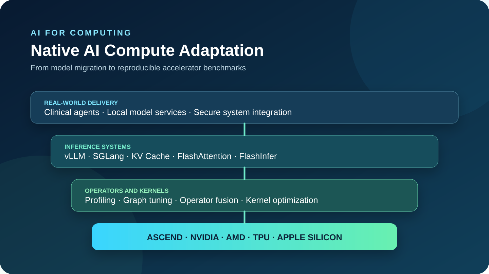

      

        <h3>From accelerator to application&#20174;&#31639;&#21147;&#21040;&#24212;&#29992;</h3>
        <ol class="project-paper-list">
          <li><strong>Scale:</strong> Arabic LLM training on 2,368 Ascend 910A processors, with results at NAACL 2024, ACL 2025, and NeurIPS 2024.</li>
          <li><strong>Systems:</strong> prompt, KV Cache, inference-engine, attention, operator, and kernel optimization.</li>
          <li><strong>Evaluation:</strong> CANNBench results and AccelMark's transparent, reproducible heterogeneous-accelerator comparisons.</li>
          <li><strong>Delivery:</strong> localized medical agents, HuatuoGPT, and intelligent health-management workflows in a secure hospital environment.</li>
          <li><strong>Ecosystem:</strong> 100+ Hugging Face models, million-scale downloads, and 10,000+ GitHub Stars across representative projects.</li>
        </ol>
      

    

  </section>

</section>
<section class="research-group" id="ai-applications"><header class="research-group-header"><h2>AI Applications</h2>
Medical, dental, legal, educational, financial, and optimization systems.医疗、牙科、法律、教育、金融与运筹优化。
</header>

AI for Healthcare：华佗GPT系列大模型

  <section class="project-program-section project-theme-medical" data-project-tags="Healthcare AI;Foundation Models" data-project-url="/projects/medical-ai-ecosystem/">
    

      
HuatuoGPT medical model family

      
      

        华佗GPT 是 AI for Healthcare 主线：从 Huatuo-26M 中文医学问答数据，到 HuatuoGPT / HuatuoGPT-II 医学适配，再到 HuatuoGPT-o1 的复杂医学推理和 HuatuoGPT-Vision 的医学视觉语言理解。
      

      

        <a class="project-action primary" href="/projects/medical-ai-ecosystem/">Open HuatuoGPT Ecosystem</a>
        <a class="project-action" href="/projects/huatuogpt-ii/">Open HuatuoGPT-II</a>
      

    

    

      

        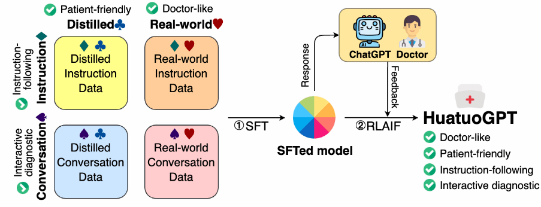
      

      

        <h3>相关论文整理</h3>
        <ol class="project-paper-list">
          <li><a href="https://arxiv.org/abs/2305.01526" target="_blank" rel="noopener">Huatuo-26M, a Large-scale Chinese Medical QA Dataset</a>：中文医学 QA 数据基础。</li>
          <li><a href="https://arxiv.org/abs/2305.15075" target="_blank" rel="noopener">HuatuoGPT, towards Taming Language Model to Be a Doctor</a>：早期开放医学对话模型。</li>
          <li><a href="https://arxiv.org/abs/2311.09774" target="_blank" rel="noopener">HuatuoGPT-II, One-stage Training for Medical Adaption of LLMs</a>：统一一阶段医学适配训练。</li>
          <li><a href="https://arxiv.org/abs/2412.18925" target="_blank" rel="noopener">Towards Medical Complex Reasoning with LLMs through Medical Verifiable Problems</a>：HuatuoGPT-o1 复杂医学推理。</li>
          <li><a href="https://arxiv.org/abs/2406.19280" target="_blank" rel="noopener">HuatuoGPT-Vision, Towards Injecting Medical Visual Knowledge into Multimodal LLMs at Scale</a>：医学多模态视觉知识注入。</li>
        </ol>
      

    

    

      
GitHub / Hugging Face 资源<strong>Code, models, datasets</strong>

      

        <a class="project-stack-row" href="https://github.com/FreedomIntelligence/Huatuo-26M" target="_blank" rel="noopener">GitHub<strong>FreedomIntelligence/Huatuo-26M</strong>中文医学 QA 数据集与构建资源。</a>
        <a class="project-stack-row" href="https://github.com/FreedomIntelligence/HuatuoGPT" target="_blank" rel="noopener">GitHub<strong>FreedomIntelligence/HuatuoGPT</strong>华佗GPT 基础医学对话模型代码。</a>
        <a class="project-stack-row" href="https://github.com/FreedomIntelligence/HuatuoGPT-II" target="_blank" rel="noopener">GitHub<strong>FreedomIntelligence/HuatuoGPT-II</strong>HuatuoGPT-II 训练和评测材料。</a>
        <a class="project-stack-row" href="https://github.com/FreedomIntelligence/HuatuoGPT-o1" target="_blank" rel="noopener">GitHub<strong>FreedomIntelligence/HuatuoGPT-o1</strong>医学复杂推理模型和数据。</a>
        <a class="project-stack-row" href="https://github.com/FreedomIntelligence/HuatuoGPT-Vision" target="_blank" rel="noopener">GitHub<strong>FreedomIntelligence/HuatuoGPT-Vision</strong>医学视觉语言模型训练代码。</a>
        <a class="project-stack-row" href="https://huggingface.co/datasets/FreedomIntelligence/PubMedVision" target="_blank" rel="noopener">HF Dataset<strong>FreedomIntelligence/PubMedVision</strong>医学图文视觉指令数据。</a>
      

    

  </section>

牙科大模型

  <section class="project-program-section project-theme-medical" data-project-tags="Healthcare AI;Foundation Models;Evaluation & Interpretability" data-project-url="/projects/dental-foundation-models/">
    

      
Dental LLMs, multimodal diagnosis, clinical reasoning, and benchmarks

      
      

        牙科是可以独立成方向的垂直医疗 AI：既有 DentalGPT 这样的多模态牙科大模型，也有 GlobalDentBench、OmniDentBench 等面向临床推理、安全风险和专家校准的 benchmark。它强调口腔影像、病例推理、专科 taxonomy、真实临床风险和专家评分。
      

      

        <a class="project-action primary" href="/projects/dental-foundation-models/">Open Dental LLMs</a>
        <a class="project-action" href="https://freedomdle.cn/" target="_blank" rel="noopener">Open OmniDentBench</a>
        <a class="project-action" href="https://github.com/FreedomIntelligence/DentalGPT" target="_blank" rel="noopener">Open DentalGPT</a>
      

    

    

      

        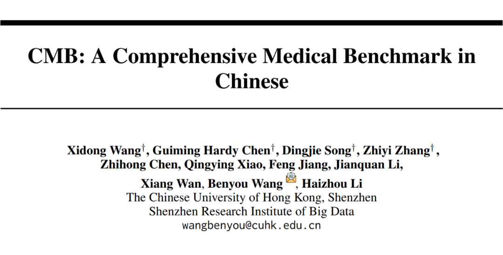
      

      

        <h3>相关论文与 benchmark</h3>
        <ol class="project-paper-list">
          <li><a href="https://arxiv.org/abs/2512.11558" target="_blank" rel="noopener">DentalGPT</a>：用 120K+ 牙科图像、domain knowledge injection 和 GRPO 强化多模态复杂推理。</li>
          <li><a href="https://arxiv.org/abs/2605.24636" target="_blank" rel="noopener">GlobalDentBench</a>：覆盖 88 个国家/地区、14 个牙科专科、8,978 道专家校准题的 multinational dental benchmark。</li>
          <li><a href="https://freedomdle.cn/" target="_blank" rel="noopener">OmniDentBench</a>：面向复杂临床决策和生物医学研究的全球牙科基准评测平台。</li>
          <li><a href="https://arxiv.org/abs/2508.20416" target="_blank" rel="noopener">DentalBench</a>：双语牙科 QA benchmark 和大规模 DentalCorpus，用于评估和增强牙科理解。</li>
          <li><a href="https://arxiv.org/abs/2511.22055" target="_blank" rel="noopener">OralGPT-Omni</a>：牙科多模态大模型与 MMOral-Uni benchmark，覆盖多种口腔影像任务。</li>
        </ol>
      

    

    

      
模型 / benchmark / 平台<strong>Dental AI stack</strong>

      

        <a class="project-stack-row" href="/projects/dental-foundation-models/">Project<strong>Dental Foundation Models</strong>牙科大模型、牙科 benchmark 和 OmniDentBench 总览。</a>
        <a class="project-stack-row" href="https://freedomdle.cn/" target="_blank" rel="noopener">Platform<strong>OmniDentBench</strong>全球牙科基准评测平台和 ODB leaderboard。</a>
        <a class="project-stack-row" href="https://github.com/FreedomIntelligence/DentalGPT" target="_blank" rel="noopener">GitHub<strong>FreedomIntelligence/DentalGPT</strong>牙科多模态大模型、训练 pipeline 和评测设置。</a>
        <a class="project-stack-row" href="https://github.com/FreedomIntelligence/GlobalDentBench" target="_blank" rel="noopener">GitHub<strong>FreedomIntelligence/GlobalDentBench</strong>专家校准的跨国牙科临床推理 benchmark。</a>
        <a class="project-stack-row" href="https://huggingface.co/datasets/FreedomIntelligence/GlobalDentBench-OA" target="_blank" rel="noopener">HF Dataset<strong>GlobalDentBench-OA</strong>GlobalDentBench 开放评测子集。</a>
      

    

  </section>

Clinical & Hospital World Models

  <section class="project-program-section project-theme-medical" data-project-tags="Healthcare AI;World Models & Simulation;Reasoning & Agents" data-project-url="/projects/clinical-agents-hospital-world-models/">
    

      
Clinical agents, patient dynamics, HIS environments, and hospital twins

      
      

        这个方向把医疗 AI 从静态问答推进到临床环境中的 agent：它关心 ICU 患者动态、医院信息系统、医生工作流、多角色医院仿真、工具调用和安全治理。牙科 benchmark 和 DentalGPT 已单独放入牙科大模型方向，这里只保留临床与医院世界模型。
      

      

        <a class="project-action primary" href="/projects/clinical-agents-hospital-world-models/">Open Clinical & Hospital Models</a>
        <a class="project-action" href="https://github.com/FreedomIntelligence/SepsisAgent" target="_blank" rel="noopener">Open SepsisAgent</a>
        <a class="project-action" href="https://github.com/FreedomIntelligence/TwinHospital" target="_blank" rel="noopener">Open TwinHospital</a>
      

    

    

      

        
      

      

        <h3>相关论文整理</h3>
        <ol class="project-paper-list">
          <li><a href="https://arxiv.org/abs/2605.14723" target="_blank" rel="noopener">SepsisAgent</a>：通过 Clinical World Model 进行 propose-simulate-refine，并用 agentic RL 学习 ICU 治疗策略。</li>
          <li><a href="https://github.com/FreedomIntelligence/Agentic-Hospital" target="_blank" rel="noopener">Agentic-Hospital</a>：把 HIS/EMR、角色仿真、工具接口、治理和 rubric 评测组织成医院级 agent 环境。</li>
          <li><a href="https://github.com/FreedomIntelligence/TwinHospital" target="_blank" rel="noopener">TwinHospital</a>：结合真实 HIS data flow 与多角色仿真，复现挂号、问诊、治疗和管理流程。</li>
          <li><a href="https://arxiv.org/abs/2510.11040" target="_blank" rel="noopener">Doctor-Centric Medical AI</a>：把任务和 benchmark 对齐到医生真实工作流。</li>
          <li><a href="https://github.com/FreedomIntelligence/OpenClaw-Medical-Skills" target="_blank" rel="noopener">OpenClaw-Medical-Skills</a>：开放医疗 AI skills library，为临床 agent 提供可调用技能入口。</li>
        </ol>
      

    

    

      
临床 agent / 医院环境 / 技能库<strong>Hospital world-model stack</strong>

      

        <a class="project-stack-row" href="/projects/clinical-agents-hospital-world-models/">Project<strong>Clinical & Hospital World Models</strong>临床与医院数字环境、患者动态世界模型总览。</a>
        <a class="project-stack-row" href="https://github.com/FreedomIntelligence/SepsisAgent" target="_blank" rel="noopener">GitHub<strong>FreedomIntelligence/SepsisAgent</strong>ICU sepsis treatment recommendation with Clinical World Model。</a>
        <a class="project-stack-row" href="https://github.com/FreedomIntelligence/Agentic-Hospital" target="_blank" rel="noopener">GitHub<strong>FreedomIntelligence/Agentic-Hospital</strong>Hospital-scale actionable environment for autonomous agents。</a>
        <a class="project-stack-row" href="https://github.com/FreedomIntelligence/TwinHospital" target="_blank" rel="noopener">GitHub<strong>FreedomIntelligence/TwinHospital</strong>HIS data-flow-driven hospital process simulation。</a>
        <a class="project-stack-row" href="https://github.com/FreedomIntelligence/OpenClaw-Medical-Skills" target="_blank" rel="noopener">GitHub<strong>FreedomIntelligence/OpenClaw-Medical-Skills</strong>面向 medical agents 的开放技能库。</a>
      

    

  </section>

医学教育与 AI 标准化病人

  <section class="project-program-section project-theme-education" data-project-tags="Healthcare AI;AI Education;Reasoning & Agents" data-project-url="/projects/medical-education-standardized-patients/">
    

      
Medical education and AI standardized patients

      
      

        这条线面向医学教育中的 SP（standardized patients）训练，把 AI 病人做成可控、可复用、可评测的练习对象。它同时连接 ACL 医学教育评测与 CHI/人机交互里的共创设计问题：AI 病人不只要“像病人说话”，还要真正帮助学生练习病史采集、沟通和临床推理。
      

      

        <a class="project-action primary" href="/projects/medical-education-standardized-patients/">Open AI Standardized Patients</a>
        <a class="project-action" href="https://github.com/FreedomIntelligence/EasyMED" target="_blank" rel="noopener">Open EasyMED</a>
      

    

    

      

        
      

      

        <h3>相关论文整理</h3>
        <ol class="project-paper-list">
          <li><a href="https://arxiv.org/abs/2511.14783" target="_blank" rel="noopener">Human or LLM as Standardized Patients? A Comparative Study in Medical Education</a>：提出 EasyMED 与 SPBench，对比 AI SP 与人类 SP 的教学效果。</li>
          <li><a href="https://arxiv.org/abs/2602.05856" target="_blank" rel="noopener">"It Talks Like a Patient, But Feels Different": Co-Designing AI Standardized Patients with Medical Learners</a>：从 CHI 视角总结医学学习者对 AI SP 的体验和设计需求。</li>
          <li><a href="https://arxiv.org/abs/2510.11040" target="_blank" rel="noopener">Doctor-centric workflow-aligned tasks and benchmarks</a>：把医学 AI 评测放进医生真实工作流。</li>
        </ol>
      

    

    

      
GitHub / 论文资源<strong>Code and papers</strong>

      

        <a class="project-stack-row" href="https://github.com/FreedomIntelligence/EasyMED" target="_blank" rel="noopener">GitHub<strong>FreedomIntelligence/EasyMED</strong>AI 标准化病人框架和医学教育评测入口。</a>
        <a class="project-stack-row" href="https://arxiv.org/abs/2511.14783" target="_blank" rel="noopener">Paper<strong>Human or LLM as Standardized Patients?</strong>EasyMED、SPBench 和医学教育对比实验。</a>
        <a class="project-stack-row" href="https://dl.acm.org/doi/10.1145/3772363.3798336" target="_blank" rel="noopener">CHI<strong>Co-designing AI standardized patients</strong>医学学习者共创设计与交互需求。</a>
      

    

  </section>

Legal AI Models, Retrieval, and Agents&#27861;&#24459;&#22823;&#27169;&#22411;&#12289;&#26816;&#32034;&#19982;&#26234;&#33021;&#20307;

  <section class="project-program-section project-theme-optimization" data-project-tags="Legal AI;Reasoning & Agents;Evaluation & Interpretability" data-project-url="/projects/legal-ai-models-agents/">
    

      
Foundation models, user-centric evaluation, evidence retrieval, and legal agents

      
      
A research path from HanFei-1.0 and UCL-Bench to GenArtID, Legal-R1, and continuously improving Legal AI systems connected to real lawyer workflows.&#20174; HanFei-1.0 &#19982; UCL-Bench&#65292;&#21040; GenArtID&#12289;Legal-R1 &#21644;&#38754;&#21521;&#30495;&#23454;&#24459;&#24072;&#24037;&#20316;&#27969;&#30340;&#27861;&#24459; AI &#38381;&#29615;&#12290;

      

        <a class="project-action primary" href="/projects/legal-ai-models-agents/">Open Legal AI Project</a>
        <a class="project-action" href="https://aclanthology.org/2025.findings-naacl.444/" target="_blank" rel="noopener">UCL-Bench</a>
        <a class="project-action" href="https://openreview.net/forum?id=2Oe3FRRcVQ" target="_blank" rel="noopener">Legal-R1</a>
      

    

    

      

      

        <h3>One connected research program&#19968;&#26465;&#36830;&#36143;&#30340;&#25216;&#26415;&#36335;&#32447;</h3>
        <ol class="project-paper-list">
          <li><strong>HanFei-1.0:</strong> Chinese legal foundation-model training.</li>
          <li><strong>UCL-Bench:</strong> 5 legal scenarios and 22 user-centric tasks.</li>
          <li><strong>GenArtID:</strong> generative statutory article identifier prediction.</li>
          <li><strong>Legal-R1:</strong> multi-step agentic retrieval for evidence-based reasoning.</li>
          <li><strong>Legal AI within a Loop:</strong> Harness → Benchmark → Training → Data Flywheel.</li>
        </ol>
      

    

  </section>

AI Education

  <section class="project-program-section project-theme-education" data-project-tags="AI Education;Reasoning & Agents;Healthcare AI" data-project-url="/projects/ai-education/">
    

      
Education agents, tutors, and learning simulation

      
      

        这条线把 LLM agent 从“答题工具”推进到可教学、可陪练、可评测的教育智能体：包括自我调节学习助手、LLM user simulator、PlatoLM / SocraticChat 的苏格拉底式多轮对话训练，以及 EasyMED / SPBench 中的 AI 标准化病人。
      

      

        <a class="project-action primary" href="/projects/ai-education/">Open AI Education</a>
        <a class="project-action" href="https://github.com/FreedomIntelligence/PlatoLM" target="_blank" rel="noopener">Open PlatoLM</a>
        <a class="project-action" href="https://github.com/FreedomIntelligence/EasyMED" target="_blank" rel="noopener">Open EasyMED</a>
      

    

    

      

        
      

      

        <h3>相关论文整理</h3>
        <ol class="project-paper-list">
          <li><a href="https://arxiv.org/abs/2506.09968" target="_blank" rel="noopener">SRLAgent</a>：用游戏化机制和 LLM assistance 增强 self-regulated learning。</li>
          <li><a href="https://arxiv.org/abs/2308.11534" target="_blank" rel="noopener">Large Language Model as a User Simulator</a>：把 LLM 作为可控用户模拟器，用于多轮对话训练和评测。</li>
          <li><a href="https://openreview.net/forum?id=9nddtu94uX" target="_blank" rel="noopener">PlatoLM</a>：通过苏格拉底式追问，把多轮教学对话能力蒸馏进 LLM。</li>
          <li><a href="https://arxiv.org/abs/2511.14783" target="_blank" rel="noopener">Human or LLM as Standardized Patients?</a>：用 EasyMED 和 SPBench 评测 AI 标准化病人的医学教育效果。</li>
          <li><a href="https://arxiv.org/abs/2602.05856" target="_blank" rel="noopener">It Talks Like a Patient, But Feels Different</a>：从 CHI / co-design 视角研究 AI 标准化病人的学习体验和设计需求。</li>
        </ol>
      

    

    

      
项目 / 数据 / 代码资源<strong>Education agent stack</strong>

      

        <a class="project-stack-row" href="/projects/ai-education/">Project<strong>AI Education</strong>教育智能体、学习模拟、Socratic dialogue 和 AI standardized patients 总览。</a>
        <a class="project-stack-row" href="https://github.com/FreedomIntelligence/PlatoLM" target="_blank" rel="noopener">GitHub<strong>FreedomIntelligence/PlatoLM</strong>PlatoLM 模型、Socratic-style dialogue training 和开源资源。</a>
        <a class="project-stack-row" href="https://huggingface.co/datasets/FreedomIntelligence/SocraticChat" target="_blank" rel="noopener">HF Dataset<strong>SocraticChat</strong>苏格拉底式对话数据资源。</a>
        <a class="project-stack-row" href="https://github.com/FreedomIntelligence/EasyMED" target="_blank" rel="noopener">GitHub<strong>FreedomIntelligence/EasyMED</strong>AI 标准化病人和医学教育评测资源。</a>
      

    

  </section>

经济世界模型和金融大模型及其 Agent 应用

  <section class="project-program-section project-theme-economics" data-project-tags="World Models & Simulation;Reasoning & Agents" data-project-url="/projects/economic-world-models/">
    

      
Economic world models, financial LLMs, and agent applications

      
      

        这条研究主线把市场、机构、政策和多智能体行为建成可计算、可演化、可对齐的经济世界，同时覆盖金融大模型、金融能力评测、多模态金融模型、中英双语金融模型，以及面向真实市场的 Agent 应用。
      

      

        <a class="project-action primary" href="/projects/economic-world-models/">Open Economic World Models</a>
        <a class="project-action" href="https://github.com/FreedomIntelligence/Awesome-Econ-World-Models/" target="_blank" rel="noopener">Awesome EconWM</a>
      

    

    

      

        
      

      

        <h3>相关论文整理</h3>
        <ol class="project-paper-list">
          <li><a href="/assets/pdf/economic-world-models.pdf" target="_blank" rel="noopener">From Economic Agents to Agentic Economies</a>：提出经济世界模型的系统蓝图，用可计算经济体支持智能体训练、政策沙盒、规划和安全分析。</li>
          <li><a href="https://arxiv.org/abs/2502.01506" target="_blank" rel="noopener">TwinMarket: A Scalable Behavioral and Social Simulation for Financial Markets</a>：用 LLM 投资者模拟金融市场中的信念、意图、信息流和交易行为。</li>
          <li><a href="https://aclanthology.org/2025.findings-naacl.300/" target="_blank" rel="noopener">UCFE: A User-Centric Financial Expertise Benchmark for Large Language Models</a>：从用户需求和动态金融任务出发评测大模型的金融专业能力。</li>
          <li><a href="https://arxiv.org/abs/2402.12659" target="_blank" rel="noopener">FinBen: A Holistic Financial Benchmark for Large Language Models</a>：面向多类金融任务的综合大语言模型评测基准。</li>
          <li><a href="https://arxiv.org/abs/2408.11878" target="_blank" rel="noopener">Open-FinLLMs: Open Multimodal Large Language Models for Financial Applications</a>：开放面向金融应用的多模态大模型、数据和评测体系。</li>
          <li><a href="https://arxiv.org/abs/2403.06249" target="_blank" rel="noopener">No Language Is an Island</a>：统一中英文金融大模型、指令数据与 benchmark，推动双语金融智能。</li>
        </ol>
      

    

    

      
GitHub / Project 资源<strong>Paper, repositories, project pages</strong>

      

      <a class="project-stack-row" href="/projects/economic-world-models/">Project<strong>Economic World Models</strong>总览经济世界模型架构、能力阶梯、代表团队和系统路线图。</a>
      <a class="project-stack-row" href="/assets/pdf/economic-world-models.pdf" target="_blank" rel="noopener">Paper<strong>From Economic Agents to Agentic Economies</strong>经济世界模型论文 PDF。</a>
      <a class="project-stack-row" href="https://github.com/FreedomIntelligence/Awesome-Econ-World-Models/" target="_blank" rel="noopener">GitHub<strong>FreedomIntelligence/Awesome-Econ-World-Models</strong>经济世界模型论文、系统和资源集合。</a>
      <a class="project-stack-row" href="/projects/twinmarket-financial-simulation/">Project<strong>TwinMarket Financial AI Simulation</strong>经济世界模型中的金融市场原型沙盒。</a>
      <a class="project-stack-row" href="https://github.com/FreedomIntelligence/TwinMarket" target="_blank" rel="noopener">GitHub<strong>FreedomIntelligence/TwinMarket</strong>金融行为与社会模拟代码资源。</a>
      <a class="project-stack-row" href="/projects/microverse-world-simulation/">Project<strong>MicroVerse Micro-World Simulation</strong>把世界模型扩展到科学微世界与生物过程。</a>
      <a class="project-stack-row" href="https://github.com/FreedomIntelligence/MicroVerse" target="_blank" rel="noopener">GitHub<strong>FreedomIntelligence/MicroVerse</strong>MicroVerse 项目资源。</a>
      

    

  </section>

运筹优化大模型系列

  <section class="project-program-section project-theme-optimization" data-project-tags="Reasoning & Agents;AI Systems & Infrastructure" data-project-url="/projects/reasoning-math-optimization/">
    

      
Optimization modeling LLMs

      
      

        运筹优化主线把自然语言问题转成数学优化模型、约束、目标函数和可执行代码。ORLM 提供开放模型与 IndustryOR benchmark，CALM/STORM 进一步研究优化建模中的原生推理能力。
      

      

        <a class="project-action primary" href="/projects/reasoning-math-optimization/">Open Reasoning and Optimization</a>
      

    

    

      

        
      

      

        <h3>相关论文整理</h3>
        <ol class="project-paper-list">
          <li><a href="https://arxiv.org/abs/2405.17743" target="_blank" rel="noopener">ORLM: A Customizable Framework in Training Large Models for Automated Optimization Modeling</a>：OR-Instruct、ORLM 和 IndustryOR。</li>
          <li><a href="https://arxiv.org/abs/2510.04204" target="_blank" rel="noopener">CALM Before the STORM: Unlocking Native Reasoning for Optimization Modeling</a>：优化建模中的原生推理。</li>
          <li><a href="https://arxiv.org/abs/2403.02884" target="_blank" rel="noopener">MathScale: Scaling Instruction Tuning for Mathematical Reasoning</a>：数学推理 scaling 与 verifier 相关基础。</li>
          <li><a href="https://arxiv.org/abs/2506.09820" target="_blank" rel="noopener">CoRT: Code-integrated Reasoning within Thinking</a>：将代码执行接入思维链，也服务于形式化建模和计算。</li>
        </ol>
      

    

    

      
GitHub / Hugging Face 资源<strong>Code, models, datasets</strong>

      

        <a class="project-stack-row" href="https://github.com/Cardinal-Operations/ORLM" target="_blank" rel="noopener">GitHub<strong>Cardinal-Operations/ORLM</strong>自动化优化建模训练框架、数据合成和 benchmark 入口。</a>
        <a class="project-stack-row" href="https://huggingface.co/datasets/CardinalOperations/IndustryOR" target="_blank" rel="noopener">HF Dataset<strong>CardinalOperations/IndustryOR</strong>100 个真实工业运筹问题 benchmark。</a>
        <a class="project-stack-row" href="https://github.com/tangzhy/STORM" target="_blank" rel="noopener">GitHub<strong>tangzhy/STORM</strong>CALM/STORM 优化建模推理资源。</a>
        <a class="project-stack-row" href="https://github.com/ChengpengLi1003/CoRT" target="_blank" rel="noopener">GitHub<strong>ChengpengLi1003/CoRT</strong>代码集成推理资源。</a>
      

    

  </section>

</section>
<section class="research-group" id="evaluation-safety"><header class="research-group-header"><h2>Evaluation and Safety</h2>
Benchmarks, responsible evaluation, and interpretable models.评测基准、负责任评估与模型可解释性。
</header>

通用大模型评估

  <section class="project-program-section project-theme-eval" data-project-tags="Evaluation & Interpretability;Foundation Models;Healthcare AI" data-project-url="/projects/general-llm-evaluation/">
    

      
Rubrics, judges, freshness, bias, ethics, and rewards

      
      

        这个方向把 Rubric-based Evaluation & Reward Design 和 Trustworthy / Responsible AI Evaluation 合并成一条更大的“通用评估”主线：从 per-sample criteria、LLM-as-a-judge 偏差、时间泛化、文化偏差，到医疗伦理和 rubric-to-reward，把开放式能力评测变成可审计、可复现、可训练的反馈系统。
      

      

        <a class="project-action primary" href="/projects/general-llm-evaluation/">Open General Evaluation</a>
        <a class="project-action" href="https://github.com/FreedomIntelligence/Awesome-Rubrics" target="_blank" rel="noopener">Open Awesome-Rubrics</a>
        <a class="project-action" href="https://github.com/FreedomIntelligence/MLLM-Bench" target="_blank" rel="noopener">Open MLLM-Bench</a>
      

    

    

      

        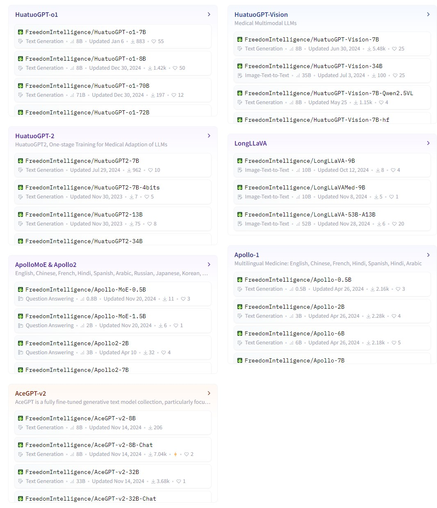
      

      

        <h3>相关论文整理</h3>
        <ol class="project-paper-list">
          <li><a href="https://aclanthology.org/2025.naacl-long.256/" target="_blank" rel="noopener">MLLM-Bench</a>：用 per-sample criteria 评估多模态大模型，让样本级标准成为 judge 的核心输入。</li>
          <li><a href="https://arxiv.org/abs/2402.10669" target="_blank" rel="noopener">Humans or LLMs as the Judge?</a>：系统分析人类和 LLM judge 的判断偏差，为自动评测校准提供依据。</li>
          <li><a href="https://github.com/FreedomIntelligence/FreshBench" target="_blank" rel="noopener">FreshBench</a>：评估大模型的 temporal generalization，判断模型是否“过时”。</li>
          <li><a href="https://arxiv.org/abs/2505.18562" target="_blank" rel="noopener">From Word to World</a>：用 word association test 评估和缓解 LLM 的文化偏差。</li>
          <li><a href="https://github.com/FreedomIntelligence/PrinciplismQA" target="_blank" rel="noopener">PrinciplismQA</a>：把四原则医学伦理转成 MCQA、临床病例和 rubric keypoints。</li>
          <li><a href="https://github.com/FreedomIntelligence/Awesome-Rubrics" target="_blank" rel="noopener">Awesome-Rubrics</a>：整理 rubric-based evaluation、reward modeling 和 post-training 资源。</li>
        </ol>
      

    

    

      
论文 / GitHub / 资源入口<strong>Evaluation and reward stack</strong>

      

        <a class="project-stack-row" href="/projects/general-llm-evaluation/">Project<strong>General LLM Evaluation</strong>通用大模型评估、rubric judge、可靠性和 reward design 总览。</a>
        <a class="project-stack-row" href="https://github.com/FreedomIntelligence/Awesome-Rubrics" target="_blank" rel="noopener">GitHub<strong>FreedomIntelligence/Awesome-Rubrics</strong>Rubric-based evaluation、alignment 和 agentic AI 文献地图。</a>
        <a class="project-stack-row" href="https://github.com/FreedomIntelligence/MLLM-Bench" target="_blank" rel="noopener">GitHub<strong>FreedomIntelligence/MLLM-Bench</strong>Per-sample criteria 多模态评测代码与数据。</a>
        <a class="project-stack-row" href="https://github.com/FreedomIntelligence/FreshBench" target="_blank" rel="noopener">GitHub<strong>FreedomIntelligence/FreshBench</strong>时间泛化和模型新鲜度评测资源。</a>
        <a class="project-stack-row" href="https://github.com/FreedomIntelligence/PrinciplismQA" target="_blank" rel="noopener">GitHub<strong>FreedomIntelligence/PrinciplismQA</strong>医学伦理知识、病例和 rubric scoring 资源。</a>
      

    

  </section>

医疗 AI 评测系列

  <section class="project-program-section project-theme-eval" data-project-tags="Healthcare AI;Evaluation & Interpretability" data-project-url="/projects/medical-evaluation-benchmarks/">
    

      
Healthcare AI evaluation

      
      

        医疗 AI 不能只看聊天流畅度。这条线把评测拆成中文医学知识、多模态医学理解、可解释诊断、实时临床、医生工作流和医学教育几层，让模型在更接近临床的任务上暴露短板。
      

      

        <a class="project-action primary" href="/projects/medical-evaluation-benchmarks/">Open Medical Evaluation Benchmarks</a>
      

    

    

      

        
      

      

        <h3>相关论文整理</h3>
        <ol class="project-paper-list">
          <li><a href="https://arxiv.org/abs/2308.08833" target="_blank" rel="noopener">CMB: A Comprehensive Medical Benchmark in Chinese</a>：中文医学综合 benchmark。</li>
          <li><a href="https://arxiv.org/abs/2408.03361" target="_blank" rel="noopener">GMAI-MMBench</a>：面向通用医疗 AI 的多模态评测。</li>
          <li><a href="https://arxiv.org/abs/2407.13301" target="_blank" rel="noopener">Chain-of-Diagnosis / DxBench</a>：可解释诊断模型和真实医患对话诊断评测。</li>
          <li><a href="https://arxiv.org/abs/2602.16747" target="_blank" rel="noopener">LiveClin: A Live Clinical Benchmark without Leakage</a>：持续更新、抗泄漏的真实临床 benchmark。</li>
          <li><a href="https://arxiv.org/abs/2510.11040" target="_blank" rel="noopener">Enabling Doctor-Centric Medical AI with LLMs through Workflow-Aligned Tasks and Benchmarks</a>：DoctorFLAN / DotaBench，面向医生工作流。</li>
        </ol>
      

    

    

      
GitHub / Hugging Face 资源<strong>Code, models, datasets</strong>

      

        <a class="project-stack-row" href="https://github.com/FreedomIntelligence/CMB" target="_blank" rel="noopener">GitHub<strong>FreedomIntelligence/CMB</strong>中文医学 benchmark 代码。</a>
        <a class="project-stack-row" href="https://github.com/uni-medical/GMAI-MMBench" target="_blank" rel="noopener">GitHub<strong>uni-medical/GMAI-MMBench</strong>GMAI-MMBench 多模态评测代码。</a>
        <a class="project-stack-row" href="https://github.com/FreedomIntelligence/Chain-of-Diagnosis" target="_blank" rel="noopener">GitHub<strong>FreedomIntelligence/Chain-of-Diagnosis</strong>CoD、DxBench、DiagnosisGPT 统一入口。</a>
        <a class="project-stack-row" href="https://github.com/AQ-MedAI/LiveClin" target="_blank" rel="noopener">GitHub<strong>AQ-MedAI/LiveClin</strong>LiveClin 代码和数据入口。</a>
        <a class="project-stack-row" href="https://github.com/FreedomIntelligence/DotaGPT" target="_blank" rel="noopener">GitHub<strong>FreedomIntelligence/DotaGPT</strong>DoctorFLAN / DotaBench 训练与评测代码。</a>
      

    

  </section>

LLM Interpretability

  <section class="project-program-section project-theme-explain" data-project-tags="Evaluation & Interpretability;Healthcare AI" data-project-url="/projects/llm-interpretability/">
    

      
Explainable and verifiable LLMs

      
      

        可解释性是横向能力：它关心模型为什么这样回答、哪些内部特征真正有用、以及如何把机制理解转成可控编辑。这个方向现在以 sparse autoencoder、model unlearning 和 circuit analysis 为主线，同时连接医学诊断链、verifier 和代码集成推理。
      

      

        <a class="project-action primary" href="/projects/llm-interpretability/">Open LLM Interpretability</a>
        <a class="project-action" href="https://arxiv.org/abs/2510.03659" target="_blank" rel="noopener">Open ICLR 2026 paper</a>
      

    

    

      

        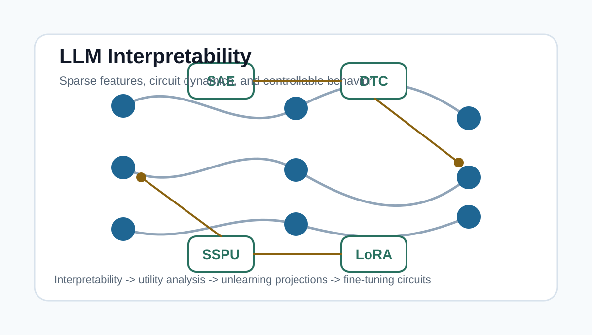
      

      

        <h3>相关论文整理</h3>
        <ol class="project-paper-list">
          <li><a href="https://arxiv.org/abs/2510.03659" target="_blank" rel="noopener">Does Higher Interpretability Imply Better Utility? A Pairwise Analysis on Sparse Autoencoders</a>：ICLR 2026，系统比较 SAE 的可解释性指标和实际 steering utility；获 NeurIPS 2025 ResponsibleFM Workshop Outstanding Paper Award。</li>
          <li><a href="https://arxiv.org/abs/2505.24428" target="_blank" rel="noopener">Model Unlearning via Sparse Autoencoder Subspace Guided Projections</a>：EMNLP 2025，用 SAE subspace guided projections 做更可控的模型遗忘。</li>
          <li><a href="https://arxiv.org/abs/2502.11812" target="_blank" rel="noopener">Towards Understanding Fine-Tuning Mechanisms of LLMs via Circuit Analysis</a>：ICML 2025，用 circuit analysis 理解微调如何改变模型内部计算。</li>
          <li><a href="https://arxiv.org/abs/2407.13301" target="_blank" rel="noopener">CoD, Towards an Interpretable Medical Agent using Chain of Diagnosis</a>：用五步诊断链和置信度分布提升医学诊断可解释性。</li>
          <li><a href="https://arxiv.org/abs/2311.09724" target="_blank" rel="noopener">Outcome-supervised Verifiers for Planning in Mathematical Reasoning</a>：用结果监督 verifier 辅助数学规划推理。</li>
          <li><a href="https://arxiv.org/abs/2506.09820" target="_blank" rel="noopener">CoRT: Code-integrated Reasoning within Thinking</a>：把代码执行放入思维过程，让中间计算更透明。</li>
        </ol>
      

    

    

      
论文 / GitHub / Hugging Face 资源<strong>Papers, code, models, datasets</strong>

      

        <a class="project-stack-row" href="/projects/llm-interpretability/">Project<strong>LLM Interpretability and Sparse Autoencoders</strong>SAE utility、SAE-guided unlearning 和 circuit analysis 的详情页。</a>
        <a class="project-stack-row" href="https://arxiv.org/abs/2510.03659" target="_blank" rel="noopener">ICLR 2026<strong>Does Higher Interpretability Imply Better Utility?</strong>Pairwise analysis on sparse autoencoders。</a>
        <a class="project-stack-row" href="https://arxiv.org/abs/2505.24428" target="_blank" rel="noopener">EMNLP 2025<strong>Model Unlearning via SAE Subspace Guided Projections</strong>可解释子空间引导的模型遗忘。</a>
        <a class="project-stack-row" href="https://arxiv.org/abs/2502.11812" target="_blank" rel="noopener">ICML 2025<strong>Fine-Tuning Mechanisms via Circuit Analysis</strong>用 circuit analysis 理解 LLM 微调机制。</a>
        <a class="project-stack-row" href="https://github.com/FreedomIntelligence/Chain-of-Diagnosis" target="_blank" rel="noopener">GitHub<strong>FreedomIntelligence/Chain-of-Diagnosis</strong>CoD 代码、诊断链数据、疾病库、DxBench 和 DiagnosisGPT 入口。</a>
        <a class="project-stack-row" href="https://huggingface.co/FreedomIntelligence/DiagnosisGPT-6B" target="_blank" rel="noopener">HF Model<strong>FreedomIntelligence/DiagnosisGPT-6B</strong>基于 CoD 的可解释诊断模型。</a>
        <a class="project-stack-row" href="https://huggingface.co/datasets/FreedomIntelligence/DxBench" target="_blank" rel="noopener">HF Dataset<strong>FreedomIntelligence/DxBench</strong>真实医患对话构建的疾病诊断 benchmark。</a>
        <a class="project-stack-row" href="https://github.com/FreedomIntelligence/OVM" target="_blank" rel="noopener">GitHub<strong>FreedomIntelligence/OVM</strong>Outcome-supervised verifier 相关代码。</a>
        <a class="project-stack-row" href="https://github.com/ChengpengLi1003/CoRT" target="_blank" rel="noopener">GitHub<strong>ChengpengLi1003/CoRT</strong>代码集成推理项目。</a>
        <a class="project-stack-row" href="https://github.com/tulerfeng/Video-R1" target="_blank" rel="noopener">GitHub<strong>tulerfeng/Video-R1</strong>视频推理强化学习代码。</a>
      

    

  </section>

</section>

