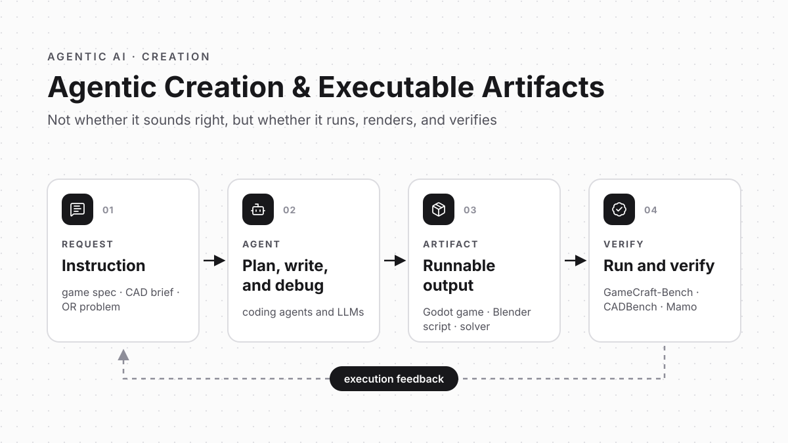
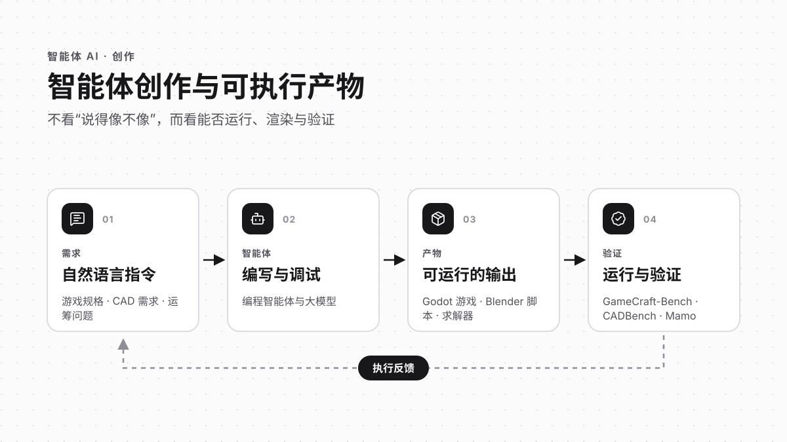

<link rel="stylesheet" href="{{ '/assets/css/project-detail.css' | relative_url }}">

Instruction-to-artifact agents

  Agentic Creation
  Executable artifacts
  Game generation
  CAD generation
  Executable reasoning

  <a class="impact-action" href="https://github.com/FreedomIntelligence/gamecraft-bench" target="_blank" rel="noopener">GameCraft-Bench</a>
  <a class="impact-action secondary" href="https://github.com/FreedomIntelligence/BlenderLLM" target="_blank" rel="noopener">BlenderLLM</a>
  <a class="impact-action secondary" href="https://github.com/FreedomIntelligence/Mamo" target="_blank" rel="noopener">Mamo</a>
  <a class="impact-action secondary" href="https://github.com/Cardinal-Operations/ORLM" target="_blank" rel="noopener">ORLM</a>
  <a class="impact-action secondary" href="/projects/">All Projects</a>

  

Agentic Creation & Executable Artifacts asks whether models can create things that actually run. A strong agent should not only produce plausible text; it should deliver a complete project, script, model, solver, trace, or environment that can be launched, executed, replayed, rendered, and verified.

<section class="impact-section">
  <h2>Research Storyline</h2>
  

    

      Game
      
<strong>Playable projects as the evaluation target</strong>
GameCraft-Bench evaluates full Godot projects through launchability, replay traces, gameplay evidence, and hidden rubric judging.

    

    

      CAD
      
<strong>Executable scripts for visual artifacts</strong>
BlenderLLM generates Python CAD scripts that execute inside Blender and render 3D models from user instructions.

    

    

      Solver
      
<strong>Mathematical and optimization artifacts</strong>
Mamo and ORLM connect natural language problems to formal models, constraints, objective functions, solvers, and benchmarkable outputs.

    

    

      Code
      
<strong>Reasoning with executable checks</strong>
CoRT integrates code execution into the thinking process so intermediate calculations can be checked rather than only narrated.

    

  

</section>

<section class="impact-section">
  <h2>Representative Work</h2>
  

    

      Games
      
<strong>GameCraft-Bench</strong>
Tests whether agents can build complete playable games in a real game engine with replay-based verification.
<a href="https://arxiv.org/abs/2606.17861" target="_blank" rel="noopener">Paper</a>

    

    

      CAD
      
<strong>BlenderLLM</strong>
Trains LLMs for CAD script generation with BlendNet, CADBench, public models, and self-improvement.
<a href="https://arxiv.org/abs/2412.14203" target="_blank" rel="noopener">Paper</a>

    

    

      Modeling
      
<strong>Mamo: a Mathematical Modeling Benchmark with Solvers</strong>
Benchmarks mathematical modeling with solver-backed executable answers.
<a href="https://arxiv.org/abs/2405.13144" target="_blank" rel="noopener">Paper</a>

    

    

      OR
      
<strong>ORLM</strong>
Trains large models for automated optimization modeling and releases benchmark resources for industrial OR problems.
<a href="https://arxiv.org/abs/2405.17743" target="_blank" rel="noopener">Paper</a>

    

    

      Reason
      
<strong>CoRT: Code-integrated Reasoning within Thinking</strong>
Connects reasoning to executable computation, making intermediate reasoning more testable.
<a href="https://arxiv.org/abs/2506.09820" target="_blank" rel="noopener">Paper</a>

    

  

</section>

<section class="impact-section">
  <h2>Why It Matters</h2>
  <ul class="impact-list">
    <li>It shifts evaluation from static answers to complete artifacts that can be launched, rendered, replayed, or solved.</li>
    <li>It gives agent research stronger evidence: traces, states, runtime behavior, and verifier outputs.</li>
    <li>It connects coding agents, creative generation, CAD, optimization, and reasoning under one executable-artifact agenda.</li>
  </ul>
</section>

  <a class="impact-action secondary" href="/projects/">Back to Projects</a>

从指令到产物的智能体

  智能体创作
  可执行产物
  游戏生成
  CAD 生成
  可执行推理

  <a class="impact-action" href="https://github.com/FreedomIntelligence/gamecraft-bench" target="_blank" rel="noopener">GameCraft-Bench</a>
  <a class="impact-action secondary" href="https://github.com/FreedomIntelligence/BlenderLLM" target="_blank" rel="noopener">BlenderLLM</a>
  <a class="impact-action secondary" href="https://github.com/FreedomIntelligence/Mamo" target="_blank" rel="noopener">Mamo</a>
  <a class="impact-action secondary" href="https://github.com/Cardinal-Operations/ORLM" target="_blank" rel="noopener">ORLM</a>
  <a class="impact-action secondary" href="/projects/">全部项目</a>

  

智能体创作与可执行产物关注的是：模型能否创造出真正能运行的东西。强大的智能体不应只产出看似合理的文本，而应交付完整的项目、脚本、模型、求解器、轨迹或环境，让它们可以被启动、执行、回放、渲染和验证。

<section class="impact-section">
  <h2>研究脉络</h2>
  

    

      游戏
      
<strong>以可玩的项目为评测对象</strong>
GameCraft-Bench 通过可启动性、回放轨迹、游玩证据和隐藏的 rubric 评判，来评测完整的 Godot 项目。

    

    

      CAD
      
<strong>面向可视产物的可执行脚本</strong>
BlenderLLM 根据用户指令生成 Python CAD 脚本，这些脚本在 Blender 中运行并渲染出 3D 模型。

    

    

      求解器
      
<strong>数学与优化产物</strong>
Mamo 和 ORLM 把自然语言问题连接到形式化模型、约束、目标函数、求解器，以及可用基准评测的输出。

    

    

      代码
      
<strong>带可执行检验的推理</strong>
CoRT 把代码执行整合进思考过程，让中间计算可以被检验，而不是只停留在文字叙述上。

    

  

</section>

<section class="impact-section">
  <h2>代表性工作</h2>
  

    

      游戏
      
<strong>GameCraft-Bench</strong>
检验智能体能否在真实游戏引擎中构建完整、可玩的游戏，并通过回放来验证。
<a href="https://arxiv.org/abs/2606.17861" target="_blank" rel="noopener">论文</a>

    

    

      CAD
      
<strong>BlenderLLM</strong>
借助 BlendNet、CADBench、公开模型和自我改进，训练大模型生成 CAD 脚本。
<a href="https://arxiv.org/abs/2412.14203" target="_blank" rel="noopener">论文</a>

    

    

      建模
      
<strong>Mamo: a Mathematical Modeling Benchmark with Solvers</strong>
以求解器支撑的可执行答案，评测数学建模能力。
<a href="https://arxiv.org/abs/2405.13144" target="_blank" rel="noopener">论文</a>

    

    

      运筹
      
<strong>ORLM</strong>
训练大模型自动完成优化建模，并发布面向工业运筹问题的评测基准资源。
<a href="https://arxiv.org/abs/2405.17743" target="_blank" rel="noopener">论文</a>

    

    

      推理
      
<strong>CoRT: Code-integrated Reasoning within Thinking</strong>
把推理与可执行的计算连接起来，使中间推理步骤更容易检验。
<a href="https://arxiv.org/abs/2506.09820" target="_blank" rel="noopener">论文</a>

    

  

</section>

<section class="impact-section">
  <h2>研究意义</h2>
  <ul class="impact-list">
    <li>它把评测对象从静态答案转向完整的产物：可以被启动、渲染、回放或求解。</li>
    <li>它为智能体研究提供更有力的证据：轨迹、状态、运行时行为和验证器的输出。</li>
    <li>它把编程智能体、创意生成、CAD、优化和推理，纳入同一个可执行产物的研究议程。</li>
  </ul>
</section>

  <a class="impact-action secondary" href="/projects/">返回项目页</a>

