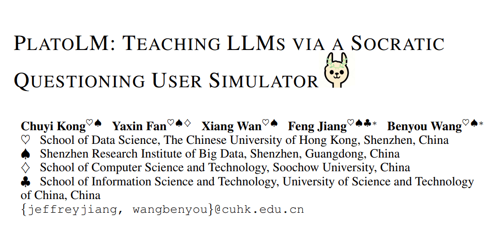
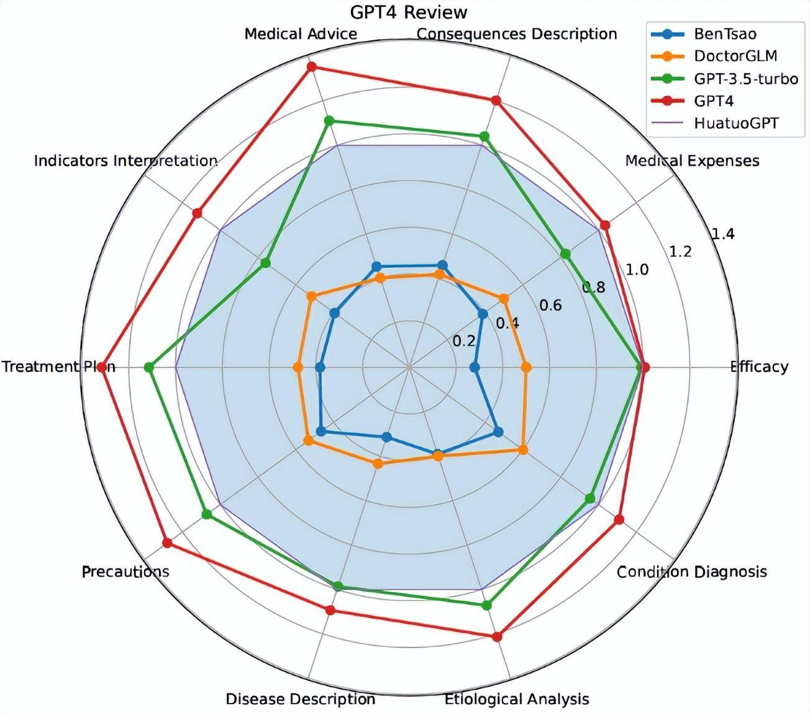

<link rel="stylesheet" href="{{ '/assets/css/project-detail.css' | relative_url }}">

Education agents and learning simulation

  AI Education
  Socratic learning
  User simulation
  Self-regulated learning
  AI standardized patients

  <a class="impact-action" href="https://github.com/FreedomIntelligence/PlatoLM" target="_blank" rel="noopener">PlatoLM</a>
  <a class="impact-action secondary" href="https://github.com/FreedomIntelligence/EasyMED" target="_blank" rel="noopener">EasyMED</a>
  <a class="impact-action secondary" href="/projects/medical-education-standardized-patients/">AI Patients</a>
  <a class="impact-action secondary" href="/projects/human-agent-interaction/">Human-Agent Interaction</a>
  <a class="impact-action secondary" href="/projects/">All Projects</a>

  

AI Education studies how LLM agents can become scalable tutors, learners, simulators, and standardized patients. The focus is educational interaction: models should ask useful questions, provide learner-aware feedback, support repeated practice, and make learning outcomes easier to evaluate.

<section class="impact-section">
  <h2>Background and Motivation</h2>
  

    

      <strong>Education needs interaction, not just answers</strong>
      
A strong educational model should probe understanding, adapt to learners, guide reflection, and create practice loops rather than only deliver final responses.

    

    

      <strong>Scalable practice is still scarce</strong>
      
Teachers, tutors, and standardized patients are difficult to scale across repeated sessions, diverse cases, and individualized feedback needs.

    

    

      <strong>Evaluation should follow learning behavior</strong>
      
Educational AI should be judged by whether it improves question asking, self-regulation, communication, reasoning, and confidence under realistic interaction.

    

  

</section>

<section class="impact-section">
  <h2>Research Storyline</h2>
  

    

      Simulate
      
<strong>Use LLMs as interactive users and learners</strong>
User simulators create controllable multi-turn partners that can teach dialogue models, stress-test systems, and generate richer learning signals.

    

    

      Question
      
<strong>Teach through Socratic dialogue</strong>
PlatoLM and Socratic-style data construction turn questioning, clarification, and guided reasoning into a training signal for multi-round dialogue.

    

    

      Coach
      
<strong>Support self-regulated learning</strong>
SRLAgent explores how LLM assistance and gamified feedback can help learners plan, monitor, and reflect on their own study process.

    

    

      Practice
      
<strong>Build AI standardized patients</strong>
EasyMED and SPBench make clinical communication training repeatable, controllable, and measurable for medical learners.

    

  

</section>

<section class="impact-section">
  <h2>Representative Work</h2>
  

    

      SRL
      
<strong>SRLAgent: Enhancing Self-Regulated Learning Skills through Gamification and LLM Assistance</strong>
Builds an LLM-assisted learning system around planning, monitoring, reflection, feedback, and engagement.
<a href="https://arxiv.org/abs/2506.09968" target="_blank" rel="noopener">Paper</a>

    

    

      User
      
<strong>Large Language Model as a User Simulator</strong>
Frames LLMs as simulated users for interactive dialogue training and evaluation.
<a href="https://arxiv.org/abs/2308.11534" target="_blank" rel="noopener">Paper</a>

    

    

      PlatoLM
      
<strong>PlatoLM: Teaching LLMs in Multi-Round Dialogue via a User Simulator</strong>
Uses Socratic-style questioning to improve multi-turn dialogue learning.
<a href="https://openreview.net/forum?id=9nddtu94uX" target="_blank" rel="noopener">Paper</a>

    

    

      AI-SP
      
<strong>Human or LLM as Standardized Patients?</strong>
Introduces EasyMED and SPBench for comparing AI standardized patients with human standardized patients in medical education.
<a href="https://arxiv.org/abs/2511.14783" target="_blank" rel="noopener">Paper</a>

    

    

      Co-design
      
<strong>It Talks Like a Patient, But Feels Different</strong>
Studies how medical learners experience AI standardized patients and what design requirements emerge from real use.
<a href="https://arxiv.org/abs/2602.05856" target="_blank" rel="noopener">Paper</a>

    

  

</section>

<section class="impact-section">
  <h2>Project Clusters</h2>
  

    

      <strong>Learning companion agents</strong>
      
LLM systems that scaffold planning, reflection, formative feedback, and learner engagement.

    

    

      <strong>Socratic dialogue training</strong>
      
Question-driven user simulation and data construction for teaching models to handle multi-round educational dialogue.

    

    

      <strong>Medical education simulation</strong>
      
AI standardized patients for history taking, communication, empathy, diagnostic reasoning, and structured feedback.

    

    

      <strong>Evaluation-centered education AI</strong>
      
Benchmarks and rubrics that connect interaction quality to measurable learning behavior and outcomes.

    

  

</section>

<section class="impact-section">
  <h2>Display Figures</h2>
  

    <figure>
      
      <figcaption>Socratic and user-simulation work turns educational interaction into trainable data and evaluation loops.</figcaption>
    </figure>
    <figure>
      
      <figcaption>Medical education extends the same idea into standardized patient practice and structured learner assessment.</figcaption>
    </figure>
  

</section>

<section class="impact-section">
  <h2>Resource Map</h2>
  

    

      <strong>PlatoLM</strong>
      
Open resources for Socratic-style dialogue training and user-simulator-driven model improvement.

      <a href="https://github.com/FreedomIntelligence/PlatoLM" target="_blank" rel="noopener">Repository</a>
    

    

      <strong>SocraticChat</strong>
      
Dataset resource behind Socratic dialogue construction and educational multi-turn training.

      <a href="https://huggingface.co/datasets/FreedomIntelligence/SocraticChat" target="_blank" rel="noopener">Dataset</a>
    

    

      <strong>EasyMED</strong>
      
AI standardized patient framework and medical education evaluation resources.

      <a href="https://github.com/FreedomIntelligence/EasyMED" target="_blank" rel="noopener">Repository</a>
    

  

</section>

  <a class="impact-action secondary" href="/projects/">Back to Projects</a>

教育智能体与学习模拟

  AI 教育
  苏格拉底式学习
  用户模拟
  自我调节学习
  AI 标准化病人

  <a class="impact-action" href="https://github.com/FreedomIntelligence/PlatoLM" target="_blank" rel="noopener">PlatoLM</a>
  <a class="impact-action secondary" href="https://github.com/FreedomIntelligence/EasyMED" target="_blank" rel="noopener">EasyMED</a>
  <a class="impact-action secondary" href="/projects/medical-education-standardized-patients/">AI 病人</a>
  <a class="impact-action secondary" href="/projects/human-agent-interaction/">人机交互</a>
  <a class="impact-action secondary" href="/projects/">全部项目</a>

  

AI 教育研究如何让大模型智能体成为可规模化的导师、学习者、模拟器和标准化病人。研究重点是教育中的互动：模型要能提出有价值的问题，给出贴合学习者情况的反馈，支持反复练习，并让学习效果更容易评测。

<section class="impact-section">
  <h2>背景与动机</h2>
  

    

      <strong>教育需要互动，而不只是答案</strong>
      
好的教育模型应当能探查学生的理解程度、适应不同的学习者、引导反思、形成练习闭环，而不是只给出最终答案。

    

    

      <strong>可规模化的练习依然稀缺</strong>
      
教师、导师和标准化病人难以规模化，无法满足反复练习、多样案例和个性化反馈的需求。

    

    

      <strong>评测应当关注学习行为</strong>
      
评价教育 AI，要看它在真实互动中能否提升学习者的提问、自我调节、沟通、推理和信心。

    

  

</section>

<section class="impact-section">
  <h2>研究脉络</h2>
  

    

      模拟
      
<strong>让大模型扮演交互式的用户和学习者</strong>
用户模拟器是可控的多轮对话对象，既能用来训练对话模型、对系统做压力测试，也能产生更丰富的学习信号。

    

    

      提问
      
<strong>通过苏格拉底式对话教学</strong>
PlatoLM 和苏格拉底式数据构建，把提问、澄清和引导式推理变成多轮对话的训练信号。

    

    

      辅导
      
<strong>支持自我调节学习</strong>
SRLAgent 探索大模型辅助和游戏化反馈如何帮助学习者规划、监控并反思自己的学习过程。

    

    

      练习
      
<strong>构建 AI 标准化病人</strong>
EasyMED 和 SPBench 让医学生的临床沟通训练可重复、可控制、可度量。

    

  

</section>

<section class="impact-section">
  <h2>代表性工作</h2>
  

    

      自我调节
      
<strong>SRLAgent: Enhancing Self-Regulated Learning Skills through Gamification and LLM Assistance</strong>
围绕规划、监控、反思、反馈和参与度，构建大模型辅助的学习系统。
<a href="https://arxiv.org/abs/2506.09968" target="_blank" rel="noopener">论文</a>

    

    

      用户
      
<strong>Large Language Model as a User Simulator</strong>
把大模型作为模拟用户，用于交互式对话的训练和评测。
<a href="https://arxiv.org/abs/2308.11534" target="_blank" rel="noopener">论文</a>

    

    

      PlatoLM
      
<strong>PlatoLM: Teaching LLMs in Multi-Round Dialogue via a User Simulator</strong>
用苏格拉底式提问，提升模型学习多轮对话的效果。
<a href="https://openreview.net/forum?id=9nddtu94uX" target="_blank" rel="noopener">论文</a>

    

    

      AI 病人
      
<strong>Human or LLM as Standardized Patients?</strong>
提出 EasyMED 和 SPBench，用于在医学教育中对比 AI 标准化病人与真人标准化病人。
<a href="https://arxiv.org/abs/2511.14783" target="_blank" rel="noopener">论文</a>

    

    

      共创设计
      
<strong>It Talks Like a Patient, But Feels Different</strong>
研究医学学习者如何体验 AI 标准化病人，以及真实使用中提出了哪些设计需求。
<a href="https://arxiv.org/abs/2602.05856" target="_blank" rel="noopener">论文</a>

    

  

</section>

<section class="impact-section">
  <h2>项目分组</h2>
  

    

      <strong>学习伙伴智能体</strong>
      
支持学习者规划、反思、获得形成性反馈并保持参与的大模型系统。

    

    

      <strong>苏格拉底式对话训练</strong>
      
以提问驱动的用户模拟和数据构建，教模型应对多轮教学对话。

    

    

      <strong>医学教育模拟</strong>
      
AI 标准化病人，用于病史采集、沟通、共情、诊断推理和结构化反馈。

    

    

      <strong>以评测为中心的教育 AI</strong>
      
把互动质量与可度量的学习行为及成果联系起来的评测基准和 rubric。

    

  

</section>

<section class="impact-section">
  <h2>图示</h2>
  

    <figure>
      
      <figcaption>苏格拉底式对话和用户模拟的工作，把教育互动转化为可训练的数据和评测闭环。</figcaption>
    </figure>
    <figure>
      
      <figcaption>医学教育把同样的思路延伸到标准化病人练习和结构化的学习者评估。</figcaption>
    </figure>
  

</section>

<section class="impact-section">
  <h2>资源导航</h2>
  

    

      <strong>PlatoLM</strong>
      
用于苏格拉底式对话训练、由用户模拟器驱动模型改进的开放资源。

      <a href="https://github.com/FreedomIntelligence/PlatoLM" target="_blank" rel="noopener">代码仓库</a>
    

    

      <strong>SocraticChat</strong>
      
支撑苏格拉底式对话构建与教育类多轮训练的数据集。

      <a href="https://huggingface.co/datasets/FreedomIntelligence/SocraticChat" target="_blank" rel="noopener">数据集</a>
    

    

      <strong>EasyMED</strong>
      
AI 标准化病人框架与医学教育评测资源。

      <a href="https://github.com/FreedomIntelligence/EasyMED" target="_blank" rel="noopener">代码仓库</a>
    

  

</section>

  <a class="impact-action secondary" href="/projects/">返回项目页</a>

