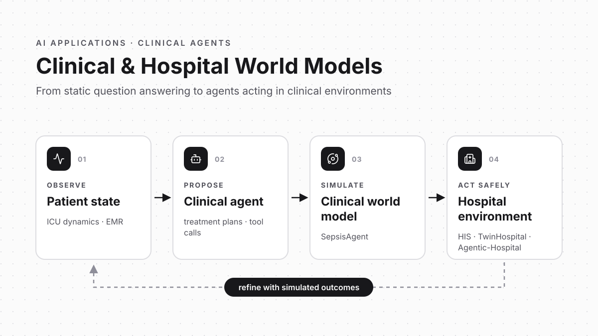
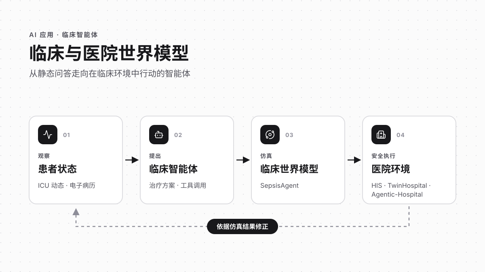

<link rel="stylesheet" href="{{ '/assets/css/project-detail.css' | relative_url }}">

Clinical agents and hospital-scale environments

  Clinical Agents
  Hospital World Models
  Patient dynamics
  HIS/EMR environments
  Medical skills

  <a class="impact-action" href="https://github.com/FreedomIntelligence/SepsisAgent" target="_blank" rel="noopener">SepsisAgent</a>
  <a class="impact-action secondary" href="https://github.com/FreedomIntelligence/Agentic-Hospital" target="_blank" rel="noopener">Agentic-Hospital</a>
  <a class="impact-action secondary" href="https://github.com/FreedomIntelligence/TwinHospital" target="_blank" rel="noopener">TwinHospital</a>
  <a class="impact-action secondary" href="https://github.com/FreedomIntelligence/OpenClaw-Medical-Skills" target="_blank" rel="noopener">Medical Skills</a>
  <a class="impact-action secondary" href="/projects/">All Projects</a>

  

Clinical & Hospital World Models moves medical AI from isolated QA to environments where agents act, observe, call tools, interact with clinical roles, and reason over changing patient or hospital states. This page intentionally excludes DentalGPT and GlobalDentBench, which are now organized under the dedicated dental foundation model direction.

<section class="impact-section">
  <h2>Research Storyline</h2>
  

    

      Patient
      
<strong>Model action-conditioned patient dynamics</strong>
SepsisAgent uses a Clinical World Model to simulate patient responses under candidate ICU interventions.

    

    

      Hospital
      
<strong>Make the hospital directly actionable</strong>
Agentic-Hospital connects role simulation, mocked HIS/EMR, structured data views, APIs, CLI interfaces, governance, and rubric-based evaluation.

    

    

      Twin
      
<strong>Simulate real hospital processes</strong>
TwinHospital combines HIS data flow with multi-role agent simulation across registration, consultation, treatment, follow-up, and operations.

    

    

      Skill
      
<strong>Give agents clinical tools</strong>
OpenClaw-Medical-Skills turns medical capabilities into callable skills for agentic workflows.

    

  

</section>

<section class="impact-section">
  <h2>Representative Work</h2>
  

    

      World
      
<strong>SepsisAgent: Agentifying Patient Dynamics within LLMs</strong>
Combines propose-simulate-refine inference with world-model-based agentic RL for ICU sepsis treatment recommendation.
<a href="https://arxiv.org/abs/2605.14723" target="_blank" rel="noopener">Paper</a>

    

    

      Hospital
      
<strong>Agentic-Hospital</strong>
Defines hospital intelligence as autonomous agents operating across human and digital hospital environments through standardized interfaces.
<a href="https://github.com/FreedomIntelligence/Agentic-Hospital" target="_blank" rel="noopener">Repository</a>

    

    

      Twin
      
<strong>TwinHospital</strong>
Builds an HIS data-flow-aware hospital simulation with patients, nurses, physicians, administrators, and management workflows.
<a href="https://github.com/FreedomIntelligence/TwinHospital" target="_blank" rel="noopener">Repository</a>

    

    

      Workflow
      
<strong>Doctor-Centric Medical AI</strong>
Defines workflow-aligned tasks and benchmarks that better match how clinicians actually work.
<a href="https://arxiv.org/abs/2510.11040" target="_blank" rel="noopener">Paper</a>

    

    

      Skills
      
<strong>OpenClaw-Medical-Skills</strong>
A large open-source medical AI skills library for building tool-using clinical agents.
<a href="https://github.com/FreedomIntelligence/OpenClaw-Medical-Skills" target="_blank" rel="noopener">Repository</a>

    

  

</section>

<section class="impact-section">
  <h2>Technical Layers</h2>
  

    

      <strong>Action-conditioned world models</strong>
      
Clinical states change after interventions, so agents need simulators that predict patient evolution under candidate actions.

    

    

      <strong>Hospital information environments</strong>
      
HIS, EMR, labs, imaging, pharmacy, scheduling, billing, and governance systems become part of the agent environment.

    

    

      <strong>Multi-role simulation</strong>
      
Doctors, nurses, administrators, patients, pharmacists, and managers make hospital workflows more realistic than single-turn diagnosis tasks.

    

    

      <strong>Safety and auditing</strong>
      
Clinical agents need permissions, logs, rubric-based scoring, guideline adherence, and unsafe-action analysis.

    

  

</section>

  <a class="impact-action secondary" href="/projects/">Back to Projects</a>

临床智能体与医院级环境

  临床智能体
  医院世界模型
  患者动态
  HIS/EMR 环境
  医疗技能

  <a class="impact-action" href="https://github.com/FreedomIntelligence/SepsisAgent" target="_blank" rel="noopener">SepsisAgent</a>
  <a class="impact-action secondary" href="https://github.com/FreedomIntelligence/Agentic-Hospital" target="_blank" rel="noopener">Agentic-Hospital</a>
  <a class="impact-action secondary" href="https://github.com/FreedomIntelligence/TwinHospital" target="_blank" rel="noopener">TwinHospital</a>
  <a class="impact-action secondary" href="https://github.com/FreedomIntelligence/OpenClaw-Medical-Skills" target="_blank" rel="noopener">医疗技能</a>
  <a class="impact-action secondary" href="/projects/">全部项目</a>

  

临床与医院世界模型让医疗 AI 走出孤立的问答，进入一类新的环境：智能体在其中行动、观察、调用工具、与各类临床角色互动，并对不断变化的患者或医院状态做推理。本页有意不收录 DentalGPT 和 GlobalDentBench，它们现在归入专门的牙科大模型方向。

<section class="impact-section">
  <h2>研究脉络</h2>
  

    

      患者
      
<strong>为动作条件下的患者动态建模</strong>
SepsisAgent 用临床世界模型仿真患者在候选 ICU 干预下的反应。

    

    

      医院
      
<strong>让医院成为可直接操作的环境</strong>
Agentic-Hospital 把角色仿真、模拟的 HIS/EMR、结构化数据视图、API、CLI 接口、治理机制和基于 rubric 的评测连接起来。

    

    

      孪生
      
<strong>仿真医院的实际流程</strong>
TwinHospital 把 HIS 数据流与多角色智能体仿真结合起来，覆盖挂号、问诊、治疗、随访和运营。

    

    

      技能
      
<strong>为智能体提供临床工具</strong>
OpenClaw-Medical-Skills 把医疗能力封装为可调用的技能，供智能体工作流使用。

    

  

</section>

<section class="impact-section">
  <h2>代表性工作</h2>
  

    

      世界模型
      
<strong>SepsisAgent: Agentifying Patient Dynamics within LLMs</strong>
把“提出—仿真—修正”推理与基于世界模型的智能体强化学习结合，用于 ICU 脓毒症治疗推荐。
<a href="https://arxiv.org/abs/2605.14723" target="_blank" rel="noopener">论文</a>

    

    

      医院
      
<strong>Agentic-Hospital</strong>
把医院智能定义为：自主智能体通过标准化接口，在人类与数字化的医院环境中运作。
<a href="https://github.com/FreedomIntelligence/Agentic-Hospital" target="_blank" rel="noopener">代码仓库</a>

    

    

      孪生
      
<strong>TwinHospital</strong>
构建了能感知 HIS 数据流的医院仿真，涵盖患者、护士、医生、行政人员和管理流程。
<a href="https://github.com/FreedomIntelligence/TwinHospital" target="_blank" rel="noopener">代码仓库</a>

    

    

      工作流
      
<strong>Doctor-Centric Medical AI</strong>
定义与工作流对齐的任务和评测基准，更贴近临床医生的实际工作方式。
<a href="https://arxiv.org/abs/2510.11040" target="_blank" rel="noopener">论文</a>

    

    

      技能
      
<strong>OpenClaw-Medical-Skills</strong>
大型开源医疗 AI 技能库，用于构建会使用工具的临床智能体。
<a href="https://github.com/FreedomIntelligence/OpenClaw-Medical-Skills" target="_blank" rel="noopener">代码仓库</a>

    

  

</section>

<section class="impact-section">
  <h2>技术层次</h2>
  

    

      <strong>动作条件世界模型</strong>
      
临床状态会随干预而改变，所以智能体需要能在候选动作下预测患者演变的仿真器。

    

    

      <strong>医院信息环境</strong>
      
HIS、EMR、检验、影像、药房、排程、收费和治理系统，都成为智能体环境的一部分。

    

    

      <strong>多角色仿真</strong>
      
医生、护士、行政人员、患者、药师和管理者共同参与，使医院工作流比单轮诊断任务更贴近现实。

    

    

      <strong>安全与审计</strong>
      
临床智能体需要权限控制、日志、基于 rubric 的评分、诊疗指南依从性，以及不安全行为分析。

    

  

</section>

  <a class="impact-action secondary" href="/projects/">返回项目页</a>

