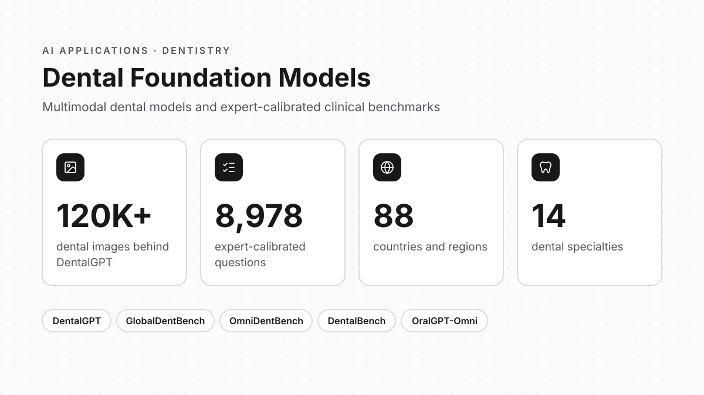
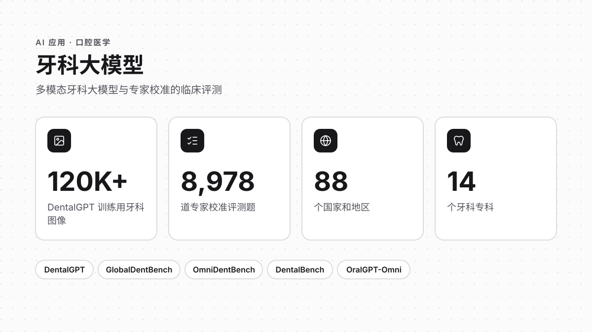

<link rel="stylesheet" href="{{ '/assets/css/project-detail.css' | relative_url }}">

Dental LLMs, multimodal diagnosis, and expert-calibrated benchmarks

  Dental Foundation Models
  DentalGPT
  GlobalDentBench
  OmniDentBench
  Clinical reasoning

  <a class="impact-action" href="https://freedomdle.cn/" target="_blank" rel="noopener">OmniDentBench</a>
  <a class="impact-action secondary" href="https://github.com/FreedomIntelligence/DentalGPT" target="_blank" rel="noopener">DentalGPT</a>
  <a class="impact-action secondary" href="https://github.com/FreedomIntelligence/GlobalDentBench" target="_blank" rel="noopener">GlobalDentBench</a>
  <a class="impact-action secondary" href="https://huggingface.co/datasets/FreedomIntelligence/GlobalDentBench-OA" target="_blank" rel="noopener">GlobalDentBench-OA</a>
  <a class="impact-action secondary" href="/projects/">All Projects</a>

  

Dental foundation models are a vertical of medical AI that is distinct enough to stand on its own: they must understand oral imaging, dental specialty knowledge, case reasoning, treatment risk, expert scoring, and clinical standards that differ across regions. DentalGPT provides a multimodal dental model route, while GlobalDentBench and OmniDentBench provide high-difficulty, expert-calibrated, clinical-reasoning-oriented benchmark entry points.

<section class="impact-section">
  <h2>Research Storyline</h2>
  

    

      Model
      
<strong>Train a multimodal dental LLM</strong>
DentalGPT strengthens multimodal complex reasoning with large-scale dental images, professional captions, instruction tuning, and GRPO.

    

    

      Bench
      
<strong>Build a multinational clinical-reasoning benchmark</strong>
GlobalDentBench covers 88 countries and regions, 14 dental specialties, and multiple question types, with an emphasis on expert calibration and risk analysis.

    

    

      ODB
      
<strong>Build an open evaluation platform</strong>
OmniDentBench targets complex clinical decision-making and biomedical research, and offers global dental benchmarking with a leaderboard entry point.

    

    

      Context
      
<strong>Align with external dental benchmarks</strong>
Work such as DentalBench, OralGPT-Omni, and OralMLLM-Bench shows that a dedicated model and evaluation ecosystem is taking shape in dentistry.

    

  

</section>

<section class="impact-section">
  <h2>Representative Work</h2>
  

    

      Model
      
<strong>DentalGPT: Incentivizing Multimodal Complex Reasoning in Dentistry</strong>
Builds a specialized 7B dental MLLM with domain knowledge injection and reinforcement learning for dental visual reasoning.
<a href="https://arxiv.org/abs/2512.11558" target="_blank" rel="noopener">Paper</a>

    

    

      Bench
      
<strong>GlobalDentBench</strong>
A multinational benchmark for LLM clinical reasoning in dentistry with expert calibration, specialty taxonomy, and risk analysis.
<a href="https://arxiv.org/abs/2605.24636" target="_blank" rel="noopener">Paper</a>

    

    

      Platform
      
<strong>OmniDentBench</strong>
A global dental benchmarking platform for high-difficulty clinical decision-making and biomedical research evaluation.
<a href="https://freedomdle.cn/" target="_blank" rel="noopener">Platform</a>

    

    

      QA
      
<strong>DentalBench</strong>
A bilingual dental QA benchmark and DentalCorpus for evaluating and adapting LLMs in dentistry.
<a href="https://arxiv.org/abs/2508.20416" target="_blank" rel="noopener">Paper</a>

    

    

      MLLM
      
<strong>OralGPT-Omni</strong>
A dental-specialized multimodal LLM and MMOral-Uni benchmark for dental image analysis.
<a href="https://arxiv.org/abs/2511.22055" target="_blank" rel="noopener">Paper</a>

    

  

</section>

<section class="impact-section">
  <h2>Benchmark Layers</h2>
  

    

      <strong>Dental visual understanding</strong>
      
Intraoral photos, panoramic X-rays, periapical radiographs, and dental-specific VQA expose failures that generic medical MLLMs often miss.

    

    

      <strong>Clinical reasoning complexity</strong>
      
GlobalDentBench moves from knowledge recall to routine reasoning and individualized reasoning with patient-specific constraints.

    

    

      <strong>Expert calibration</strong>
      
Dentist-in-the-loop validation and rubric-based scoring make dental evaluation more clinically meaningful than generic QA accuracy.

    

    

      <strong>Risk analysis</strong>
      
Dental AI needs to track unsafe treatment suggestions, irreversible harm risks, and specialty-specific failure modes.

    

  

</section>

<section class="impact-section">
  <h2>Resource Map</h2>
  

    

      <strong>OmniDentBench</strong>
      
Global dental benchmark platform and leaderboard.

      <a href="https://freedomdle.cn/" target="_blank" rel="noopener">Platform</a>
    

    

      <strong>DentalGPT</strong>
      
Dental multimodal model repository and evaluation setup.

      <a href="https://github.com/FreedomIntelligence/DentalGPT" target="_blank" rel="noopener">Repository</a>
    

    

      <strong>GlobalDentBench</strong>
      
Expert-calibrated multinational dental clinical reasoning benchmark.

      <a href="https://github.com/FreedomIntelligence/GlobalDentBench" target="_blank" rel="noopener">Repository</a>
    

  

</section>

  <a class="impact-action secondary" href="/projects/">Back to Projects</a>

牙科大模型、多模态诊断与专家校准的评测基准

  牙科大模型
  DentalGPT
  GlobalDentBench
  OmniDentBench
  临床推理

  <a class="impact-action" href="https://freedomdle.cn/" target="_blank" rel="noopener">OmniDentBench</a>
  <a class="impact-action secondary" href="https://github.com/FreedomIntelligence/DentalGPT" target="_blank" rel="noopener">DentalGPT</a>
  <a class="impact-action secondary" href="https://github.com/FreedomIntelligence/GlobalDentBench" target="_blank" rel="noopener">GlobalDentBench</a>
  <a class="impact-action secondary" href="https://huggingface.co/datasets/FreedomIntelligence/GlobalDentBench-OA" target="_blank" rel="noopener">GlobalDentBench-OA</a>
  <a class="impact-action secondary" href="/projects/">全部项目</a>

  

牙科大模型是医疗 AI 里足够独立的一条垂直线：它需要理解口腔影像、牙科专科知识、病例推理、治疗风险、专家评分和跨地区诊疗标准。DentalGPT 提供多模态牙科模型路线，GlobalDentBench 和 OmniDentBench 则提供高难度、专家校准、临床推理导向的评测基准入口。

<section class="impact-section">
  <h2>研究脉络</h2>
  

    

      模型
      
<strong>训练牙科多模态大模型</strong>
DentalGPT 用大规模牙科图像、专业图像描述、指令微调和 GRPO 强化多模态复杂推理。

    

    

      基准
      
<strong>构建跨国临床推理评测基准</strong>
GlobalDentBench 覆盖 88 个国家和地区、14 个牙科专科和多种题型，强调专家校准和风险分析。

    

    

      ODB
      
<strong>搭建开放评测平台</strong>
OmniDentBench 面向复杂临床决策和生物医学研究，提供全球牙科基准评测与排行榜入口。

    

    

      背景
      
<strong>对齐外部牙科评测基准</strong>
DentalBench、OralGPT-Omni 和 OralMLLM-Bench 等工作显示牙科领域正在形成专门的模型和评测生态。

    

  

</section>

<section class="impact-section">
  <h2>代表性工作</h2>
  

    

      模型
      
<strong>DentalGPT: Incentivizing Multimodal Complex Reasoning in Dentistry</strong>
构建了专门面向牙科的 7B 多模态大模型，用领域知识注入和强化学习提升牙科视觉推理。
<a href="https://arxiv.org/abs/2512.11558" target="_blank" rel="noopener">论文</a>

    

    

      基准
      
<strong>GlobalDentBench</strong>
面向牙科临床推理的跨国大模型评测基准，包含专家校准、专科分类体系和风险分析。
<a href="https://arxiv.org/abs/2605.24636" target="_blank" rel="noopener">论文</a>

    

    

      平台
      
<strong>OmniDentBench</strong>
全球牙科评测基准平台，面向高难度的临床决策和生物医学研究评测。
<a href="https://freedomdle.cn/" target="_blank" rel="noopener">平台</a>

    

    

      问答
      
<strong>DentalBench</strong>
双语牙科问答评测基准和 DentalCorpus，用于评测和适配牙科领域的大模型。
<a href="https://arxiv.org/abs/2508.20416" target="_blank" rel="noopener">论文</a>

    

    

      多模态大模型
      
<strong>OralGPT-Omni</strong>
面向牙科图像分析的专用多模态大模型，以及 MMOral-Uni 评测基准。
<a href="https://arxiv.org/abs/2511.22055" target="_blank" rel="noopener">论文</a>

    

  

</section>

<section class="impact-section">
  <h2>评测层次</h2>
  

    

      <strong>牙科视觉理解</strong>
      
口内照片、全景 X 线片、根尖片和牙科专用的视觉问答（VQA），能暴露通用医疗多模态大模型常常忽略的问题。

    

    

      <strong>临床推理的复杂度</strong>
      
GlobalDentBench 的题目从知识回忆，推进到常规推理，再到带有患者个体约束的个性化推理。

    

    

      <strong>专家校准</strong>
      
牙医参与的验证和基于 rubric 的评分，让牙科评测比通用问答准确率更具临床意义。

    

    

      <strong>风险分析</strong>
      
牙科 AI 需要追踪不安全的治疗建议、不可逆损害的风险，以及各专科特有的失败模式。

    

  

</section>

<section class="impact-section">
  <h2>资源导航</h2>
  

    

      <strong>OmniDentBench</strong>
      
全球牙科评测基准平台与排行榜。

      <a href="https://freedomdle.cn/" target="_blank" rel="noopener">平台</a>
    

    

      <strong>DentalGPT</strong>
      
牙科多模态模型的代码仓库与评测设置。

      <a href="https://github.com/FreedomIntelligence/DentalGPT" target="_blank" rel="noopener">代码仓库</a>
    

    

      <strong>GlobalDentBench</strong>
      
经专家校准的跨国牙科临床推理评测基准。

      <a href="https://github.com/FreedomIntelligence/GlobalDentBench" target="_blank" rel="noopener">代码仓库</a>
    

  

</section>

  <a class="impact-action secondary" href="/projects/">返回项目页</a>

