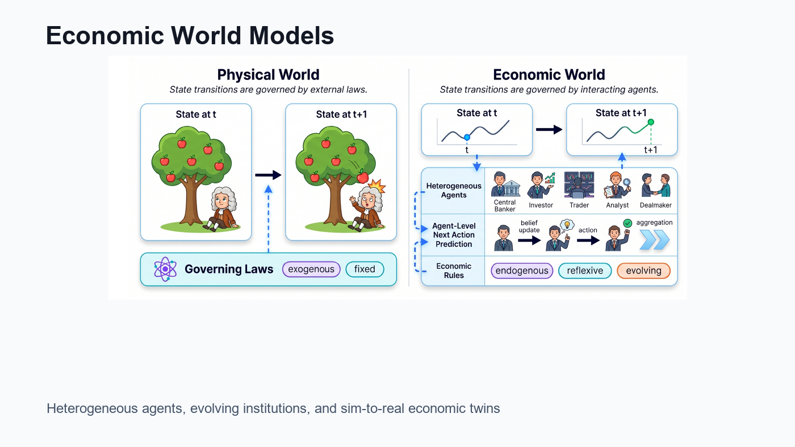

<link rel="stylesheet" href="{{ '/assets/css/project-detail.css' | relative_url }}">

Environment engineering and world models

  Environment engineering
  World models
  Agent societies
  Micro-world simulation
  Executable reasoning

  <a class="impact-action" href="/projects/">Projects Map</a>
  <a class="impact-action secondary" href="/projects/economic-world-models/">Economic World Models</a>
  <a class="impact-action secondary" href="/projects/microverse-world-simulation/">MicroVerse</a>
  <a class="impact-action secondary" href="/projects/twinmarket-financial-simulation/">TwinMarket</a>
  <a class="impact-action secondary" href="https://wabyking.github.io/" target="_blank" rel="noopener">Benyou Wang Papers</a>

  

Environment engineering and world models are about more than a single prompt or a one-off benchmark: they place a task inside an environment that responds, evolves, and can be observed and audited. This line organizes agents, rules, states, tools, users, markets, scientific mechanisms, and evaluators into runnable worlds, used to train models, test behavior, and build policy or system sandboxes, with simulated results aligned to real-world evidence.

<section class="impact-section">
  <h2>Organizing Logic</h2>
  

    

      Spec
      
<strong>Define the environment</strong>
Specify the state space, action interface, external tools, task goals, constraints, observation window, and failure modes, turning a task from static QA into a reproducible interactive system.

    

    

      Actors
      
<strong>Add agents and users</strong>
User simulators, role-playing agents, investors, doctors, patients, or scientific objects can all act inside the environment, exposing multi-turn behavior and social feedback.

    

    

      Dynamics
      
<strong>Model world dynamics</strong>
From financial markets and economic institutions to biological micro-worlds, the core questions are how state changes in response to actions and how hidden mechanisms shape observable outcomes.

    

    

      Align
      
<strong>Evaluate and align with reality</strong>
An environment should record trajectories, explain decisions, compare against real data, and locate deviations, and it should support downstream agent tuning, policy testing, and safety analysis.

    

  

</section>

<section class="impact-section">
  <h2>Paper Trail</h2>
  

    

      World
      
<strong>MicroVerse: A Preliminary Exploration Toward a Micro-World Simulation</strong>
Extends world models to organ, cell, and subcellular processes, emphasizing hidden mechanisms, state evolution, and scientific constraints.
<a href="https://arxiv.org/abs/2603.00585" target="_blank" rel="noopener">Paper</a>

    

    

      Market
      
<strong>TwinMarket: A Scalable Behavioral and Social Simulation for Financial Markets</strong>
Builds a financial-market environment from LLM investors, generating macro-level market behavior from individual beliefs, intentions, and information flow.
<a href="https://arxiv.org/abs/2502.01506" target="_blank" rel="noopener">Paper</a>

    

    

      Economy
      
<strong>From Economic Agents to Agentic Economies</strong>
Proposes a system blueprint for economic world models, organizing agents, environments, co-evolution, and real-world alignment into an implementable architecture.
<a href="/assets/pdf/economic-world-models.pdf" target="_blank" rel="noopener">PDF</a>

    

    

      User
      
<strong>Large Language Model as a User Simulator</strong>
Uses an LLM to build a controllable user environment, giving multi-turn dialogue training and evaluation a repeatable interaction partner.
<a href="https://arxiv.org/abs/2308.11534" target="_blank" rel="noopener">Paper</a>

    

    

      Optimize
      
<strong>ORLM and CALM Before the STORM</strong>
Turns natural-language industrial problems into optimization models, constraints, and executable code, forming a verifiable engineering-modeling environment.
<a href="https://arxiv.org/abs/2405.17743" target="_blank" rel="noopener">ORLM</a> · <a href="https://arxiv.org/abs/2510.04204" target="_blank" rel="noopener">CALM/STORM</a>

    

    

      Execute
      
<strong>CoRT: Code-integrated Reasoning within Thinking</strong>
Connects code execution to the reasoning process, so models can check intermediate computation in a runnable environment rather than emitting only a natural-language reasoning chain.
<a href="https://arxiv.org/abs/2506.09820" target="_blank" rel="noopener">Paper</a>

    

  

</section>

<section class="impact-section">
  <h2>Research Modules</h2>
  

    

      <strong>Interactive environments</strong>
      
User simulation, Socratic dialogue, role-play, and AI standardized patients let models learn from controllable personas and multi-turn feedback.

    

    

      <strong>Social and market environments</strong>
      
TwinMarket and Economic World Models turn financial markets, policy sandboxes, and institutional change into observable multi-agent environments.

    

    

      <strong>Scientific micro-worlds</strong>
      
MicroVerse targets biological and scientific mechanisms, requiring models to understand unseen states, constraints, and dynamics rather than merely generate visual appearances.

    

    

      <strong>Executable engineering environments</strong>
      
ORLM, CALM/STORM, and CoRT connect reasoning to optimization modeling, code execution, and checkers, so answers can be run, verified, and corrected.

    

  

</section>

<section class="impact-section">
  <h2>Related Projects</h2>
  

    

      <strong>Economic World Models</strong>
      
The overview page for economic world models, covering agentic economies, policy sandboxes, the capability ladder, and real-world alignment.

      <a href="/projects/economic-world-models/">Project page</a>
    

    

      <strong>TwinMarket</strong>
      
A behavioral and social multi-agent simulation of financial markets, and a concrete prototype of environment engineering in a market world.

      <a href="/projects/twinmarket-financial-simulation/">Project page</a>
    

    

      <strong>MicroVerse</strong>
      
Extends world models to biological micro-worlds, emphasizing scientific mechanisms, hidden states, and dynamic evolution.

      <a href="/projects/microverse-world-simulation/">Project page</a>
    

    

      <strong>Human-Agent Interaction</strong>
      
Puts user simulation, standardized patients, speech interaction, and social simulation into one interaction-research framework.

      <a href="/projects/human-agent-interaction/">Project page</a>
    

  

</section>

  <a class="impact-action secondary" href="/projects/">Back to Projects</a>

环境工程和世界模型

  环境工程
  世界模型
  智能体社会
  微世界模拟
  可执行推理

  <a class="impact-action" href="/projects/">项目总览</a>
  <a class="impact-action secondary" href="/projects/economic-world-models/">经济世界模型</a>
  <a class="impact-action secondary" href="/projects/microverse-world-simulation/">MicroVerse</a>
  <a class="impact-action secondary" href="/projects/twinmarket-financial-simulation/">TwinMarket</a>
  <a class="impact-action secondary" href="https://wabyking.github.io/" target="_blank" rel="noopener">王本友论文列表</a>

  

环境工程和世界模型关注的不是单个提示词或一次评测，而是如何把任务放进一个会响应、会演化、可观测、可审计的环境里。这个方向把智能体、规则、状态、工具、用户、市场、科学机制和评价器组织成可运行的世界，用来训练模型、测试行为、搭建政策或系统沙盒，并把模拟结果对齐到真实证据。

<section class="impact-section">
  <h2>组织逻辑</h2>
  

    

      设定
      
<strong>定义环境</strong>
明确状态空间、行动接口、外部工具、任务目标、约束、观测窗口和失败模式，让任务从静态问答变成可复现的交互系统。

    

    

      行动者
      
<strong>放入智能体和用户</strong>
用户模拟器、角色扮演智能体、投资者、医生、病人或科学对象都可以成为环境中的行动者，暴露多轮行为和社会反馈。

    

    

      动力学
      
<strong>建模世界动力学</strong>
从金融市场、经济制度到生物微世界，核心是状态如何因行动而变化，以及隐藏机制如何影响可观察结果。

    

    

      对齐
      
<strong>评测与真实对齐</strong>
环境要能记录轨迹、解释决策、比较真实数据、定位偏差，并支持后续的智能体调优、政策测试和安全分析。

    

  

</section>

<section class="impact-section">
  <h2>论文脉络</h2>
  

    

      世界
      
<strong>MicroVerse: A Preliminary Exploration Toward a Micro-World Simulation</strong>
把世界模型推进到器官、细胞和亚细胞过程，强调隐藏机制、状态演化和科学约束。
<a href="https://arxiv.org/abs/2603.00585" target="_blank" rel="noopener">论文</a>

    

    

      市场
      
<strong>TwinMarket: A Scalable Behavioral and Social Simulation for Financial Markets</strong>
用大模型投资者构建金融市场环境，从个体信念、意图和信息流生成宏观市场行为。
<a href="https://arxiv.org/abs/2502.01506" target="_blank" rel="noopener">论文</a>

    

    

      经济
      
<strong>From Economic Agents to Agentic Economies</strong>
提出经济世界模型的系统蓝图，把智能体、环境、共演化和真实世界对齐组织成可实现的架构。
<a href="/assets/pdf/economic-world-models.pdf" target="_blank" rel="noopener">PDF</a>

    

    

      用户
      
<strong>Large Language Model as a User Simulator</strong>
用大模型构造可控的用户环境，为多轮对话训练和评测提供可重复的交互对象。
<a href="https://arxiv.org/abs/2308.11534" target="_blank" rel="noopener">论文</a>

    

    

      优化
      
<strong>ORLM 与 CALM Before the STORM</strong>
把自然语言工业问题转成优化模型、约束和可执行代码，形成可验证的工程建模环境。
<a href="https://arxiv.org/abs/2405.17743" target="_blank" rel="noopener">ORLM</a> · <a href="https://arxiv.org/abs/2510.04204" target="_blank" rel="noopener">CALM/STORM</a>

    

    

      执行
      
<strong>CoRT: Code-integrated Reasoning within Thinking</strong>
把代码执行接入推理过程，让模型在可运行环境中检查中间计算，而不是只输出自然语言推理链。
<a href="https://arxiv.org/abs/2506.09820" target="_blank" rel="noopener">论文</a>

    

  

</section>

<section class="impact-section">
  <h2>研究模块</h2>
  

    

      <strong>交互环境</strong>
      
用户模拟、苏格拉底式对话、角色扮演和 AI 标准化病人，让模型在可控人物和多轮反馈里学习。

    

    

      <strong>社会与市场环境</strong>
      
TwinMarket 和经济世界模型让金融市场、政策沙盒和制度变化成为可观测的多智能体环境。

    

    

      <strong>科学微世界</strong>
      
MicroVerse 面向生物和科学机制，要求模型理解看不见的状态、约束和动态，而不只是生成视觉表象。

    

    

      <strong>可执行工程环境</strong>
      
ORLM、CALM/STORM 和 CoRT 把推理连接到优化建模、代码执行和检查器，让答案可以运行、验证和修正。

    

  

</section>

<section class="impact-section">
  <h2>相关项目</h2>
  

    

      <strong>经济世界模型</strong>
      
经济世界模型的总览页，覆盖智能体经济、政策沙盒、能力阶梯和真实世界对齐。

      <a href="/projects/economic-world-models/">项目页面</a>
    

    

      <strong>TwinMarket</strong>
      
金融市场中的行为和社会多智能体模拟，是环境工程在市场世界中的具体原型。

      <a href="/projects/twinmarket-financial-simulation/">项目页面</a>
    

    

      <strong>MicroVerse</strong>
      
把世界模型拓展到生物微世界，强调科学机制、隐藏状态和动态演化。

      <a href="/projects/microverse-world-simulation/">项目页面</a>
    

    

      <strong>人机交互</strong>
      
把用户模拟、标准化病人、语音交互和社会模拟放进同一个交互研究框架。

      <a href="/projects/human-agent-interaction/">项目页面</a>
    

  

</section>

  <a class="impact-action secondary" href="/projects/">返回项目页</a>

