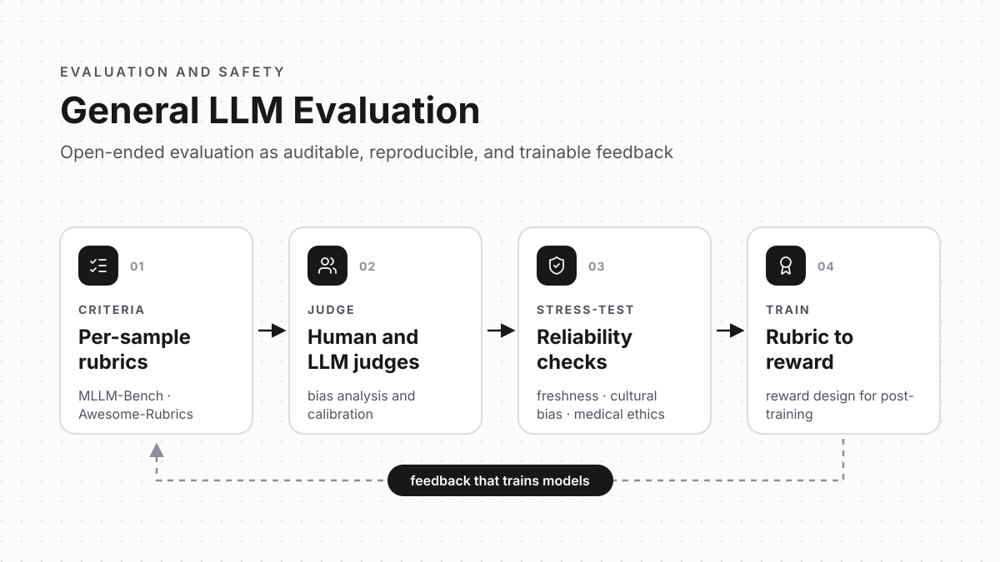
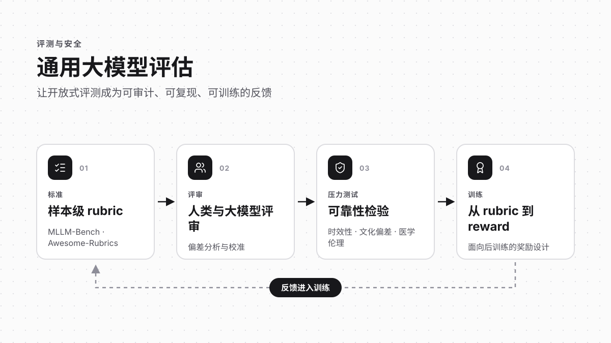

<link rel="stylesheet" href="{{ '/assets/css/project-detail.css' | relative_url }}">

Rubrics, judges, freshness, bias, ethics, and rewards

  General LLM Evaluation
  Rubric-based evaluation
  LLM-as-a-judge
  Responsible AI
  Reward design

  <a class="impact-action" href="https://github.com/FreedomIntelligence/Awesome-Rubrics" target="_blank" rel="noopener">Awesome-Rubrics</a>
  <a class="impact-action secondary" href="https://github.com/FreedomIntelligence/MLLM-Bench" target="_blank" rel="noopener">MLLM-Bench</a>
  <a class="impact-action secondary" href="https://github.com/FreedomIntelligence/FreshBench" target="_blank" rel="noopener">FreshBench</a>
  <a class="impact-action secondary" href="https://github.com/FreedomIntelligence/PrinciplismQA" target="_blank" rel="noopener">PrinciplismQA</a>
  <a class="impact-action secondary" href="/projects/">All Projects</a>

  

General LLM evaluation treats rubric-based evaluation, LLM-as-a-judge, trustworthy evaluation, responsible AI, and reward design as one connected line of work. Its goal is not to pile up another leaderboard, but to turn open-ended outputs, subjective quality, freshness, cultural differences, ethical principles, and expert standards into evaluation signals that are auditable, reproducible, and trainable.

<section class="impact-section">
  <h2>Research Storyline</h2>
  

    

      Criteria
      
<strong>Move from right-or-wrong answers to per-sample criteria</strong>
MLLM-Bench organizes multimodal evaluation around per-sample criteria, stressing that a judge needs to know exactly what to look at in each sample.

    

    

      Judge
      
<strong>Calibrate LLM-as-a-judge</strong>
"Humans or LLMs as the Judge?" exposes biases in both human and model judges, moving automatic evaluation from merely convenient to quality-controlled.

    

    

      Trust
      
<strong>Evaluate real deployment risks</strong>
FreshBench, Culture Bias, and PrinciplismQA address outdated knowledge, cross-cultural bias, and clinical medical ethics respectively, extending evaluation to the boundaries where models can do real harm.

    

    

      Reward
      
<strong>Turn evaluation signals into training signals</strong>
Awesome-Rubrics organizes rubrics into a unified interface for evaluation, alignment, reward modeling, and post-training.

    

  

</section>

<section class="impact-section">
  <h2>Representative Work</h2>
  

    

      Rubric
      
<strong>Awesome-Rubrics</strong>
A curated reading list and survey around rubric-based evaluation, reward modeling, alignment, and agentic AI.
<a href="https://github.com/FreedomIntelligence/Awesome-Rubrics" target="_blank" rel="noopener">Repository</a>

    

    

      MLLM
      
<strong>MLLM-Bench: Evaluating Multimodal LLMs with Per-sample Criteria</strong>
Uses per-sample criteria to make multimodal evaluation more explicit and judgeable.
<a href="https://aclanthology.org/2025.naacl-long.256/" target="_blank" rel="noopener">Paper</a>

    

    

      Judge
      
<strong>Humans or LLMs as the Judge? A Study on Judgement Biases</strong>
Studies judgement bias in human and LLM evaluators, a core issue for automated evaluation.
<a href="https://arxiv.org/abs/2402.10669" target="_blank" rel="noopener">Paper</a>

    

    

      Fresh
      
<strong>FreshBench: Is Your LLM Outdated?</strong>
Tests temporal generalization and whether models remain reliable as the world changes.
<a href="https://github.com/FreedomIntelligence/FreshBench" target="_blank" rel="noopener">Repository</a>

    

    

      Culture
      
<strong>From Word to World</strong>
Evaluates and mitigates culture bias through an LLM-adaptive word association test.
<a href="https://arxiv.org/abs/2505.18562" target="_blank" rel="noopener">Paper</a>

    

    

      Ethics
      
<strong>PrinciplismQA</strong>
Assesses clinical medical ethics alignment with expert-validated MCQA, open-ended cases, and rubric keypoints.
<a href="https://github.com/FreedomIntelligence/PrinciplismQA" target="_blank" rel="noopener">Repository</a>

    

  

</section>

<section class="impact-section">
  <h2>What This Direction Adds</h2>
  

    

      <strong>Evaluation as infrastructure</strong>
      
Rubrics, judges, criteria, calibration, and reliability checks become reusable infrastructure for many domains.

    

    

      <strong>Evaluation as alignment signal</strong>
      
Structured feedback can supervise SFT, preference tuning, reward modeling, RL, and self-improvement loops.

    

    

      <strong>Evaluation as risk lens</strong>
      
Freshness, culture, ethics, safety, and expert standards expose failures that ordinary accuracy scores miss.

    

  

</section>

  <a class="impact-action secondary" href="/projects/">Back to Projects</a>

rubric、评委、时效性、偏差、伦理与奖励

  通用大模型评估
  基于 rubric 的评测
  LLM-as-a-judge
  负责任 AI
  奖励设计

  <a class="impact-action" href="https://github.com/FreedomIntelligence/Awesome-Rubrics" target="_blank" rel="noopener">Awesome-Rubrics</a>
  <a class="impact-action secondary" href="https://github.com/FreedomIntelligence/MLLM-Bench" target="_blank" rel="noopener">MLLM-Bench</a>
  <a class="impact-action secondary" href="https://github.com/FreedomIntelligence/FreshBench" target="_blank" rel="noopener">FreshBench</a>
  <a class="impact-action secondary" href="https://github.com/FreedomIntelligence/PrinciplismQA" target="_blank" rel="noopener">PrinciplismQA</a>
  <a class="impact-action secondary" href="/projects/">全部项目</a>

  

通用大模型评估把基于 rubric 的评测、LLM-as-a-judge、可信评测、负责任 AI 和奖励设计放在同一条线上。它的目标不是再堆一个榜单，而是把开放式输出、主观质量、时效性、文化差异、伦理原则和专家标准变成可审计、可复现、可训练的评测信号。

<section class="impact-section">
  <h2>研究脉络</h2>
  

    

      标准
      
<strong>从答案对错走向样本级标准</strong>
MLLM-Bench 用样本级标准组织多模态评测，强调评委需要知道每个样本到底该看什么。

    

    

      评委
      
<strong>校准 LLM-as-a-judge</strong>
“Humans or LLMs as the Judge?”暴露了人类和模型评委的偏差，让自动评测从“方便”走向“可质控”。

    

    

      可信
      
<strong>评估真实部署风险</strong>
FreshBench、Culture Bias 和 PrinciplismQA 分别处理过时知识、跨文化偏差和临床医学伦理，让评测覆盖模型真正会伤人的边界。

    

    

      奖励
      
<strong>把评测信号变成训练信号</strong>
Awesome-Rubrics 将 rubric 组织成评测、对齐、奖励建模和后训练的统一接口。

    

  

</section>

<section class="impact-section">
  <h2>代表性工作</h2>
  

    

      Rubric
      
<strong>Awesome-Rubrics</strong>
精选阅读清单与综述，涵盖基于 rubric 的评测、奖励建模、对齐和智能体 AI。
<a href="https://github.com/FreedomIntelligence/Awesome-Rubrics" target="_blank" rel="noopener">代码仓库</a>

    

    

      多模态
      
<strong>MLLM-Bench: Evaluating Multimodal LLMs with Per-sample Criteria</strong>
用样本级标准让多模态评测更明确，也更易于评判。
<a href="https://aclanthology.org/2025.naacl-long.256/" target="_blank" rel="noopener">论文</a>

    

    

      评委
      
<strong>Humans or LLMs as the Judge? A Study on Judgement Biases</strong>
研究人类评委与大模型评委的判断偏差，这是自动评测的核心问题。
<a href="https://arxiv.org/abs/2402.10669" target="_blank" rel="noopener">论文</a>

    

    

      时效
      
<strong>FreshBench: Is Your LLM Outdated?</strong>
检验模型的时间泛化能力，以及世界变化后它是否依然可靠。
<a href="https://github.com/FreedomIntelligence/FreshBench" target="_blank" rel="noopener">代码仓库</a>

    

    

      文化
      
<strong>From Word to World</strong>
通过适配大模型的词语联想测试，评测并缓解文化偏差。
<a href="https://arxiv.org/abs/2505.18562" target="_blank" rel="noopener">论文</a>

    

    

      伦理
      
<strong>PrinciplismQA</strong>
用经专家验证的选择题、开放式案例和 rubric 要点，评估模型与临床医学伦理的对齐程度。
<a href="https://github.com/FreedomIntelligence/PrinciplismQA" target="_blank" rel="noopener">代码仓库</a>

    

  

</section>

<section class="impact-section">
  <h2>这一方向的贡献</h2>
  

    

      <strong>评测即基础设施</strong>
      
rubric、评委、评价标准、校准和可靠性检验，成为可复用于多个领域的基础设施。

    

    

      <strong>评测即对齐信号</strong>
      
结构化反馈可以监督 SFT、偏好调优、奖励建模、强化学习和自我改进循环。

    

    

      <strong>评测即风险视角</strong>
      
时效性、文化、伦理、安全和专家标准，能暴露准确率等常规分数遗漏的失败情形。

    

  

</section>

  <a class="impact-action secondary" href="/projects/">返回项目页</a>

