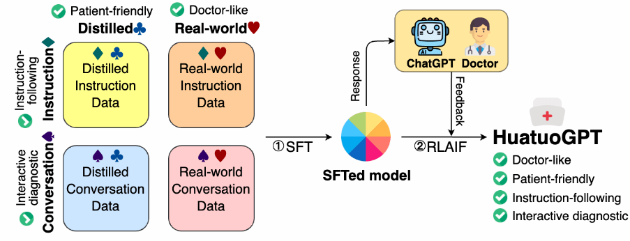

<link rel="stylesheet" href="{{ '/assets/css/project-detail.css' | relative_url }}">

Medical LLM adaptation

  HuatuoGPT-II
  One-stage training
  Medical adaptation
  Chinese medical QA

  <a class="impact-action" href="https://github.com/FreedomIntelligence/HuatuoGPT-II" target="_blank" rel="noopener">GitHub</a>
  <a class="impact-action secondary" href="https://huggingface.co/FreedomIntelligence/HuatuoGPT2-34B" target="_blank" rel="noopener">34B model</a>
  <a class="impact-action secondary" href="https://huggingface.co/FreedomIntelligence/HuatuoGPT2-7B" target="_blank" rel="noopener">7B model</a>
  <a class="impact-action secondary" href="https://arxiv.org/abs/2311.09774" target="_blank" rel="noopener">Paper</a>

  

HuatuoGPT-II studies how to adapt large language models to medicine with a cleaner one-stage training recipe, reducing pipeline complexity while preserving strong medical instruction-following and exam-style performance.

<section class="impact-section">
  <h2>Storyline</h2>
  

    

      Before
      
<strong>Medical adaptation was often multi-stage</strong>
Early medical LLM pipelines mixed domain corpora, instruction tuning, and dialogue alignment in separate steps, which made reproduction and ablation harder.

    

    

      Recipe
      
<strong>Unify the training format</strong>
HuatuoGPT-II asks whether medical ability can be learned through a cleaner one-stage format that combines medical instructions and general dialogue behavior.

    

    

      Reuse
      
<strong>Release checkpoints and SFT data</strong>
The 7B/34B checkpoints and HuatuoGPT2-SFT-GPT4-140K data turn the idea into a reusable baseline for later medical reasoning and vision work.

    

  

</section>

<section class="impact-section">
  <h2>Core Idea</h2>
  

    

      <strong>One unified format</strong>
      
Training examples are organized so general instruction following and medical domain adaptation can be learned together rather than through brittle multi-stage handoffs.

    

    

      <strong>Domain-specific supervision</strong>
      
The system uses curated medical QA and GPT-assisted medical SFT data to teach medical language, clinical question answering, and medical dialogue behavior.

    

    

      <strong>Open checkpoints</strong>
      
HuatuoGPT2-7B and HuatuoGPT2-34B provide reusable model checkpoints for downstream research and comparison.

    

  

</section>

<section class="impact-section">
  <h2>Display Figures</h2>
  

    <figure>
      
      <figcaption>Automatic evaluation and medical QA testing make the adaptation recipe measurable.</figcaption>
    </figure>
    <figure>
      
      <figcaption>HuatuoGPT-II sits between the original HuatuoGPT dialogue model and later reasoning/vision extensions.</figcaption>
    </figure>
  

</section>

<section class="impact-section">
  <h2>Project Outputs</h2>
  

    

      <strong>HuatuoGPT-II code</strong>
      
Training, evaluation, and release notes for the one-stage medical adaptation approach.

      <a href="https://github.com/FreedomIntelligence/HuatuoGPT-II" target="_blank" rel="noopener">Repository</a>
    

    

      <strong>HuatuoGPT2-SFT-GPT4-140K</strong>
      
A medical SFT dataset connected to the HuatuoGPT-II training pipeline.

      <a href="https://huggingface.co/datasets/FreedomIntelligence/HuatuoGPT2-SFT-GPT4-140K" target="_blank" rel="noopener">Dataset</a>
    

    

      <strong>HuatuoGPT2 models</strong>
      
Open Hugging Face checkpoints for Chinese medical language modeling and medical QA experiments.

      <a href="https://huggingface.co/FreedomIntelligence/HuatuoGPT2-34B" target="_blank" rel="noopener">Model</a>
    

  

</section>

<section class="impact-section">
  <h2>Paper Trail</h2>
  

    

      Origin
      
<strong>HuatuoGPT, towards Taming Language Model to Be a Doctor</strong>
Defines the medical dialogue direction and shows why domain data matters for Chinese medical QA.
<a href="https://github.com/FreedomIntelligence/HuatuoGPT" target="_blank" rel="noopener">HuatuoGPT</a>

    

    

      Adapt
      
<strong>HuatuoGPT-II, One-stage Training for Medical Adaption of LLMs</strong>
The focused contribution: simpler one-stage medical adaptation with released checkpoints and SFT data.
<a href="https://arxiv.org/abs/2311.09774" target="_blank" rel="noopener">Paper</a>

    

    

      Next
      
<strong>HuatuoGPT-o1 and HuatuoGPT-Vision</strong>
Later projects reuse the medical model stack for complex reasoning and medical multimodal understanding.
<a href="/projects/medical-ai-ecosystem/">Full ecosystem</a>

    

  

</section>

<section class="impact-section">
  <h2>Where It Fits</h2>
  

HuatuoGPT-II is the practical adaptation layer inside the broader HuatuoGPT ecosystem. HuatuoGPT starts the open medical dialogue agenda, HuatuoGPT-II simplifies medical adaptation, HuatuoGPT-o1 pushes complex reasoning, and HuatuoGPT-Vision expands the stack to multimodal medical knowledge.
  

</section>

医疗大模型适配

  HuatuoGPT-II
  单阶段训练
  医学适配
  中文医学问答

  <a class="impact-action" href="https://github.com/FreedomIntelligence/HuatuoGPT-II" target="_blank" rel="noopener">GitHub</a>
  <a class="impact-action secondary" href="https://huggingface.co/FreedomIntelligence/HuatuoGPT2-34B" target="_blank" rel="noopener">34B 模型</a>
  <a class="impact-action secondary" href="https://huggingface.co/FreedomIntelligence/HuatuoGPT2-7B" target="_blank" rel="noopener">7B 模型</a>
  <a class="impact-action secondary" href="https://arxiv.org/abs/2311.09774" target="_blank" rel="noopener">论文</a>

  

HuatuoGPT-II 研究如何用更简洁的单阶段训练方案让大模型适配医学领域，在降低流程复杂度的同时，保持较强的医学指令遵循能力和考试类评测表现。

<section class="impact-section">
  <h2>研究脉络</h2>
  

    

      此前
      
<strong>医学适配往往分多个阶段</strong>
早期医疗大模型的训练流程把领域语料、指令微调和对话对齐分成几个独立步骤，不易复现，也不便做消融实验。

    

    

      方案
      
<strong>统一训练格式</strong>
HuatuoGPT-II 探讨能否用更简洁的单阶段格式学会医学能力，把医学指令与通用对话行为放在一起训练。

    

    

      复用
      
<strong>发布模型权重和 SFT 数据</strong>
7B/34B 模型权重和 HuatuoGPT2-SFT-GPT4-140K 数据把这一思路变成可复用的基线，供后续的医学推理和视觉工作使用。

    

  

</section>

<section class="impact-section">
  <h2>核心思路</h2>
  

    

      <strong>统一格式</strong>
      
训练样本经过统一组织，使通用指令遵循和医学领域适配可以一起学习，而不必依赖脆弱的多阶段衔接。

    

    

      <strong>医学领域监督</strong>
      
系统使用精选的医学问答数据和借助 GPT 构建的医学 SFT 数据，教模型医学语言、临床问答和医学对话行为。

    

    

      <strong>开放模型权重</strong>
      
HuatuoGPT2-7B 和 HuatuoGPT2-34B 提供可复用的模型权重，供下游研究和对比使用。

    

  

</section>

<section class="impact-section">
  <h2>图示</h2>
  

    <figure>
      
      <figcaption>自动评测和医学问答测试，让这套适配方案的效果可以衡量。</figcaption>
    </figure>
    <figure>
      
      <figcaption>HuatuoGPT-II 位于最初的 HuatuoGPT 对话模型与后续推理、视觉扩展之间。</figcaption>
    </figure>
  

</section>

<section class="impact-section">
  <h2>项目成果</h2>
  

    

      <strong>HuatuoGPT-II 代码</strong>
      
单阶段医学适配方法的训练、评测和发布说明。

      <a href="https://github.com/FreedomIntelligence/HuatuoGPT-II" target="_blank" rel="noopener">代码仓库</a>
    

    

      <strong>HuatuoGPT2-SFT-GPT4-140K</strong>
      
与 HuatuoGPT-II 训练流程配套的医学 SFT 数据集。

      <a href="https://huggingface.co/datasets/FreedomIntelligence/HuatuoGPT2-SFT-GPT4-140K" target="_blank" rel="noopener">数据集</a>
    

    

      <strong>HuatuoGPT2 模型</strong>
      
Hugging Face 上开放的模型权重，可用于中文医学语言建模和医学问答实验。

      <a href="https://huggingface.co/FreedomIntelligence/HuatuoGPT2-34B" target="_blank" rel="noopener">模型</a>
    

  

</section>

<section class="impact-section">
  <h2>论文脉络</h2>
  

    

      起点
      
<strong>HuatuoGPT, towards Taming Language Model to Be a Doctor</strong>
确立医疗对话方向，并说明领域数据为何对中文医学问答至关重要。
<a href="https://github.com/FreedomIntelligence/HuatuoGPT" target="_blank" rel="noopener">HuatuoGPT</a>

    

    

      适配
      
<strong>HuatuoGPT-II, One-stage Training for Medical Adaption of LLMs</strong>
本项目的核心贡献：更简洁的单阶段医学适配，并发布模型权重和 SFT 数据。
<a href="https://arxiv.org/abs/2311.09774" target="_blank" rel="noopener">论文</a>

    

    

      后续
      
<strong>HuatuoGPT-o1 与 HuatuoGPT-Vision</strong>
后续项目沿用这套医疗模型技术栈，用于复杂推理和医学多模态理解。
<a href="/projects/medical-ai-ecosystem/">完整生态</a>

    

  

</section>

<section class="impact-section">
  <h2>在生态中的位置</h2>
  

HuatuoGPT-II 是整个华佗GPT 生态中偏实用的适配层。HuatuoGPT 开启了开放的医疗对话研究，HuatuoGPT-II 简化了医学适配，HuatuoGPT-o1 推进复杂推理，HuatuoGPT-Vision 则把技术栈扩展到多模态医学知识。
  

</section>

