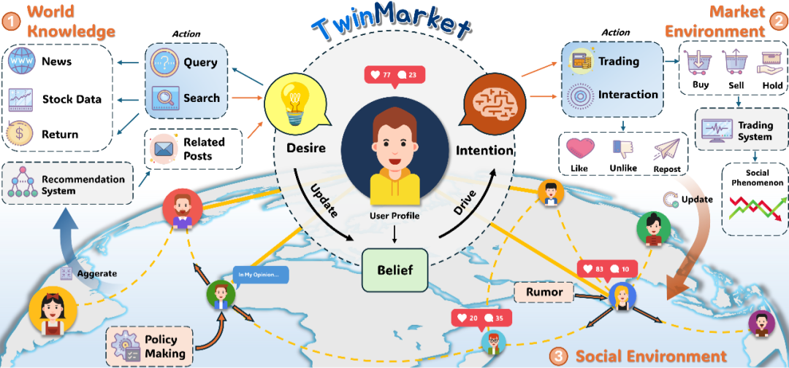
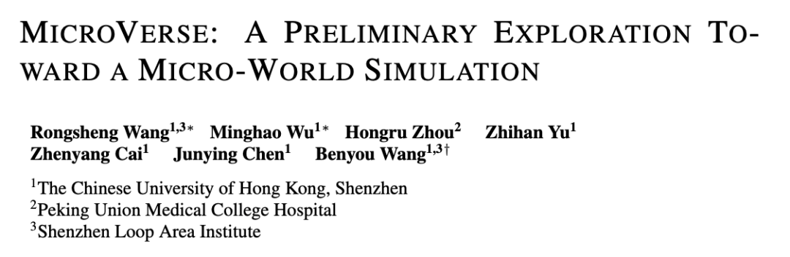
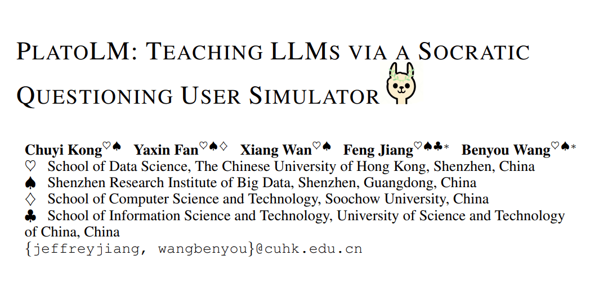

<link rel="stylesheet" href="{{ '/assets/css/project-detail.css' | relative_url }}">

Human-agent interaction

  User simulation
  AI standardized patients
  Multi-agent markets
  Micro-world simulation
  Speech interaction

  <a class="impact-action" href="/projects/economic-world-models/">Economic World Models</a>
  <a class="impact-action secondary" href="/projects/twinmarket-financial-simulation/">TwinMarket</a>
  <a class="impact-action secondary" href="/projects/microverse-world-simulation/">MicroVerse</a>
  <a class="impact-action secondary" href="/projects/medical-education-standardized-patients/">AI Patients</a>
  <a class="impact-action secondary" href="/projects/">All Projects</a>

  

Human-agent interaction is the connective tissue between model capability and real deployment. This project line studies agents that interact with people, learners, patients, investors, speech partners, and simulated worlds, where behavior unfolds over time rather than in a single static prompt.

<section class="impact-section">
  <h2>Background and Motivation</h2>
  

    

      <strong>Static benchmarks miss interaction</strong>
      
Many failures only appear after several turns: users change goals, agents adapt, environments respond, and earlier decisions constrain later ones.

    

    

      <strong>Human-facing agents need social realism</strong>
      
Medical learners, investors, patients, and speech users bring beliefs, emotions, incentives, and incomplete information into the loop.

    

    

      <strong>Simulation creates safe testbeds</strong>
      
Before deploying agents in clinics, markets, classrooms, or social settings, we can study them in controlled and instrumented environments.

    

  

</section>

<section class="impact-section">
  <h2>Research Storyline</h2>
  

    

      User
      
<strong>Simulate users for dialogue learning</strong>
LLM user simulators and Socratic questioning systems generate interactive training environments for multi-turn dialogue.

    

    

      Patient
      
<strong>Turn AI into a medical learning partner</strong>
AI standardized patients support repeatable practice in history taking, communication, and clinical reasoning.

    

    

      Society
      
<strong>Study multi-agent social and market behavior</strong>
TwinMarket and Economic World Models use agent societies to examine emergent markets, policy sandboxes, and collective risk.

    

    

      World
      
<strong>Build environments where state evolves</strong>
MicroVerse extends interaction to scientific worlds, where agents must reason about hidden mechanisms and changing biological states.

    

  

</section>

<section class="impact-section">
  <h2>Project Clusters</h2>
  

    

      <strong>Dialogue and user simulation</strong>
      
Large Language Model as a User Simulator and PlatoLM study how simulated users can teach, probe, and improve dialogue models.

    

    

      <strong>Medical education agents</strong>
      
EasyMED and AI standardized patients connect human-agent interaction with medical training and learner-centered evaluation.

    

    

      <strong>Agentic markets and economies</strong>
      
TwinMarket and Economic World Models make multi-agent interaction observable at social, financial, and policy scale.

    

    

      <strong>Speech and embodied interaction</strong>
      
S2S-Arena, EchoMind, and speech-to-speech Turing tests examine whether agents can interact naturally through voice and paralinguistic signals.

    

  

</section>

<section class="impact-section">
  <h2>Typical Work</h2>
  

    

      Dialogue
      
<strong>Large Language Model as a User Simulator</strong>
Uses LLMs to simulate users and generate interactive training or evaluation data for dialogue systems.
<a href="https://arxiv.org/abs/2308.11534" target="_blank" rel="noopener">Paper</a>

    

    

      Learning
      
<strong>PlatoLM and Socratic user simulation</strong>
Studies Socratic questioning as a way to teach multi-turn dialogue behavior through simulated interaction.
<a href="https://openreview.net/forum?id=9nddtu94uX" target="_blank" rel="noopener">Paper</a>

    

    

      Markets
      
<strong>TwinMarket</strong>
Builds a scalable behavioral and social simulation for financial markets with LLM-based investor agents.
<a href="/projects/twinmarket-financial-simulation/">Project page</a>

    

    

      Worlds
      
<strong>MicroVerse</strong>
Explores micro-world simulation where visible phenomena depend on hidden scientific mechanisms and evolving states.
<a href="/projects/microverse-world-simulation/">Project page</a>

    

  

</section>

<section class="impact-section">
  <h2>Display Figures</h2>
  

    <figure>
      
      <figcaption>TwinMarket models investors as agents with beliefs, desires, intentions, and market-facing actions.</figcaption>
    </figure>
    <figure>
      
      <figcaption>MicroVerse shifts interaction from social dialogue to scientific environments with hidden mechanisms.</figcaption>
    </figure>
    <figure>
      
      <figcaption>Dialogue, education, and speech projects share a common loop: simulate, interact, evaluate, and improve.</figcaption>
    </figure>
  

</section>

<section class="impact-section">
  <h2>Resource Map</h2>
  

    

      <strong>Economic World Models</strong>
      
Umbrella project for agentic economies, policy sandboxes, and self-correcting economic twins.

      <a href="/projects/economic-world-models/">Project page</a>
    

    

      <strong>Medical Education and AI Patients</strong>
      
AI standardized patient project for repeatable and benchmarked medical learning scenarios.

      <a href="/projects/medical-education-standardized-patients/">Project page</a>
    

    

      <strong>Speech, Audio, and Talking-Head AI</strong>
      
Voice, paralinguistic, empathy, and embodied interaction benchmarks and datasets.

      <a href="/projects/speech-audio-talking-head-ai/">Project page</a>
    

  

</section>

  <a class="impact-action secondary" href="/projects/">Back to Projects</a>

人机交互

  用户模拟
  AI 标准化病人
  多智能体市场
  微观世界模拟
  语音交互

  <a class="impact-action" href="/projects/economic-world-models/">经济世界模型</a>
  <a class="impact-action secondary" href="/projects/twinmarket-financial-simulation/">TwinMarket</a>
  <a class="impact-action secondary" href="/projects/microverse-world-simulation/">MicroVerse</a>
  <a class="impact-action secondary" href="/projects/medical-education-standardized-patients/">AI 病人</a>
  <a class="impact-action secondary" href="/projects/">全部项目</a>

  

人机交互是连接模型能力与真实部署的纽带。这一研究方向关注与用户、学习者、病人、投资者、语音对话者以及模拟世界交互的智能体。在这些场景中，行为随时间逐步展开，而不是局限于一条静态提示。

<section class="impact-section">
  <h2>背景与动机</h2>
  

    

      <strong>静态基准看不到交互</strong>
      
许多失败要在几轮交互之后才显现：用户会改变目标，智能体会调整策略，环境会作出反馈，早先的决策还会限制后面的选择。

    

    

      <strong>与人打交道的智能体需要社会真实感</strong>
      
医学学习者、投资者、病人和语音用户，会把各自的信念、情绪、动机和不完整的信息带进交互之中。

    

    

      <strong>模拟提供安全的测试环境</strong>
      
在把智能体部署到诊所、市场、课堂或社会场景之前，我们可以先在可控、可观测的环境中研究它们。

    

  

</section>

<section class="impact-section">
  <h2>研究脉络</h2>
  

    

      用户
      
<strong>模拟用户，学习对话</strong>
大模型用户模拟器和苏格拉底式提问系统，为多轮对话生成交互式的训练环境。

    

    

      病人
      
<strong>让 AI 成为医学学习伙伴</strong>
AI 标准化病人支持反复练习问诊、沟通和临床推理。

    

    

      社会
      
<strong>研究多智能体的社会与市场行为</strong>
TwinMarket 和经济世界模型借助智能体社会，考察涌现的市场现象、政策沙盒与集体风险。

    

    

      世界
      
<strong>构建状态会演化的环境</strong>
MicroVerse 把交互拓展到科学世界：智能体需要推理隐藏机制和不断变化的生物状态。

    

  

</section>

<section class="impact-section">
  <h2>项目分组</h2>
  

    

      <strong>对话与用户模拟</strong>
      
Large Language Model as a User Simulator 和 PlatoLM 研究如何用模拟用户来教导、检验并改进对话模型。

    

    

      <strong>医学教育智能体</strong>
      
EasyMED 和 AI 标准化病人把人机交互与医学培训、以学习者为中心的评测结合起来。

    

    

      <strong>智能体市场与经济</strong>
      
TwinMarket 和经济世界模型让多智能体交互在社会、金融和政策层面都变得可观测。

    

    

      <strong>语音与具身交互</strong>
      
S2S-Arena、EchoMind 和语音到语音图灵测试，考察智能体能否通过声音和副语言信号自然地交互。

    

  

</section>

<section class="impact-section">
  <h2>代表性工作</h2>
  

    

      对话
      
<strong>Large Language Model as a User Simulator</strong>
用大模型模拟用户，为对话系统生成交互式的训练或评测数据。
<a href="https://arxiv.org/abs/2308.11534" target="_blank" rel="noopener">论文</a>

    

    

      学习
      
<strong>PlatoLM 与苏格拉底式用户模拟</strong>
研究如何通过模拟交互，用苏格拉底式提问教会模型多轮对话行为。
<a href="https://openreview.net/forum?id=9nddtu94uX" target="_blank" rel="noopener">论文</a>

    

    

      市场
      
<strong>TwinMarket</strong>
用大模型驱动的投资者智能体，构建可扩展的金融市场行为与社会模拟。
<a href="/projects/twinmarket-financial-simulation/">项目主页</a>

    

    

      世界
      
<strong>MicroVerse</strong>
探索微观世界模拟：可见的现象取决于隐藏的科学机制和不断演化的状态。
<a href="/projects/microverse-world-simulation/">项目主页</a>

    

  

</section>

<section class="impact-section">
  <h2>图示</h2>
  

    <figure>
      
      <figcaption>TwinMarket 把投资者建模为具有信念、愿望、意图和市场行动的智能体。</figcaption>
    </figure>
    <figure>
      
      <figcaption>MicroVerse 把交互从社会性对话推向带有隐藏机制的科学环境。</figcaption>
    </figure>
    <figure>
      
      <figcaption>对话、教育和语音类项目有一个共同的循环：模拟、交互、评测、改进。</figcaption>
    </figure>
  

</section>

<section class="impact-section">
  <h2>资源导航</h2>
  

    

      <strong>经济世界模型</strong>
      
面向智能体经济、政策沙盒和可自我校正的经济孪生体的总览项目。

      <a href="/projects/economic-world-models/">项目主页</a>
    

    

      <strong>医学教育与 AI 病人</strong>
      
AI 标准化病人项目，提供可反复练习、有评测基准支撑的医学学习场景。

      <a href="/projects/medical-education-standardized-patients/">项目主页</a>
    

    

      <strong>语音、音频与说话人视频 AI</strong>
      
语音、副语言、共情和具身交互方面的评测基准与数据集。

      <a href="/projects/speech-audio-talking-head-ai/">项目主页</a>
    

  

</section>

  <a class="impact-action secondary" href="/projects/">返回项目页</a>

