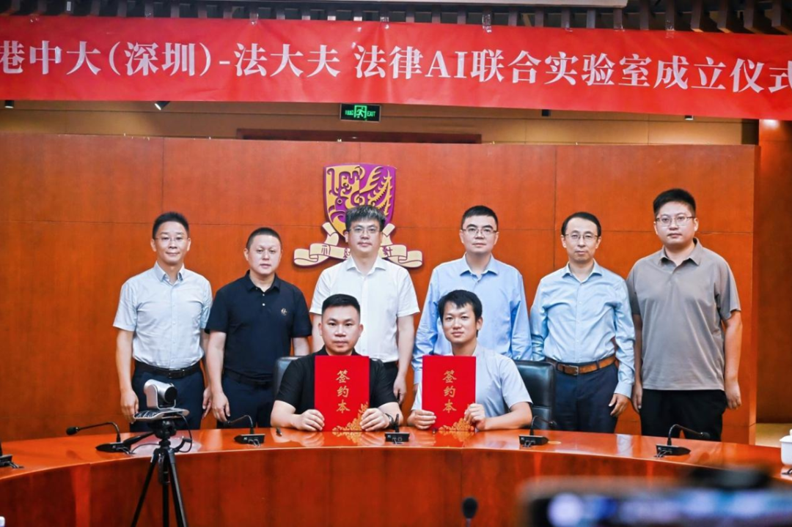
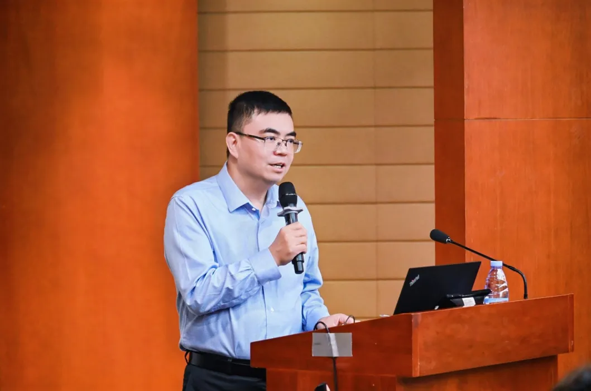
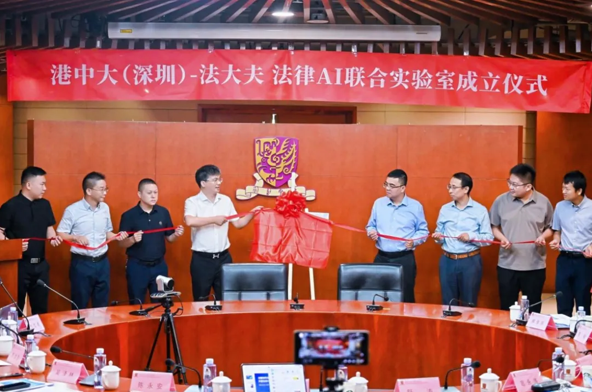

<link rel="stylesheet" href="{{ '/assets/css/project-detail.css' | relative_url }}">

Legal foundation models to Legal AI within a Loop

  HanFei-1.0UCL-BenchLegal-R1GenArtIDLegal AgentsLoop Engineering

  <a class="impact-action" href="https://github.com/siat-nlp/HanFei" target="_blank" rel="noopener">HanFei</a>
  <a class="impact-action secondary" href="https://aclanthology.org/2025.findings-naacl.444/" target="_blank" rel="noopener">UCL-Bench</a>
  <a class="impact-action secondary" href="https://openreview.net/forum?id=2Oe3FRRcVQ" target="_blank" rel="noopener">Legal-R1</a>
  <a class="impact-action secondary" href="https://openreview.net/forum?id=SJcpGTx0Ag" target="_blank" rel="noopener">GenArtID</a>

<strong>The team has built a systematic Legal AI foundation spanning domain-model training, real-user evaluation, legal knowledge retrieval, and agentic evidence-based reasoning.</strong> The research has evolved from training a Chinese legal model to connecting models, legal databases, tools, benchmarks, and lawyer workflows in a continuously improving closed loop.

<section class="impact-section">
  <h2>Research Evolution</h2>
  

    
Model
<strong>HanFei-1.0: build legal domain capability</strong>
A 7B Chinese legal model trained on approximately 60 GB of cases, statutes, complaints, and legal news, supporting legal question answering, dialogue, and document generation.

    
User
<strong>UCL-Bench: evaluate what legal professionals need</strong>
Moves from knowledge-centric legal exams to user-centric evaluation with five legal scenarios and 22 tasks grounded in surveys and validation by legal professionals.

    
Retrieve
<strong>GenArtID: generate statutory identifiers</strong>
Reframes legal retrieval as direct prediction of relevant article identifiers, connecting a legal question to structured statutory memory instead of relying only on embedding similarity.

    
Agent
<strong>Legal-R1: retrieve evidence while reasoning</strong>
Extends one-shot RAG into a Think → Retrieve → Rethink → Retrieve → Answer process that actively identifies missing evidence and revises reasoning.

    
Loop
<strong>Legal AI within a Loop</strong>
Connect real lawyer use, expert edits, data accumulation, benchmark updates, and model training into a sustainable improvement cycle.

  

</section>

<section class="impact-section">
  <h2>Four Research Foundations</h2>
  

    
2023
<strong>HanFei-1.0</strong>
Early full-parameter Chinese legal LLM work covering corpus construction, continual pre-training, instruction tuning, and deployment.
<a href="https://github.com/siat-nlp/HanFei" target="_blank" rel="noopener">Repository</a>

    
NAACL
<strong>UCL-Bench: A Chinese User-Centric Legal Benchmark</strong>
Findings of NAACL 2025, pp. 7960–8003. It asks whether a model can complete the work legal professionals actually need.
<a href="https://aclanthology.org/2025.findings-naacl.444/" target="_blank" rel="noopener">Paper</a>

    
ARR
<strong>Legal-R1: Agentic Retrieval for Evidence-Based Legal Reasoning</strong>
Combines legal agents, databases, iterative retrieval, and traceable evidence in a multi-step reasoning process.
<a href="https://openreview.net/forum?id=2Oe3FRRcVQ" target="_blank" rel="noopener">OpenReview</a>

    
ARR
<strong>GenArtID: Generative Article Identifier Prediction</strong>
Uses the structure of statutory knowledge to retrieve law through article identifiers rather than only vector matching.
<a href="https://openreview.net/forum?id=SJcpGTx0Ag" target="_blank" rel="noopener">OpenReview</a>

  

</section>

<section class="impact-section">
  <h2>Harness → Benchmark → Training → Loop</h2>
  

    
<strong>Harness</strong>
Connect legal databases, case repositories, contracts, knowledge graphs, retrieval interfaces, and reusable Legal Skills so agents can act in real workflows.

    
<strong>Benchmark</strong>
Derive tasks from lawyer practice and involve legal professionals in rubric design, expert evaluation, and authoritative validation.

    
<strong>Training</strong>
Use expert edits and evaluation data for supervised fine-tuning, rubric-based reinforcement learning, and legal retrieval training.

    
<strong>Data Flywheel</strong>
Turn adoption, modification, scoring, and business outcomes into new training data and benchmark updates.

  

  
<strong>Model building → evaluation → workflow automation → real-user pilots → data feedback and iteration.</strong> This is the core Loop Engineering path for reliable, explainable, and trustworthy Legal AI.

</section>

<section class="impact-section">
  <h2>Joint Laboratory and Real-World Agenda</h2>
  

    <figure><figcaption>Presenting the Legal AI research plan and Loop Engineering roadmap at the joint laboratory launch.</figcaption></figure>
    <figure><figcaption>The CUHK-Shenzhen–FaDaFu Legal AI Joint Laboratory connects frontier research with industry validation and productization.</figcaption></figure>
    <figure><figcaption>The joint laboratory will focus on legal model optimization, intelligent retrieval, contract review, compliance risk, litigation prediction, and decision support.</figcaption></figure>
  

  <ul class="impact-list">
    <li><strong>Core research:</strong> legal reasoning, hallucination reduction, factual evidence chains, privacy, and security.</li>
    <li><strong>Priority scenarios:</strong> intelligent contract review, enterprise compliance and risk control, and public legal services.</li>
    <li><strong>Operating model:</strong> university-led frontier research plus enterprise-led scenario validation and productization.</li>
  </ul>
</section>

<section class="impact-section">
  <h2>Why It Matters</h2>
  
<strong>The next step is not another isolated legal LLM.</strong> It is a Legal AI system in which models, structured legal knowledge, tools, benchmarks, expert feedback, and real lawyer workflows improve together.

</section>

<a class="impact-action secondary" href="/projects/">Back to Projects</a>

从法律基础模型到闭环中的法律 AI

  HanFei-1.0UCL-BenchLegal-R1GenArtID法律智能体闭环工程

  <a class="impact-action" href="https://github.com/siat-nlp/HanFei" target="_blank" rel="noopener">HanFei</a>
  <a class="impact-action secondary" href="https://aclanthology.org/2025.findings-naacl.444/" target="_blank" rel="noopener">UCL-Bench</a>
  <a class="impact-action secondary" href="https://openreview.net/forum?id=2Oe3FRRcVQ" target="_blank" rel="noopener">Legal-R1</a>
  <a class="impact-action secondary" href="https://openreview.net/forum?id=SJcpGTx0Ag" target="_blank" rel="noopener">GenArtID</a>

<strong>团队已构建起系统的法律 AI 基础，覆盖领域模型训练、真实用户评测、法律知识检索和智能体循证推理。</strong>研究从训练一个中文法律模型起步，逐步发展为把模型、法律数据库、工具、评测基准和律师工作流连成一个持续改进的闭环。

<section class="impact-section">
  <h2>研究演进</h2>
  

    
模型
<strong>HanFei-1.0：构建法律领域能力</strong>
7B 中文法律模型，使用约 60 GB 的案例、法规、起诉状和法律新闻训练，支持法律问答、对话和文书生成。

    
用户
<strong>UCL-Bench：评测法律从业者真正需要的能力</strong>
评测从以知识为中心的法律考试，转向以用户为中心：包含 5 类法律场景、22 项任务，任务设计依据问卷调查，并经法律从业者验证。

    
检索
<strong>GenArtID：生成法条编号</strong>
把法律检索重新定义为直接预测相关法条编号：让法律问题对接结构化的法条记忆，而不再只依赖向量相似度。

    
智能体
<strong>Legal-R1：边推理边检索证据</strong>
把一次性的 RAG 扩展为“思考 → 检索 → 再思考 → 再检索 → 作答”的过程，主动发现缺失的证据并修正推理。

    
闭环
<strong>闭环中的法律 AI</strong>
把律师的真实使用、专家修改、数据积累、评测基准更新和模型训练连成可持续的改进循环。

  

</section>

<section class="impact-section">
  <h2>四项研究基础</h2>
  

    
2023
<strong>HanFei-1.0</strong>
早期的全参数中文法律大模型工作，涵盖语料构建、持续预训练、指令微调和部署。
<a href="https://github.com/siat-nlp/HanFei" target="_blank" rel="noopener">代码仓库</a>

    
NAACL
<strong>UCL-Bench: A Chinese User-Centric Legal Benchmark</strong>
发表于 Findings of NAACL 2025，第 7960–8003 页。它考察模型能否完成法律从业者真正需要的工作。
<a href="https://aclanthology.org/2025.findings-naacl.444/" target="_blank" rel="noopener">论文</a>

    
ARR
<strong>Legal-R1: Agentic Retrieval for Evidence-Based Legal Reasoning</strong>
在多步推理过程中，结合法律智能体、数据库、迭代检索和可追溯的证据。
<a href="https://openreview.net/forum?id=2Oe3FRRcVQ" target="_blank" rel="noopener">OpenReview</a>

    
ARR
<strong>GenArtID: Generative Article Identifier Prediction</strong>
利用法条知识的结构，通过法条编号检索法律，而不只是做向量匹配。
<a href="https://openreview.net/forum?id=SJcpGTx0Ag" target="_blank" rel="noopener">OpenReview</a>

  

</section>

<section class="impact-section">
  <h2>Harness → 评测基准 → 训练 → 闭环</h2>
  

    
<strong>Harness</strong>
接入法律数据库、案例库、合同、知识图谱、检索接口和可复用的 Legal Skills，让智能体能在真实工作流中行动。

    
<strong>评测基准</strong>
任务取自律师的实际工作，并邀请法律从业者参与 rubric 设计、专家评测和权威验证。

    
<strong>训练</strong>
把专家修改和评测数据用于监督微调、基于 rubric 的强化学习和法律检索训练。

    
<strong>数据飞轮</strong>
把采纳、修改、打分和业务结果转化为新的训练数据和评测基准更新。

  

  
<strong>模型构建 → 评测 → 工作流自动化 → 真实用户试点 → 数据反馈与迭代。</strong>这是打造可靠、可解释、可信的法律 AI 的核心路径，即闭环工程（Loop Engineering）。

</section>

<section class="impact-section">
  <h2>联合实验室与落地规划</h2>
  

    <figure><figcaption>在联合实验室启动仪式上介绍法律 AI 研究规划和闭环工程路线图。</figcaption></figure>
    <figure><figcaption>港中大（深圳）—法大大法律 AI 联合实验室，把前沿研究与产业验证、产品化连接起来。</figcaption></figure>
    <figure><figcaption>联合实验室将聚焦法律模型优化、智能检索、合同审查、合规风险、诉讼预测和决策支持。</figcaption></figure>
  

  <ul class="impact-list">
    <li><strong>核心研究：</strong>法律推理、幻觉抑制、事实证据链、隐私与安全。</li>
    <li><strong>重点场景：</strong>智能合同审查、企业合规与风控、公共法律服务。</li>
    <li><strong>运作模式：</strong>高校主导前沿研究，企业主导场景验证与产品化。</li>
  </ul>
</section>

<section class="impact-section">
  <h2>研究意义</h2>
  
<strong>下一步不是再做一个孤立的法律大模型。</strong>我们要建设的是这样一个法律 AI 系统：模型、结构化法律知识、工具、评测基准、专家反馈和真实的律师工作流，相互促进，共同提升。

</section>

<a class="impact-action secondary" href="/projects/">返回项目页</a>

