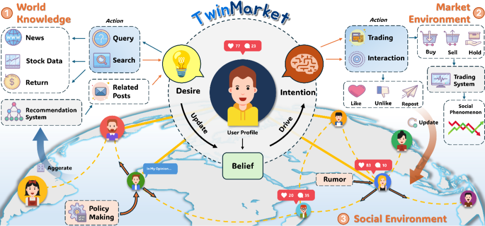

<link rel="stylesheet" href="{{ '/assets/css/project-detail.css' | relative_url }}">

Agents and applications

  Tool agents
  User simulators
  AI patients
  Role-playing agents
  Market agents

  <a class="impact-action" href="https://wabyking.github.io/" target="_blank" rel="noopener">Benyou Wang papers</a>
  <a class="impact-action secondary" href="/projects/human-agent-interaction/">Human-Agent Interaction</a>
  <a class="impact-action secondary" href="/projects/economic-world-models/">Economic World Models</a>
  <a class="impact-action secondary" href="/projects/">All Projects</a>

  

This project organizes papers where LLMs do more than answer: they plan with tools, simulate users, play roles, teach learners, act as standardized patients, participate in markets, or operate inside evolving environments.

<section class="impact-section">
  <h2>Research Storyline</h2>
  

    

      Plan
      
<strong>Use tools through multi-agent search</strong>
Smurfs studies how multiple agents can coordinate tool planning while keeping search context efficient.

    

    

      Simulate
      
<strong>Generate interactive users and learners</strong>
UserGPT and PlatoLM turn LLMs into simulated users, giving dialogue systems richer multi-turn practice.

    

    

      Practice
      
<strong>Deploy agents in education and medicine</strong>
EasyMED and AI standardized patients make clinical communication and reasoning practice repeatable and measurable.

    

    

      World
      
<strong>Put agents into markets and micro-worlds</strong>
TwinMarket and MicroVerse move from isolated prompts to environments where agent actions change future states.

    

  

</section>

<section class="impact-section">
  <h2>Paper Trail</h2>
  

    

      Tools
      
<strong>Smurfs: Multi-Agent System using Context-Efficient DFSDT for Tool Planning</strong>
Uses multi-agent search for tool planning with better context efficiency.
<a href="https://aclanthology.org/2025.naacl-long.169/" target="_blank" rel="noopener">Paper</a>

    

    

      User
      
<strong>Large Language Model as a User Simulator</strong>
Builds LLM user simulators for dialogue data generation, training, and evaluation.
<a href="https://arxiv.org/abs/2308.11534" target="_blank" rel="noopener">Paper</a>

    

    

      Tutor
      
<strong>PlatoLM: Teaching LLMs via a Socratic Questioning User Simulator</strong>
Uses Socratic user simulation to improve multi-turn dialogue learning.
<a href="https://openreview.net/forum?id=9nddtu94uX" target="_blank" rel="noopener">Paper</a>

    

    

      Patient
      
<strong>Human or LLM as Standardized Patients?</strong>
Compares AI standardized patients and human standardized patients for medical education.
<a href="https://arxiv.org/abs/2511.14783" target="_blank" rel="noopener">Paper</a>

    

    

      Role
      
<strong>CRPO: Character-centric Group Relative Policy Optimization</strong>
Optimizes role-playing agents while preserving character fidelity and reasoning quality.
<a href="https://arxiv.org/abs/2605.25511" target="_blank" rel="noopener">Paper</a>

    

    

      Market
      
<strong>TwinMarket</strong>
Simulates financial markets with LLM investor agents that carry beliefs, desires, intentions, and actions.
<a href="/projects/twinmarket-financial-simulation/">Project page</a>

    

    

      World
      
<strong>MicroVerse</strong>
Explores scientific micro-world simulation with hidden mechanisms and evolving states.
<a href="/projects/microverse-world-simulation/">Project page</a>

    

  

</section>

<section class="impact-section">
  <h2>Application Clusters</h2>
  

    

      <strong>Tool-use agents</strong>
      
Smurfs organizes tool planning as a multi-agent search problem rather than a single fragile ReAct trajectory.

    

    

      <strong>Dialogue and education agents</strong>
      
User simulators, PlatoLM, and AI standardized patients use interaction to create practice, feedback, and evaluation loops.

    

    

      <strong>Role-aware agents</strong>
      
CRPO studies how RL objectives should change when the agent must preserve persona, style, and character consistency.

    

    

      <strong>World and market agents</strong>
      
TwinMarket, Economic World Models, and MicroVerse treat agents as actors inside environments that respond to their decisions.

    

  

</section>

<section class="impact-section">
  <h2>Resource Map</h2>
  

    

      <strong>Smurfs</strong>
      
Paper and ACL Anthology page for multi-agent tool planning.

      <a href="https://aclanthology.org/2025.naacl-long.169/" target="_blank" rel="noopener">Paper</a>
    

    

      <strong>EasyMED</strong>
      
AI standardized patient framework and medical education evaluation resources.

      <a href="https://github.com/FreedomIntelligence/EasyMED" target="_blank" rel="noopener">Repository</a>
    

    

      <strong>TwinMarket</strong>
      
Financial market simulation with LLM investor agents.

      <a href="/projects/twinmarket-financial-simulation/">Project page</a>
    

    

      <strong>MicroVerse</strong>
      
Micro-world simulation for scientific environments.

      <a href="/projects/microverse-world-simulation/">Project page</a>
    

  

</section>

  <a class="impact-action secondary" href="/projects/">Back to Projects</a>

智能体与应用

  工具智能体
  用户模拟器
  AI 病人
  角色扮演智能体
  市场智能体

  <a class="impact-action" href="https://wabyking.github.io/" target="_blank" rel="noopener">王本友论文列表</a>
  <a class="impact-action secondary" href="/projects/human-agent-interaction/">人机交互</a>
  <a class="impact-action secondary" href="/projects/economic-world-models/">经济世界模型</a>
  <a class="impact-action secondary" href="/projects/">全部项目</a>

  

本项目梳理这样一类论文：大模型不只是回答问题，还会借助工具做规划、模拟用户、扮演角色、辅导学习者、充当标准化病人、参与市场，或在不断演化的环境中行动。

<section class="impact-section">
  <h2>研究脉络</h2>
  

    

      规划
      
<strong>借助多智能体搜索调用工具</strong>
Smurfs 研究多个智能体如何协同规划工具调用，同时控制搜索的上下文开销。

    

    

      模拟
      
<strong>生成可交互的用户与学习者</strong>
UserGPT 和 PlatoLM 把大模型变成模拟用户，为对话系统提供更丰富的多轮练习。

    

    

      练习
      
<strong>把智能体用于教育与医疗</strong>
EasyMED 和 AI 标准化病人让临床沟通与推理练习可重复、可度量。

    

    

      世界
      
<strong>让智能体进入市场与微观世界</strong>
TwinMarket 和 MicroVerse 不再停留在孤立的提示词上，而是转向交互环境：智能体的行动会改变后续状态。

    

  

</section>

<section class="impact-section">
  <h2>论文脉络</h2>
  

    

      工具
      
<strong>Smurfs: Multi-Agent System using Context-Efficient DFSDT for Tool Planning</strong>
用多智能体搜索做工具规划，并提升上下文使用效率。
<a href="https://aclanthology.org/2025.naacl-long.169/" target="_blank" rel="noopener">论文</a>

    

    

      用户
      
<strong>Large Language Model as a User Simulator</strong>
构建大模型用户模拟器，用于对话数据生成、训练和评测。
<a href="https://arxiv.org/abs/2308.11534" target="_blank" rel="noopener">论文</a>

    

    

      辅导
      
<strong>PlatoLM: Teaching LLMs via a Socratic Questioning User Simulator</strong>
用苏格拉底式的用户模拟改进多轮对话学习。
<a href="https://openreview.net/forum?id=9nddtu94uX" target="_blank" rel="noopener">论文</a>

    

    

      病人
      
<strong>Human or LLM as Standardized Patients?</strong>
在医学教育中对比 AI 标准化病人与真人标准化病人。
<a href="https://arxiv.org/abs/2511.14783" target="_blank" rel="noopener">论文</a>

    

    

      角色
      
<strong>CRPO: Character-centric Group Relative Policy Optimization</strong>
优化角色扮演智能体，同时保持角色忠实度和推理质量。
<a href="https://arxiv.org/abs/2605.25511" target="_blank" rel="noopener">论文</a>

    

    

      市场
      
<strong>TwinMarket</strong>
用大模型投资者智能体模拟金融市场，每个智能体都有自己的信念、愿望、意图和行动。
<a href="/projects/twinmarket-financial-simulation/">项目主页</a>

    

    

      世界
      
<strong>MicroVerse</strong>
探索带有隐藏机制和演化状态的科学微观世界模拟。
<a href="/projects/microverse-world-simulation/">项目主页</a>

    

  

</section>

<section class="impact-section">
  <h2>应用类别</h2>
  

    

      <strong>工具使用智能体</strong>
      
Smurfs 把工具规划看作多智能体搜索问题，而不是单条脆弱的 ReAct 轨迹。

    

    

      <strong>对话与教育智能体</strong>
      
用户模拟器、PlatoLM 和 AI 标准化病人通过交互形成练习、反馈与评测的闭环。

    

    

      <strong>角色感知智能体</strong>
      
CRPO 研究：当智能体需要始终保持角色设定与说话风格时，强化学习目标该怎样调整。

    

    

      <strong>世界与市场智能体</strong>
      
TwinMarket、经济世界模型和 MicroVerse 把智能体当作环境中的行动者，环境会对它们的决策作出响应。

    

  

</section>

<section class="impact-section">
  <h2>资源导航</h2>
  

    

      <strong>Smurfs</strong>
      
多智能体工具规划的论文，收录于 ACL Anthology。

      <a href="https://aclanthology.org/2025.naacl-long.169/" target="_blank" rel="noopener">论文</a>
    

    

      <strong>EasyMED</strong>
      
AI 标准化病人框架与医学教育评测资源。

      <a href="https://github.com/FreedomIntelligence/EasyMED" target="_blank" rel="noopener">代码仓库</a>
    

    

      <strong>TwinMarket</strong>
      
用大模型投资者智能体模拟金融市场。

      <a href="/projects/twinmarket-financial-simulation/">项目主页</a>
    

    

      <strong>MicroVerse</strong>
      
面向科学环境的微观世界模拟。

      <a href="/projects/microverse-world-simulation/">项目主页</a>
    

  

</section>

  <a class="impact-action secondary" href="/projects/">返回项目页</a>

