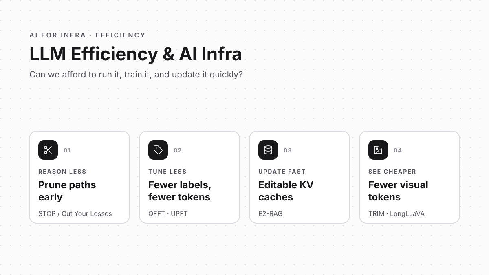
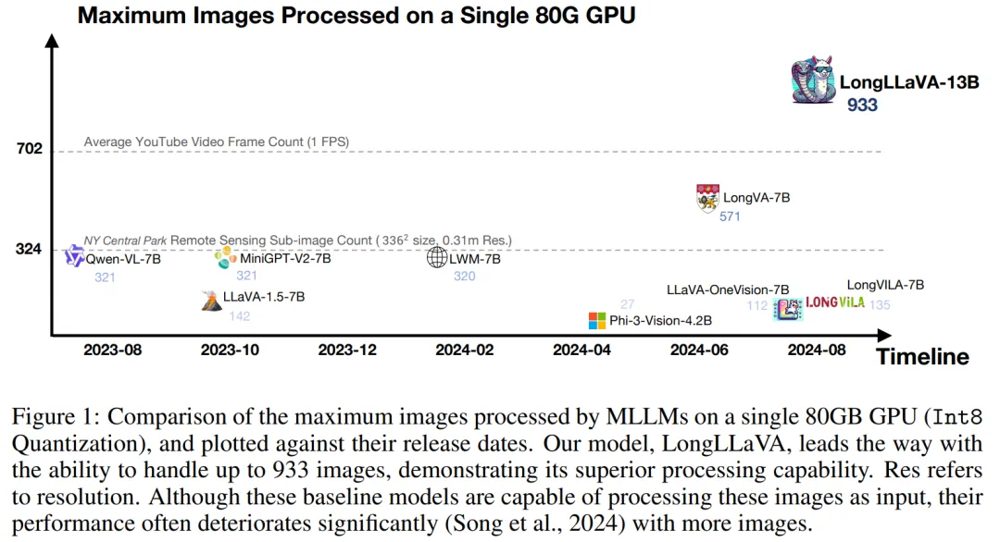
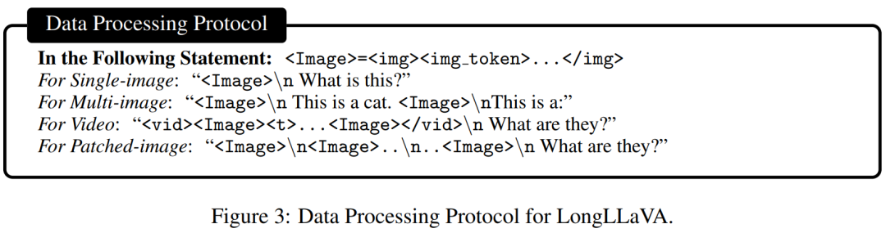
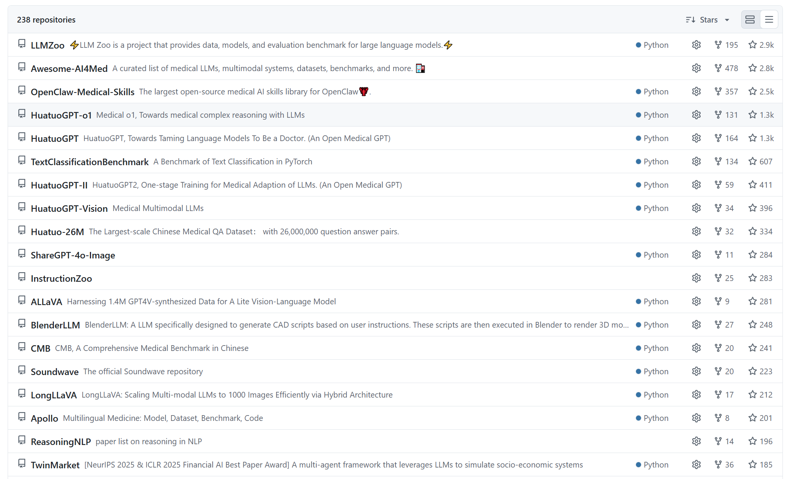

<link rel="stylesheet" href="{{ '/assets/css/project-detail.css' | relative_url }}">

Efficiency and infrastructure

  Long context
  Efficient reasoning
  RAG data
  Token reduction
  Open infrastructure

  <a class="impact-action" href="/projects/long-context-multimodal/">LongLLaVA and MileBench</a>
  <a class="impact-action secondary" href="/projects/rag-instruction-data/">RAG and Data</a>
  <a class="impact-action secondary" href="https://github.com/FreedomIntelligence/TRIM" target="_blank" rel="noopener">TRIM</a>
  <a class="impact-action secondary" href="/projects/">All Projects</a>

  

This project gathers the infrastructure work that makes open models more usable: longer multimodal context, cheaper visual tokens, stronger retrieval data, editable memory, efficient fine-tuning, and reasoning systems that spend computation where it matters.

<section class="impact-section">
  <h2>Background and Motivation</h2>
  

    

      <strong>Capability is constrained by infrastructure</strong>
      
Better models are not enough if training data, retrieval pipelines, memory, long context, and inference cost do not scale with real tasks.

    

    

      <strong>Multimodal inputs are expensive</strong>
      
Images, videos, and long documents quickly overload context windows, making token selection and long-context design central to deployment.

    

    

      <strong>Reasoning needs adaptive compute</strong>
      
Efficient reasoning systems should prune weak paths, tune with minimal supervision, and update knowledge without expensive retraining.

    

  

</section>

<section class="impact-section">
  <h2>Core Ideas</h2>
  

    

      Context
      
<strong>Scale multimodal context length</strong>
LongLLaVA and MileBench study how models reason over many images and long multimodal inputs without losing global structure.

    

    

      Tokens
      
<strong>Spend visual tokens only where they help</strong>
TRIM studies token reduction for multimodal LLMs, reducing cost while preserving reasoning-critical visual information.

    

    

      Data
      
<strong>Build instruction and retrieval infrastructure</strong>
RAG-Instruct, LLMZoo, and related resources package data, models, and tasks so downstream builders can reproduce and extend systems.

    

    

      Update
      
<strong>Make memory and reasoning editable</strong>
E2-RAG, prefix tuning, question-free fine-tuning, and early path pruning all aim to update or accelerate systems without rebuilding everything.

    

  

</section>

<section class="impact-section">
  <h2>Typical Work</h2>
  

    

      Long
      
<strong>LongLLaVA and MileBench</strong>
Long-context multimodal model and benchmark work for reasoning over many images, videos, and long visual contexts.
<a href="/projects/long-context-multimodal/">Project page</a>

    

    

      Efficient
      
<strong>TRIM: Less is More for Efficient Multi-modal LLMs</strong>
Reduces visual tokens so multimodal inference is cheaper while retaining task-relevant evidence.
<a href="https://arxiv.org/abs/2409.10994" target="_blank" rel="noopener">Paper</a>

    

    

      RAG
      
<strong>E2-RAG and RAG-Instruct</strong>
Studies editable efficient retrieval and data infrastructure for retrieval-augmented instruction following.
<a href="/projects/rag-instruction-data/">Project page</a>

    

    

      Reason
      
<strong>Question-Free Fine-Tuning and path pruning</strong>
Improves adaptive reasoning with less supervision and by pruning low-value reasoning branches early.
<a href="https://arxiv.org/abs/2506.12860" target="_blank" rel="noopener">QFFT</a>

    

  

</section>

<section class="impact-section">
  <h2>Display Figures</h2>
  

    <figure>
      
      <figcaption>Long-context multimodal infrastructure lets models reason across many images rather than isolated visual snippets.</figcaption>
    </figure>
    <figure>
      
      <figcaption>Efficient training pipelines connect data design, context scaling, and downstream evaluation.</figcaption>
    </figure>
    <figure>
      
      <figcaption>Open repositories, datasets, and model cards turn infrastructure work into reusable building blocks.</figcaption>
    </figure>
  

</section>

<section class="impact-section">
  <h2>Resource Map</h2>
  

    

      <strong>LongLLaVA and MileBench</strong>
      
Long-context multimodal project page covering models, benchmarks, and visual context scaling.

      <a href="/projects/long-context-multimodal/">Project page</a>
    

    

      <strong>RAG and Instruction Data</strong>
      
Data and retrieval infrastructure for instruction tuning and knowledge-grounded model building.

      <a href="/projects/rag-instruction-data/">Project page</a>
    

    

      <strong>LLMZoo</strong>
      
Open model and training resource collection that supports the lab's broader multilingual and infrastructure stack.

      <a href="https://github.com/FreedomIntelligence/LLMZoo" target="_blank" rel="noopener">Repository</a>
    

  

</section>

<section class="impact-section">
  <h2>Why It Matters</h2>
  <ul class="impact-list">
    <li>Open AI progress depends on infrastructure that smaller teams can run, inspect, and extend.</li>
    <li>Long-context and multimodal tasks need cost-aware model design, not only larger context windows.</li>
    <li>Editable retrieval and efficient adaptation make models more practical in domains where knowledge changes quickly.</li>
  </ul>
</section>

  <a class="impact-action secondary" href="/projects/">Back to Projects</a>

效率与基础设施

  长上下文
  高效推理
  RAG 数据
  token 压缩
  开源基础设施

  <a class="impact-action" href="/projects/long-context-multimodal/">LongLLaVA 与 MileBench</a>
  <a class="impact-action secondary" href="/projects/rag-instruction-data/">RAG 与数据</a>
  <a class="impact-action secondary" href="https://github.com/FreedomIntelligence/TRIM" target="_blank" rel="noopener">TRIM</a>
  <a class="impact-action secondary" href="/projects/">全部项目</a>

  

本项目汇集了让开源模型更好用的基础设施工作：更长的多模态上下文、更低成本的视觉 token、更优质的检索数据、可编辑的记忆、高效微调，以及把算力用在刀刃上的推理系统。

<section class="impact-section">
  <h2>背景与动机</h2>
  

    

      <strong>能力受限于基础设施</strong>
      
光有更好的模型还不够：训练数据、检索流程、记忆、长上下文和推理成本，都要能跟上真实任务的规模。

    

    

      <strong>多模态输入开销大</strong>
      
图像、视频和长文档很容易占满上下文窗口，因此 token 选择和长上下文设计成为部署的关键。

    

    

      <strong>推理需要按需分配算力</strong>
      
高效的推理系统应当剪掉低价值路径，用最少的监督完成微调，并且无需昂贵的重新训练就能更新知识。

    

  

</section>

<section class="impact-section">
  <h2>核心思路</h2>
  

    

      上下文
      
<strong>扩展多模态上下文长度</strong>
LongLLaVA 和 MileBench 研究模型如何在大量图像和长多模态输入上推理，同时不丢失全局结构。

    

    

      Token
      
<strong>视觉 token 只用在有帮助的地方</strong>
TRIM 研究多模态大模型的 token 压缩，在降低成本的同时保留对推理至关重要的视觉信息。

    

    

      数据
      
<strong>搭建指令数据与检索基础设施</strong>
RAG-Instruct、LLMZoo 等资源把数据、模型和任务打包开放，方便下游开发者复现并扩展系统。

    

    

      更新
      
<strong>让记忆和推理可编辑</strong>
E2-RAG、前缀微调、Question-Free Fine-Tuning 和早期路径剪枝，目标都是在不推倒重来的前提下更新或加速系统。

    

  

</section>

<section class="impact-section">
  <h2>代表性工作</h2>
  

    

      长上下文
      
<strong>LongLLaVA 与 MileBench</strong>
围绕多图像、视频和长视觉上下文推理，提出长上下文多模态模型与评测基准。
<a href="/projects/long-context-multimodal/">项目主页</a>

    

    

      高效
      
<strong>TRIM: Less is More for Efficient Multi-modal LLMs</strong>
减少视觉 token，在保留任务相关证据的同时降低多模态推理成本。
<a href="https://arxiv.org/abs/2409.10994" target="_blank" rel="noopener">论文</a>

    

    

      RAG
      
<strong>E2-RAG 与 RAG-Instruct</strong>
研究可编辑的高效检索，以及面向检索增强指令遵循的数据基础设施。
<a href="/projects/rag-instruction-data/">项目主页</a>

    

    

      推理
      
<strong>Question-Free Fine-Tuning 与路径剪枝</strong>
用更少的监督提升自适应推理能力，并尽早剪掉低价值的推理分支。
<a href="https://arxiv.org/abs/2506.12860" target="_blank" rel="noopener">QFFT</a>

    

  

</section>

<section class="impact-section">
  <h2>图示</h2>
  

    <figure>
      
      <figcaption>长上下文多模态基础设施让模型能够跨多张图像推理，而不是只看孤立的视觉片段。</figcaption>
    </figure>
    <figure>
      
      <figcaption>高效的训练流程把数据设计、上下文扩展和下游评测衔接起来。</figcaption>
    </figure>
    <figure>
      
      <figcaption>开放的代码仓库、数据集和模型卡，把基础设施工作变成可复用的基础组件。</figcaption>
    </figure>
  

</section>

<section class="impact-section">
  <h2>资源导航</h2>
  

    

      <strong>LongLLaVA 与 MileBench</strong>
      
长上下文多模态项目页面，涵盖模型、评测基准和视觉上下文扩展。

      <a href="/projects/long-context-multimodal/">项目主页</a>
    

    

      <strong>RAG 与指令数据</strong>
      
为指令微调和知识增强的模型构建提供数据与检索基础设施。

      <a href="/projects/rag-instruction-data/">项目主页</a>
    

    

      <strong>LLMZoo</strong>
      
开放的模型与训练资源合集，支撑实验室更广泛的多语言与基础设施技术栈。

      <a href="https://github.com/FreedomIntelligence/LLMZoo" target="_blank" rel="noopener">代码仓库</a>
    

  

</section>

<section class="impact-section">
  <h2>研究意义</h2>
  <ul class="impact-list">
    <li>开源 AI 的进步，离不开小团队也能运行、检查和扩展的基础设施。</li>
    <li>长上下文和多模态任务需要兼顾成本的模型设计，而不只是更大的上下文窗口。</li>
    <li>可编辑的检索和高效适配，让模型在知识更新很快的领域更加实用。</li>
  </ul>
</section>

  <a class="impact-action secondary" href="/projects/">返回项目页</a>

