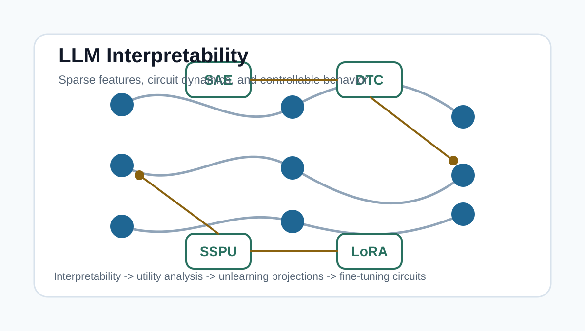

<link rel="stylesheet" href="{{ '/assets/css/project-detail.css' | relative_url }}">

Mechanistic interpretability

  Sparse Autoencoders
  Circuit Analysis
  Model Unlearning
  Fine-Tuning Mechanisms

  <a class="impact-action" href="https://arxiv.org/abs/2510.03659" target="_blank" rel="noopener">ICLR 2026 Paper</a>
  <a class="impact-action secondary" href="https://arxiv.org/abs/2505.24428" target="_blank" rel="noopener">EMNLP 2025 Paper</a>
  <a class="impact-action secondary" href="https://arxiv.org/abs/2502.11812" target="_blank" rel="noopener">ICML 2025 Paper</a>

  

This project studies how to make LLM behavior legible and controllable. The line connects sparse autoencoder feature analysis, SAE-guided subspace projections for unlearning, and circuit-level studies of what fine-tuning changes inside a model.

<section class="impact-section">
  <h2>Research Storyline</h2>
  

    

      Utility
      
<strong>Test whether interpretability predicts usefulness</strong>
The SAE utility work compares interpretability scores against actual steering utility and studies when interpretable features are not the most effective control features.

    

    

      Control
      
<strong>Use interpretable features for model unlearning</strong>
SAE-guided subspace projections turn feature-level evidence into constrained parameter updates, aiming for precise and robust removal of unwanted knowledge.

    

    

      Circuits
      
<strong>Explain how fine-tuning changes computation</strong>
Circuit analysis tracks edge changes, subtask composition, and circuit-aware LoRA allocation during fine-tuning.

    

  

</section>

<section class="impact-section">
  <h2>Key Papers</h2>
  

    

      ICLR 2026
      
<strong>Does Higher Interpretability Imply Better Utility? A Pairwise Analysis on Sparse Autoencoders</strong>
Xu Wang, Yan Hu, Benyou Wang, Difan Zou. Also received the Outstanding Paper Award at the NeurIPS 2025 ResponsibleFM Workshop.
<a href="https://arxiv.org/abs/2510.03659" target="_blank" rel="noopener">Paper</a>

    

    

      EMNLP 2025
      
<strong>Model Unlearning via Sparse Autoencoder Subspace Guided Projections</strong>
Xu Wang, Zihao Li, Benyou Wang, Yan Hu, Difan Zou. Studies SAE-guided subspace projection unlearning for controllable and robust knowledge removal.
<a href="https://arxiv.org/abs/2505.24428" target="_blank" rel="noopener">Paper</a>

    

    

      ICML 2025
      
<strong>Towards Understanding Fine-Tuning Mechanisms of LLMs via Circuit Analysis</strong>
Xu Wang, Yan Hu, Wenyu Du, Reynold Cheng, Benyou Wang, Difan Zou. Uses circuit analysis to understand fine-tuning dynamics and circuit-aware adaptation.
<a href="https://arxiv.org/abs/2502.11812" target="_blank" rel="noopener">Paper</a>

    

  

</section>

<section class="impact-section">
  <h2>Why It Matters</h2>
  <ul class="impact-list">
    <li>Interpretability should be validated against downstream utility, not treated as a proxy by default.</li>
    <li>SAE features can support controllable model editing when connected to parameter-space objectives.</li>
    <li>Circuit-level views make fine-tuning more inspectable and can guide more efficient adaptation methods.</li>
  </ul>
</section>

机制可解释性

  稀疏自编码器
  电路分析
  模型遗忘
  微调机制

  <a class="impact-action" href="https://arxiv.org/abs/2510.03659" target="_blank" rel="noopener">ICLR 2026 论文</a>
  <a class="impact-action secondary" href="https://arxiv.org/abs/2505.24428" target="_blank" rel="noopener">EMNLP 2025 论文</a>
  <a class="impact-action secondary" href="https://arxiv.org/abs/2502.11812" target="_blank" rel="noopener">ICML 2025 论文</a>

  

本项目研究如何让大模型的行为既可理解，又可控制。研究主线由三部分串联而成：分析稀疏自编码器（SAE）的特征，利用 SAE 引导的子空间投影实现遗忘，并在电路层面研究微调究竟改变了模型内部的什么。

<section class="impact-section">
  <h2>研究脉络</h2>
  

    

      效用
      
<strong>检验可解释性能否预测实际效用</strong>
SAE 效用研究把可解释性得分与实际的 steering 效用相对照，并分析在哪些情况下，可解释的特征并不是最有效的控制特征。

    

    

      控制
      
<strong>用可解释特征实现模型遗忘</strong>
SAE 引导的子空间投影把特征层面的证据转化为受约束的参数更新，目标是精确、稳健地移除不需要的知识。

    

    

      电路
      
<strong>解释微调如何改变模型的计算</strong>
电路分析追踪微调过程中边的变化、子任务的组合，以及电路感知的 LoRA 分配。

    

  

</section>

<section class="impact-section">
  <h2>重点论文</h2>
  

    

      ICLR 2026
      
<strong>Does Higher Interpretability Imply Better Utility? A Pairwise Analysis on Sparse Autoencoders</strong>
Xu Wang、Yan Hu、Benyou Wang、Difan Zou。该论文同时获得 NeurIPS 2025 ResponsibleFM Workshop 杰出论文奖。
<a href="https://arxiv.org/abs/2510.03659" target="_blank" rel="noopener">论文</a>

    

    

      EMNLP 2025
      
<strong>Model Unlearning via Sparse Autoencoder Subspace Guided Projections</strong>
Xu Wang、Zihao Li、Benyou Wang、Yan Hu、Difan Zou。研究用 SAE 引导的子空间投影实现遗忘，做到可控、稳健地移除知识。
<a href="https://arxiv.org/abs/2505.24428" target="_blank" rel="noopener">论文</a>

    

    

      ICML 2025
      
<strong>Towards Understanding Fine-Tuning Mechanisms of LLMs via Circuit Analysis</strong>
Xu Wang、Yan Hu、Wenyu Du、Reynold Cheng、Benyou Wang、Difan Zou。用电路分析理解微调的动态过程，并据此做电路感知的模型适配。
<a href="https://arxiv.org/abs/2502.11812" target="_blank" rel="noopener">论文</a>

    

  

</section>

<section class="impact-section">
  <h2>研究意义</h2>
  <ul class="impact-list">
    <li>可解释性应当用下游效用来检验，而不是默认把它当作效用的代理指标。</li>
    <li>SAE 特征与参数空间的目标相结合后，可以支持可控的模型编辑。</li>
    <li>电路层面的视角让微调过程更易于检视，也能指导更高效的适配方法。</li>
  </ul>
</section>

