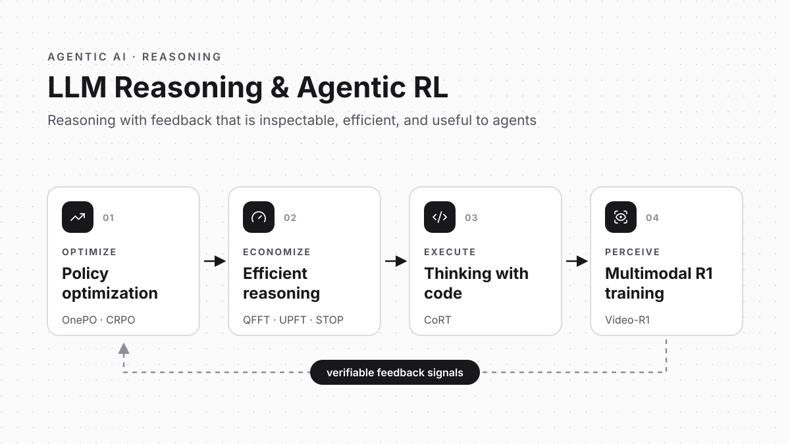
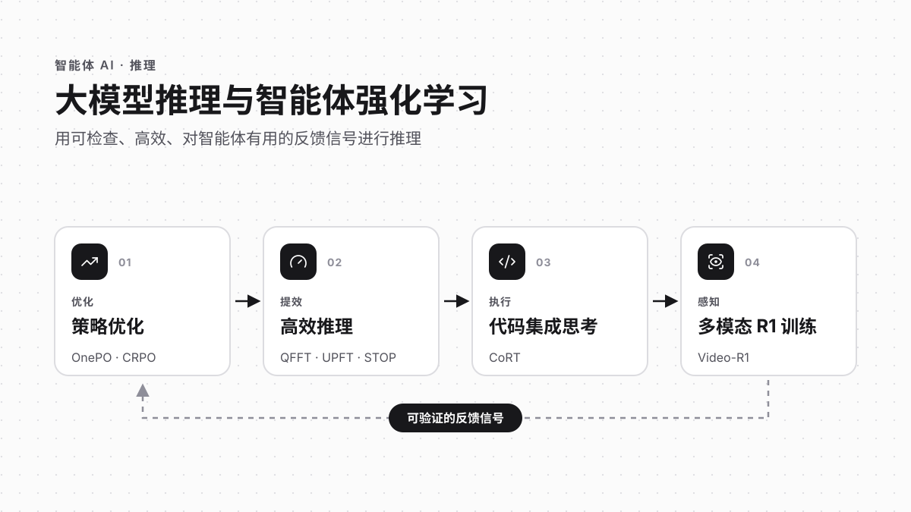

<link rel="stylesheet" href="{{ '/assets/css/project-detail.css' | relative_url }}">

Reasoning and agentic RL

  Policy optimization
  Agentic RL
  Path pruning
  Code reasoning
  Video reasoning

  <a class="impact-action" href="https://wabyking.github.io/" target="_blank" rel="noopener">Benyou Wang papers</a>
  <a class="impact-action secondary" href="/projects/reasoning-math-optimization/">Math and Optimization</a>
  <a class="impact-action secondary" href="/projects/llm-efficiency-ai-infra/">LLM Infra</a>
  <a class="impact-action secondary" href="/projects/">All Projects</a>

  

This project organizes papers where reasoning is trained, optimized, pruned, or grounded in executable feedback. The scope covers policy optimization, role-aware agent RL, adaptive compute, code-integrated thinking, and multimodal R1-style learning.

<section class="impact-section">
  <h2>Research Storyline</h2>
  

    

      Optimize
      
<strong>Move from SFT to policy optimization</strong>
OnePO and QFFT study how to adapt models more directly, reducing dependence on heavy multi-stage pipelines while preserving exploration.

    

    

      Act
      
<strong>Make RL objectives agent-aware</strong>
CRPO turns GRPO-style optimization toward role-playing agents, balancing task utility with persona fidelity and style consistency.

    

    

      Spend
      
<strong>Allocate reasoning compute where it matters</strong>
STOP learns to prune doomed reasoning paths early, making parallel reasoning more accurate under a fixed compute budget.

    

    

      Ground
      
<strong>Ground reasoning in code and perception</strong>
CoRT and Video-R1 extend reasoning feedback to executable computation and temporal multimodal understanding.

    

  

</section>

<section class="impact-section">
  <h2>Paper Trail</h2>
  

    

      RL
      
<strong>OnePO: Direct One-stage Policy Optimization for SFT-free Domain Adaptation</strong>
Directly optimizes policies for domain adaptation without a separate SFT stage.
<a href="https://wabyking.github.io/" target="_blank" rel="noopener">Publication list</a>

    

    

      Role
      
<strong>CRPO: Character-centric Group Relative Policy Optimization</strong>
Adapts group-relative policy optimization to role-aware reasoning agents.
<a href="https://arxiv.org/abs/2605.25511" target="_blank" rel="noopener">Paper</a>

    

    

      Adapt
      
<strong>Question-Free Fine-Tuning</strong>
Studies efficient and adaptive reasoning fine-tuning for large language models.
<a href="https://arxiv.org/abs/2506.12860" target="_blank" rel="noopener">Paper</a>

    

    

      Prune
      
<strong>Cut Your Losses!</strong>
Learns internal signals that prune low-value reasoning paths early during parallel reasoning.
<a href="https://arxiv.org/abs/2604.16029" target="_blank" rel="noopener">Paper</a>

    

    

      Code
      
<strong>CoRT: Code-integrated Reasoning within Thinking</strong>
Lets models use executable computation as part of the reasoning process.
<a href="https://arxiv.org/abs/2506.09820" target="_blank" rel="noopener">Paper</a>

    

    

      Video
      
<strong>Video-R1: Reinforcing Video Reasoning in MLLMs</strong>
Applies R1-style reinforcement learning to temporal video reasoning in multimodal LLMs.
<a href="https://arxiv.org/abs/2503.21776" target="_blank" rel="noopener">Paper</a>

    

  

</section>

<section class="impact-section">
  <h2>Project Clusters</h2>
  

    

      <strong>Policy optimization</strong>
      
OnePO, CRPO, and QFFT organize RL-style post-training around direct optimization, role fidelity, and efficient adaptation.

    

    

      <strong>Adaptive compute</strong>
      
STOP and UPFT focus on spending less compute without losing reasoning quality, especially for long or parallel reasoning traces.

    

    

      <strong>Tool and code grounding</strong>
      
CoRT connects reasoning to code execution, making intermediate calculations easier to verify and debug.

    

    

      <strong>Multimodal reasoning RL</strong>
      
Video-R1 extends reinforcement learning for reasoning beyond text-only math into temporal video understanding.

    

  

</section>

<section class="impact-section">
  <h2>Resource Map</h2>
  

    

      <strong>STOP / Cut Your Losses</strong>
      
Project page for early pruning in efficient parallel reasoning.

      <a href="https://bijiaxihh.github.io/STOP/" target="_blank" rel="noopener">Project page</a>
    

    

      <strong>Video-R1</strong>
      
Code and datasets for R1-style video reasoning.

      <a href="https://github.com/tulerfeng/Video-R1" target="_blank" rel="noopener">Repository</a>
    

    

      <strong>CoRT</strong>
      
Code-integrated reasoning resources.

      <a href="https://github.com/ChengpengLi1003/CoRT" target="_blank" rel="noopener">Repository</a>
    

  

</section>

  <a class="impact-action secondary" href="/projects/">Back to Projects</a>

推理与智能体强化学习

  策略优化
  智能体强化学习
  路径剪枝
  代码推理
  视频推理

  <a class="impact-action" href="https://wabyking.github.io/" target="_blank" rel="noopener">王本友论文列表</a>
  <a class="impact-action secondary" href="/projects/reasoning-math-optimization/">数学与运筹优化</a>
  <a class="impact-action secondary" href="/projects/llm-efficiency-ai-infra/">大模型基础设施</a>
  <a class="impact-action secondary" href="/projects/">全部项目</a>

  

本项目梳理围绕推理能力的一组论文：如何训练和优化推理，如何剪掉低价值的推理路径，以及如何让推理建立在可执行的反馈之上。内容涵盖策略优化、角色感知的智能体强化学习、自适应算力分配、代码集成思考和多模态 R1 式学习。

<section class="impact-section">
  <h2>研究脉络</h2>
  

    

      优化
      
<strong>从 SFT 走向策略优化</strong>
OnePO 和 QFFT 探索更直接的模型适配方式，减少对复杂多阶段流程的依赖，同时保留探索能力。

    

    

      行动
      
<strong>让强化学习目标面向智能体</strong>
CRPO 把 GRPO 式优化引向角色扮演智能体，兼顾任务效用、角色设定的忠实度和风格一致性。

    

    

      分配
      
<strong>把推理算力用在关键处</strong>
STOP 学会尽早剪掉注定失败的推理路径，让并行推理在固定算力预算下更准确。

    

    

      扎根
      
<strong>让推理扎根于代码与感知</strong>
CoRT 和 Video-R1 把推理反馈延伸到可执行的计算和时序多模态理解上。

    

  

</section>

<section class="impact-section">
  <h2>论文脉络</h2>
  

    

      强化学习
      
<strong>OnePO: Direct One-stage Policy Optimization for SFT-free Domain Adaptation</strong>
不经过单独的 SFT 阶段，直接优化策略来完成领域适配。
<a href="https://wabyking.github.io/" target="_blank" rel="noopener">论文列表</a>

    

    

      角色
      
<strong>CRPO: Character-centric Group Relative Policy Optimization</strong>
把组相对策略优化用于角色感知的推理智能体。
<a href="https://arxiv.org/abs/2605.25511" target="_blank" rel="noopener">论文</a>

    

    

      适配
      
<strong>Question-Free Fine-Tuning</strong>
研究面向大模型的高效、自适应推理微调。
<a href="https://arxiv.org/abs/2506.12860" target="_blank" rel="noopener">论文</a>

    

    

      剪枝
      
<strong>Cut Your Losses!</strong>
学习模型内部信号，在并行推理中尽早剪掉低价值的推理路径。
<a href="https://arxiv.org/abs/2604.16029" target="_blank" rel="noopener">论文</a>

    

    

      代码
      
<strong>CoRT: Code-integrated Reasoning within Thinking</strong>
让模型把可执行的计算作为推理过程的一部分。
<a href="https://arxiv.org/abs/2506.09820" target="_blank" rel="noopener">论文</a>

    

    

      视频
      
<strong>Video-R1: Reinforcing Video Reasoning in MLLMs</strong>
把 R1 式强化学习用于多模态大模型的时序视频推理。
<a href="https://arxiv.org/abs/2503.21776" target="_blank" rel="noopener">论文</a>

    

  

</section>

<section class="impact-section">
  <h2>项目分组</h2>
  

    

      <strong>策略优化</strong>
      
OnePO、CRPO 和 QFFT 的强化学习式后训练，分别围绕直接优化、角色忠实度和高效适配展开。

    

    

      <strong>自适应算力分配</strong>
      
STOP 和 UPFT 关注如何在不损失推理质量的前提下少花算力，尤其针对长推理轨迹和并行推理轨迹。

    

    

      <strong>工具与代码支撑</strong>
      
CoRT 把推理与代码执行连接起来，让中间计算更容易验证和调试。

    

    

      <strong>多模态推理强化学习</strong>
      
Video-R1 把推理强化学习从纯文本数学扩展到时序视频理解。

    

  

</section>

<section class="impact-section">
  <h2>资源导航</h2>
  

    

      <strong>STOP / Cut Your Losses</strong>
      
高效并行推理中提前剪枝的项目主页。

      <a href="https://bijiaxihh.github.io/STOP/" target="_blank" rel="noopener">项目主页</a>
    

    

      <strong>Video-R1</strong>
      
R1 式视频推理的代码与数据集。

      <a href="https://github.com/tulerfeng/Video-R1" target="_blank" rel="noopener">代码仓库</a>
    

    

      <strong>CoRT</strong>
      
代码集成推理的相关资源。

      <a href="https://github.com/ChengpengLi1003/CoRT" target="_blank" rel="noopener">代码仓库</a>
    

  

</section>

  <a class="impact-action secondary" href="/projects/">返回项目页</a>

