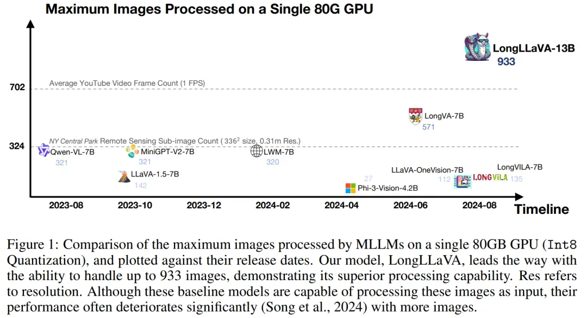
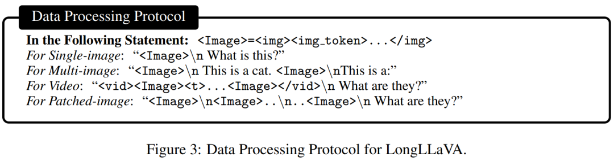
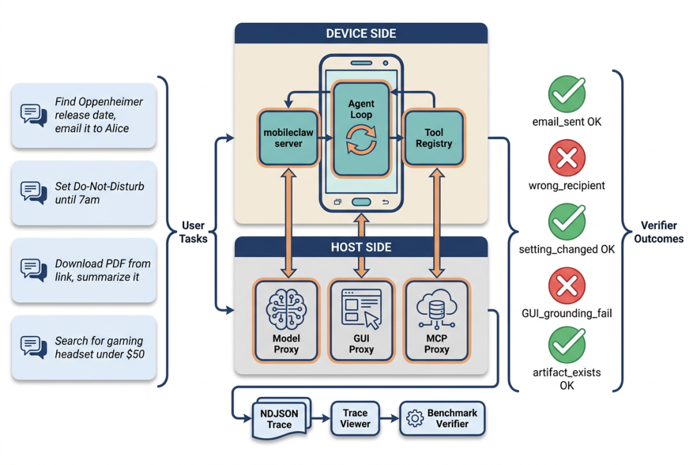

<link rel="stylesheet" href="{{ '/assets/css/project-detail.css' | relative_url }}">

Long-context multimodal AI

  LongLLaVA
  MileBench
  Many-image reasoning
  Video understanding
  Efficient MLLMs

  <a class="impact-action" href="https://github.com/FreedomIntelligence/LongLLaVA" target="_blank" rel="noopener">LongLLaVA</a>
  <a class="impact-action secondary" href="https://huggingface.co/datasets/FreedomIntelligence/MileBench" target="_blank" rel="noopener">MileBench</a>
  <a class="impact-action secondary" href="https://arxiv.org/abs/2409.02889" target="_blank" rel="noopener">LongLLaVA paper</a>
  <a class="impact-action secondary" href="https://arxiv.org/abs/2404.18532" target="_blank" rel="noopener">MileBench paper</a>

  

LongLLaVA asks how multimodal LLMs can reason over hundreds or thousands of images without exploding memory or latency. MileBench provides the benchmark pressure: long-context visual QA, retrieval, counting, ordering, and video tasks that expose whether a model truly uses long visual context.

<section class="impact-section">
  <h2>Research Storyline</h2>
  

    

      Benchmark
      
<strong>MileBench defines the pressure</strong>
Many-image and video tasks expose whether a multimodal model can retrieve, count, order, and reason across long visual contexts.

    

    

      Model
      
<strong>LongLLaVA scales the context window</strong>
The model combines hybrid architecture, data construction, and progressive training so a single model can handle many images efficiently.

    

    

      Efficiency
      
<strong>TRIM attacks token waste</strong>
Token reduction is the practical counterpart of long-context modeling: longer context only matters if inference remains affordable.

    

    

      Agents
      
<strong>Phone and web agents need this capability</strong>
Real agents inspect many screenshots, browser states, UI panels, and videos; long-context multimodal reasoning becomes infrastructure for agentic workflows.

    

  

</section>

<section class="impact-section">
  <h2>Technical Shape</h2>
  

    

      <strong>Hybrid language backbone</strong>
      
The model combines Transformer-style reasoning with sequence-efficient components, targeting long visual contexts that ordinary MLLM attention struggles to scale.

    

    

      <strong>Progressive multimodal training</strong>
      
Training moves from single-image alignment to multi-image and video-style instruction tuning so the model can retain both ordinary VQA ability and long-context behavior.

    

    

      <strong>Benchmark-driven iteration</strong>
      
MileBench makes progress measurable across long visual sequences, multi-image retrieval, temporal context, and mixed image-video reasoning tasks.

    

  

</section>

  

<section class="impact-section">
  <h2>Display Figures</h2>
  

    <figure>
      
      <figcaption>The architecture story: scale multimodal context without letting attention cost dominate the whole model.</figcaption>
    </figure>
    <figure>
      
      <figcaption>The training story: retain single-image ability while teaching the model to reason over many images and video frames.</figcaption>
    </figure>
    <figure>
      
      <figcaption>Downstream agent settings, such as phone control, turn long visual context into an operational requirement.</figcaption>
    </figure>
  

</section>

<section class="impact-section">
  <h2>Why It Matters</h2>
  <ul class="impact-list">
    <li>Real multimodal agents need to inspect many screenshots, frames, pages, or documents, not just answer about a single image.</li>
    <li>Long visual context is a systems problem: architecture, data mixture, token reduction, and evaluation all have to co-evolve.</li>
    <li>The LongLLaVA/MileBench pairing creates both a model direction and a public yardstick for future long-context MLLMs.</li>
  </ul>
</section>

<section class="impact-section">
  <h2>Paper Trail</h2>
  

    

      Benchmark
      
<strong>MileBench: Benchmarking MLLMs in Long Context</strong>
Creates the public pressure test for many-image and video reasoning, making long-context claims measurable.
<a href="https://huggingface.co/datasets/FreedomIntelligence/MileBench" target="_blank" rel="noopener">Dataset</a>

    

    

      Model
      
<strong>LongLLaVA: Scaling Multi-modal LLMs to 1000 Images Efficiently via Hybrid Architecture</strong>
Responds to the benchmark pressure with a hybrid architecture and progressive multimodal training recipe.
<a href="https://github.com/FreedomIntelligence/LongLLaVA" target="_blank" rel="noopener">Repository</a>

    

    

      Efficiency
      
<strong>TRIM and efficient multimodal context</strong>
Complements LongLLaVA by reducing redundant visual tokens so long-context systems can be deployed more cheaply.
<a href="https://github.com/FreedomIntelligence/TRIM" target="_blank" rel="noopener">TRIM</a>

    

  

</section>

<section class="impact-section">
  <h2>Resource Map</h2>
  

    

      <strong>LongLLaVA</strong>
      
Model architecture, training recipe, and release material for long-context multimodal understanding.

      <a href="https://github.com/FreedomIntelligence/LongLLaVA" target="_blank" rel="noopener">Repository</a>
    

    

      <strong>MileBench dataset</strong>
      
Long-context multimodal benchmark data for evaluating image, video, and cross-context capabilities.

      <a href="https://huggingface.co/datasets/FreedomIntelligence/MileBench" target="_blank" rel="noopener">Dataset</a>
    

    

      <strong>Related efficiency line</strong>
      
TRIM and token-reduction work connect to the same goal: make multimodal context longer without making inference unusable.

      <a href="https://github.com/FreedomIntelligence/TRIM" target="_blank" rel="noopener">TRIM</a>
    

  

</section>

长上下文多模态 AI

  LongLLaVA
  MileBench
  多图像推理
  视频理解
  高效多模态大模型

  <a class="impact-action" href="https://github.com/FreedomIntelligence/LongLLaVA" target="_blank" rel="noopener">LongLLaVA</a>
  <a class="impact-action secondary" href="https://huggingface.co/datasets/FreedomIntelligence/MileBench" target="_blank" rel="noopener">MileBench</a>
  <a class="impact-action secondary" href="https://arxiv.org/abs/2409.02889" target="_blank" rel="noopener">LongLLaVA 论文</a>
  <a class="impact-action secondary" href="https://arxiv.org/abs/2404.18532" target="_blank" rel="noopener">MileBench 论文</a>

  

LongLLaVA 要回答的问题是：多模态大模型如何在数百乃至上千张图像上推理，同时不让显存和延迟失控。MileBench 则提供压力测试：长上下文视觉问答、检索、计数、排序和视频任务，用来检验模型是否真正用上了长视觉上下文。

<section class="impact-section">
  <h2>研究脉络</h2>
  

    

      基准
      
<strong>MileBench 设定压力测试</strong>
多图像和视频任务能检验多模态模型能否在长视觉上下文中检索、计数、排序和推理。

    

    

      模型
      
<strong>LongLLaVA 扩展上下文窗口</strong>
它把混合架构、数据构建和渐进式训练结合起来，让单个模型就能高效处理大量图像。

    

    

      效率
      
<strong>TRIM 减少 token 浪费</strong>
token 压缩是长上下文建模在实践中的另一半：只有推理成本仍然可承受，更长的上下文才有意义。

    

    

      智能体
      
<strong>手机和网页智能体需要这种能力</strong>
真实场景中的智能体需要查看大量截图、浏览器状态、UI 面板和视频，长上下文多模态推理因而成为智能体工作流的基础设施。

    

  

</section>

<section class="impact-section">
  <h2>技术要点</h2>
  

    

      <strong>混合式语言主干</strong>
      
模型把 Transformer 式推理与更适合长序列的高效组件结合起来，瞄准普通多模态大模型注意力难以扩展的长视觉上下文。

    

    

      <strong>渐进式多模态训练</strong>
      
训练从单图像对齐出发，逐步过渡到多图像和视频式指令微调，使模型既保留常规 VQA 能力，又具备长上下文能力。

    

    

      <strong>以评测基准驱动迭代</strong>
      
有了 MileBench，长视觉序列、多图像检索、时序上下文以及图像与视频混合推理任务上的进展都变得可衡量。

    

  

</section>

  

<section class="impact-section">
  <h2>图示</h2>
  

    <figure>
      
      <figcaption>架构思路：扩展多模态上下文，同时不让注意力开销成为整个模型的主要负担。</figcaption>
    </figure>
    <figure>
      
      <figcaption>训练思路：保留单图像能力，同时教会模型在多图像和视频帧上推理。</figcaption>
    </figure>
    <figure>
      
      <figcaption>在手机操控等下游智能体场景中，长视觉上下文成了实际运行的刚需。</figcaption>
    </figure>
  

</section>

<section class="impact-section">
  <h2>研究意义</h2>
  <ul class="impact-list">
    <li>真实的多模态智能体需要查看大量截图、视频帧、页面或文档，而不只是回答关于单张图像的问题。</li>
    <li>长视觉上下文是一个系统性问题：架构、数据配比、token 压缩和评测必须协同演进。</li>
    <li>LongLLaVA 与 MileBench 相互配合，既给出一条模型路线，也为后续的长上下文多模态大模型提供了公开的衡量标尺。</li>
  </ul>
</section>

<section class="impact-section">
  <h2>论文脉络</h2>
  

    

      基准
      
<strong>MileBench: Benchmarking MLLMs in Long Context</strong>
为多图像和视频推理建立公开的压力测试，让长上下文能力的宣称变得可衡量。
<a href="https://huggingface.co/datasets/FreedomIntelligence/MileBench" target="_blank" rel="noopener">数据集</a>

    

    

      模型
      
<strong>LongLLaVA: Scaling Multi-modal LLMs to 1000 Images Efficiently via Hybrid Architecture</strong>
以混合架构和渐进式多模态训练方案，回应评测基准带来的压力。
<a href="https://github.com/FreedomIntelligence/LongLLaVA" target="_blank" rel="noopener">代码仓库</a>

    

    

      效率
      
<strong>TRIM 与高效多模态上下文</strong>
与 LongLLaVA 互补：减少冗余的视觉 token，让长上下文系统部署起来成本更低。
<a href="https://github.com/FreedomIntelligence/TRIM" target="_blank" rel="noopener">TRIM</a>

    

  

</section>

<section class="impact-section">
  <h2>资源导航</h2>
  

    

      <strong>LongLLaVA</strong>
      
面向长上下文多模态理解的模型架构、训练方案与发布材料。

      <a href="https://github.com/FreedomIntelligence/LongLLaVA" target="_blank" rel="noopener">代码仓库</a>
    

    

      <strong>MileBench 数据集</strong>
      
用于评估图像、视频和跨上下文能力的长上下文多模态基准数据。

      <a href="https://huggingface.co/datasets/FreedomIntelligence/MileBench" target="_blank" rel="noopener">数据集</a>
    

    

      <strong>相关的效率方向</strong>
      
TRIM 等 token 压缩工作指向同一个目标：在拉长多模态上下文的同时，不让推理变得难以承受。

      <a href="https://github.com/FreedomIntelligence/TRIM" target="_blank" rel="noopener">TRIM</a>
    

  

</section>

