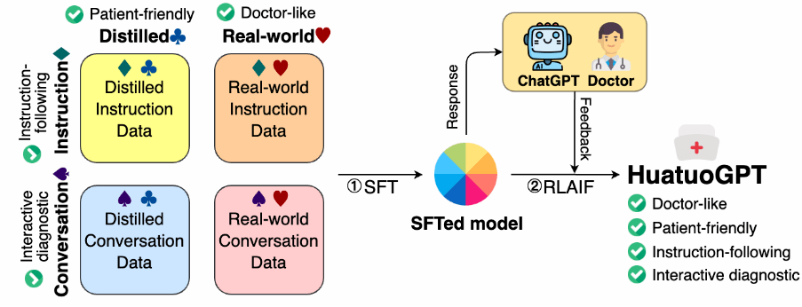
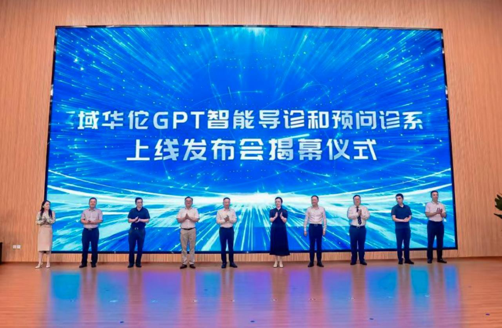

<link rel="stylesheet" href="{{ '/assets/css/project-detail.css' | relative_url }}">

Medical AI ecosystem

  AI for Healthcare
  Clinical reasoning
  Medical vision-language
  Open data
  Deployment

  <a class="impact-action" href="https://github.com/FreedomIntelligence/HuatuoGPT" target="_blank" rel="noopener">HuatuoGPT</a>
  <a class="impact-action secondary" href="https://github.com/FreedomIntelligence/HuatuoGPT-o1" target="_blank" rel="noopener">HuatuoGPT-o1</a>
  <a class="impact-action secondary" href="https://github.com/FreedomIntelligence/HuatuoGPT-Vision" target="_blank" rel="noopener">HuatuoGPT-Vision</a>
  <a class="impact-action secondary" href="https://huggingface.co/datasets/FreedomIntelligence/medical-o1-reasoning-SFT" target="_blank" rel="noopener">Reasoning data</a>

  

HuatuoGPT is the lab's flagship medical AI program: an open ecosystem that moves from Chinese medical QA data to doctor-facing chat models, medical complex reasoning, multimodal medical vision, and real-world triage and pre-consultation systems.

The project is not a single model release. It is a stack: medical data construction, supervised medical adaptation, verifier-style reasoning problems, visual medical knowledge injection, evaluation, and deployment loops that expose what medical AI can and cannot safely do.

<section class="impact-section">
  <h2>Research Storyline</h2>
  

    

      Data
      
<strong>Start with Chinese medical QA</strong>
Huatuo-26M and the early HuatuoGPT work created a reusable Chinese medical question-answering substrate for medical instruction tuning.

    

    

      Adapt
      
<strong>Turn general LLMs into medical assistants</strong>
HuatuoGPT-II simplifies medical adaptation with a one-stage recipe and public checkpoints, making the training pipeline easier to reproduce.

    

    

      Reason
      
<strong>Move from chat to complex diagnosis</strong>
HuatuoGPT-o1 introduces medical complex reasoning data and models, pushing beyond fluent consultation toward step-by-step clinical reasoning.

    

    

      See
      
<strong>Add visual medical knowledge</strong>
HuatuoGPT-Vision and PubMedVision connect medical images, reports, and dialogue so the ecosystem can handle multimodal clinical questions.

    

    

      Deploy
      
<strong>Close the loop with real workflows</strong>
Longgang triage and pre-consultation deployment turns evaluation pressure back into product and research questions.

    

  

</section>

<section class="impact-section">
  <h2>What It Builds</h2>
  

    

      <strong>Open medical LLMs</strong>
      
HuatuoGPT and HuatuoGPT-II adapt general LLMs to medical consultation, QA, and instruction-following with domain-specific supervision and evaluation.

    

    

      <strong>Complex medical reasoning</strong>
      
HuatuoGPT-o1 introduces verifiable medical problems and reasoning SFT data, targeting multi-step diagnosis, treatment reasoning, and medical decision support.

    

    

      <strong>Medical multimodality</strong>
      
HuatuoGPT-Vision and PubMedVision inject medical visual knowledge into multimodal LLMs for image-grounded medical dialogue and visual QA.

    

    

      <strong>Deployment path</strong>
      
HuatuoGPT-powered intelligent triage and pre-consultation systems have been used in Longgang, Shenzhen public hospital and community health settings.

    

  

</section>

<section class="impact-section">
  <h2>Project Gallery</h2>
  

    <figure>
      
      <figcaption>The ecosystem view: data, medical LLMs, reasoning, multimodality, and deployment form one pipeline.</figcaption>
    </figure>
    <figure>
      
      <figcaption>HuatuoGPT-II focuses on a simpler medical adaptation recipe and reproducible evaluation.</figcaption>
    </figure>
    <figure>
      
      <figcaption>Deployment in Longgang turns model research into triage and pre-consultation workflow feedback.</figcaption>
    </figure>
  

</section>

<section class="impact-section">
  <h2>Representative Work</h2>
  

    

      <strong>Huatuo-26M</strong>
      
A large Chinese medical QA dataset that seeded the early HuatuoGPT training pipeline and made Chinese medical instruction data reusable.

      <a href="https://github.com/FreedomIntelligence/Huatuo-26M" target="_blank" rel="noopener">Code and data</a>
    

    

      <strong>HuatuoGPT-o1</strong>
      
Medical complex reasoning models trained with medical-o1-reasoning-SFT and verifiable medical problem data.

      <a href="https://huggingface.co/FreedomIntelligence/HuatuoGPT-o1-8B" target="_blank" rel="noopener">Model</a>
    

    

      <strong>HuatuoGPT-Vision</strong>
      
A multimodal medical model line connected to PubMedVision, a large image-text medical visual instruction dataset.

      <a href="https://huggingface.co/FreedomIntelligence/HuatuoGPT-Vision-7B" target="_blank" rel="noopener">Model</a>
    

  

</section>

<section class="impact-section">
  <h2>Paper Trail</h2>
  

    

      Dataset
      
<strong>Huatuo-26M, a Large-scale Chinese Medical QA Dataset</strong>
Builds the data foundation for Chinese medical instruction tuning and evaluation.
<a href="https://github.com/FreedomIntelligence/Huatuo-26M" target="_blank" rel="noopener">Code and data</a>

    

    

      Model
      
<strong>HuatuoGPT, towards Taming Language Model to Be a Doctor</strong>
Turns the data foundation into an open medical dialogue model and establishes the first HuatuoGPT model family.
<a href="https://github.com/FreedomIntelligence/HuatuoGPT" target="_blank" rel="noopener">Repository</a>

    

    

      Adapt
      
<strong>HuatuoGPT-II, One-stage Training for Medical Adaption of LLMs</strong>
Simplifies the adaptation pipeline and releases public checkpoints for downstream medical LLM research.
<a href="https://github.com/FreedomIntelligence/HuatuoGPT-II" target="_blank" rel="noopener">Repository</a>

    

    

      Reasoning
      
<strong>HuatuoGPT-o1: Towards Medical Complex Reasoning with LLMs</strong>
Adds verifier-style medical reasoning data and models to make medical outputs more structured and testable.
<a href="https://github.com/FreedomIntelligence/HuatuoGPT-o1" target="_blank" rel="noopener">Repository</a>

    

    

      Vision
      
<strong>HuatuoGPT-Vision, Towards Injecting Medical Visual Knowledge into Multimodal LLMs at Scale</strong>
Extends the ecosystem from text-only medical QA to image-grounded medical dialogue and multimodal knowledge.
<a href="https://github.com/FreedomIntelligence/HuatuoGPT-Vision" target="_blank" rel="noopener">Repository</a>

    

  

</section>

<section class="impact-section">
  <h2>Why It Matters</h2>
  <ul class="impact-list">
    <li>It turns medical AI from a demo into a reproducible stack of datasets, models, benchmarks, and deployment artifacts.</li>
    <li>It connects text-only consultation, visual medical understanding, and explicit reasoning rather than treating them as isolated model families.</li>
    <li>It provides open entry points for the community: GitHub repositories, Hugging Face checkpoints, and medical reasoning datasets.</li>
  </ul>
</section>

医疗 AI 生态

  AI for Healthcare
  临床推理
  医疗视觉-语言
  开放数据
  部署

  <a class="impact-action" href="https://github.com/FreedomIntelligence/HuatuoGPT" target="_blank" rel="noopener">HuatuoGPT</a>
  <a class="impact-action secondary" href="https://github.com/FreedomIntelligence/HuatuoGPT-o1" target="_blank" rel="noopener">HuatuoGPT-o1</a>
  <a class="impact-action secondary" href="https://github.com/FreedomIntelligence/HuatuoGPT-Vision" target="_blank" rel="noopener">HuatuoGPT-Vision</a>
  <a class="impact-action secondary" href="https://huggingface.co/datasets/FreedomIntelligence/medical-o1-reasoning-SFT" target="_blank" rel="noopener">推理数据</a>

  

华佗GPT 是实验室的旗舰医疗 AI 项目，也是一个开放生态。它从中文医学问答数据起步，逐步扩展到面向医生的对话模型、复杂医学推理、多模态医学视觉，以及真实场景中的分诊与预问诊系统。

该项目不是单次的模型发布，而是一整套技术栈：医学数据构建、监督式医学适配、可验证的推理问题、医学视觉知识注入、评测，以及部署闭环。评测与部署让我们看清，医疗 AI 哪些事能安全地做，哪些不能。

<section class="impact-section">
  <h2>研究脉络</h2>
  

    

      数据
      
<strong>从中文医学问答起步</strong>
Huatuo-26M 与早期的 HuatuoGPT 工作，为医学指令微调提供了可复用的中文医学问答数据基础。

    

    

      适配
      
<strong>把通用大模型变成医疗助手</strong>
HuatuoGPT-II 用一阶段训练方案和公开的模型权重简化医学适配，让训练流程更容易复现。

    

    

      推理
      
<strong>从对话走向复杂诊断</strong>
HuatuoGPT-o1 引入医学复杂推理数据和模型，推动模型从流畅的问诊走向逐步的临床推理。

    

    

      视觉
      
<strong>加入医学视觉知识</strong>
HuatuoGPT-Vision 与 PubMedVision 把医学图像、报告和对话连接起来，使整个生态能够处理多模态临床问题。

    

    

      部署
      
<strong>用真实工作流形成闭环</strong>
龙岗的分诊与预问诊部署，把真实场景带来的评测压力转化为新的产品和研究问题。

    

  

</section>

<section class="impact-section">
  <h2>主要构成</h2>
  

    

      <strong>开源医疗大模型</strong>
      
HuatuoGPT 和 HuatuoGPT-II 借助领域监督数据和评测，把通用大模型适配到医疗问诊、问答和指令遵循。

    

    

      <strong>复杂医学推理</strong>
      
HuatuoGPT-o1 提出可验证的医学问题和推理 SFT 数据，面向多步诊断、治疗推理和医疗决策支持。

    

    

      <strong>医学多模态</strong>
      
HuatuoGPT-Vision 和 PubMedVision 把医学视觉知识注入多模态大模型，用于基于图像的医疗对话和视觉问答。

    

    

      <strong>部署路径</strong>
      
由华佗GPT 驱动的智能分诊和预问诊系统，已在深圳龙岗的公立医院和社康中心投入使用。

    

  

</section>

<section class="impact-section">
  <h2>项目图集</h2>
  

    <figure>
      
      <figcaption>生态全景：数据、医疗大模型、推理、多模态与部署，构成同一条流水线。</figcaption>
    </figure>
    <figure>
      
      <figcaption>HuatuoGPT-II 追求更简洁的医学适配方案和可复现的评测。</figcaption>
    </figure>
    <figure>
      
      <figcaption>龙岗的部署让模型研究接入分诊和预问诊流程，并从中获得反馈。</figcaption>
    </figure>
  

</section>

<section class="impact-section">
  <h2>代表性工作</h2>
  

    

      <strong>Huatuo-26M</strong>
      
大规模中文医学问答数据集，为早期 HuatuoGPT 的训练流程提供了数据起点，也让中文医学指令数据得以复用。

      <a href="https://github.com/FreedomIntelligence/Huatuo-26M" target="_blank" rel="noopener">代码与数据</a>
    

    

      <strong>HuatuoGPT-o1</strong>
      
用 medical-o1-reasoning-SFT 和可验证的医学问题数据训练的医学复杂推理模型。

      <a href="https://huggingface.co/FreedomIntelligence/HuatuoGPT-o1-8B" target="_blank" rel="noopener">模型</a>
    

    

      <strong>HuatuoGPT-Vision</strong>
      
多模态医学模型系列，配套大规模医学图文视觉指令数据集 PubMedVision。

      <a href="https://huggingface.co/FreedomIntelligence/HuatuoGPT-Vision-7B" target="_blank" rel="noopener">模型</a>
    

  

</section>

<section class="impact-section">
  <h2>论文脉络</h2>
  

    

      数据集
      
<strong>Huatuo-26M, a Large-scale Chinese Medical QA Dataset</strong>
为中文医学指令微调和评测打下数据基础。
<a href="https://github.com/FreedomIntelligence/Huatuo-26M" target="_blank" rel="noopener">代码与数据</a>

    

    

      模型
      
<strong>HuatuoGPT, towards Taming Language Model to Be a Doctor</strong>
把数据基础转化为开放的医学对话模型，并确立了最初的 HuatuoGPT 模型系列。
<a href="https://github.com/FreedomIntelligence/HuatuoGPT" target="_blank" rel="noopener">代码仓库</a>

    

    

      适配
      
<strong>HuatuoGPT-II, One-stage Training for Medical Adaption of LLMs</strong>
简化了适配流程，并发布公开的模型权重，供下游医疗大模型研究使用。
<a href="https://github.com/FreedomIntelligence/HuatuoGPT-II" target="_blank" rel="noopener">代码仓库</a>

    

    

      推理
      
<strong>HuatuoGPT-o1: Towards Medical Complex Reasoning with LLMs</strong>
加入可验证的医学推理数据和模型，让医疗输出更有条理，也更容易检验。
<a href="https://github.com/FreedomIntelligence/HuatuoGPT-o1" target="_blank" rel="noopener">代码仓库</a>

    

    

      视觉
      
<strong>HuatuoGPT-Vision, Towards Injecting Medical Visual Knowledge into Multimodal LLMs at Scale</strong>
把生态从纯文本的医学问答，扩展到基于图像的医疗对话和多模态知识。
<a href="https://github.com/FreedomIntelligence/HuatuoGPT-Vision" target="_blank" rel="noopener">代码仓库</a>

    

  

</section>

<section class="impact-section">
  <h2>研究意义</h2>
  <ul class="impact-list">
    <li>它让医疗 AI 不再只是演示，而是一套可复现的体系，涵盖数据集、模型、评测基准和部署成果。</li>
    <li>它把纯文本问诊、医学视觉理解和显式推理连成一体，而不是当作彼此孤立的模型系列。</li>
    <li>它为社区提供开放的入口：GitHub 代码仓库、Hugging Face 上的模型权重，以及医学推理数据集。</li>
  </ul>
</section>

