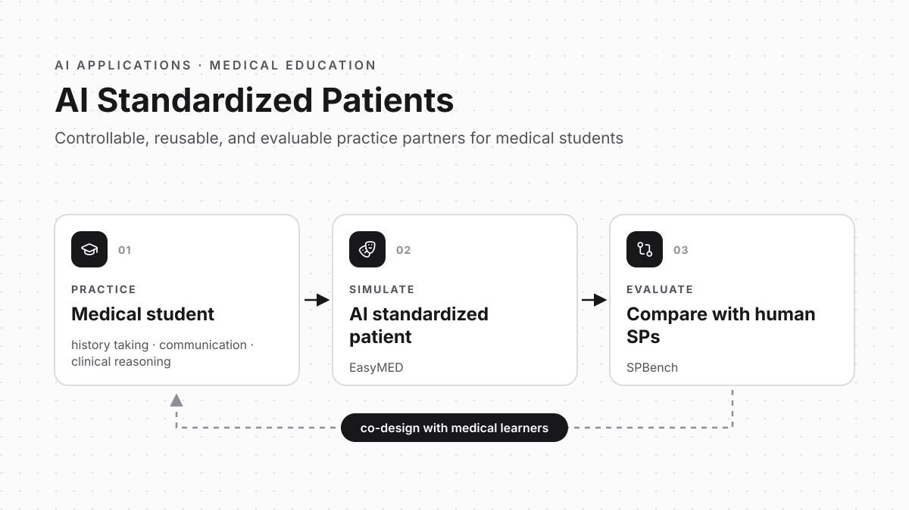
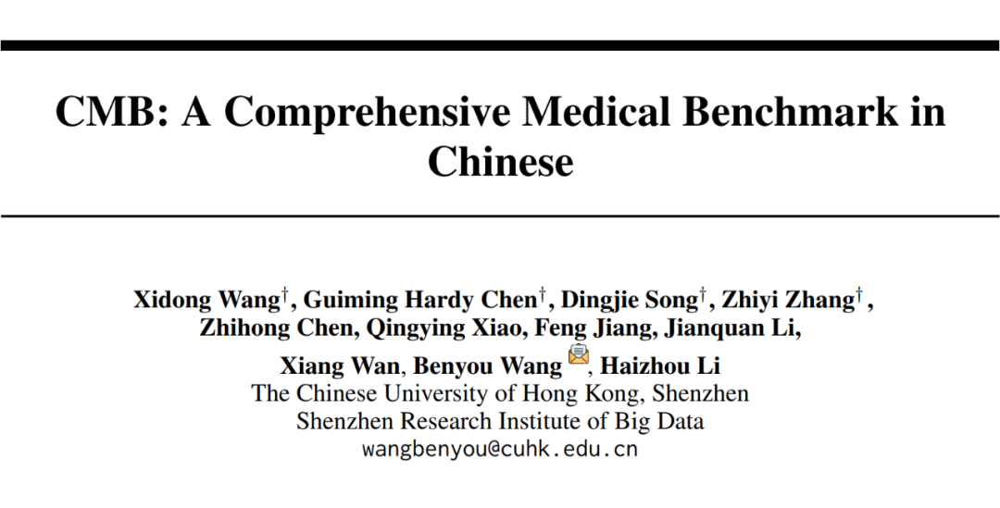
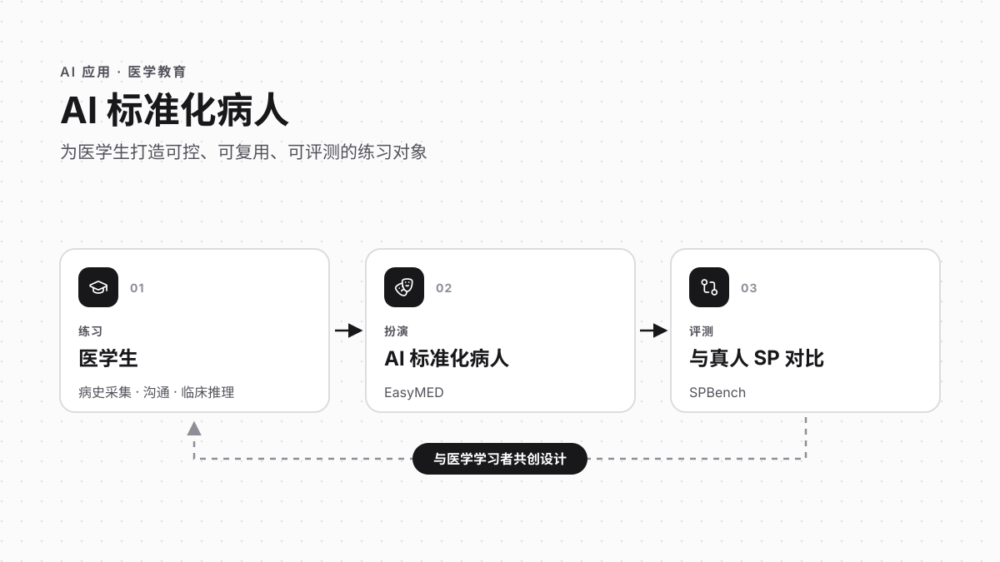

<link rel="stylesheet" href="{{ '/assets/css/project-detail.css' | relative_url }}">

Medical education and human-agent interaction

  AI standardized patients
  EasyMED
  SPBench
  Medical learning
  Co-design

  <a class="impact-action" href="https://github.com/FreedomIntelligence/EasyMED" target="_blank" rel="noopener">EasyMED</a>
  <a class="impact-action secondary" href="https://arxiv.org/abs/2511.14783" target="_blank" rel="noopener">AI-SP Paper</a>
  <a class="impact-action secondary" href="https://arxiv.org/abs/2602.05856" target="_blank" rel="noopener">Co-design Paper</a>
  <a class="impact-action secondary" href="/projects/">All Projects</a>

  

This project asks how AI can become a reliable practice partner for medical learners. The goal is not only to make a model talk like a patient, but to make standardized-patient training scalable, controllable, repeatable, and evaluable.

<section class="impact-section">
  <h2>Background and Motivation</h2>
  

    

      <strong>Standardized patient training is expensive to scale</strong>
      
Human standardized patients are valuable, but scheduling, case coverage, training consistency, and feedback quality are hard to maintain across many learners.

    

    

      <strong>LLMs can simulate conversation, but education needs more</strong>
      
A useful AI patient must preserve clinical persona, reveal information gradually, respond to learner behavior, and support structured feedback.

    

    

      <strong>Medical learners need safe repetition</strong>
      
Students need repeated practice in history taking, communication, empathy, and clinical reasoning before facing high-stakes clinical settings.

    

  

</section>

<section class="impact-section">
  <h2>Core Ideas</h2>
  

    

      Case
      
<strong>Build controllable patient cases</strong>
Define patient background, symptoms, hidden findings, emotional stance, and disclosure rules so the AI patient behaves consistently across sessions.

    

    

      Dialogue
      
<strong>Make the patient interactive, not scripted</strong>
The simulated patient should respond to learner questions, resist over-disclosure, and expose missing history-taking skills.

    

    

      Rubric
      
<strong>Connect interaction to evaluation</strong>
Practice conversations are paired with rubrics and benchmarks so the system can measure information coverage, reasoning quality, communication, and safety.

    

    

      Design
      
<strong>Co-design with medical learners</strong>
The CHI-facing work studies how students experience AI patients, what feels different from human SPs, and how interfaces should support learning.

    

  

</section>

<section class="impact-section">
  <h2>Typical Work</h2>
  

    

      EasyMED
      
<strong>Human or LLM as Standardized Patients?</strong>
Introduces EasyMED and SPBench, comparing AI standardized patients with human standardized patients in medical education scenarios.
<a href="https://arxiv.org/abs/2511.14783" target="_blank" rel="noopener">Paper</a>

    

    

      CHI
      
<strong>It Talks Like a Patient, But Feels Different</strong>
Co-designs AI standardized patients with medical learners and surfaces design requirements around realism, agency, feedback, and trust.
<a href="https://arxiv.org/abs/2602.05856" target="_blank" rel="noopener">Paper</a>

    

    

      Workflow
      
<strong>Doctor-centric workflow-aligned tasks and benchmarks</strong>
Connects medical education and AI evaluation to the real workflows doctors use for documentation, reasoning, and decision support.
<a href="https://arxiv.org/abs/2510.11040" target="_blank" rel="noopener">Paper</a>

    

  

</section>

<section class="impact-section">
  <h2>Display Figures</h2>
  

    <figure>
      
      <figcaption>Medical education scenarios need both realistic conversations and structured evaluation signals.</figcaption>
    </figure>
    <figure>
      
      <figcaption>The AI-SP line connects to the broader medical benchmark stack, including knowledge, multimodal, and workflow-aligned evaluation.</figcaption>
    </figure>
  

</section>

<section class="impact-section">
  <h2>Resource Map</h2>
  

    

      <strong>EasyMED</strong>
      
Repository for AI standardized patient simulation and related medical education resources.

      <a href="https://github.com/FreedomIntelligence/EasyMED" target="_blank" rel="noopener">Repository</a>
    

    

      <strong>Medical Evaluation Benchmarks</strong>
      
Companion project for medical QA, multimodal medical AI, diagnosis, live clinical benchmarks, and doctor workflows.

      <a href="/projects/medical-evaluation-benchmarks/">Project page</a>
    

    

      <strong>HuatuoGPT Ecosystem</strong>
      
The medical model family that supplies the language, vision, reasoning, and deployment backbone for medical AI scenarios.

      <a href="/projects/medical-ai-ecosystem/">Project page</a>
    

  

</section>

  <a class="impact-action secondary" href="/projects/">Back to Projects</a>

医学教育与人机交互

  AI 标准化病人
  EasyMED
  SPBench
  医学学习
  共创设计

  <a class="impact-action" href="https://github.com/FreedomIntelligence/EasyMED" target="_blank" rel="noopener">EasyMED</a>
  <a class="impact-action secondary" href="https://arxiv.org/abs/2511.14783" target="_blank" rel="noopener">AI-SP 论文</a>
  <a class="impact-action secondary" href="https://arxiv.org/abs/2602.05856" target="_blank" rel="noopener">共创设计论文</a>
  <a class="impact-action secondary" href="/projects/">全部项目</a>

  

本项目探讨 AI 如何成为医学学习者可靠的练习伙伴。目标不只是让模型“像病人一样说话”，更是让标准化病人训练可规模化、可控、可重复、可评测。

<section class="impact-section">
  <h2>背景与动机</h2>
  

    

      <strong>标准化病人训练的规模化成本很高</strong>
      
真人标准化病人很有价值，但学习者一多，排班、病例覆盖、培训一致性和反馈质量都难以保证。

    

    

      <strong>大模型能模拟对话，但教学需要更多</strong>
      
真正有用的 AI 病人需要保持稳定的病人角色、逐步透露信息、回应学习者的行为，并支持结构化反馈。

    

    

      <strong>医学学习者需要安全的反复练习</strong>
      
在面对高风险的临床场景之前，学生需要反复练习病史采集、沟通、共情和临床推理。

    

  

</section>

<section class="impact-section">
  <h2>核心思路</h2>
  

    

      病例
      
<strong>构建可控的病例</strong>
定义病人的背景、症状、隐藏的临床发现、情绪态度和信息披露规则，让 AI 病人在多次练习中表现一致。

    

    

      对话
      
<strong>让病人能互动，而不是照本宣科</strong>
模拟病人要回应学习者的提问，不会一次说出全部信息，并让学习者在病史采集上的不足暴露出来。

    

    

      Rubric
      
<strong>把交互与评测连接起来</strong>
练习对话配有 rubric 和评测基准，系统因此可以衡量信息覆盖、推理质量、沟通表现和安全性。

    

    

      设计
      
<strong>与医学学习者共创设计</strong>
CHI 方向的这项工作研究学生如何体验 AI 病人、与真人标准化病人相比感受有何不同，以及界面应如何支持学习。

    

  

</section>

<section class="impact-section">
  <h2>代表性工作</h2>
  

    

      EasyMED
      
<strong>Human or LLM as Standardized Patients?</strong>
提出 EasyMED 和 SPBench，在医学教育场景中对比 AI 标准化病人与真人标准化病人。
<a href="https://arxiv.org/abs/2511.14783" target="_blank" rel="noopener">论文</a>

    

    

      CHI
      
<strong>It Talks Like a Patient, But Feels Different</strong>
与医学学习者共同设计 AI 标准化病人，归纳出围绕真实感、自主性、反馈和信任的设计需求。
<a href="https://arxiv.org/abs/2602.05856" target="_blank" rel="noopener">论文</a>

    

    

      工作流
      
<strong>以医生为中心、与工作流对齐的任务与评测基准</strong>
让医学教育和 AI 评测贴近医生的真实工作流，包括病历文书、推理和决策支持。
<a href="https://arxiv.org/abs/2510.11040" target="_blank" rel="noopener">论文</a>

    

  

</section>

<section class="impact-section">
  <h2>图示</h2>
  

    <figure>
      
      <figcaption>医学教育场景既需要逼真的对话，也需要结构化的评测信号。</figcaption>
    </figure>
    <figure>
      
      <figcaption>AI-SP 研究线与更广泛的医学评测基准体系相连，涵盖知识、多模态以及与工作流对齐的评测。</figcaption>
    </figure>
  

</section>

<section class="impact-section">
  <h2>资源导航</h2>
  

    

      <strong>EasyMED</strong>
      
AI 标准化病人模拟及相关医学教育资源的代码仓库。

      <a href="https://github.com/FreedomIntelligence/EasyMED" target="_blank" rel="noopener">代码仓库</a>
    

    

      <strong>医疗评测基准</strong>
      
配套项目，涵盖医学问答、多模态医疗 AI、诊断、实时临床评测基准和医生工作流。

      <a href="/projects/medical-evaluation-benchmarks/">项目主页</a>
    

    

      <strong>华佗GPT 生态</strong>
      
为医疗 AI 场景提供语言、视觉、推理和部署底座的医疗模型系列。

      <a href="/projects/medical-ai-ecosystem/">项目主页</a>
    

  

</section>

  <a class="impact-action secondary" href="/projects/">返回项目页</a>

