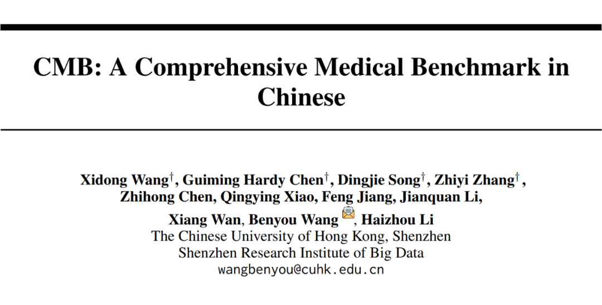

<link rel="stylesheet" href="{{ '/assets/css/project-detail.css' | relative_url }}">

Medical evaluation

  CMB
  GMAI-MMBench
  LiveClin
  DxBench
  Doctor workflow

  <a class="impact-action" href="https://github.com/FreedomIntelligence/CMB" target="_blank" rel="noopener">CMB</a>
  <a class="impact-action secondary" href="https://huggingface.co/datasets/FreedomIntelligence/CMB" target="_blank" rel="noopener">CMB data</a>
  <a class="impact-action secondary" href="https://arxiv.org/abs/2308.08833" target="_blank" rel="noopener">CMB paper</a>
  <a class="impact-action secondary" href="https://github.com/uni-medical/GMAI-MMBench" target="_blank" rel="noopener">GMAI-MMBench</a>

  

Medical AI cannot be judged only by generic chat quality. The lab's benchmark work builds domain-specific tests for Chinese medical knowledge, multimodal medical perception, live clinical leakage control, diagnostic reasoning, and doctor-centered workflows.

<section class="impact-section">
  <h2>Evaluation Storyline</h2>
  

    

      Knowledge
      
<strong>CMB starts from Chinese medical exams and clinical QA</strong>
It tests whether models know medicine in the language and assessment structure used by Chinese medical education and practice.

    

    

      Dialogue
      
<strong>CMB-Clin adds complex consultation cases</strong>
Clinical question answering forces models to use patient histories and multi-turn information rather than isolated multiple-choice memory.

    

    

      Vision
      
<strong>GMAI-MMBench moves evaluation into multimodality</strong>
Medical AI must combine images, reports, and clinical knowledge, so the benchmark stack expands beyond text-only questions.

    

    

      Reality
      
<strong>LiveClin, DxBench, and workflow tests reduce benchmark comfort</strong>
Later evaluation directions stress leakage control, diagnostic reasoning, and doctor-centered tasks closer to deployed clinical workflows.

    

  

</section>

<section class="impact-section">
  <h2>Benchmark Layers</h2>
  

    

      <strong>CMB</strong>
      
A comprehensive Chinese medical benchmark covering medical exams, clinical QA, and Chinese medical knowledge, with code and Hugging Face data.

    

    

      <strong>GMAI-MMBench</strong>
      
A multimodal benchmark for general medical AI, testing whether models can combine medical vision, text, and domain reasoning.

    

    

      <strong>LiveClin and DxBench</strong>
      
Clinical evaluation directions that reduce leakage risk and stress diagnostic reasoning under more realistic clinical settings.

    

    

      <strong>Workflow-aligned tasks</strong>
      
Doctor-centric evaluation reframes medical AI around tasks clinicians actually perform, rather than only static QA accuracy.

    

  

</section>

<section class="impact-section">
  <h2>Display Figures</h2>
  

    <figure>
      
      <figcaption>CMB combines exam-style medical knowledge with clinical diagnostic questions and expert-aligned scoring.</figcaption>
    </figure>
    <figure>
      
      <figcaption>Model building and benchmark design stay connected: evaluation reveals where medical adaptation still fails.</figcaption>
    </figure>
  

</section>

<section class="impact-section">
  <h2>Evaluation Philosophy</h2>
  

Benchmarks should not reward fluent medical-sounding text alone. Strong medical evaluation asks whether the model uses evidence, handles uncertainty, follows workflow constraints, avoids memorized leakage, and supports the clinician's actual decision process.
  

</section>

<section class="impact-section">
  <h2>Paper Trail</h2>
  

    

      CMB
      
<strong>CMB: A Comprehensive Medical Benchmark in Chinese</strong>
Builds a Chinese medical benchmark with exam and clinical components, giving Chinese medical LLMs a domain-specific yardstick.
<a href="https://github.com/FreedomIntelligence/CMB" target="_blank" rel="noopener">Repository</a>

    

    

      Vision
      
<strong>GMAI-MMBench: A Comprehensive Multimodal Evaluation Benchmark Towards General Medical AI</strong>
Extends the evaluation stack to general medical AI scenarios that require multimodal perception and domain reasoning.
<a href="https://uni-medical.github.io/GMAI-MMBench.github.io/" target="_blank" rel="noopener">Project site</a>

    

    

      Clinical
      
<strong>LiveClin and DxBench</strong>
Push medical evaluation toward live, leakage-resistant, diagnostic, and workflow-aligned settings.
<a href="https://github.com/AQ-MedAI/LiveClin" target="_blank" rel="noopener">LiveClin</a>

    

  

</section>

<section class="impact-section">
  <h2>Resource Map</h2>
  

    

      <strong>CMB code</strong>
      
Core Chinese medical benchmark repository and evaluation tooling.

      <a href="https://github.com/FreedomIntelligence/CMB" target="_blank" rel="noopener">Repository</a>
    

    

      <strong>CMB dataset</strong>
      
Hugging Face release for reproducible Chinese medical benchmark experiments.

      <a href="https://huggingface.co/datasets/FreedomIntelligence/CMB" target="_blank" rel="noopener">Dataset</a>
    

    

      <strong>GMAI-MMBench</strong>
      
Multimodal general medical AI benchmark and public project resources.

      <a href="https://uni-medical.github.io/GMAI-MMBench.github.io/" target="_blank" rel="noopener">Project</a>
    

  

</section>

医疗评测

  CMB
  GMAI-MMBench
  LiveClin
  DxBench
  医生工作流

  <a class="impact-action" href="https://github.com/FreedomIntelligence/CMB" target="_blank" rel="noopener">CMB</a>
  <a class="impact-action secondary" href="https://huggingface.co/datasets/FreedomIntelligence/CMB" target="_blank" rel="noopener">CMB 数据</a>
  <a class="impact-action secondary" href="https://arxiv.org/abs/2308.08833" target="_blank" rel="noopener">CMB 论文</a>
  <a class="impact-action secondary" href="https://github.com/uni-medical/GMAI-MMBench" target="_blank" rel="noopener">GMAI-MMBench</a>

  

医疗 AI 不能只看通用对话质量。实验室的评测工作分别针对中文医学知识、多模态医学感知、防泄漏的实时临床测试、诊断推理，以及以医生为中心的工作流，构建专门的测试。

<section class="impact-section">
  <h2>评测脉络</h2>
  

    

      知识
      
<strong>CMB 从中文医学考试和临床问答出发</strong>
在中国医学教育与临床实践使用的语言和考核形式下，检验模型是否掌握医学知识。

    

    

      对话
      
<strong>CMB-Clin 加入复杂的问诊病例</strong>
临床问答要求模型利用病史和多轮信息作答，而不是靠孤立的选择题记忆。

    

    

      视觉
      
<strong>GMAI-MMBench 把评测推向多模态</strong>
医疗 AI 必须综合图像、报告和临床知识，评测体系也因此不再局限于纯文本题目。

    

    

      现实
      
<strong>LiveClin、DxBench 和工作流测试打破评测的“舒适区”</strong>
后续评测更强调防数据泄漏、诊断推理，以及以医生为中心、更贴近实际临床工作流的任务。

    

  

</section>

<section class="impact-section">
  <h2>评测层次</h2>
  

    

      <strong>CMB</strong>
      
综合性的中文医学评测基准，涵盖医学考试、临床问答和中文医学知识，并提供代码和 Hugging Face 数据。

    

    

      <strong>GMAI-MMBench</strong>
      
面向通用医疗 AI 的多模态评测基准，检验模型能否把医学视觉、文本和领域推理结合起来。

    

    

      <strong>LiveClin 与 DxBench</strong>
      
两个临床评测方向：降低数据泄漏风险，并在更贴近真实的临床场景中考察诊断推理。

    

    

      <strong>贴合工作流的任务</strong>
      
以医生为中心的评测围绕临床医生实际承担的任务来衡量医疗 AI，而不只看静态问答的准确率。

    

  

</section>

<section class="impact-section">
  <h2>图示</h2>
  

    <figure>
      
      <figcaption>CMB 把考试式医学知识与临床诊断问题结合起来，并采用与专家判断一致的评分方式。</figcaption>
    </figure>
    <figure>
      
      <figcaption>模型研发与评测设计紧密相连：评测会暴露医学适配仍然失败的地方。</figcaption>
    </figure>
  

</section>

<section class="impact-section">
  <h2>评测理念</h2>
  

评测基准不应只奖励流畅、听起来很专业的医学文本。好的医疗评测要看模型是否依据证据作答、能否处理不确定性、是否遵守工作流约束、是否避免靠记住泄漏的题目得分，以及能否真正支持临床医生的决策过程。
  

</section>

<section class="impact-section">
  <h2>论文脉络</h2>
  

    

      CMB
      
<strong>CMB: A Comprehensive Medical Benchmark in Chinese</strong>
构建包含考试和临床两部分的中文医学评测基准，为中文医疗大模型提供领域专用的衡量标尺。
<a href="https://github.com/FreedomIntelligence/CMB" target="_blank" rel="noopener">代码仓库</a>

    

    

      视觉
      
<strong>GMAI-MMBench: A Comprehensive Multimodal Evaluation Benchmark Towards General Medical AI</strong>
把评测体系扩展到需要多模态感知和领域推理的通用医疗 AI 场景。
<a href="https://uni-medical.github.io/GMAI-MMBench.github.io/" target="_blank" rel="noopener">项目主页</a>

    

    

      临床
      
<strong>LiveClin 与 DxBench</strong>
把医疗评测推向实时更新、抗数据泄漏、侧重诊断推理且贴合工作流的场景。
<a href="https://github.com/AQ-MedAI/LiveClin" target="_blank" rel="noopener">LiveClin</a>

    

  

</section>

<section class="impact-section">
  <h2>资源导航</h2>
  

    

      <strong>CMB 代码</strong>
      
中文医学评测基准的核心代码仓库和评测工具。

      <a href="https://github.com/FreedomIntelligence/CMB" target="_blank" rel="noopener">代码仓库</a>
    

    

      <strong>CMB 数据集</strong>
      
在 Hugging Face 上发布的数据，用于复现中文医学评测实验。

      <a href="https://huggingface.co/datasets/FreedomIntelligence/CMB" target="_blank" rel="noopener">数据集</a>
    

    

      <strong>GMAI-MMBench</strong>
      
面向通用医疗 AI 的多模态评测基准及公开项目资源。

      <a href="https://uni-medical.github.io/GMAI-MMBench.github.io/" target="_blank" rel="noopener">项目主页</a>
    

  

</section>

