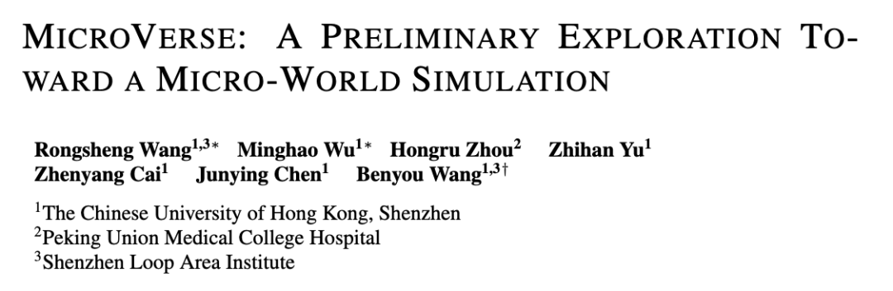
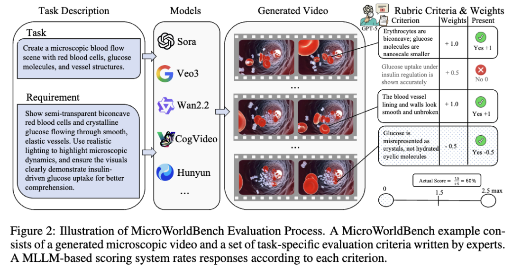

<link rel="stylesheet" href="{{ '/assets/css/project-detail.css' | relative_url }}">

Micro-world models

  MicroVerse
  World models
  Biological simulation
  Mechanistic reasoning
  ICLR 2026

  <a class="impact-action" href="https://github.com/FreedomIntelligence/MicroVerse" target="_blank" rel="noopener">GitHub</a>
  <a class="impact-action secondary" href="https://arxiv.org/abs/2603.00585" target="_blank" rel="noopener">Paper</a>

  

MicroVerse explores a different kind of world model: not city streets or game worlds, but biological micro-worlds where organ, cellular, and subcellular processes unfold under domain mechanisms that are often invisible to ordinary vision-language models.

<section class="impact-section">
  <h2>Research Storyline</h2>
  

    

      Scope
      
<strong>Move world models into biology</strong>
MicroVerse treats organs, cells, and subcellular processes as evolving worlds whose important state is often hidden from surface images.

    

    

      Mechanism
      
<strong>Use scientific constraints, not only pixels</strong>
The project asks whether generative systems can respect biological mechanisms and state transitions, not merely produce plausible-looking pictures.

    

    

      Benchmark
      
<strong>Evaluate micro-world dynamics</strong>
Benchmarks pressure models to predict, generate, and reason about biologically meaningful transitions over time.

    

    

      Bridge
      
<strong>Connect scientific and economic simulations</strong>
MicroVerse complements TwinMarket and Economic World Models by showing how the same simulation agenda can apply to high-stakes scientific domains.

    

  

</section>

<section class="impact-section">
  <h2>Research Questions</h2>
  

    

      <strong>Can AI simulate hidden biological dynamics?</strong>
      
Micro-world modeling requires reasoning about mechanisms, state transitions, and biological constraints, not only visual appearance.

    

    

      <strong>How should micro-worlds be evaluated?</strong>
      
The project builds tasks and benchmarks that test whether generated or predicted dynamics remain biologically meaningful.

    

    

      <strong>What does a scientific world model need?</strong>
      
The system points toward simulation models that can be inspected, corrected, and aligned with scientific evidence.

    

  

</section>

  

<section class="impact-section">
  <h2>Display Figures</h2>
  

    <figure>
      
      <figcaption>MicroVerse frames biological processes as micro-worlds with hidden mechanisms and evolving states.</figcaption>
    </figure>
    <figure>
      
      <figcaption>The benchmark side asks whether predictions remain scientifically meaningful, not only visually plausible.</figcaption>
    </figure>
  

</section>

<section class="impact-section">
  <h2>Paper Trail</h2>
  

    

      Micro
      
<strong>MicroVerse: A Preliminary Exploration Toward a Micro-World Simulation</strong>
Introduces biological micro-world simulation as a world-modeling direction for organs, cells, and subcellular processes.
<a href="https://github.com/FreedomIntelligence/MicroVerse" target="_blank" rel="noopener">Repository</a>

    

    

      Macro
      
<strong>Economic World Models and TwinMarket</strong>
Shows the same agentic simulation idea at social and market scale, giving MicroVerse a broader world-modeling context.
<a href="/projects/economic-world-models/">Economic World Models</a>

    

  

</section>

<section class="impact-section">
  <h2>Why It Matters</h2>
  <ul class="impact-list">
    <li>It expands world modeling from visually obvious environments to scientific domains where mechanisms are hidden and high-stakes.</li>
    <li>It connects medical AI, biological modeling, and agentic simulation under one research question: can models reason over evolving worlds?</li>
    <li>It complements Economic World Models and TwinMarket by showing that the same simulation agenda can apply to microscopic systems.</li>
  </ul>
</section>

微观世界模型

  MicroVerse
  世界模型
  生物模拟
  机制推理
  ICLR 2026

  <a class="impact-action" href="https://github.com/FreedomIntelligence/MicroVerse" target="_blank" rel="noopener">GitHub</a>
  <a class="impact-action secondary" href="https://arxiv.org/abs/2603.00585" target="_blank" rel="noopener">论文</a>

  

MicroVerse 探索的是另一类世界模型：不是城市街道，也不是游戏世界，而是生物微观世界。器官、细胞和亚细胞层面的过程在其中按领域机制展开，而这些机制往往是普通视觉-语言模型看不到的。

<section class="impact-section">
  <h2>研究脉络</h2>
  

    

      范围
      
<strong>把世界模型带入生物学</strong>
MicroVerse 把器官、细胞和亚细胞过程看作不断演化的世界，其关键状态往往藏在表面图像之下。

    

    

      机制
      
<strong>不只看像素，也要用科学约束</strong>
项目关心的是：生成系统能否遵循生物机制和状态转移，而不只是画出看上去合理的图像。

    

    

      基准
      
<strong>评测微观世界的动态</strong>
评测基准要求模型预测、生成并推理随时间发生的、有生物学意义的状态转移。

    

    

      衔接
      
<strong>连接科学模拟与经济模拟</strong>
MicroVerse 与 TwinMarket、经济世界模型相互补充，说明同一套模拟思路也适用于高风险的科学领域。

    

  

</section>

<section class="impact-section">
  <h2>研究问题</h2>
  

    

      <strong>AI 能模拟隐藏的生物动态吗？</strong>
      
微观世界建模不能只看视觉外观，还需要对机制、状态转移和生物学约束做推理。

    

    

      <strong>微观世界该如何评测？</strong>
      
项目构建了一批任务和评测基准，检验生成或预测出的动态是否仍然具有生物学意义。

    

    

      <strong>科学世界模型需要什么？</strong>
      
这套系统指向的是一类可检视、可修正，并能与科学证据对齐的模拟模型。

    

  

</section>

  

<section class="impact-section">
  <h2>图示</h2>
  

    <figure>
      
      <figcaption>MicroVerse 把生物过程看作具有隐藏机制、状态不断演化的微观世界。</figcaption>
    </figure>
    <figure>
      
      <figcaption>评测基准考察的是预测结果是否仍有科学意义，而不只是看起来合理。</figcaption>
    </figure>
  

</section>

<section class="impact-section">
  <h2>论文脉络</h2>
  

    

      微观
      
<strong>MicroVerse: A Preliminary Exploration Toward a Micro-World Simulation</strong>
提出生物微观世界模拟，作为面向器官、细胞和亚细胞过程的世界建模方向。
<a href="https://github.com/FreedomIntelligence/MicroVerse" target="_blank" rel="noopener">代码仓库</a>

    

    

      宏观
      
<strong>经济世界模型与 TwinMarket</strong>
在社会和市场尺度上展示同一套智能体模拟思路，为 MicroVerse 提供更广阔的世界建模背景。
<a href="/projects/economic-world-models/">经济世界模型</a>

    

  

</section>

<section class="impact-section">
  <h2>研究意义</h2>
  <ul class="impact-list">
    <li>它把世界建模从视觉上一目了然的环境，扩展到机制隐藏、风险很高的科学领域。</li>
    <li>它把医疗 AI、生物建模和智能体模拟放在同一个研究问题之下：模型能否对不断演化的世界做推理？</li>
    <li>它与经济世界模型和 TwinMarket 相互补充，说明同一套模拟思路同样适用于微观系统。</li>
  </ul>
</section>

