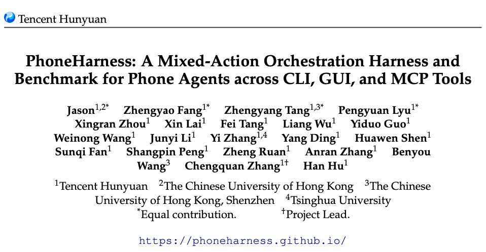
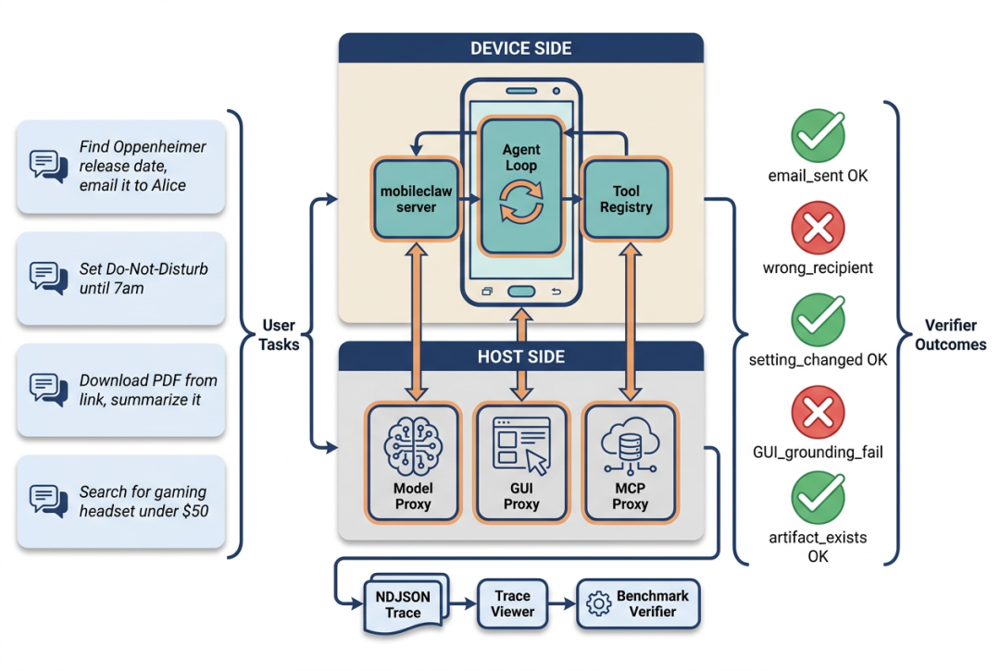

<link rel="stylesheet" href="{{ '/assets/css/project-detail.css' | relative_url }}">

Phone-use agents and mobile workflow execution

  Mobile Agent
  Phone-use agents
  GUI agents
  Privacy and safety
  Agent training

  <a class="impact-action" href="https://phoneharness.github.io/" target="_blank" rel="noopener">PhoneHarness</a>
  <a class="impact-action secondary" href="https://github.com/PhoneHarness/PhoneHarness" target="_blank" rel="noopener">GitHub</a>
  <a class="impact-action secondary" href="https://huggingface.co/datasets/PhoneHarness/phoneharness-bench" target="_blank" rel="noopener">Dataset</a>
  <a class="impact-action secondary" href="/projects/long-context-multimodal/">Long-context MLLMs</a>
  <a class="impact-action secondary" href="/projects/">All Projects</a>

  

Mobile Agent builds the infrastructure, benchmarks, and training recipes for phone-use agents that can operate mobile workflows reliably, privately, and safely. The research line moves beyond screenshot QA toward executable tasks, auditable traces, mixed action spaces, simulated phone environments, and real-app reinforcement learning.

<section class="impact-section">
  <h2>Background and Motivation</h2>
  

    

      <strong>Phones are a natural agent arena</strong>
      
Daily work already happens across mobile apps, permissions, notifications, files, accounts, and dynamic screens, making phones a realistic testbed for general-purpose agents.

    

    

      <strong>GUI-only evaluation is too narrow</strong>
      
Real workflows often require a mixture of GUI interaction, command-line execution, tool calls, state inspection, and verification beyond simple click trajectories.

    

    

      <strong>Success must be safe and private</strong>
      
An agent that completes a task while leaking data, overusing permissions, or taking unsafe actions is not deployment-ready.

    

  

</section>

<section class="impact-section">
  <h2>Research Storyline</h2>
  

    

      Privacy
      
<strong>Measure whether phone agents respect user data</strong>
MyPhoneBench reframes phone-agent readiness around permissioned access, minimal disclosure, and user-controlled memory.

    

    

      Safety
      
<strong>Separate safe behavior from incapability</strong>
PhoneSafety evaluates safety-critical moments and distinguishes safe actions, unsafe actions, and failures to do anything useful.

    

    

      World
      
<strong>Scale controllable phone environments</strong>
PhoneWorld turns real GUI trajectories and screenshots into reusable environments with executable tasks, state transitions, and verifiers.

    

    

      Harness
      
<strong>Combine GUI, CLI, and tool actions</strong>
PhoneHarness gives phone agents a mixed-action execution framework with auditable traces and task-level verification.

    

    

      Train
      
<strong>Train open models for real phone use</strong>
PhoneBuddy combines real-app environments and mock environments so open models can learn robust agentic phone-use behavior.

    

  

</section>

<section class="impact-section">
  <h2>Representative Work</h2>
  

    

      Privacy
      
<strong>Do Phone-Use Agents Respect Your Privacy?</strong>
Introduces MyPhoneBench for evaluating privacy risks in phone-use agents across realistic mobile tasks.
<a href="https://arxiv.org/abs/2604.00986" target="_blank" rel="noopener">Paper</a>

    

    

      Safety
      
<strong>Safe, or Simply Incapable?</strong>
Rethinks safety evaluation by separating genuinely safe choices from unhelpful or failed actions.
<a href="https://arxiv.org/abs/2605.07630" target="_blank" rel="noopener">Paper</a>

    

    

      Env
      
<strong>PhoneWorld: Scaling Phone-Use Agent Environments</strong>
Builds scalable phone-use environments from real GUI traces, controllable screens, executable tasks, and verifiers.
<a href="https://arxiv.org/abs/2605.29486" target="_blank" rel="noopener">Paper</a>

    

    

      Harness
      
<strong>PhoneHarness: Harnessing Phone-Use Agents through Mixed GUI, CLI, and Tool Actions</strong>
Expands agent execution beyond GUI-only actions and evaluates whether mobile workflows are truly completed.
<a href="https://arxiv.org/abs/2606.14832" target="_blank" rel="noopener">Paper</a>

    

    

      Training
      
<strong>PhoneBuddy: Training Open Models for Agentic Phone Use</strong>
Uses real-app and mock phone environments to train open models for stronger agentic phone-use performance.
<a href="https://arxiv.org/abs/2606.23049" target="_blank" rel="noopener">Paper</a>

    

  

</section>

<section class="impact-section">
  <h2>Technical Layers</h2>
  

    

      <strong>Environment construction</strong>
      
Reusable mobile environments make real app workflows controllable, replayable, and measurable.

    

    

      <strong>Mixed action execution</strong>
      
Agents can combine GUI operations, CLI commands, and tool calls while leaving traces that humans and verifiers can audit.

    

    

      <strong>Task-level verification</strong>
      
Benchmarks judge whether the external phone state changed correctly, not just whether the model produced plausible intermediate actions.

    

    

      <strong>Safety and privacy constraints</strong>
      
Evaluation tracks permission use, data disclosure, memory control, unsafe operations, and refusal behavior in mobile settings.

    

  

</section>

<section class="impact-section">
  <h2>Display Figures</h2>
  

    <figure>
      
      <figcaption>PhoneHarness evaluates whether mobile agents complete real workflows, not only whether their GUI traces look plausible.</figcaption>
    </figure>
    <figure>
      
      <figcaption>The harness combines GUI, CLI, tool actions, system state, task traces, and verifier signals.</figcaption>
    </figure>
  

</section>

<section class="impact-section">
  <h2>Resource Map</h2>
  

    

      <strong>PhoneHarness</strong>
      
Project site for mixed-action phone-use agent harnessing and benchmark resources.

      <a href="https://phoneharness.github.io/" target="_blank" rel="noopener">Project site</a>
    

    

      <strong>PhoneHarness code</strong>
      
Open-source implementation for the phone-use harness and evaluation workflow.

      <a href="https://github.com/PhoneHarness/PhoneHarness" target="_blank" rel="noopener">Repository</a>
    

    

      <strong>PhoneHarness Bench</strong>
      
Dataset release for evaluating phone agents through mixed GUI, CLI, and tool-action traces.

      <a href="https://huggingface.co/datasets/PhoneHarness/phoneharness-bench" target="_blank" rel="noopener">Dataset</a>
    

  

</section>

  <a class="impact-action secondary" href="/projects/">Back to Projects</a>

手机使用智能体与移动端工作流执行

  手机智能体
  手机使用智能体
  GUI 智能体
  隐私与安全
  智能体训练

  <a class="impact-action" href="https://phoneharness.github.io/" target="_blank" rel="noopener">PhoneHarness</a>
  <a class="impact-action secondary" href="https://github.com/PhoneHarness/PhoneHarness" target="_blank" rel="noopener">GitHub</a>
  <a class="impact-action secondary" href="https://huggingface.co/datasets/PhoneHarness/phoneharness-bench" target="_blank" rel="noopener">数据集</a>
  <a class="impact-action secondary" href="/projects/long-context-multimodal/">长上下文多模态大模型</a>
  <a class="impact-action secondary" href="/projects/">全部项目</a>

  

本项目为手机使用智能体搭建基础设施、评测基准和训练方案，让它们能够可靠、安全地执行手机工作流，并保护用户隐私。这条研究线不止步于截图问答，而是走向可执行的任务、可审计的轨迹、混合动作空间、模拟手机环境，以及真实 App 上的强化学习。

<section class="impact-section">
  <h2>背景与动机</h2>
  

    

      <strong>手机是天然的智能体舞台</strong>
      
日常工作本来就横跨手机 App、权限、通知、文件、账号和不断变化的界面，因此手机是检验通用智能体的真实试验场。

    

    

      <strong>只评测 GUI 操作远远不够</strong>
      
真实工作流往往需要混合使用 GUI 交互、命令行执行、工具调用、状态检查和验证，远不止简单的点击轨迹。

    

    

      <strong>成功必须安全且保护隐私</strong>
      
任务完成了，却泄露数据、滥用权限或执行不安全操作的智能体，还不具备部署条件。

    

  

</section>

<section class="impact-section">
  <h2>研究脉络</h2>
  

    

      隐私
      
<strong>衡量手机智能体是否尊重用户数据</strong>
MyPhoneBench 围绕权限访问、最小披露和用户可控的记忆，重新定义手机智能体的可部署标准。

    

    

      安全
      
<strong>区分安全行为与能力不足</strong>
PhoneSafety 评测安全攸关的时刻，区分三类结果：安全的行动、不安全的行动，以及什么也没做成的失败。

    

    

      环境
      
<strong>规模化构建可控的手机环境</strong>
PhoneWorld 把真实的 GUI 轨迹和截图转化为可复用的环境，带有可执行的任务、状态转移和验证器。

    

    

      Harness
      
<strong>融合 GUI、CLI 和工具动作</strong>
PhoneHarness 为手机智能体提供混合动作的执行框架，轨迹可审计，并支持任务级验证。

    

    

      训练
      
<strong>训练面向真实手机使用的开源模型</strong>
PhoneBuddy 结合真实 App 环境和模拟环境，让开源模型学到稳健的手机智能体行为。

    

  

</section>

<section class="impact-section">
  <h2>代表性工作</h2>
  

    

      隐私
      
<strong>Do Phone-Use Agents Respect Your Privacy?</strong>
提出 MyPhoneBench，在真实的手机任务中评测手机智能体的隐私风险。
<a href="https://arxiv.org/abs/2604.00986" target="_blank" rel="noopener">论文</a>

    

    

      安全
      
<strong>Safe, or Simply Incapable?</strong>
重新审视安全评测：把真正安全的选择，与无用或失败的行动分开。
<a href="https://arxiv.org/abs/2605.07630" target="_blank" rel="noopener">论文</a>

    

    

      环境
      
<strong>PhoneWorld: Scaling Phone-Use Agent Environments</strong>
从真实 GUI 轨迹出发，构建可扩展的手机环境，提供可控的界面、可执行的任务和验证器。
<a href="https://arxiv.org/abs/2605.29486" target="_blank" rel="noopener">论文</a>

    

    

      Harness
      
<strong>PhoneHarness: Harnessing Phone-Use Agents through Mixed GUI, CLI, and Tool Actions</strong>
把智能体的执行扩展到纯 GUI 动作之外，并评测手机工作流是否真正完成。
<a href="https://arxiv.org/abs/2606.14832" target="_blank" rel="noopener">论文</a>

    

    

      训练
      
<strong>PhoneBuddy: Training Open Models for Agentic Phone Use</strong>
用真实 App 和模拟手机环境训练开源模型，提升它们作为智能体使用手机的表现。
<a href="https://arxiv.org/abs/2606.23049" target="_blank" rel="noopener">论文</a>

    

  

</section>

<section class="impact-section">
  <h2>技术层次</h2>
  

    

      <strong>环境构建</strong>
      
可复用的手机环境，让真实 App 工作流变得可控、可回放、可度量。

    

    

      <strong>混合动作执行</strong>
      
智能体可以组合 GUI 操作、CLI 命令和工具调用，并留下人和验证器都能审计的轨迹。

    

    

      <strong>任务级验证</strong>
      
评测基准判断的是手机的外部状态是否发生了正确变化，而不只是模型的中间动作看上去是否合理。

    

    

      <strong>安全与隐私约束</strong>
      
评测会追踪手机场景中的权限使用、数据披露、记忆控制、不安全操作和拒绝行为。

    

  

</section>

<section class="impact-section">
  <h2>图示</h2>
  

    <figure>
      
      <figcaption>PhoneHarness 评测手机智能体是否真正完成了工作流，而不只是看 GUI 轨迹是否合理。</figcaption>
    </figure>
    <figure>
      
      <figcaption>Harness 整合了 GUI、CLI、工具动作、系统状态、任务轨迹和验证器信号。</figcaption>
    </figure>
  

</section>

<section class="impact-section">
  <h2>资源导航</h2>
  

    

      <strong>PhoneHarness</strong>
      
混合动作手机智能体 Harness 与评测资源的项目主页。

      <a href="https://phoneharness.github.io/" target="_blank" rel="noopener">项目主页</a>
    

    

      <strong>PhoneHarness 代码</strong>
      
手机智能体 Harness 与评测工作流的开源实现。

      <a href="https://github.com/PhoneHarness/PhoneHarness" target="_blank" rel="noopener">代码仓库</a>
    

    

      <strong>PhoneHarness Bench</strong>
      
用于评测手机智能体的数据集，包含 GUI、CLI 与工具混合动作的轨迹。

      <a href="https://huggingface.co/datasets/PhoneHarness/phoneharness-bench" target="_blank" rel="noopener">数据集</a>
    

  

</section>

  <a class="impact-action secondary" href="/projects/">返回项目页</a>

