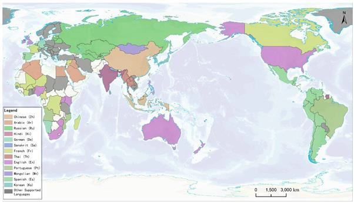
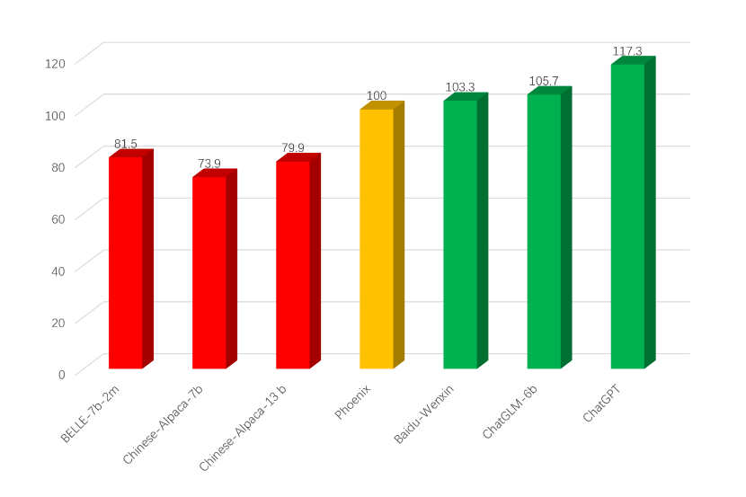

<link rel="stylesheet" href="{{ '/assets/css/project-detail.css' | relative_url }}">

Localized language models

  Apollo
  AceGPT
  Phoenix
  Arabic LLMs
  Multilingual medicine

  <a class="impact-action" href="https://github.com/FreedomIntelligence/Apollo" target="_blank" rel="noopener">Apollo</a>
  <a class="impact-action secondary" href="https://github.com/FreedomIntelligence/AceGPT" target="_blank" rel="noopener">AceGPT</a>
  <a class="impact-action secondary" href="https://github.com/FreedomIntelligence/LLMZoo" target="_blank" rel="noopener">LLMZoo</a>
  <a class="impact-action secondary" href="https://huggingface.co/FreedomIntelligence/phoenix-inst-chat-7b" target="_blank" rel="noopener">Phoenix</a>

  

The multilingual model line makes open LLMs useful outside the English-centric default. Phoenix democratized chat models across languages, AceGPT localized LLMs for Arabic, and Apollo extends medical LLMs across many languages with models, corpora, and benchmarks.

<section class="impact-section">
  <h2>Research Storyline</h2>
  

    

      General
      
<strong>Phoenix starts from multilingual chat access</strong>
The early model line asks how open chat models can serve users across languages rather than only English-heavy settings.

    

    

      Localize
      
<strong>AceGPT focuses on Arabic alignment</strong>
Arabic LLM localization shows that alignment data, vocabulary, culture, and evaluation must be designed for the target language.

    

    

      Medicine
      
<strong>Apollo moves localization into healthcare</strong>
Apollo combines multilingual medical corpora, models, and benchmarks so medical AI can cover many more language communities.

    

    

      Scale
      
<strong>ApolloMoE makes language-family specialization efficient</strong>
Mixture-of-experts style multilingual medical modeling keeps specialization while reducing the cost of serving many languages.

    

  

</section>

<section class="impact-section">
  <h2>Project Families</h2>
  

    

      <strong>Phoenix and LLMZoo</strong>
      
An early open multilingual chat direction that combined multilingual instruction data, open checkpoints, and evaluation resources.

    

    

      <strong>AceGPT and Arabic alignment</strong>
      
A localized Arabic LLM family, followed by work on progressive Arabic vocabulary expansion and native Arabic alignment.

    

    

      <strong>Apollo medical LLMs</strong>
      
A multilingual medical model, dataset, and benchmark stack that pushes medical AI toward broader global access.

    

    

      <strong>ApolloMoE</strong>
      
A mixture-of-language-family-experts direction for efficient multilingual medical modeling across language families.

    

  

</section>

<section class="impact-section">
  <h2>Display Figures</h2>
  

    <figure>
      
      <figcaption>Apollo reframes medical LLM access as a multilingual infrastructure problem.</figcaption>
    </figure>
    <figure>
      
      <figcaption>Phoenix and LLMZoo show the early open multilingual release pattern: models, data, and public resources together.</figcaption>
    </figure>
    <figure>
      
      <figcaption>Evaluation is part of localization: translated tasks alone do not capture model behavior across languages.</figcaption>
    </figure>
  

</section>

<section class="impact-section">
  <h2>Paper Trail</h2>
  

    

      Phoenix
      
<strong>Phoenix: Democratizing ChatGPT across Languages</strong>
Introduces the lab's early multilingual chat direction and open multilingual model resources.
<a href="https://huggingface.co/FreedomIntelligence/phoenix-inst-chat-7b" target="_blank" rel="noopener">Model</a>

    

    

      AceGPT
      
<strong>AceGPT, Localizing Large Language Models in Arabic</strong>
Shows how localized data and alignment produce stronger Arabic LLM behavior than generic multilingual tuning.
<a href="https://github.com/FreedomIntelligence/AceGPT" target="_blank" rel="noopener">Repository</a>

    

    

      Apollo
      
<strong>Apollo and ApolloMoE</strong>
Extends localization to multilingual medical AI with corpora, benchmarks, models, and language-family expert routing.
<a href="https://github.com/FreedomIntelligence/Apollo" target="_blank" rel="noopener">Apollo</a>

    

  

</section>

<section class="impact-section">
  <h2>Why It Matters</h2>
  <ul class="impact-list">
    <li>Medical and public-interest AI cannot be accessible if it works only in a small set of high-resource languages.</li>
    <li>Localization is more than translation: model vocabulary, alignment data, evaluation, and cultural/domain assumptions all matter.</li>
    <li>The project connects general multilingual chat, Arabic-specific alignment, and multilingual medical AI into a single access agenda.</li>
  </ul>
</section>

<section class="impact-section">
  <h2>Resource Map</h2>
  

    

      <strong>Apollo</strong>
      
Multilingual medical models, datasets, benchmark code, and public checkpoints.

      <a href="https://github.com/FreedomIntelligence/Apollo" target="_blank" rel="noopener">Repository</a>
    

    

      <strong>ApolloCorpus</strong>
      
Large multilingual medical corpus released on Hugging Face.

      <a href="https://huggingface.co/datasets/FreedomIntelligence/ApolloCorpus" target="_blank" rel="noopener">Dataset</a>
    

    

      <strong>AceGPT</strong>
      
Arabic LLM resources and checkpoints for localized open language modeling.

      <a href="https://huggingface.co/FreedomIntelligence/AceGPT-13B-chat" target="_blank" rel="noopener">Model</a>
    

  

</section>

本地化语言模型

  Apollo
  AceGPT
  Phoenix
  阿拉伯语大模型
  多语言医学

  <a class="impact-action" href="https://github.com/FreedomIntelligence/Apollo" target="_blank" rel="noopener">Apollo</a>
  <a class="impact-action secondary" href="https://github.com/FreedomIntelligence/AceGPT" target="_blank" rel="noopener">AceGPT</a>
  <a class="impact-action secondary" href="https://github.com/FreedomIntelligence/LLMZoo" target="_blank" rel="noopener">LLMZoo</a>
  <a class="impact-action secondary" href="https://huggingface.co/FreedomIntelligence/phoenix-inst-chat-7b" target="_blank" rel="noopener">Phoenix</a>

  

多语言模型方向让开源大模型走出以英语为中心的默认设定，在更多语言中真正好用。Phoenix 把对话模型普及到多种语言，AceGPT 把大模型本地化到阿拉伯语，Apollo 则用模型、语料和评测基准，把医学大模型扩展到众多语言。

<section class="impact-section">
  <h2>研究脉络</h2>
  

    

      通用
      
<strong>Phoenix 从多语言对话普及起步</strong>
早期的模型工作关注开源对话模型如何服务多种语言的用户，而不只局限于以英语为主的场景。

    

    

      本地化
      
<strong>AceGPT 专注阿拉伯语对齐</strong>
阿拉伯语大模型的本地化表明：对齐数据、词表、文化和评测都必须针对目标语言专门设计。

    

    

      医学
      
<strong>Apollo 把本地化带入医疗健康</strong>
Apollo 把多语言医学语料、模型和评测基准结合起来，让医学 AI 覆盖更多语言社群。

    

    

      扩展
      
<strong>ApolloMoE 高效实现语系专精</strong>
混合专家式的多语言医学建模，既保留专精能力，又降低了同时服务多种语言的成本。

    

  

</section>

<section class="impact-section">
  <h2>项目系列</h2>
  

    

      <strong>Phoenix 与 LLMZoo</strong>
      
早期的开源多语言对话方向，整合了多语言指令数据、公开的模型权重和评测资源。

    

    

      <strong>AceGPT 与阿拉伯语对齐</strong>
      
本地化的阿拉伯语大模型系列，后续工作包括渐进式阿拉伯语词表扩展和原生阿拉伯语对齐。

    

    

      <strong>Apollo 医学大模型</strong>
      
一套多语言医学模型、数据集和评测基准，推动医学 AI 惠及全球更多人群。

    

    

      <strong>ApolloMoE</strong>
      
按语系组织混合专家的方向，用于跨语系的高效多语言医学建模。

    

  

</section>

<section class="impact-section">
  <h2>图示</h2>
  

    <figure>
      
      <figcaption>Apollo 把医学大模型的普及视为一个多语言基础设施问题。</figcaption>
    </figure>
    <figure>
      
      <figcaption>Phoenix 与 LLMZoo 体现了早期开源多语言发布的模式：模型、数据和公开资源打包在一起。</figcaption>
    </figure>
    <figure>
      
      <figcaption>评测是本地化的一部分：只靠翻译过来的任务，无法反映模型在不同语言中的表现。</figcaption>
    </figure>
  

</section>

<section class="impact-section">
  <h2>论文脉络</h2>
  

    

      Phoenix
      
<strong>Phoenix: Democratizing ChatGPT across Languages</strong>
介绍实验室早期的多语言对话方向和开源多语言模型资源。
<a href="https://huggingface.co/FreedomIntelligence/phoenix-inst-chat-7b" target="_blank" rel="noopener">模型</a>

    

    

      AceGPT
      
<strong>AceGPT, Localizing Large Language Models in Arabic</strong>
展示本地化数据和对齐如何让阿拉伯语大模型的表现优于通用的多语言微调。
<a href="https://github.com/FreedomIntelligence/AceGPT" target="_blank" rel="noopener">代码仓库</a>

    

    

      Apollo
      
<strong>Apollo 与 ApolloMoE</strong>
把本地化扩展到多语言医学 AI，提供语料、评测基准、模型和语系专家路由。
<a href="https://github.com/FreedomIntelligence/Apollo" target="_blank" rel="noopener">Apollo</a>

    

  

</section>

<section class="impact-section">
  <h2>研究意义</h2>
  <ul class="impact-list">
    <li>如果医学和公益 AI 只能在少数高资源语言中使用，就谈不上真正普及。</li>
    <li>本地化不只是翻译：模型词表、对齐数据、评测，以及文化和领域层面的隐含假设，都很关键。</li>
    <li>该项目把通用多语言对话、阿拉伯语专项对齐和多语言医学 AI 串成一条主线：让更多语言社区用上 AI。</li>
  </ul>
</section>

<section class="impact-section">
  <h2>资源导航</h2>
  

    

      <strong>Apollo</strong>
      
多语言医学模型、数据集、评测代码和公开的模型权重。

      <a href="https://github.com/FreedomIntelligence/Apollo" target="_blank" rel="noopener">代码仓库</a>
    

    

      <strong>ApolloCorpus</strong>
      
发布在 Hugging Face 上的大规模多语言医学语料。

      <a href="https://huggingface.co/datasets/FreedomIntelligence/ApolloCorpus" target="_blank" rel="noopener">数据集</a>
    

    

      <strong>AceGPT</strong>
      
阿拉伯语大模型资源和模型权重，用于本地化的开源语言建模。

      <a href="https://huggingface.co/FreedomIntelligence/AceGPT-13B-chat" target="_blank" rel="noopener">模型</a>
    

  

</section>

