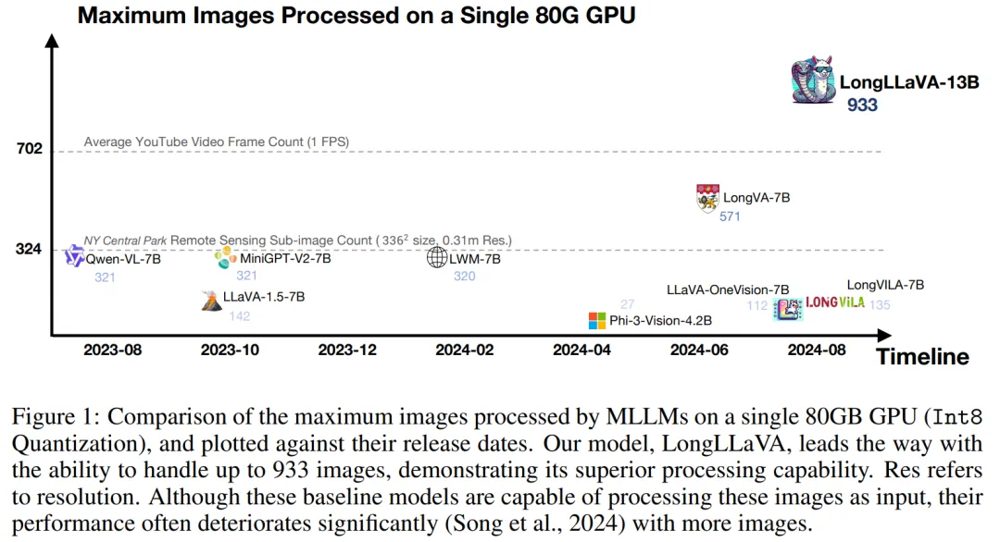

<link rel="stylesheet" href="{{ '/assets/css/project-detail.css' | relative_url }}">

Multimodal foundation models

  Multimodal LLMs
  Long visual context
  Image generation
  Video reasoning
  Medical vision
  Audio-language

  <a class="impact-action" href="/projects/">Projects Map</a>
  <a class="impact-action secondary" href="/projects/long-context-multimodal/">LongLLaVA and MileBench</a>
  <a class="impact-action secondary" href="/projects/sharegpt-4o-image-janus-4o/">ShareGPT-4o and Janus-4o</a>
  <a class="impact-action secondary" href="/projects/medical-ai-ecosystem/">Medical Multimodality</a>
  <a class="impact-action secondary" href="/projects/speech-audio-talking-head-ai/">Speech and Audio</a>

  

The multimodal LLM line organizes vision, language, video, audio, and domain knowledge into a single capability thread. It asks whether models can understand many images, long videos, and complex scenes; generate and edit images; combine expert knowledge with medical imaging; and grasp both meaning and prosody in audio. It also works to make these abilities efficient, evaluable, and reproducible.

<section class="impact-section">
  <h2>Research Storyline</h2>
  

    

      Context
      
<strong>Extend visual context</strong>
LongLLaVA and MileBench target multi-image, long-video, and long visual contexts, moving models from single-image QA toward reasoning across frames, pages, and pieces of evidence.

    

    

      Efficiency
      
<strong>Compress redundant visual tokens</strong>
TRIM puts multimodal capability under real deployment constraints, cutting visual-token redundancy so that long-context and multi-image tasks are not overwhelmed by inference cost.

    

    

      Generation
      
<strong>Open image generation and editing</strong>
ShareGPT-4o-Image and Janus-4o make GPT-4o-style image generation and image-conditioned editing openly available, along with a unified multimodal generation model.

    

    

      Reason
      
<strong>Carry reasoning into video and specialist vision</strong>
Video-R1, HuatuoGPT-Vision, GMAI-MMBench, and related work confront multimodal models with time, medical knowledge, and verifiable tasks rather than image description alone.

    

  

</section>

<section class="impact-section">
  <h2>Capability Modules</h2>
  

    

      <strong>Long-context visual understanding</strong>
      
Handles hundreds to thousands of images, long videos, and complex visual material, requiring models to retrieve, count, order, summarize, and reason across contexts.

    

    

      <strong>Visual generation and editing</strong>
      
From open instruction data to unified generation models, supporting text-to-image, image-to-image, image-conditioned modification, and the study of generation behavior.

    

    

      <strong>Video reasoning</strong>
      
Video-R1 brings reinforcement-learning-style reasoning training into video understanding, so models form inspectable reasoning paths over temporal sequences and event chains.

    

    

      <strong>Medical vision-language</strong>
      
HuatuoGPT-Vision, PubMedVision, and GMAI-MMBench connect medical images, reports, QA, and clinical knowledge.

    

    

      <strong>Audio-language fusion</strong>
      
Soundwave, FusionAudio, EchoMind, and S2S-Arena bring speech, prosody, audio captions, and human-likeness evaluation into the multimodal map.

    

    

      <strong>Efficient deployment</strong>
      
TRIM, LongLLaVA, and long-context training strategies together answer one engineering question: how can multimodal capability run at realistic cost?

    

  

</section>

<section class="impact-section">
  <h2>Paper Trail</h2>
  

    

      Model
      
<strong>LongLLaVA: Scaling Multi-modal LLMs to 1000 Images Efficiently</strong>
Extends multi-image long-context ability with a hybrid architecture and training strategy.
<a href="https://arxiv.org/abs/2409.02889" target="_blank" rel="noopener">Paper</a>

    

    

      Benchmark
      
<strong>MileBench: Benchmarking MLLMs in Long Context</strong>
Tests whether models truly use visual evidence, with multi-image, video, and long-context tasks.
<a href="https://arxiv.org/abs/2404.18532" target="_blank" rel="noopener">Paper</a>

    

    

      Efficient
      
<strong>TRIM: Less is More for Efficient Multi-modal LLMs</strong>
Reduces visual-token redundancy so multimodal models are cheaper and easier to deploy.
<a href="https://arxiv.org/abs/2409.10994" target="_blank" rel="noopener">Paper</a>

    

    

      Generate
      
<strong>ShareGPT-4o-Image and Janus-4o</strong>
Releases open instruction data for image generation and editing, and trains a unified multimodal generation model.
<a href="https://arxiv.org/abs/2506.18095" target="_blank" rel="noopener">Paper</a>

    

    

      Video
      
<strong>Video-R1: Reinforcing Video Reasoning in MLLMs</strong>
Extends R1-style reinforcement-learning reasoning training to video understanding.
<a href="https://arxiv.org/abs/2503.21776" target="_blank" rel="noopener">Paper</a>

    

    

      Medical
      
<strong>HuatuoGPT-Vision</strong>
Injects medical visual knowledge into multimodal LLMs, connecting medical images, reports, and QA.
<a href="https://arxiv.org/abs/2406.19280" target="_blank" rel="noopener">Paper</a>

    

    

      Audio
      
<strong>FusionAudio-1.2M</strong>
A data resource for fine-grained audio captioning with multimodal contextual fusion.
<a href="https://arxiv.org/abs/2506.01111" target="_blank" rel="noopener">Paper</a>

    

  

</section>

<section class="impact-section">
  <h2>Related Projects</h2>
  

    

      <strong>LongLLaVA and MileBench</strong>
      
A long-context multimodal model and benchmark covering many-image reasoning, video tasks, and visual-context scaling.

      <a href="/projects/long-context-multimodal/">Project page</a>
    

    

      <strong>ShareGPT-4o-Image and Janus-4o</strong>
      
Open image generation and editing datasets, a unified multimodal model, and reproducible release resources.

      <a href="/projects/sharegpt-4o-image-janus-4o/">Project page</a>
    

    

      <strong>HuatuoGPT-Vision</strong>
      
A medical vision-language model and the PubMedVision data, part of the HuatuoGPT medical AI ecosystem.

      <a href="/projects/medical-ai-ecosystem/">Project page</a>
    

    

      <strong>Video-R1</strong>
      
Reinforcement-learning-style reasoning training for video understanding, linking multimodal capability to the lab's reasoning projects.

      <a href="https://github.com/tulerfeng/Video-R1" target="_blank" rel="noopener">Repository</a>
    

    

      <strong>TRIM</strong>
      
Efficient multimodal token reduction, making multimodal models more affordable to deploy.

      <a href="https://github.com/FreedomIntelligence/TRIM" target="_blank" rel="noopener">Repository</a>
    

    

      <strong>Speech and Audio AI</strong>
      
Speech, audio captioning, a paralinguistic benchmark, and audio-driven video generation.

      <a href="/projects/speech-audio-talking-head-ai/">Project page</a>
    

  

</section>

  <a class="impact-action secondary" href="/projects/">Back to Projects</a>

多模态基础模型

  多模态大模型
  长视觉上下文
  图像生成
  视频推理
  医学视觉
  音频-语言

  <a class="impact-action" href="/projects/">项目总览</a>
  <a class="impact-action secondary" href="/projects/long-context-multimodal/">LongLLaVA 与 MileBench</a>
  <a class="impact-action secondary" href="/projects/sharegpt-4o-image-janus-4o/">ShareGPT-4o 与 Janus-4o</a>
  <a class="impact-action secondary" href="/projects/medical-ai-ecosystem/">医学多模态</a>
  <a class="impact-action secondary" href="/projects/speech-audio-talking-head-ai/">语音与音频</a>

  

多模态大模型方向把视觉、语言、视频、音频和专业领域知识组织成一条统一的能力线。它既关注模型能否看懂大量图像、长视频和复杂场景，也关注能否生成和编辑图像、在医学影像中结合专业知识、在音频中理解语义和韵律，并让这些能力足够高效、可评测、可复现。

<section class="impact-section">
  <h2>研究脉络</h2>
  

    

      上下文
      
<strong>扩展视觉上下文</strong>
LongLLaVA 和 MileBench 关注多图像、长视频和长视觉上下文，让模型从单图问答走向跨帧、跨页、跨证据的推理。

    

    

      效率
      
<strong>压缩无效视觉 token</strong>
TRIM 把多模态能力放进实际部署约束中，减少视觉 token 冗余，让长上下文和多图像任务不被推理成本压垮。

    

    

      生成
      
<strong>开放图像生成与编辑</strong>
ShareGPT-4o-Image 和 Janus-4o 把 GPT-4o 风格的图像生成、图像条件编辑和统一多模态生成模型开放出来。

    

    

      推理
      
<strong>把推理迁移到视频和专业视觉</strong>
Video-R1、HuatuoGPT-Vision、GMAI-MMBench 等工作让多模态模型面对时间、医学知识和可验证任务，而不只是描述图像。

    

  

</section>

<section class="impact-section">
  <h2>能力模块</h2>
  

    

      <strong>长上下文视觉理解</strong>
      
处理上百到上千张图像、长视频和复杂视觉材料，要求模型能检索、计数、排序、归纳和跨上下文推理。

    

    

      <strong>视觉生成与编辑</strong>
      
从开放指令数据到统一生成模型，支持文生图、图生图、图像条件修改和生成行为研究。

    

    

      <strong>视频推理</strong>
      
Video-R1 把强化学习式推理训练带进视频理解，使模型在时间序列和事件链中形成可检查的推理路径。

    

    

      <strong>医学视觉-语言</strong>
      
HuatuoGPT-Vision、PubMedVision 和 GMAI-MMBench 把医学图像、报告、问答和临床知识连接起来。

    

    

      <strong>音频-语言融合</strong>
      
Soundwave、FusionAudio、EchoMind 和 S2S-Arena 将语音、韵律、音频描述和类人表现评测纳入多模态地图。

    

    

      <strong>高效部署</strong>
      
TRIM、LongLLaVA 和长上下文训练策略共同回答一个工程问题：多模态能力如何在真实成本下运行。

    

  

</section>

<section class="impact-section">
  <h2>论文脉络</h2>
  

    

      模型
      
<strong>LongLLaVA: Scaling Multi-modal LLMs to 1000 Images Efficiently</strong>
用混合架构和训练策略扩展多图像长上下文能力。
<a href="https://arxiv.org/abs/2409.02889" target="_blank" rel="noopener">论文</a>

    

    

      评测基准
      
<strong>MileBench: Benchmarking MLLMs in Long Context</strong>
用多图像、视频和长上下文任务测试模型是否真的使用视觉证据。
<a href="https://arxiv.org/abs/2404.18532" target="_blank" rel="noopener">论文</a>

    

    

      高效
      
<strong>TRIM: Less is More for Efficient Multi-modal LLMs</strong>
减少视觉 token 冗余，让多模态模型更便宜、更容易部署。
<a href="https://arxiv.org/abs/2409.10994" target="_blank" rel="noopener">论文</a>

    

    

      生成
      
<strong>ShareGPT-4o-Image 与 Janus-4o</strong>
开放图像生成与编辑指令数据，并训练统一多模态生成模型。
<a href="https://arxiv.org/abs/2506.18095" target="_blank" rel="noopener">论文</a>

    

    

      视频
      
<strong>Video-R1: Reinforcing Video Reasoning in MLLMs</strong>
把 R1 式强化学习推理训练扩展到视频理解。
<a href="https://arxiv.org/abs/2503.21776" target="_blank" rel="noopener">论文</a>

    

    

      医学
      
<strong>HuatuoGPT-Vision</strong>
将医学视觉知识注入多模态大模型，连接医学图像、报告和问答。
<a href="https://arxiv.org/abs/2406.19280" target="_blank" rel="noopener">论文</a>

    

    

      音频
      
<strong>FusionAudio-1.2M</strong>
细粒度音频描述与多模态上下文融合的数据资源。
<a href="https://arxiv.org/abs/2506.01111" target="_blank" rel="noopener">论文</a>

    

  

</section>

<section class="impact-section">
  <h2>相关项目</h2>
  

    

      <strong>LongLLaVA 与 MileBench</strong>
      
长上下文多模态模型与评测基准，覆盖多图像推理、视频任务和视觉上下文扩展。

      <a href="/projects/long-context-multimodal/">项目页面</a>
    

    

      <strong>ShareGPT-4o-Image 与 Janus-4o</strong>
      
开放的图像生成与编辑数据集、统一多模态模型和可复现的发布资源。

      <a href="/projects/sharegpt-4o-image-janus-4o/">项目页面</a>
    

    

      <strong>HuatuoGPT-Vision</strong>
      
医学视觉-语言模型和 PubMedVision 数据，是华佗GPT 医疗 AI 生态的一部分。

      <a href="/projects/medical-ai-ecosystem/">项目页面</a>
    

    

      <strong>Video-R1</strong>
      
视频理解中的强化学习式推理训练，把多模态能力与推理项目线连接起来。

      <a href="https://github.com/tulerfeng/Video-R1" target="_blank" rel="noopener">代码仓库</a>
    

    

      <strong>TRIM</strong>
      
高效的多模态 token 压缩，让多模态模型在部署时更经济。

      <a href="https://github.com/FreedomIntelligence/TRIM" target="_blank" rel="noopener">代码仓库</a>
    

    

      <strong>语音与音频 AI</strong>
      
语音、音频描述、副语言评测基准和音频驱动的视频生成。

      <a href="/projects/speech-audio-talking-head-ai/">项目页面</a>
    

  

</section>

  <a class="impact-action secondary" href="/projects/">返回项目页</a>

