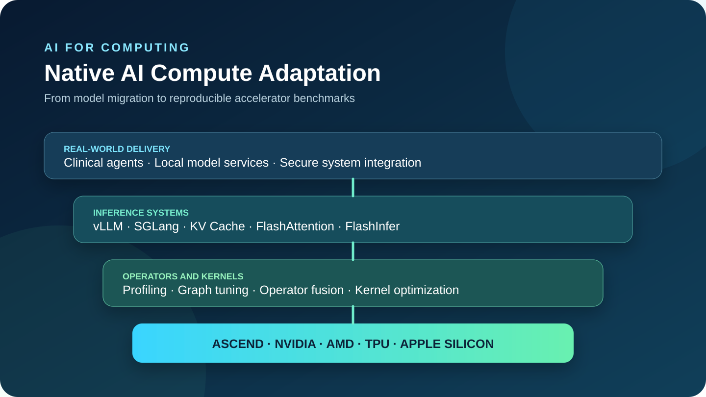

<link rel="stylesheet" href="{{ '/assets/css/project-detail.css' | relative_url }}">

China-developed accelerators and AI systems

  AscendLarge-scale trainingInference accelerationKernel optimizationAccelMarkOpen ecosystem

  <a class="impact-action" href="https://github.com/FreedomIntelligence/AccelMark" target="_blank" rel="noopener">AccelMark</a>
  <a class="impact-action secondary" href="https://huggingface.co/FreedomIntelligence/openPangu-Embedded-7B" target="_blank" rel="noopener">openPangu on Ascend</a>
  <a class="impact-action secondary" href="https://aclanthology.org/2025.acl-long.100/" target="_blank" rel="noopener">ACL 2025</a>
  <a class="impact-action secondary" href="/projects/llm-efficiency-ai-infra/">LLM Infrastructure</a>

<strong>Our goal is not only to make large models run on China-developed AI accelerators, but to make them efficient, reliable, and scalable.</strong> The team has built an end-to-end technical chain connecting large-scale Ascend training, model and framework adaptation, inference acceleration, operator and kernel optimization, benchmark validation, real-world delivery, and open ecosystem development.

<section class="impact-section">
  <h2>1. Large-Scale Training on Ascend</h2>
  
<strong>The team has first-hand experience training large language models on thousands of China-developed AI processors.</strong> In collaboration with Peng Cheng Laboratory and other institutions, the AraLLaMA/AceGPT-v1.5 program trained 7B and 13B Arabic models using <strong>2,368 Huawei Ascend 910A processors</strong>, covering continual pre-training, progressive vocabulary expansion, and model alignment.

  

    
NAACL
<strong>AceGPT: Localizing Large Language Models in Arabic</strong>
Arabic continual pre-training, supervised fine-tuning, and culturally grounded RLAIF established the localized LLM program.
<a href="https://aclanthology.org/2024.naacl-long.450/" target="_blank" rel="noopener">NAACL 2024</a>

    
ACL
<strong>Progressive Vocabulary Expansion</strong>
The 7B and 13B models were trained with 2,368 Ascend 910A processors, demonstrating large-scale training on China-developed AI compute.
<a href="https://aclanthology.org/2025.acl-long.100/" target="_blank" rel="noopener">ACL 2025</a>

    
NeurIPS
<strong>Native Alignment for Arabic LLMs</strong>
Moves value alignment directly into pre-training rather than treating it only as a post-training step.
<a href="https://proceedings.neurips.cc/paper_files/paper/2024/hash/195c4e2910bedabd813f9fe4e70c642c-Abstract-Conference.html" target="_blank" rel="noopener">NeurIPS 2024</a>

  

</section>

<section class="impact-section">
  <h2>2. Full-Stack Compute Optimization</h2>
  
<strong>The capability has evolved from using China-developed compute to systematically optimizing it.</strong> Optimization spans the model, serving system, inference framework, operator, and kernel layers.

  

    
Model
<strong>Reduce model-side serving cost</strong>
Compress system prompts and manage or compress KV Cache to reduce memory pressure and repeated computation.

    
Runtime
<strong>Tune the inference path</strong>
Adapt and optimize vLLM, SGLang, FlashAttention, and FlashInfer-style components for target workloads and hardware stacks.

    
Kernel
<strong>Optimize below the framework layer</strong>
Profile bottlenecks and improve CANN operators, kernels, memory movement, graph execution, and hardware utilization.

    
Service
<strong>Validate production behavior</strong>
Measure latency, throughput, concurrency, utilization, reliability, security, and deployment cost—not compatibility alone.

  

</section>

<section class="impact-section">
  <h2>3. Benchmark Validation and Open Evaluation</h2>
  

    
<strong>CANNBench</strong>
Team solutions have taken <strong>top positions in multiple Ascend operator-optimization tasks</strong>. Because the leaderboard changes over time, each external claim should include a query date or archived screenshot.
<a href="https://gitcode.com/cann/cann-bench/blob/master/README.md" target="_blank" rel="noopener">Benchmark</a>

    
<strong>AccelMark</strong>
An open, community-driven benchmark for LLM inference across NVIDIA, AMD, Ascend, Apple Silicon, TPU, and emerging accelerators.
<a href="https://github.com/FreedomIntelligence/AccelMark" target="_blank" rel="noopener">Open benchmark</a>

    
<strong>Reproducibility by design</strong>
Results connect performance with environment metadata, runner versions, execution outputs, and reproduction instructions.

    
<strong>One evaluation surface</strong>
AccelMark aims to compare hardware together with vLLM/SGLang, KV Cache methods, FlashAttention/FlashInfer, operators, and kernels under a shared experimental framework.

  

</section>

<section class="impact-section">
  <h2>4. Hospital and Industry Delivery</h2>
  
<strong>Real applications turn optimization into measurable engineering requirements.</strong> Hospital workflows expose concrete constraints for privacy, latency, concurrency, reliability, and deployment cost; these requirements feed back into system optimization and hardware adaptation.

  

    
<strong>OpenClaw and HuatuoGPT</strong>
The team supported localized deployment at The Chinese University of Hong Kong, Shenzhen Hospital. Read-only access to hospital information systems helps preserve medical-data and system integrity.
<a href="https://med.cuhk.edu.cn/article/1746" target="_blank" rel="noopener">Hospital report</a>

    
<strong>Health screening and management</strong>
The system supports customized screening-package recommendations and uses idle nighttime compute to process examination records in batches, generating reports and personalized follow-up guidance.

    
<strong>AI for Computing collaboration</strong>
The team collaborates with companies including KernelCAT developer Zhizi Xinyuan on model migration, framework tuning, inference acceleration, and operator optimization across CUDA and CANN stacks.
<a href="https://kernelcat.cn/" target="_blank" rel="noopener">KernelCAT</a>

  

  

    
Demand
<strong>Applications define constraints</strong>
Security, latency, throughput, concurrency, reliability, and cost become concrete targets.

    
System
<strong>Optimization answers demand</strong>
Models, runtimes, caches, operators, and kernels are tuned against production workloads.

    
Compute
<strong>Adaptation closes the loop</strong>
Methods are ported, measured, and validated across China-developed and heterogeneous accelerator stacks.

  

</section>

<section class="impact-section">
  <h2>5. Open Models, Data, and Community Infrastructure</h2>
  
<strong>The long-term objective is to turn project experience into reusable community infrastructure.</strong> Open benchmarks, models, datasets, serving recipes, and kernel knowledge reduce repeated adaptation work across a fragmented accelerator ecosystem.

  

    
<strong>100+ open models</strong>
FreedomIntelligence hosts more than one hundred public model repositories spanning HuatuoGPT, AceGPT, ShizhenGPT, openPangu, and related releases.
<a href="https://huggingface.co/FreedomIntelligence/models" target="_blank" rel="noopener">Hugging Face</a>

    
<strong>openPangu on Ascend</strong>
openPangu-Embedded-7B was trained from scratch on Ascend NPUs with approximately <strong>19 trillion tokens</strong>.
<a href="https://huggingface.co/FreedomIntelligence/openPangu-Embedded-7B" target="_blank" rel="noopener">Model card</a>

    
<strong>Million-scale community use</strong>
Periodic team statistics report more than <strong>one million cumulative downloads</strong> and a peak above <strong>200,000 downloads for one model in one month</strong>. Rolling figures should be published with dates and archived evidence.
<a href="https://huggingface.co/FreedomIntelligence" target="_blank" rel="noopener">Organization</a>

    
<strong>TRL documentation example</strong>
Hugging Face TRL uses FreedomIntelligence/medical-o1-reasoning-SFT as an example for preprocessing a non-standard dataset format.
<a href="https://huggingface.co/docs/trl/sft_trainer" target="_blank" rel="noopener">SFTTrainer documentation</a>

    
<strong>10,000+ GitHub Stars</strong>
Representative FreedomIntelligence repositories have collectively received more than <strong>ten thousand publicly visible Stars</strong>.
<a href="https://github.com/FreedomIntelligence" target="_blank" rel="noopener">GitHub organization</a>

  

</section>

<section class="impact-section">
  <h2>Evidence and Resources</h2>
  

    
1–3
<strong>Arabic LLM research</strong>
AceGPT at NAACL 2024, Progressive Vocabulary Expansion at ACL 2025, and Native Alignment at NeurIPS 2024.
<a href="https://aclanthology.org/2024.naacl-long.450/" target="_blank" rel="noopener">AceGPT</a> · <a href="https://aclanthology.org/2025.acl-long.100/" target="_blank" rel="noopener">ACL 2025</a> · <a href="https://proceedings.neurips.cc/paper_files/paper/2024/hash/195c4e2910bedabd813f9fe4e70c642c-Abstract-Conference.html" target="_blank" rel="noopener">NeurIPS 2024</a>

    
4–5
<strong>CANNBench and AccelMark</strong>
Operator-level Ascend evaluation and open heterogeneous-accelerator inference benchmarking.
<a href="https://gitcode.com/cann/cann-bench/blob/master/README.md" target="_blank" rel="noopener">CANNBench</a> · <a href="https://github.com/FreedomIntelligence/AccelMark" target="_blank" rel="noopener">AccelMark</a>

    
6
<strong>Hospital deployment</strong>
Official report on localized OpenClaw, HuatuoGPT, read-only access, and health-screening workflows.
<a href="https://med.cuhk.edu.cn/article/1746" target="_blank" rel="noopener">CUHK-Shenzhen Medicine</a>

    
7–10
<strong>Open-source ecosystem</strong>
FreedomIntelligence on Hugging Face and GitHub, openPangu-Embedded-7B, and TRL documentation.
<a href="https://huggingface.co/FreedomIntelligence" target="_blank" rel="noopener">Hugging Face</a> · <a href="https://huggingface.co/FreedomIntelligence/openPangu-Embedded-7B" target="_blank" rel="noopener">openPangu</a> · <a href="https://huggingface.co/docs/trl/sft_trainer" target="_blank" rel="noopener">TRL</a> · <a href="https://github.com/FreedomIntelligence" target="_blank" rel="noopener">GitHub</a>

  

</section>

<section class="impact-section">
  <h2>From Available to Efficient and Scalable</h2>
  
<strong>The capability path is clear:</strong> train models on thousands of China-developed processors; optimize the full software stack; validate performance through benchmarks; solve real hospital and industry problems; and convert the resulting knowledge into open benchmarks, models, and community infrastructure.

</section>

<a class="impact-action secondary" href="/projects/">Back to Projects</a>

国产加速器与 AI 系统

  昇腾大规模训练推理加速Kernel 优化AccelMark开放生态

  <a class="impact-action" href="https://github.com/FreedomIntelligence/AccelMark" target="_blank" rel="noopener">AccelMark</a>
  <a class="impact-action secondary" href="https://huggingface.co/FreedomIntelligence/openPangu-Embedded-7B" target="_blank" rel="noopener">昇腾上的 openPangu</a>
  <a class="impact-action secondary" href="https://aclanthology.org/2025.acl-long.100/" target="_blank" rel="noopener">ACL 2025</a>
  <a class="impact-action secondary" href="/projects/llm-efficiency-ai-infra/">大模型基础设施</a>

<strong>我们的目标不只是让大模型在国产 AI 加速器上跑起来，更要让它们跑得高效、可靠、可扩展。</strong>团队已打通一条端到端的技术链条，涵盖昇腾大规模训练、模型与框架适配、推理加速、算子与 Kernel 优化、基准验证、真实场景交付和开放生态建设。

<section class="impact-section">
  <h2>1. 昇腾大规模训练</h2>
  
<strong>团队有在数千块国产 AI 处理器上训练大模型的一手经验。</strong>AraLLaMA/AceGPT-v1.5 项目与鹏城实验室等机构合作，使用 <strong>2,368 块华为昇腾 910A 处理器</strong>训练了 7B 和 13B 阿拉伯语模型，涵盖持续预训练、渐进式词表扩展和模型对齐。

  

    
NAACL
<strong>AceGPT: Localizing Large Language Models in Arabic</strong>
阿拉伯语持续预训练、监督微调和融入文化语境的 RLAIF，开启了本地化大模型研究。
<a href="https://aclanthology.org/2024.naacl-long.450/" target="_blank" rel="noopener">NAACL 2024</a>

    
ACL
<strong>Progressive Vocabulary Expansion</strong>
7B 和 13B 模型在 2,368 块昇腾 910A 处理器上训练，展示了国产 AI 算力支撑大规模训练的能力。
<a href="https://aclanthology.org/2025.acl-long.100/" target="_blank" rel="noopener">ACL 2025</a>

    
NeurIPS
<strong>Native Alignment for Arabic LLMs</strong>
把价值观对齐直接放进预训练，而不只是当作后训练环节。
<a href="https://proceedings.neurips.cc/paper_files/paper/2024/hash/195c4e2910bedabd813f9fe4e70c642c-Abstract-Conference.html" target="_blank" rel="noopener">NeurIPS 2024</a>

  

</section>

<section class="impact-section">
  <h2>2. 全栈算力优化</h2>
  
<strong>团队的能力已从使用国产算力，发展为系统性地优化国产算力。</strong>优化覆盖模型、推理服务系统、推理框架、算子和 Kernel 各个层次。

  

    
模型
<strong>降低模型侧的推理成本</strong>
压缩系统提示词，管理或压缩 KV 缓存，减轻显存压力，减少重复计算。

    
运行时
<strong>调优推理链路</strong>
针对目标负载和硬件栈，适配并优化 vLLM、SGLang、FlashAttention、FlashInfer 等组件。

    
Kernel
<strong>深入框架之下优化</strong>
分析性能瓶颈，改进 CANN 算子、Kernel、数据搬运、图执行和硬件利用率。

    
服务
<strong>验证生产环境表现</strong>
测量延迟、吞吐量、并发、利用率、可靠性、安全性和部署成本，而不只是检查能否兼容。

  

</section>

<section class="impact-section">
  <h2>3. 基准验证与开放评测</h2>
  

    
<strong>CANNBench</strong>
团队方案已在<strong>多个昇腾算子优化任务中位居前列</strong>。榜单会随时间变化，对外引用时应注明查询日期，或附上存档截图。
<a href="https://gitcode.com/cann/cann-bench/blob/master/README.md" target="_blank" rel="noopener">评测基准</a>

    
<strong>AccelMark</strong>
面向大模型推理的开放、社区驱动评测基准，覆盖 NVIDIA、AMD、昇腾、Apple Silicon、TPU 和新兴加速器。
<a href="https://github.com/FreedomIntelligence/AccelMark" target="_blank" rel="noopener">开放评测基准</a>

    
<strong>从设计上保证可复现</strong>
每条结果都把性能数据与环境元数据、runner 版本、执行输出和复现说明关联起来。

    
<strong>软硬件同台评测</strong>
AccelMark 希望在统一的实验框架下，让硬件与 vLLM/SGLang、KV 缓存方法、FlashAttention/FlashInfer、算子和 Kernel 同台对比。

  

</section>

<section class="impact-section">
  <h2>4. 医院与产业交付</h2>
  
<strong>真实应用把优化变成可衡量的工程需求。</strong>医院工作流对隐私、延迟、并发、可靠性和部署成本提出了具体约束，这些要求又反过来推动系统优化和硬件适配。

  

    
<strong>OpenClaw 与华佗GPT</strong>
团队支持了香港中文大学（深圳）医院的本地化部署。系统以只读方式访问医院信息系统，有助于保障医疗数据和系统的完整性。
<a href="https://med.cuhk.edu.cn/article/1746" target="_blank" rel="noopener">医院部署报道</a>

    
<strong>健康体检与管理</strong>
系统可推荐定制化的体检套餐，并利用夜间闲置算力批量处理体检记录，生成报告和个性化的后续健康指导。

    
<strong>AI for Computing 合作</strong>
团队与 KernelCAT 的研发方智子芯元等企业合作，在 CUDA 和 CANN 软件栈上开展模型迁移、框架调优、推理加速和算子优化。
<a href="https://kernelcat.cn/" target="_blank" rel="noopener">KernelCAT</a>

  

  

    
需求
<strong>应用定义约束</strong>
安全、延迟、吞吐量、并发、可靠性和成本，都成为具体的目标。

    
系统
<strong>优化回应需求</strong>
模型、运行时、缓存、算子和 Kernel，都针对真实生产负载调优。

    
算力
<strong>适配形成闭环</strong>
这些方法被移植到国产和其他异构加速器软件栈上，并经过测量与验证。

  

</section>

<section class="impact-section">
  <h2>5. 开放模型、数据与社区基础设施</h2>
  
<strong>长期目标是把项目经验沉淀为可复用的社区基础设施。</strong>开放的评测基准、模型、数据集、推理部署方案和 Kernel 知识，可以减少加速器生态碎片化带来的重复适配工作。

  

    
<strong>100+ 个开源模型</strong>
FreedomIntelligence 公开了 100 多个模型仓库，涵盖华佗GPT、AceGPT、ShizhenGPT、openPangu 等系列及相关发布。
<a href="https://huggingface.co/FreedomIntelligence/models" target="_blank" rel="noopener">Hugging Face</a>

    
<strong>昇腾上的 openPangu</strong>
openPangu-Embedded-7B 在昇腾 NPU 上从零开始训练，使用约 <strong>19 万亿 token</strong>。
<a href="https://huggingface.co/FreedomIntelligence/openPangu-Embedded-7B" target="_blank" rel="noopener">模型卡</a>

    
<strong>百万级社区使用量</strong>
团队的定期统计显示，累计下载量超过 <strong>100 万次</strong>，单个模型单月下载量峰值超过 <strong>20 万次</strong>。这类滚动更新的数字，发布时应注明日期并附存档证据。
<a href="https://huggingface.co/FreedomIntelligence" target="_blank" rel="noopener">组织主页</a>

    
<strong>TRL 文档示例</strong>
Hugging Face TRL 在文档中以 FreedomIntelligence/medical-o1-reasoning-SFT 为例，演示如何预处理非标准格式的数据集。
<a href="https://huggingface.co/docs/trl/sft_trainer" target="_blank" rel="noopener">SFTTrainer 文档</a>

    
<strong>10,000+ GitHub Stars</strong>
FreedomIntelligence 的代表性仓库累计获得超过 <strong>1 万个公开可见的 Star</strong>。
<a href="https://github.com/FreedomIntelligence" target="_blank" rel="noopener">GitHub 组织主页</a>

  

</section>

<section class="impact-section">
  <h2>佐证与资源</h2>
  

    
1–3
<strong>阿拉伯语大模型研究</strong>
NAACL 2024 的 AceGPT、ACL 2025 的 Progressive Vocabulary Expansion，以及 NeurIPS 2024 的 Native Alignment。
<a href="https://aclanthology.org/2024.naacl-long.450/" target="_blank" rel="noopener">AceGPT</a> · <a href="https://aclanthology.org/2025.acl-long.100/" target="_blank" rel="noopener">ACL 2025</a> · <a href="https://proceedings.neurips.cc/paper_files/paper/2024/hash/195c4e2910bedabd813f9fe4e70c642c-Abstract-Conference.html" target="_blank" rel="noopener">NeurIPS 2024</a>

    
4–5
<strong>CANNBench 与 AccelMark</strong>
昇腾算子级评测，以及面向异构加速器的开放推理基准评测。
<a href="https://gitcode.com/cann/cann-bench/blob/master/README.md" target="_blank" rel="noopener">CANNBench</a> · <a href="https://github.com/FreedomIntelligence/AccelMark" target="_blank" rel="noopener">AccelMark</a>

    
6
<strong>医院部署</strong>
关于 OpenClaw 与华佗GPT 本地化部署、只读访问和健康体检工作流的官方报道。
<a href="https://med.cuhk.edu.cn/article/1746" target="_blank" rel="noopener">港中大（深圳）医学院</a>

    
7–10
<strong>开源生态</strong>
Hugging Face 和 GitHub 上的 FreedomIntelligence、openPangu-Embedded-7B，以及 TRL 文档。
<a href="https://huggingface.co/FreedomIntelligence" target="_blank" rel="noopener">Hugging Face</a> · <a href="https://huggingface.co/FreedomIntelligence/openPangu-Embedded-7B" target="_blank" rel="noopener">openPangu</a> · <a href="https://huggingface.co/docs/trl/sft_trainer" target="_blank" rel="noopener">TRL</a> · <a href="https://github.com/FreedomIntelligence" target="_blank" rel="noopener">GitHub</a>

  

</section>

<section class="impact-section">
  <h2>从“能用”到高效、可扩展</h2>
  
<strong>这条能力路径很清晰：</strong>在数千块国产处理器上训练模型；优化整个软件栈；用评测基准验证性能；解决医院和产业中的真实问题；再把由此积累的知识转化为开放的评测基准、模型和社区基础设施。

</section>

<a class="impact-action secondary" href="/projects/">返回项目页</a>

