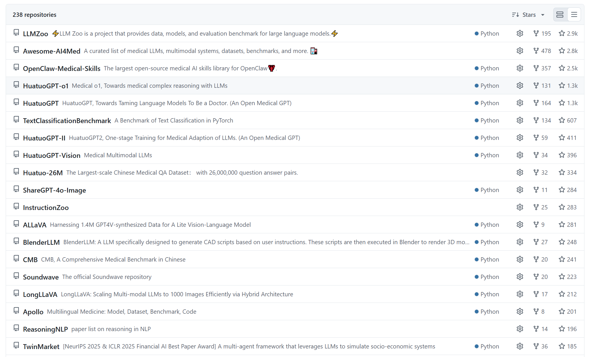

<link rel="stylesheet" href="{{ '/assets/css/project-detail.css' | relative_url }}">

Open data infrastructure

  RAG-Instruct
  LLMZoo
  InstructionZoo
  Huatuo-26M
  ApolloCorpus

  <a class="impact-action" href="https://github.com/FreedomIntelligence/RAG-Instruct" target="_blank" rel="noopener">RAG-Instruct</a>
  <a class="impact-action secondary" href="https://github.com/FreedomIntelligence/LLMZoo" target="_blank" rel="noopener">LLMZoo</a>
  <a class="impact-action secondary" href="https://github.com/FreedomIntelligence/InstructionZoo" target="_blank" rel="noopener">InstructionZoo</a>
  <a class="impact-action secondary" href="https://huggingface.co/datasets/FreedomIntelligence/RAG-Instruct" target="_blank" rel="noopener">Dataset</a>

  

Many FreedomAI projects are useful because they release the substrate that other builders need: instruction data, domain corpora, retrieval-augmented tasks, medical QA datasets, multimodal feedback data, and reproducible model checkpoints.

<section class="impact-section">
  <h2>Research Storyline</h2>
  

    

      Collect
      
<strong>Build reusable domain corpora</strong>
Huatuo-26M, ApolloCorpus, PubMedVision, and related releases give medical and multilingual projects a stronger data substrate.

    

    

      Ground
      
<strong>Teach models to use retrieved evidence</strong>
RAG-Instruct turns retrieval into an instruction-following skill rather than a post-hoc wrapper around memorized model answers.

    

    

      Package
      
<strong>Release models with data and tasks</strong>
LLMZoo, InstructionZoo, and Hugging Face checkpoints make the data useful to people who want to reproduce or extend the recipe.

    

    

      Feed back
      
<strong>Connect infrastructure to benchmarks</strong>
Datasets are most useful when paired with CMB, Apollo evaluation, multimodal medical benchmarks, and downstream project pages.

    

  

</section>

<section class="impact-section">
  <h2>Infrastructure Pieces</h2>
  

    

      <strong>RAG-Instruct</strong>
      
Retrieval-augmented instruction data designed to teach models how to use retrieved evidence rather than only memorize parametric knowledge.

    

    

      <strong>LLMZoo and InstructionZoo</strong>
      
Curated model, data, evaluation, and instruction-tuning resources that made the lab's early open LLM ecosystem easier to reproduce.

    

    

      <strong>Domain corpora</strong>
      
Huatuo-26M, ApolloCorpus, PubMedVision, and other datasets provide domain-specific supervision for medicine, multilingual AI, and visual reasoning.

    

    

      <strong>Model releases</strong>
      
Small and mid-size checkpoints such as RAG-Instruct-Llama3-3B let researchers test data recipes without rebuilding the whole pipeline.

    

  

</section>

<section class="impact-section">
  <h2>Paper Trail</h2>
  

    

      Medical data
      
<strong>Huatuo-26M</strong>
Large-scale Chinese medical QA data that feeds medical LLM instruction tuning and evaluation.
<a href="https://github.com/FreedomIntelligence/Huatuo-26M" target="_blank" rel="noopener">Repository</a>

    

    

      RAG
      
<strong>RAG-Instruct: Boosting LLMs with Diverse Retrieval-Augmented Instructions</strong>
Teaches models how to condition answers on retrieved evidence across diverse tasks.
<a href="https://github.com/FreedomIntelligence/RAG-Instruct" target="_blank" rel="noopener">Repository</a>

    

    

      Multilingual
      
<strong>ApolloCorpus and PubMedVision</strong>
Domain corpora for multilingual medical modeling and medical visual-language supervision.
<a href="https://huggingface.co/datasets/FreedomIntelligence/ApolloCorpus" target="_blank" rel="noopener">ApolloCorpus</a>

    

  

</section>

<section class="impact-section">
  <h2>Design Principles</h2>
  <ul class="impact-list">
    <li>Data releases should be paired with model checkpoints, paper context, and task definitions so they are usable rather than merely downloadable.</li>
    <li>Retrieval-augmented instruction data should stress evidence use, citation-sensitive reasoning, and answer grounding.</li>
    <li>Domain corpora should connect to benchmarks so downstream work can measure whether adaptation helped.</li>
  </ul>
</section>

<section class="impact-section">
  <h2>Resource Map</h2>
  

    

      <strong>RAG-Instruct model</strong>
      
A Llama3-based checkpoint trained with retrieval-augmented instruction data.

      <a href="https://huggingface.co/FreedomIntelligence/RAG-Instruct-Llama3-3B" target="_blank" rel="noopener">Model</a>
    

    

      <strong>Huatuo-26M</strong>
      
Large Chinese medical QA data used across medical LLM research.

      <a href="https://github.com/FreedomIntelligence/Huatuo-26M" target="_blank" rel="noopener">Repository</a>
    

    

      <strong>ApolloCorpus</strong>
      
Multilingual medical corpus for the Apollo model family.

      <a href="https://huggingface.co/datasets/FreedomIntelligence/ApolloCorpus" target="_blank" rel="noopener">Dataset</a>
    

  

</section>

开放数据基础设施

  RAG-Instruct
  LLMZoo
  InstructionZoo
  Huatuo-26M
  ApolloCorpus

  <a class="impact-action" href="https://github.com/FreedomIntelligence/RAG-Instruct" target="_blank" rel="noopener">RAG-Instruct</a>
  <a class="impact-action secondary" href="https://github.com/FreedomIntelligence/LLMZoo" target="_blank" rel="noopener">LLMZoo</a>
  <a class="impact-action secondary" href="https://github.com/FreedomIntelligence/InstructionZoo" target="_blank" rel="noopener">InstructionZoo</a>
  <a class="impact-action secondary" href="https://huggingface.co/datasets/FreedomIntelligence/RAG-Instruct" target="_blank" rel="noopener">数据集</a>

  

FreedomAI 的不少项目之所以有价值，在于它们发布了其他开发者真正需要的底层资源：指令数据、领域语料、检索增强任务、医学问答数据集、多模态反馈数据和可复现的模型权重。

<section class="impact-section">
  <h2>研究脉络</h2>
  

    

      收集
      
<strong>构建可复用的领域语料</strong>
Huatuo-26M、ApolloCorpus、PubMedVision 等相关发布，为医学和多语言项目提供更扎实的数据基础。

    

    

      依据
      
<strong>教模型使用检索到的证据</strong>
RAG-Instruct 让检索成为模型指令遵循能力的一部分，而不是事后套在模型记忆答案外面的一层包装。

    

    

      打包
      
<strong>模型与数据、任务一起发布</strong>
LLMZoo、InstructionZoo 和 Hugging Face 上的模型权重，让想复现或扩展这套方案的人能真正用上这些数据。

    

    

      反馈
      
<strong>把基础设施与评测基准连接起来</strong>
数据集与 CMB、Apollo 评测、多模态医学评测基准以及下游项目页面配合使用时，价值最大。

    

  

</section>

<section class="impact-section">
  <h2>基础设施组成</h2>
  

    

      <strong>RAG-Instruct</strong>
      
检索增强指令数据，旨在教模型如何使用检索到的证据，而不是只记忆参数化知识。

    

    

      <strong>LLMZoo 与 InstructionZoo</strong>
      
整理好的模型、数据、评测和指令微调资源，让实验室早期的开源大模型生态更容易复现。

    

    

      <strong>领域语料</strong>
      
Huatuo-26M、ApolloCorpus、PubMedVision 等数据集，为医学、多语言 AI 和视觉推理提供领域专用的监督。

    

    

      <strong>模型发布</strong>
      
RAG-Instruct-Llama3-3B 等中小规模模型权重，让研究者不必重建整条流程，也能检验数据配方。

    

  

</section>

<section class="impact-section">
  <h2>论文脉络</h2>
  

    

      医学数据
      
<strong>Huatuo-26M</strong>
大规模中文医学问答数据，用于医疗大模型的指令微调和评测。
<a href="https://github.com/FreedomIntelligence/Huatuo-26M" target="_blank" rel="noopener">代码仓库</a>

    

    

      RAG
      
<strong>RAG-Instruct: Boosting LLMs with Diverse Retrieval-Augmented Instructions</strong>
教模型在各类任务中依据检索到的证据作答。
<a href="https://github.com/FreedomIntelligence/RAG-Instruct" target="_blank" rel="noopener">代码仓库</a>

    

    

      多语言
      
<strong>ApolloCorpus 与 PubMedVision</strong>
用于多语言医学建模和医学视觉-语言监督的领域语料。
<a href="https://huggingface.co/datasets/FreedomIntelligence/ApolloCorpus" target="_blank" rel="noopener">ApolloCorpus</a>

    

  

</section>

<section class="impact-section">
  <h2>设计原则</h2>
  <ul class="impact-list">
    <li>数据发布应当配上模型权重、论文背景和任务定义，让数据真正可用，而不只是可以下载。</li>
    <li>检索增强指令数据应强调证据的使用、注重引用的推理，以及答案有据可依。</li>
    <li>领域语料应与评测基准相连，让下游工作能够衡量适配是否真的带来了提升。</li>
  </ul>
</section>

<section class="impact-section">
  <h2>资源导航</h2>
  

    

      <strong>RAG-Instruct 模型</strong>
      
基于 Llama3、用检索增强指令数据训练的模型权重。

      <a href="https://huggingface.co/FreedomIntelligence/RAG-Instruct-Llama3-3B" target="_blank" rel="noopener">模型</a>
    

    

      <strong>Huatuo-26M</strong>
      
大规模中文医学问答数据，广泛用于医疗大模型研究。

      <a href="https://github.com/FreedomIntelligence/Huatuo-26M" target="_blank" rel="noopener">代码仓库</a>
    

    

      <strong>ApolloCorpus</strong>
      
Apollo 系列模型使用的多语言医学语料。

      <a href="https://huggingface.co/datasets/FreedomIntelligence/ApolloCorpus" target="_blank" rel="noopener">数据集</a>
    

  

</section>

