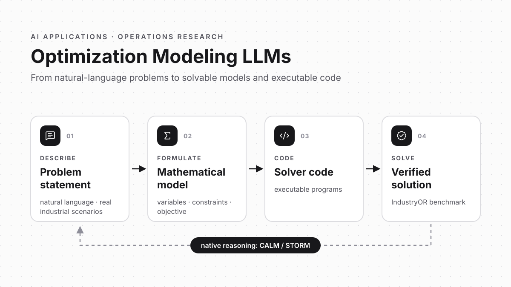
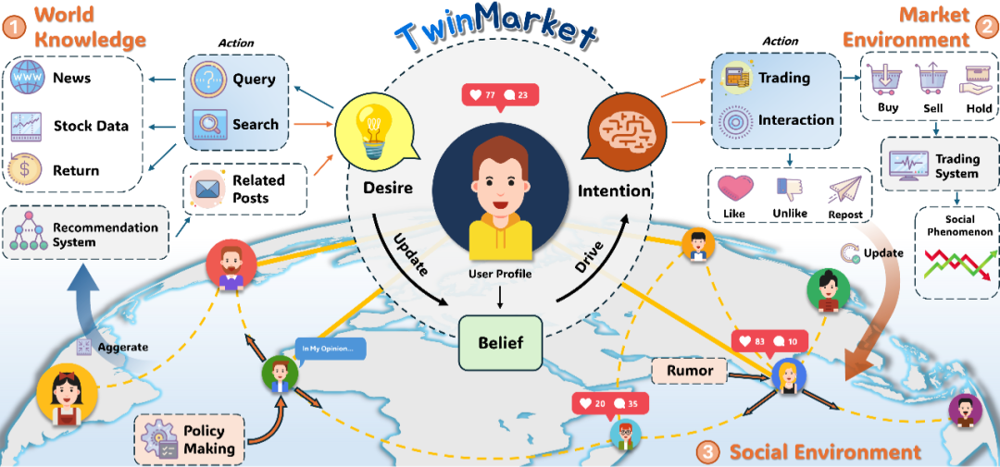
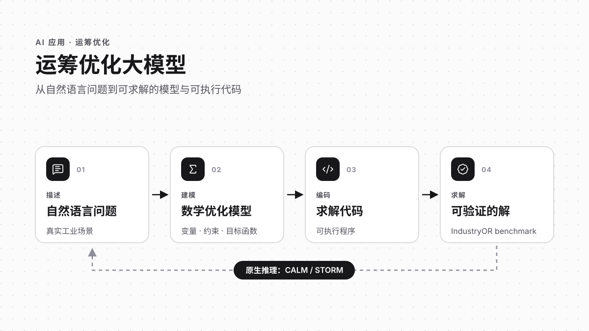

<link rel="stylesheet" href="{{ '/assets/css/project-detail.css' | relative_url }}">

Reasoning systems

  MathScale
  ORLM
  CALM/STORM
  CoRT
  Video-R1

  <a class="impact-action" href="https://github.com/FreedomIntelligence/ReasoningNLP" target="_blank" rel="noopener">ReasoningNLP</a>
  <a class="impact-action secondary" href="https://github.com/Cardinal-Operations/ORLM" target="_blank" rel="noopener">ORLM</a>
  <a class="impact-action secondary" href="https://arxiv.org/abs/2403.02884" target="_blank" rel="noopener">MathScale</a>
  <a class="impact-action secondary" href="https://github.com/tulerfeng/Video-R1" target="_blank" rel="noopener">Video-R1</a>

  

The reasoning line studies how models solve problems when correctness can be checked: math, optimization modeling, medical reasoning, code-integrated thinking, critique, and multimodal video reasoning.

<section class="impact-section">
  <h2>Research Storyline</h2>
  

    

      Math
      
<strong>Start with verifiable answers</strong>
MathScale and outcome-supervised verifiers use problems where correctness can be checked, giving reasoning models sharper feedback than preference alone.

    

    

      Optimize
      
<strong>Translate language into executable models</strong>
ORLM asks models to formulate optimization problems with formal constraints, objectives, and solver-ready structure.

    

    

      Compute
      
<strong>Let code enter the thinking loop</strong>
CoRT treats computation as part of reasoning, making intermediate steps more inspectable and less dependent on hidden mental arithmetic.

    

    

      See
      
<strong>Extend reasoning to video and medicine</strong>
Video-R1 and HuatuoGPT-o1 show the same verifiable-reasoning idea in multimodal and medical settings.

    

  

</section>

<section class="impact-section">
  <h2>Research Threads</h2>
  

    

      <strong>MathScale and verifiers</strong>
      
Scaling instruction tuning and outcome-supervised verifiers for mathematical reasoning and planning.

    

    

      <strong>ORLM and CALM/STORM</strong>
      
Large models for automated optimization modeling, where outputs must match formal constraints and executable optimization structure.

    

    

      <strong>CoRT and code-integrated reasoning</strong>
      
Models reason with code inside the thinking process, making intermediate computation more explicit and testable.

    

    

      <strong>Video-R1 and multimodal reasoning</strong>
      
Reinforcement-style training for video reasoning in multimodal LLMs, extending verifiable reasoning beyond text-only math.

    

  

</section>

<section class="impact-section">
  <h2>Display Figures</h2>
  

    <figure>
      
      <figcaption>The reasoning line connects mathematical rigor, optimization, and applied decision systems.</figcaption>
    </figure>
    <figure>
      
      <figcaption>Agentic simulations make reasoning visible in decisions, constraints, and downstream actions.</figcaption>
    </figure>
  

</section>

<section class="impact-section">
  <h2>Paper Trail</h2>
  

    

      Math
      
<strong>MathScale: Scaling Instruction Tuning for Mathematical Reasoning</strong>
Studies scaling and verifier-style feedback for mathematical reasoning.
<a href="https://arxiv.org/abs/2403.02884" target="_blank" rel="noopener">Paper</a>

    

    

      OR
      
<strong>ORLM: Training Large Models for Automated Optimization Modeling</strong>
Turns natural language problem descriptions into formal optimization models and solver-ready structure.
<a href="https://github.com/Cardinal-Operations/ORLM" target="_blank" rel="noopener">Repository</a>

    

    

      Code
      
<strong>CoRT: Code-integrated Reasoning within Thinking</strong>
Uses executable computation inside the reasoning process to improve reliability and inspectability.
<a href="https://github.com/ChengpengLi1003/CoRT" target="_blank" rel="noopener">Repository</a>

    

    

      Video
      
<strong>Video-R1: Reinforcing Video Reasoning in MLLMs</strong>
Transfers reasoning-style training into video understanding and multimodal LLMs.
<a href="https://github.com/tulerfeng/Video-R1" target="_blank" rel="noopener">Repository</a>

    

  

</section>

<section class="impact-section">
  <h2>Why It Matters</h2>
  <ul class="impact-list">
    <li>Reasoning models become more trustworthy when they can be trained and evaluated against verifiable constraints.</li>
    <li>Optimization modeling is a bridge from natural language to executable decision-making systems.</li>
    <li>Code and video reasoning show that "thinking" is not a single modality; it can involve computation, perception, and action.</li>
  </ul>
</section>

<section class="impact-section">
  <h2>Resource Map</h2>
  

    

      <strong>ORLM</strong>
      
Customizable framework for training large models for automated optimization modeling.

      <a href="https://github.com/Cardinal-Operations/ORLM" target="_blank" rel="noopener">Repository</a>
    

    

      <strong>CoRT</strong>
      
Code-integrated reasoning within thinking for models that can use computation as part of the reasoning process.

      <a href="https://github.com/ChengpengLi1003/CoRT" target="_blank" rel="noopener">Repository</a>
    

    

      <strong>Video-R1</strong>
      
Reinforcing video reasoning in multimodal LLMs.

      <a href="https://github.com/tulerfeng/Video-R1" target="_blank" rel="noopener">Repository</a>
    

  

</section>

推理系统

  MathScale
  ORLM
  CALM/STORM
  CoRT
  Video-R1

  <a class="impact-action" href="https://github.com/FreedomIntelligence/ReasoningNLP" target="_blank" rel="noopener">ReasoningNLP</a>
  <a class="impact-action secondary" href="https://github.com/Cardinal-Operations/ORLM" target="_blank" rel="noopener">ORLM</a>
  <a class="impact-action secondary" href="https://arxiv.org/abs/2403.02884" target="_blank" rel="noopener">MathScale</a>
  <a class="impact-action secondary" href="https://github.com/tulerfeng/Video-R1" target="_blank" rel="noopener">Video-R1</a>

  

推理方向关注答案正确性可以检验的任务，研究模型如何解决这类问题，涵盖数学、运筹优化建模、医学推理、代码集成思考、批判能力和多模态视频推理。

<section class="impact-section">
  <h2>研究脉络</h2>
  

    

      数学
      
<strong>从可验证的答案入手</strong>
MathScale 与结果监督验证器使用正确性可检验的题目，为推理模型提供比单靠偏好更明确的反馈。

    

    

      优化
      
<strong>把自然语言转成可执行的模型</strong>
ORLM 让模型把优化问题写成形式化的约束和目标函数，整理成求解器可直接使用的结构。

    

    

      计算
      
<strong>让代码进入思考过程</strong>
CoRT 把计算视为推理的一部分，中间步骤更容易检查，不再依赖模型暗中“心算”。

    

    

      视觉
      
<strong>把推理延伸到视频和医学</strong>
Video-R1 和 HuatuoGPT-o1 把同样的可验证推理思路带到了多模态和医学场景。

    

  

</section>

<section class="impact-section">
  <h2>研究主线</h2>
  

    

      <strong>MathScale 与验证器</strong>
      
面向数学推理与规划，规模化指令微调，并使用结果监督验证器。

    

    

      <strong>ORLM 与 CALM/STORM</strong>
      
用于自动化运筹优化建模的大模型，输出必须符合形式化约束，并具备可执行的优化结构。

    

    

      <strong>CoRT 与代码集成推理</strong>
      
模型在思考过程中借助代码推理，使中间计算更加显式、可测试。

    

    

      <strong>Video-R1 与多模态推理</strong>
      
面向多模态大模型视频推理的强化学习式训练，把可验证推理从纯文本数学拓展到更多场景。

    

  

</section>

<section class="impact-section">
  <h2>图示</h2>
  

    <figure>
      
      <figcaption>推理方向把数学严谨性、优化与实际决策系统连接起来。</figcaption>
    </figure>
    <figure>
      
      <figcaption>智能体模拟让推理在决策、约束和后续行动中变得可见。</figcaption>
    </figure>
  

</section>

<section class="impact-section">
  <h2>论文脉络</h2>
  

    

      数学
      
<strong>MathScale: Scaling Instruction Tuning for Mathematical Reasoning</strong>
研究数学推理中的规模化训练与验证器式反馈。
<a href="https://arxiv.org/abs/2403.02884" target="_blank" rel="noopener">论文</a>

    

    

      运筹
      
<strong>ORLM: Training Large Models for Automated Optimization Modeling</strong>
把自然语言的问题描述转化为形式化的优化模型和可直接求解的结构。
<a href="https://github.com/Cardinal-Operations/ORLM" target="_blank" rel="noopener">代码仓库</a>

    

    

      代码
      
<strong>CoRT: Code-integrated Reasoning within Thinking</strong>
在推理过程中引入可执行的计算，提升可靠性和可检查性。
<a href="https://github.com/ChengpengLi1003/CoRT" target="_blank" rel="noopener">代码仓库</a>

    

    

      视频
      
<strong>Video-R1: Reinforcing Video Reasoning in MLLMs</strong>
把推理式训练迁移到视频理解和多模态大模型中。
<a href="https://github.com/tulerfeng/Video-R1" target="_blank" rel="noopener">代码仓库</a>

    

  

</section>

<section class="impact-section">
  <h2>研究意义</h2>
  <ul class="impact-list">
    <li>当推理模型能依据可验证的约束来训练和评测时，就更值得信赖。</li>
    <li>运筹优化建模是连接自然语言与可执行决策系统的桥梁。</li>
    <li>代码推理和视频推理说明，“思考”并不局限于单一模态，它可以同时涉及计算、感知和行动。</li>
  </ul>
</section>

<section class="impact-section">
  <h2>资源导航</h2>
  

    

      <strong>ORLM</strong>
      
可定制的框架，用于训练自动化运筹优化建模的大模型。

      <a href="https://github.com/Cardinal-Operations/ORLM" target="_blank" rel="noopener">代码仓库</a>
    

    

      <strong>CoRT</strong>
      
思考过程中的代码集成推理，让模型能把计算当作推理的一部分。

      <a href="https://github.com/ChengpengLi1003/CoRT" target="_blank" rel="noopener">代码仓库</a>
    

    

      <strong>Video-R1</strong>
      
强化多模态大模型的视频推理。

      <a href="https://github.com/tulerfeng/Video-R1" target="_blank" rel="noopener">代码仓库</a>
    

  

</section>

