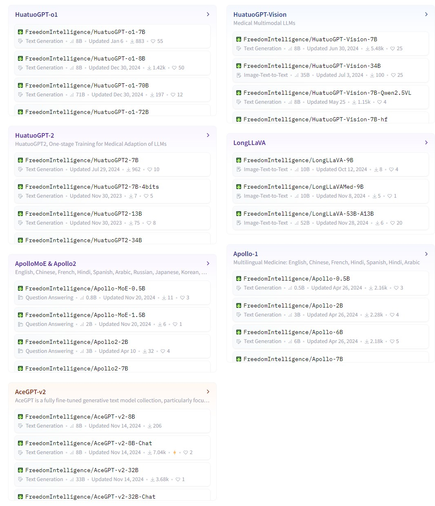
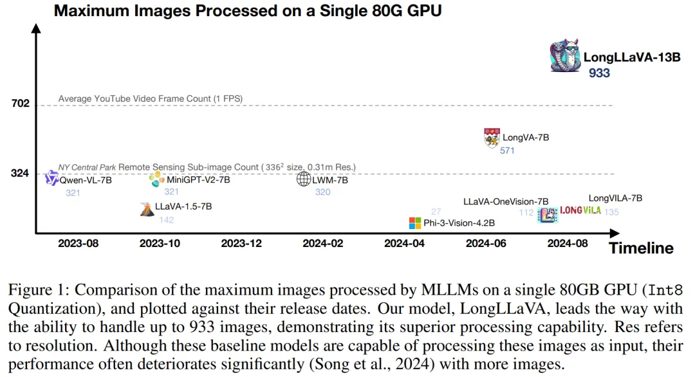

<link rel="stylesheet" href="{{ '/assets/css/project-detail.css' | relative_url }}">

Image generation alignment

  ShareGPT-4o-Image
  Janus-4o
  Text-to-image
  Image editing
  Multimodal alignment

  <a class="impact-action" href="https://github.com/FreedomIntelligence/ShareGPT-4o-Image" target="_blank" rel="noopener">GitHub</a>
  <a class="impact-action secondary" href="https://huggingface.co/datasets/FreedomIntelligence/ShareGPT-4o-Image" target="_blank" rel="noopener">Dataset</a>
  <a class="impact-action secondary" href="https://huggingface.co/FreedomIntelligence/Janus-4o-7B" target="_blank" rel="noopener">Model</a>
  <a class="impact-action secondary" href="https://arxiv.org/abs/2506.18095" target="_blank" rel="noopener">Paper</a>

  

ShareGPT-4o-Image distills GPT-4o-style image generation interactions into an open dataset, and Janus-4o turns that data into a practical multimodal model for text-to-image and text-plus-image-to-image generation.

<section class="impact-section">
  <h2>Research Storyline</h2>
  

    

      Data
      
<strong>Open the interaction format</strong>
ShareGPT-4o-Image captures text-to-image and image-conditioned editing instructions so researchers can study generation behavior with open data.

    

    

      Model
      
<strong>Train a unified multimodal generator</strong>
Janus-4o uses the data to support image understanding and generation in one compact model family.

    

    

      Edit
      
<strong>Move beyond one-shot generation</strong>
Image-conditioned generation and editing matter because real users usually refine, transform, and localize existing visual content.

    

    

      Reuse
      
<strong>Make visual alignment reproducible</strong>
The dataset, model, and paper give the community an open reference point for GPT-4o-like image generation interactions.

    

  

</section>

<section class="impact-section">
  <h2>What The Project Contributes</h2>
  

    

      <strong>Open generation data</strong>
      
The dataset includes text-to-image and image-conditioned generation examples, making GPT-4o-like generation behavior easier to study and reproduce.

    

    

      <strong>Unified multimodal model</strong>
      
Janus-4o adapts a unified multimodal architecture so image understanding and image generation can live in one model family.

    

    

      <strong>Practical image editing</strong>
      
The data and model support not only generation from text but also edits and transformations conditioned on existing images.

    

  

</section>

<section class="impact-section">
  <h2>Display Figures</h2>
  

    <figure>
      
      <figcaption>The project follows the lab's open-release pattern: dataset, model, repository, and paper linked as one reproducible package.</figcaption>
    </figure>
    <figure>
      
      <figcaption>ShareGPT-4o-Image and Janus-4o sit alongside the lab's broader multimodal line, from understanding to generation.</figcaption>
    </figure>
  

</section>

<section class="impact-section">
  <h2>Paper Trail</h2>
  

    

      Dataset
      
<strong>ShareGPT-4o-Image</strong>
Open image generation and editing instruction data for studying GPT-4o-style multimodal generation behavior.
<a href="https://huggingface.co/datasets/FreedomIntelligence/ShareGPT-4o-Image" target="_blank" rel="noopener">Dataset</a>

    

    

      Model
      
<strong>Janus-4o-7B</strong>
A unified multimodal model checkpoint for text-to-image and image-conditioned generation.
<a href="https://huggingface.co/FreedomIntelligence/Janus-4o-7B" target="_blank" rel="noopener">Model</a>

    

    

      Context
      
<strong>LongLLaVA and multimodal infrastructure</strong>
Connects the generation project to the lab's larger multimodal program on visual context, data quality, and open model behavior.
<a href="/projects/long-context-multimodal/">Long-context multimodal AI</a>

    

  

</section>

<section class="impact-section">
  <h2>Why It Matters</h2>
  <ul class="impact-list">
    <li>Open image generation research needs high-quality instruction data, not just model weights.</li>
    <li>Image editing is an important multimodal interaction pattern because users often refine existing visual content rather than generate from scratch.</li>
    <li>The project gives the community a compact way to study GPT-4o-level image generation behavior in open models.</li>
  </ul>
</section>

<section class="impact-section">
  <h2>Resource Map</h2>
  

    

      <strong>ShareGPT-4o-Image dataset</strong>
      
Open image generation and editing instruction data.

      <a href="https://huggingface.co/datasets/FreedomIntelligence/ShareGPT-4o-Image" target="_blank" rel="noopener">Dataset</a>
    

    

      <strong>Janus-4o-7B</strong>
      
Unified multimodal model checkpoint for text-to-image and image-conditioned generation.

      <a href="https://huggingface.co/FreedomIntelligence/Janus-4o-7B" target="_blank" rel="noopener">Model</a>
    

    

      <strong>Project repository</strong>
      
Code, examples, and release documentation for the ShareGPT-4o-Image project.

      <a href="https://github.com/FreedomIntelligence/ShareGPT-4o-Image" target="_blank" rel="noopener">Repository</a>
    

  

</section>

图像生成对齐

  ShareGPT-4o-Image
  Janus-4o
  文生图
  图像编辑
  多模态对齐

  <a class="impact-action" href="https://github.com/FreedomIntelligence/ShareGPT-4o-Image" target="_blank" rel="noopener">GitHub</a>
  <a class="impact-action secondary" href="https://huggingface.co/datasets/FreedomIntelligence/ShareGPT-4o-Image" target="_blank" rel="noopener">数据集</a>
  <a class="impact-action secondary" href="https://huggingface.co/FreedomIntelligence/Janus-4o-7B" target="_blank" rel="noopener">模型</a>
  <a class="impact-action secondary" href="https://arxiv.org/abs/2506.18095" target="_blank" rel="noopener">论文</a>

  

ShareGPT-4o-Image 把 GPT-4o 风格的图像生成交互蒸馏为开放数据集。Janus-4o 用这些数据训练出实用的多模态模型，既支持文生图，也支持以文本和图像为输入的图像生成。

<section class="impact-section">
  <h2>研究脉络</h2>
  

    

      数据
      
<strong>开放图像生成的交互数据</strong>
ShareGPT-4o-Image 收录文生图指令和以图像为条件的编辑指令，让研究者能用开放数据研究图像生成行为。

    

    

      模型
      
<strong>训练统一的多模态生成模型</strong>
Janus-4o 借助这些数据，在一个紧凑的模型系列中同时支持图像理解和图像生成。

    

    

      编辑
      
<strong>不止于一次性生成</strong>
图像条件生成与编辑很重要，因为真实用户通常会在已有图像上反复修改、转换和做局部调整。

    

    

      复用
      
<strong>让视觉对齐可复现</strong>
数据集、模型和论文共同为社区提供了一个开放的参照，用来研究类似 GPT-4o 的图像生成交互。

    

  

</section>

<section class="impact-section">
  <h2>项目贡献</h2>
  

    

      <strong>开放的生成数据</strong>
      
数据集包含文生图和图像条件生成的样例，让类似 GPT-4o 的生成行为更容易研究和复现。

    

    

      <strong>统一的多模态模型</strong>
      
Janus-4o 适配了统一的多模态架构，让图像理解和图像生成共存于同一个模型系列。

    

    

      <strong>实用的图像编辑</strong>
      
数据和模型不仅支持从文本生成图像，也支持以已有图像为条件的编辑与转换。

    

  

</section>

<section class="impact-section">
  <h2>图示</h2>
  

    <figure>
      
      <figcaption>项目沿用实验室的开放发布方式：数据集、模型、代码仓库和论文串成一套可复现的资源。</figcaption>
    </figure>
    <figure>
      
      <figcaption>ShareGPT-4o-Image 与 Janus-4o 属于实验室更广泛的多模态研究线，从理解延伸到生成。</figcaption>
    </figure>
  

</section>

<section class="impact-section">
  <h2>论文脉络</h2>
  

    

      数据集
      
<strong>ShareGPT-4o-Image</strong>
开放的图像生成与编辑指令数据，用于研究 GPT-4o 风格的多模态生成行为。
<a href="https://huggingface.co/datasets/FreedomIntelligence/ShareGPT-4o-Image" target="_blank" rel="noopener">数据集</a>

    

    

      模型
      
<strong>Janus-4o-7B</strong>
统一的多模态模型权重，支持文生图和图像条件生成。
<a href="https://huggingface.co/FreedomIntelligence/Janus-4o-7B" target="_blank" rel="noopener">模型</a>

    

    

      关联
      
<strong>LongLLaVA 与多模态基础设施</strong>
把图像生成项目与实验室更大的多模态研究衔接起来，涵盖视觉上下文、数据质量和开源模型的行为。
<a href="/projects/long-context-multimodal/">长上下文多模态 AI</a>

    

  

</section>

<section class="impact-section">
  <h2>研究意义</h2>
  <ul class="impact-list">
    <li>开源图像生成研究不能只靠模型权重，还需要高质量的指令数据。</li>
    <li>图像编辑是重要的多模态交互方式，因为用户往往是在已有图像上修改，而不是从零生成。</li>
    <li>项目为社区提供了一种轻量的途径，可以在开源模型上研究 GPT-4o 级别的图像生成行为。</li>
  </ul>
</section>

<section class="impact-section">
  <h2>资源导航</h2>
  

    

      <strong>ShareGPT-4o-Image 数据集</strong>
      
开放的图像生成与编辑指令数据。

      <a href="https://huggingface.co/datasets/FreedomIntelligence/ShareGPT-4o-Image" target="_blank" rel="noopener">数据集</a>
    

    

      <strong>Janus-4o-7B</strong>
      
支持文生图和图像条件生成的统一多模态模型权重。

      <a href="https://huggingface.co/FreedomIntelligence/Janus-4o-7B" target="_blank" rel="noopener">模型</a>
    

    

      <strong>项目代码仓库</strong>
      
ShareGPT-4o-Image 项目的代码、示例和发布文档。

      <a href="https://github.com/FreedomIntelligence/ShareGPT-4o-Image" target="_blank" rel="noopener">代码仓库</a>
    

  

</section>

