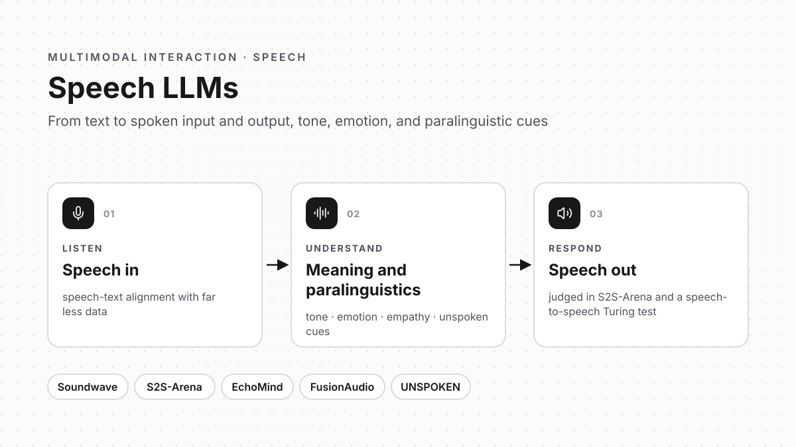
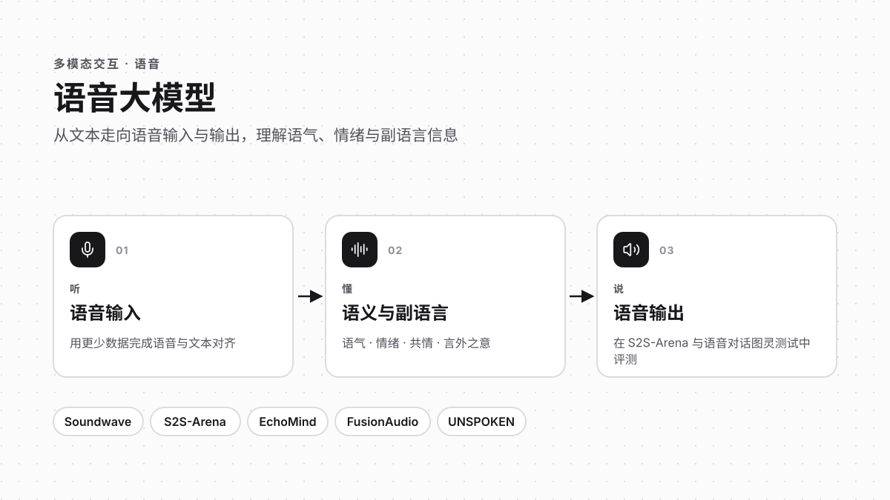

<link rel="stylesheet" href="{{ '/assets/css/project-detail.css' | relative_url }}">

Speech and audio AI

  Soundwave
  TalkVid
  EchoMind
  S2S-Arena
  Audio-driven video

  <a class="impact-action" href="https://github.com/FreedomIntelligence/TalkVid" target="_blank" rel="noopener">TalkVid</a>
  <a class="impact-action secondary" href="https://github.com/FreedomIntelligence/S2S-Arena" target="_blank" rel="noopener">S2S-Arena</a>
  <a class="impact-action secondary" href="https://huggingface.co/datasets/FreedomIntelligence/TalkVid" target="_blank" rel="noopener">TalkVid data</a>
  <a class="impact-action secondary" href="https://hlt-cuhksz.github.io/EchoMind/" target="_blank" rel="noopener">EchoMind</a>

  

The speech and audio line extends the lab's model ecosystem from text and images to how people actually communicate: voice, prosody, empathy, paralinguistic cues, and audio-driven face or talking-head generation.

<section class="impact-section">
  <h2>Research Storyline</h2>
  

    

      Align
      
<strong>Soundwave connects speech and text</strong>
The first question is how little speech supervision is needed to ground LLMs in spoken input and output.

    

    

      Evaluate
      
<strong>S2S-Arena tests how things are spoken</strong>
Speech-to-speech systems need to follow paralinguistic instructions, not just transcribe or answer textually.

    

    

      Empathy
      
<strong>EchoMind measures affective speech behavior</strong>
Empathetic speech requires multi-level evaluation of emotion, response style, and conversational alignment.

    

    

      Embody
      
<strong>TalkVid turns speech into talking-head generation</strong>
Audio-driven video generation connects speech understanding to visible, embodied communication.

    

  

</section>

<section class="impact-section">
  <h2>Project Threads</h2>
  

    

      <strong>Soundwave</strong>
      
Studies speech-text alignment for LLMs, asking how much speech supervision is actually needed for strong speech-language grounding.

    

    

      <strong>S2S-Arena</strong>
      
Evaluates paralinguistic instruction following in speech-to-speech systems, moving beyond word accuracy into how something is spoken.

    

    

      <strong>EchoMind</strong>
      
Benchmarks empathetic speech language models with multi-level evaluation of affective and conversational signals.

    

    

      <strong>TalkVid</strong>
      
Provides a diversified dataset for audio-driven talking-head synthesis across multiple languages and video generation settings.

    

  

</section>

<section class="impact-section">
  <h2>Display Figures</h2>
  

    <figure>
      
      <figcaption>The speech line shares a common pipeline with interactive agents: perceive, reason, respond, and evaluate behavior.</figcaption>
    </figure>
    <figure>
      
      <figcaption>Open datasets and benchmarks make speech and embodied interaction research easier to reproduce.</figcaption>
    </figure>
  

</section>

<section class="impact-section">
  <h2>Paper Trail</h2>
  

    

      Speech
      
<strong>Soundwave: Less is More for Speech-Text Alignment in LLMs</strong>
Studies efficient speech-text alignment so LLMs can connect spoken signals and language behavior.
<a href="https://github.com/FreedomIntelligence/Soundwave" target="_blank" rel="noopener">Repository</a>

    

    

      Eval
      
<strong>S2S-Arena and EchoMind</strong>
Benchmarks paralinguistic instruction following and empathetic speech model behavior.
<a href="https://github.com/FreedomIntelligence/S2S-Arena" target="_blank" rel="noopener">S2S-Arena</a>

    

    

      Video
      
<strong>TalkVid</strong>
Provides diversified audio-driven talking-head data so voice can control visible speech behavior.
<a href="https://huggingface.co/datasets/FreedomIntelligence/TalkVid" target="_blank" rel="noopener">Dataset</a>

    

  

</section>

<section class="impact-section">
  <h2>Why It Matters</h2>
  <ul class="impact-list">
    <li>Human-facing agents need to understand how speech is delivered, not only the transcript.</li>
    <li>Medical, education, and companionship scenarios require empathy, timing, tone, and paralinguistic control.</li>
    <li>Audio-driven video generation connects speech understanding with embodied and visual communication.</li>
  </ul>
</section>

<section class="impact-section">
  <h2>Resource Map</h2>
  

    

      <strong>TalkVid</strong>
      
Large-scale diversified dataset for audio-driven talking-head synthesis.

      <a href="https://huggingface.co/datasets/FreedomIntelligence/TalkVid" target="_blank" rel="noopener">Dataset</a>
    

    

      <strong>S2S-Arena</strong>
      
Evaluation benchmark for paralinguistic instruction following in speech-to-speech models.

      <a href="https://github.com/FreedomIntelligence/S2S-Arena" target="_blank" rel="noopener">Repository</a>
    

    

      <strong>EchoMind</strong>
      
Benchmark site for empathetic speech language model evaluation.

      <a href="https://hlt-cuhksz.github.io/EchoMind/" target="_blank" rel="noopener">Project</a>
    

  

</section>

语音与音频 AI

  Soundwave
  TalkVid
  EchoMind
  S2S-Arena
  音频驱动视频

  <a class="impact-action" href="https://github.com/FreedomIntelligence/TalkVid" target="_blank" rel="noopener">TalkVid</a>
  <a class="impact-action secondary" href="https://github.com/FreedomIntelligence/S2S-Arena" target="_blank" rel="noopener">S2S-Arena</a>
  <a class="impact-action secondary" href="https://huggingface.co/datasets/FreedomIntelligence/TalkVid" target="_blank" rel="noopener">TalkVid 数据</a>
  <a class="impact-action secondary" href="https://hlt-cuhksz.github.io/EchoMind/" target="_blank" rel="noopener">EchoMind</a>

  

语音与音频研究线把实验室的模型生态从文本和图像延伸到人们真实的交流方式：声音、韵律、共情和副语言线索，以及音频驱动的人脸与说话人视频生成。

<section class="impact-section">
  <h2>研究脉络</h2>
  

    

      对齐
      
<strong>Soundwave 连接语音与文本</strong>
首要问题是：要让大模型接入语音输入和输出，最少需要多少语音监督。

    

    

      评测
      
<strong>S2S-Arena 考察“怎么说”</strong>
语音到语音系统需要遵循副语言指令，而不只是转写语音或给出文字回答。

    

    

      共情
      
<strong>EchoMind 衡量语音中的情感表现</strong>
共情语音需要多层级评测，覆盖情绪、回应风格和对话契合度。

    

    

      具身
      
<strong>TalkVid 让语音驱动说话人视频生成</strong>
音频驱动的视频生成把语音理解与看得见的具身交流连接起来。

    

  

</section>

<section class="impact-section">
  <h2>子项目</h2>
  

    

      <strong>Soundwave</strong>
      
研究大模型的语音-文本对齐，追问要获得扎实的语音-语言对应，究竟需要多少语音监督。

    

    

      <strong>S2S-Arena</strong>
      
评测语音到语音系统的副语言指令跟随能力，评价重点从字词准确率延伸到说话方式。

    

    

      <strong>EchoMind</strong>
      
为共情语音语言模型建立评测基准，分多个层级评估情感信号和对话信号。

    

    

      <strong>TalkVid</strong>
      
提供多样化的数据集，支持跨多种语言和多种视频生成设置的音频驱动说话人视频合成。

    

  

</section>

<section class="impact-section">
  <h2>图示</h2>
  

    <figure>
      
      <figcaption>语音研究线与交互式智能体共用一条流程：感知、推理、回应，并评测行为。</figcaption>
    </figure>
    <figure>
      
      <figcaption>开放的数据集和评测基准，让语音与具身交互研究更容易复现。</figcaption>
    </figure>
  

</section>

<section class="impact-section">
  <h2>论文脉络</h2>
  

    

      语音
      
<strong>Soundwave: Less is More for Speech-Text Alignment in LLMs</strong>
研究高效的语音-文本对齐，让大模型把语音信号与语言行为联系起来。
<a href="https://github.com/FreedomIntelligence/Soundwave" target="_blank" rel="noopener">代码仓库</a>

    

    

      评测
      
<strong>S2S-Arena 与 EchoMind</strong>
为副语言指令跟随与共情语音模型的行为建立评测基准。
<a href="https://github.com/FreedomIntelligence/S2S-Arena" target="_blank" rel="noopener">S2S-Arena</a>

    

    

      视频
      
<strong>TalkVid</strong>
提供多样化的音频驱动说话人视频数据，让声音可以控制可见的说话行为。
<a href="https://huggingface.co/datasets/FreedomIntelligence/TalkVid" target="_blank" rel="noopener">数据集</a>

    

  

</section>

<section class="impact-section">
  <h2>研究意义</h2>
  <ul class="impact-list">
    <li>直接面向用户的智能体，不能只理解转写文本，还要理解语音是怎样表达出来的。</li>
    <li>医疗、教育和陪伴场景需要共情、时机、语气和副语言层面的控制。</li>
    <li>音频驱动的视频生成把语音理解与具身、可视的交流连接起来。</li>
  </ul>
</section>

<section class="impact-section">
  <h2>资源导航</h2>
  

    

      <strong>TalkVid</strong>
      
面向音频驱动说话人视频合成的大规模多样化数据集。

      <a href="https://huggingface.co/datasets/FreedomIntelligence/TalkVid" target="_blank" rel="noopener">数据集</a>
    

    

      <strong>S2S-Arena</strong>
      
评测语音到语音模型副语言指令跟随能力的基准。

      <a href="https://github.com/FreedomIntelligence/S2S-Arena" target="_blank" rel="noopener">代码仓库</a>
    

    

      <strong>EchoMind</strong>
      
共情语音语言模型评测基准的项目网站。

      <a href="https://hlt-cuhksz.github.io/EchoMind/" target="_blank" rel="noopener">项目主页</a>
    

  

</section>

