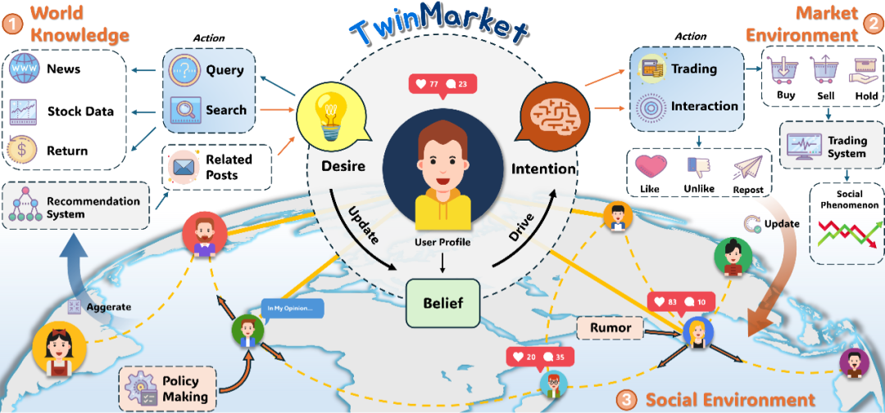
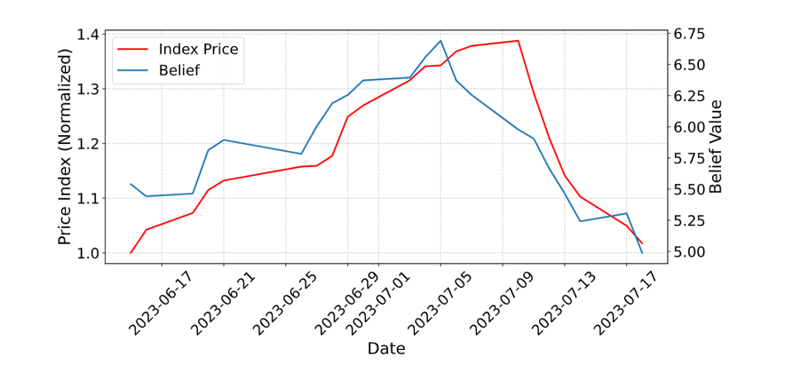
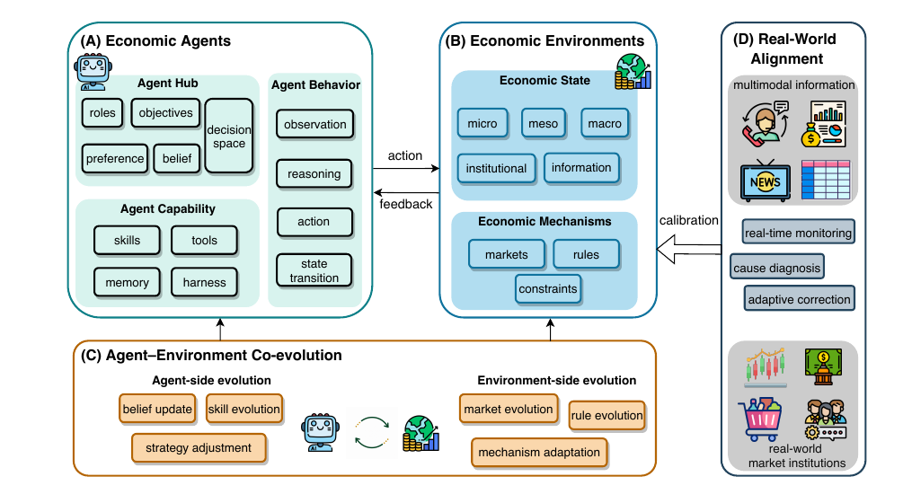

<link rel="stylesheet" href="{{ '/assets/css/project-detail.css' | relative_url }}">

Financial and social simulation

  TwinMarket
  Multi-agent simulation
  Financial AI
  Behavioral finance
  Policy sandbox

  <a class="impact-action" href="https://github.com/FreedomIntelligence/TwinMarket" target="_blank" rel="noopener">GitHub</a>
  <a class="impact-action secondary" href="https://freedomintelligence.github.io/TwinMarket" target="_blank" rel="noopener">Project site</a>
  <a class="impact-action secondary" href="https://arxiv.org/abs/2502.01506" target="_blank" rel="noopener">Paper</a>

  

TwinMarket uses LLM-powered virtual investors to simulate financial markets from the bottom up. Instead of treating the market as an equation, it models agents with beliefs, desires, intentions, information, social signals, and trading behavior.

The project received Best Paper recognition at the ICLR 2025 Financial AI Workshop and is connected to the lab's broader agenda on agentic economies and economic world models.

<section class="impact-section">
  <h2>Research Storyline</h2>
  

    

      Agents
      
<strong>Start from investor cognition</strong>
Each virtual investor carries beliefs, desires, intentions, information access, and social influence rather than acting as a fixed equation.

    

    

      Market
      
<strong>Let aggregate patterns emerge</strong>
Prices, volatility, herding, and bubbles become outcomes of many interacting agents rather than manually scripted market curves.

    

    

      Policy
      
<strong>Turn the market into a sandbox</strong>
Researchers can perturb information flow, agent populations, or regulation and observe counterfactual market behavior.

    

    

      EconWM
      
<strong>Connect to agentic economies</strong>
TwinMarket is a concrete financial prototype for the broader Economic World Models agenda: agents, environments, co-evolution, and real-world alignment.

    

  

</section>

<section class="impact-section">
  <h2>What The Simulator Studies</h2>
  

    

      <strong>Micro-to-macro emergence</strong>
      
Individual investor choices, overconfidence, herding, information delay, and social influence can aggregate into market-wide patterns and instability.

    

    

      <strong>Stylized market facts</strong>
      
The simulator tests whether agent societies can reproduce empirical regularities that appear in real markets but are hard to capture with simple rules.

    

    

      <strong>Risk and policy stress tests</strong>
      
Because the simulated world is controllable, researchers can perturb information flow, regulation, and agent composition to study counterfactual outcomes.

    

  

</section>

  

<section class="impact-section">
  <h2>Display Figures</h2>
  

    <figure>
      
      <figcaption>The BDI architecture makes each trading decision traceable to agent beliefs, desires, intentions, and market signals.</figcaption>
    </figure>
    <figure>
      
      <figcaption>Market-level phenomena emerge from interacting virtual investors rather than fixed aggregate equations.</figcaption>
    </figure>
    <figure>
      
      <figcaption>TwinMarket is one concrete sandbox inside the larger Economic World Models architecture.</figcaption>
    </figure>
  

</section>

<section class="impact-section">
  <h2>Paper Trail</h2>
  

    

      System
      
<strong>TwinMarket: A Scalable Behavioral and Social Simulation for Financial Markets</strong>
Builds the market simulator, investor agents, and experimental setting for financial social simulation.
<a href="https://github.com/FreedomIntelligence/TwinMarket" target="_blank" rel="noopener">Repository</a>

    

    

      Blueprint
      
<strong>From Economic Agents to Agentic Economies</strong>
Generalizes the TwinMarket-style sandbox into a wider architecture for economic digital twins and agentic economies.
<a href="/projects/economic-world-models/">Economic World Models</a>

    

  

</section>

<section class="impact-section">
  <h2>Why It Matters</h2>
  <ul class="impact-list">
    <li>Financial systems are social systems; agentic simulation makes individual behavior visible instead of hiding it inside aggregate curves.</li>
    <li>It offers a practical bridge from LLM agents to social science experiments, financial risk analysis, and economic digital twins.</li>
    <li>It gives the Economic World Models agenda a concrete, high-impact market sandbox.</li>
  </ul>
</section>

金融与社会模拟

  TwinMarket
  多智能体模拟
  金融 AI
  行为金融
  政策沙盒

  <a class="impact-action" href="https://github.com/FreedomIntelligence/TwinMarket" target="_blank" rel="noopener">GitHub</a>
  <a class="impact-action secondary" href="https://freedomintelligence.github.io/TwinMarket" target="_blank" rel="noopener">项目主页</a>
  <a class="impact-action secondary" href="https://arxiv.org/abs/2502.01506" target="_blank" rel="noopener">论文</a>

  

TwinMarket 用大模型驱动的虚拟投资者，自下而上地模拟金融市场。它不把市场当作一个方程，而是对智能体的信念、愿望、意图、信息、社交信号和交易行为建模。

该项目在 ICLR 2025 Financial AI Workshop 上获评最佳论文，并与实验室在智能体经济和经济世界模型方向上的整体研究规划相衔接。

<section class="impact-section">
  <h2>研究脉络</h2>
  

    

      智能体
      
<strong>从投资者认知出发</strong>
每个虚拟投资者都带有信念、愿望、意图、信息渠道和社交影响，而不是按固定公式行事。

    

    

      市场
      
<strong>让宏观规律涌现</strong>
价格、波动、羊群效应和泡沫，是众多智能体相互作用的结果，而不是人为设定的市场曲线。

    

    

      政策
      
<strong>把市场变成沙盒</strong>
研究者可以扰动信息流、智能体群体或监管规则，观察反事实的市场行为。

    

    

      EconWM
      
<strong>通向智能体经济</strong>
TwinMarket 是经济世界模型这一更大研究议程在金融领域的具体原型，涵盖智能体、环境、共演化和真实世界对齐。

    

  

</section>

<section class="impact-section">
  <h2>模拟器研究的问题</h2>
  

    

      <strong>从微观到宏观的涌现</strong>
      
个体投资者的选择、过度自信、羊群效应、信息延迟和社交影响，可以汇聚成全市场的模式与不稳定性。

    

    

      <strong>市场典型事实</strong>
      
模拟器检验智能体社会能否复现真实市场中的经验规律；这些规律很难用简单规则刻画。

    

    

      <strong>风险与政策压力测试</strong>
      
模拟世界是可控的，研究者可以扰动信息流、监管规则和智能体构成，研究反事实结果。

    

  

</section>

  

<section class="impact-section">
  <h2>图示</h2>
  

    <figure>
      
      <figcaption>BDI 架构让每一次交易决策都能追溯到智能体的信念、愿望、意图和市场信号。</figcaption>
    </figure>
    <figure>
      
      <figcaption>市场层面的现象来自虚拟投资者之间的相互作用，而不是固定的宏观方程。</figcaption>
    </figure>
    <figure>
      
      <figcaption>TwinMarket 是更大的经济世界模型架构中的一个具体沙盒。</figcaption>
    </figure>
  

</section>

<section class="impact-section">
  <h2>论文脉络</h2>
  

    

      系统
      
<strong>TwinMarket: A Scalable Behavioral and Social Simulation for Financial Markets</strong>
构建了市场模拟器、投资者智能体，以及金融社会模拟的实验设置。
<a href="https://github.com/FreedomIntelligence/TwinMarket" target="_blank" rel="noopener">代码仓库</a>

    

    

      蓝图
      
<strong>From Economic Agents to Agentic Economies</strong>
把 TwinMarket 式的沙盒推广为更宽广的架构，用于经济数字孪生和智能体经济。
<a href="/projects/economic-world-models/">经济世界模型</a>

    

  

</section>

<section class="impact-section">
  <h2>研究意义</h2>
  <ul class="impact-list">
    <li>金融系统是社会系统；智能体模拟让个体行为清晰可见，而不是隐藏在宏观曲线之中。</li>
    <li>它为大模型智能体走向社会科学实验、金融风险分析和经济数字孪生，提供了一座切实可行的桥梁。</li>
    <li>它为经济世界模型的研究议程提供了一个具体、有影响力的市场沙盒。</li>
  </ul>
</section>

